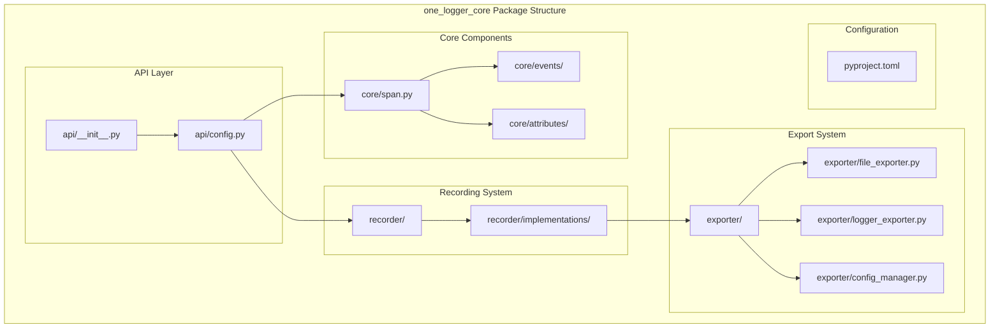
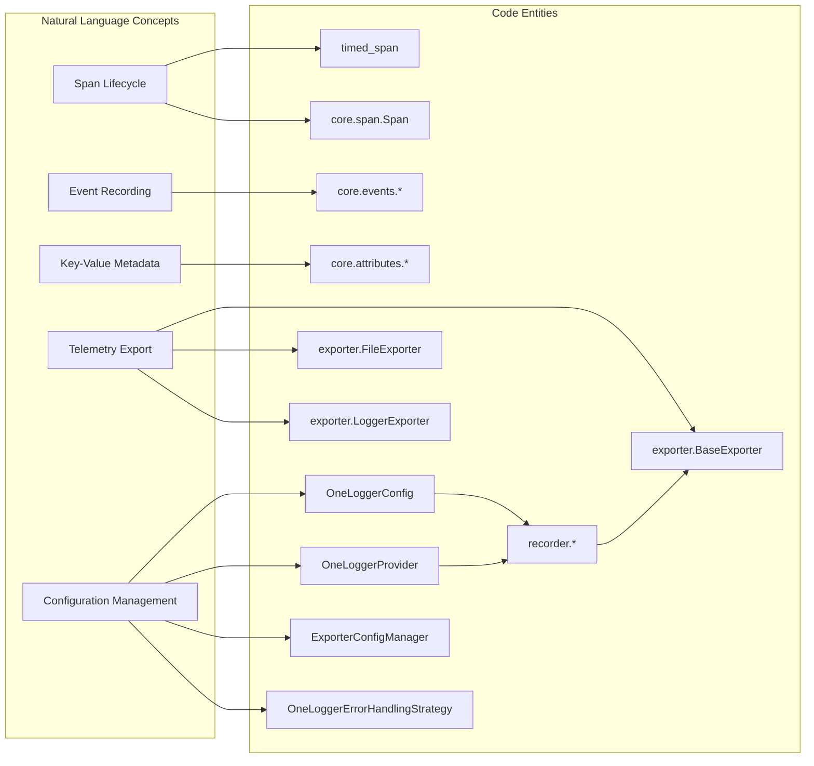
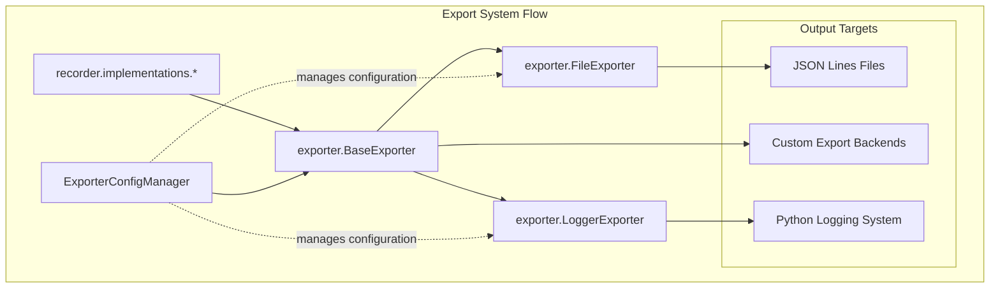

<!-- source: DeepWiki mcp.deepwiki.com · repo NVIDIA/nv-one-logger · page 2 Core Package (one_logger_core) · fetched 2026-10-26 -->

# Core Package (one_logger_core)

Relevant source files

The following files were used as context for generating this wiki page:

- [nv_one_logger/one_logger_core/pyproject.toml](nv_one_logger/one_logger_core/pyproject.toml)
- [nv_one_logger/one_logger_core/src/nv_one_logger/api/__init__.py](nv_one_logger/one_logger_core/src/nv_one_logger/api/__init__.py)

## Purpose and Scope

The `one_logger_core` package provides the foundational logging and telemetry infrastructure for the nv-one-logger ecosystem. It defines the core abstractions, APIs, and data structures that all other packages in the monorepo build upon. This package handles span lifecycle management, event recording, attribute management, and the base export system that enables telemetry data to be sent to various backends.

For ML training-specific telemetry functionality, see [Training Telemetry Package](#3). For backend-specific integrations like OpenTelemetry and Weights & Biases, see [Backend Integrations](#4). For application-layer integrations, see [Application Integrations](#5).

## Package Structure and Architecture

**Sources:** [nv_one_logger/one_logger_core/pyproject.toml:1-110](), [nv_one_logger/one_logger_core/src/nv_one_logger/api/__init__.py:1-10]()

## Core Components and Code Entity Mapping

**Sources:** [nv_one_logger/one_logger_core/src/nv_one_logger/api/__init__.py:9]()

## API Layer

The API layer provides the primary interface for users to interact with the logging system. The main entry points are exposed through the `api` module:

| Component | Purpose | Location |
|-----------|---------|----------|
| `OneLoggerConfig` | Configuration container for logger setup | `api/config.py` |
| `OneLoggerProvider` | Main provider class for logger instances | `api/config.py` |
| `OneLoggerErrorHandlingStrategy` | Error handling strategy enumeration | `api/config.py` |
| `timed_span` | Context manager for span creation | `api/` (implied from architecture) |

The `timed_span` context manager serves as the primary user-facing API for creating spans, while `OneLoggerProvider` handles the configuration and instantiation of the logging infrastructure.

**Sources:** [nv_one_logger/one_logger_core/src/nv_one_logger/api/__init__.py:9]()

## Export System Architecture

The export system provides a pluggable architecture where different exporters can be configured declaratively. The `BaseExporter` class defines the interface that all exporters must implement, while built-in implementations handle common use cases like file output and Python logging integration.

**Sources:** Based on architecture diagrams and implied structure from pyproject.toml

## Dependencies and Configuration

The core package has minimal external dependencies to maintain broad compatibility:

| Dependency | Version Constraint | Purpose |
|------------|-------------------|---------|
| `pydantic` | `^2.10.6` | Data validation and serialization |
| `overrides` | `^7.7.0` | Method override decorators |
| `StrEnum` | `^0.4.0` | String enumeration support |
| `toml` | `^0.10.2` | Configuration file parsing |
| `typing-extensions` | `^4.12.2` | Enhanced type annotations |

The package supports Python 3.8+ and uses Poetry for dependency management. The configuration supports strict typing with MyPy and comprehensive testing with pytest coverage requirements set to 80%.

**Sources:** [nv_one_logger/one_logger_core/pyproject.toml:15-22](), [nv_one_logger/one_logger_core/pyproject.toml:60-76](), [nv_one_logger/one_logger_core/pyproject.toml:94-95]()

## Package Metadata

- **Package Name:** `nv-one-logger-core`
- **Version:** `2.1.0`
- **License:** Apache-2.0
- **Source Structure:** Code located in `src/nv_one_logger/` with packages included from this location
- **Repository:** https://github.com/NVIDIA/nv-one-logger

The package is published to NVIDIA's internal Artifactory repositories for both staging and production deployments.

**Sources:** [nv_one_logger/one_logger_core/pyproject.toml:1-10](), [nv_one_logger/one_logger_core/pyproject.toml:106-109]()

---

