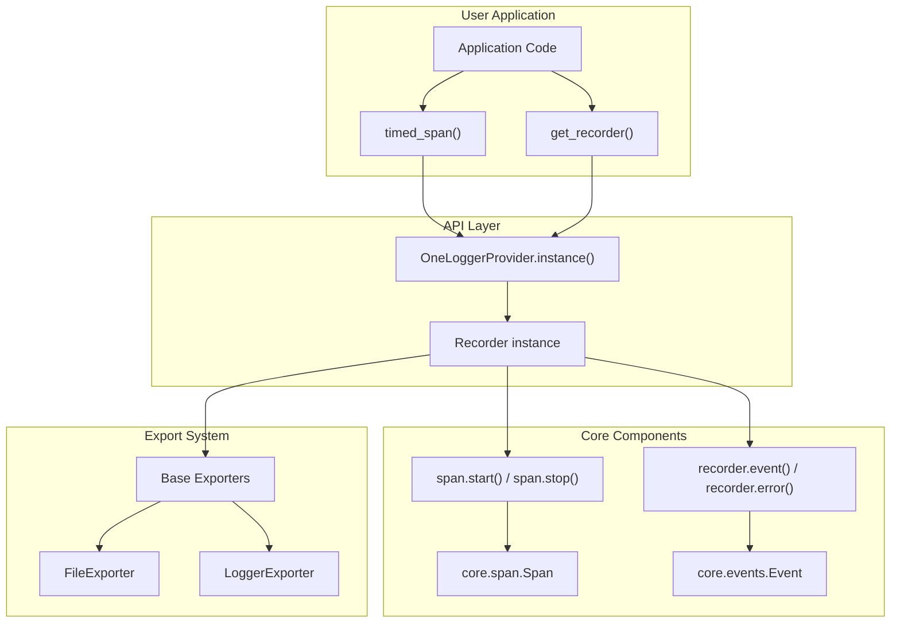
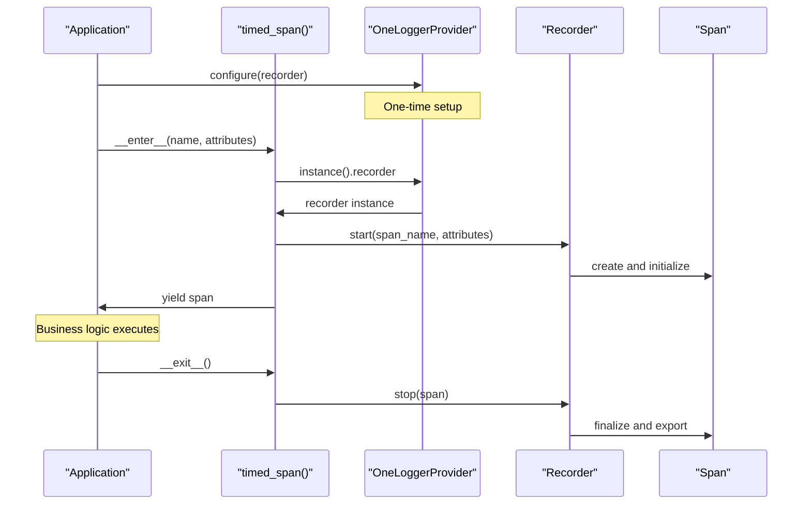
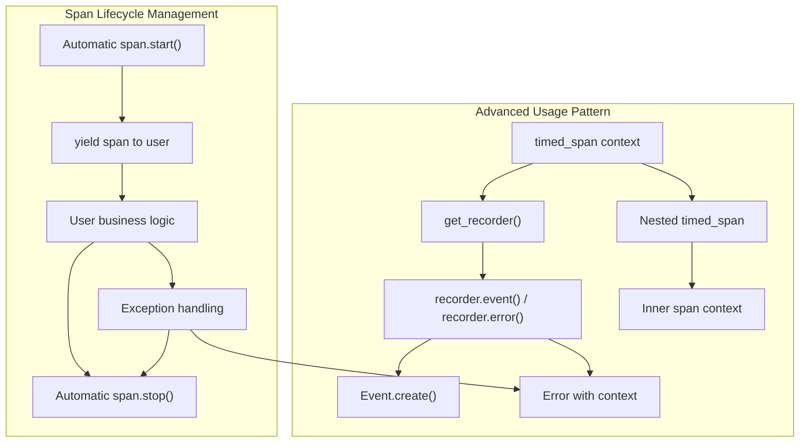

<!-- source: DeepWiki mcp.deepwiki.com · repo NVIDIA/nv-one-logger · page 2.1 API and Usage · fetched 2026-10-26 -->

# API and Usage

<details>
<summary>Relevant source files</summary>

The following files were used as context for generating this wiki page:

- [nv_one_logger/one_logger_core/src/nv_one_logger/api/timed_span.py](nv_one_logger/one_logger_core/src/nv_one_logger/api/timed_span.py)
- [nv_one_logger/one_logger_core/tests/nv_one_logger/api/test_timed_span.py](nv_one_logger/one_logger_core/tests/nv_one_logger/api/test_timed_span.py)

</details>


This document covers the main user-facing APIs in the `one_logger_core` package, focusing on the `timed_span` context manager and `OneLoggerProvider` configuration system. These are the primary interfaces that applications use to integrate logging and telemetry functionality.

For training-specific telemetry APIs, see [Training Telemetry APIs](#3.1). For backend integration details, see [Backend Integrations](#4).

## Core API Components

The `one_logger_core` package provides three main API components for user applications:

| Component | Purpose | Location |
|-----------|---------|----------|
| `timed_span` | Context manager for span lifecycle | `nv_one_logger.api.timed_span` |
| `OneLoggerProvider` | Global configuration and recorder management | `nv_one_logger.api.one_logger_provider` |
| `get_recorder` | Direct access to recorder instance | `nv_one_logger.api.timed_span` |

### API Component Architecture



**Sources:** [nv_one_logger/one_logger_core/src/nv_one_logger/api/timed_span.py:15-21](), [nv_one_logger/one_logger_core/src/nv_one_logger/api/timed_span.py:84-94]()

## Basic Usage Pattern

### Initialization

Applications must configure the `OneLoggerProvider` once per process before using the `timed_span` context manager:

```python
from nv_one_logger.api.one_logger_provider import OneLoggerProvider
from nv_one_logger.recorder.default_recorder import DefaultRecorder

def main():
    # One-time initialization
    recorder = DefaultRecorder(exporters=[...])
    OneLoggerProvider.instance().configure(recorder)
```

### Span Creation

The `timed_span` context manager automatically handles span lifecycle:

```python
from nv_one_logger.api.timed_span import timed_span
from nv_one_logger.core.attributes import Attributes

def business_function():
    with timed_span(name="foo", start_event_attributes=Attributes({"key": "value"})):
        # Business logic executes within span context
        pass
```

### Basic Usage Flow



**Sources:** [nv_one_logger/one_logger_core/src/nv_one_logger/api/timed_span.py:45-54](), [nv_one_logger/one_logger_core/src/nv_one_logger/api/timed_span.py:84-94]()

## Advanced Usage Patterns

### Direct Recorder Access

Applications can access the recorder directly for event recording and error handling:

```python
from nv_one_logger.api.timed_span import get_recorder, timed_span
from nv_one_logger.core.events import Event

def advanced_function():
    with timed_span(name="application", span_attributes=Attributes({"app_tag": "value"})) as span:
        # Record custom events
        get_recorder().event(span, Event.create(...))
        
        # Record errors conditionally
        if error_condition:
            get_recorder().error(span, "Error in function", error_details)
```

### Nested Spans

The API supports nested span contexts:

```python
def nested_operations():
    with timed_span("outer_span", span_attributes=Attributes({"level": "outer"})):
        # Outer span operations
        
        with timed_span("inner_span", span_attributes=Attributes({"level": "inner"})):
            # Inner span operations
            pass
```

### Advanced API Flow



**Sources:** [nv_one_logger/one_logger_core/src/nv_one_logger/api/timed_span.py:65-81](), [nv_one_logger/one_logger_core/tests/nv_one_logger/api/test_timed_span.py:64-82]()

## Error Handling

The `timed_span` context manager automatically captures and records exceptions:

```python
def error_prone_function():
    with timed_span("risky_operation"):
        # If exception occurs, it's automatically recorded
        raise ValueError("Something went wrong")
        # Exception is re-raised after recording
```

The error handling mechanism:
1. Catches any exception in the span context
2. Records the error via `recorder.error(span, message, exception)`  
3. Re-raises the original exception
4. Ensures `recorder.stop(span)` is called in the finally block

**Sources:** [nv_one_logger/one_logger_core/src/nv_one_logger/api/timed_span.py:88-94](), [nv_one_logger/one_logger_core/tests/nv_one_logger/api/test_timed_span.py:83-98]()

## Configuration Requirements

### Provider Configuration

The `OneLoggerProvider` must be configured exactly once per process:

| Requirement | Details |
|-------------|---------|
| **Timing** | Before first `timed_span` usage |
| **Frequency** | Once per process |
| **Location** | Application startup (e.g., `main()` function) |
| **Error Handling** | Throws `OneLoggerError` if configured multiple times |

### Configuration Validation

The API includes runtime validation:
- `timed_span` asserts that a recorder is configured before span creation
- `OneLoggerProvider.configure()` prevents multiple configuration attempts
- Missing configuration results in clear error messages

**Sources:** [nv_one_logger/one_logger_core/src/nv_one_logger/api/timed_span.py:84-86](), [nv_one_logger/one_logger_core/tests/nv_one_logger/api/test_timed_span.py:100-104]()

---

