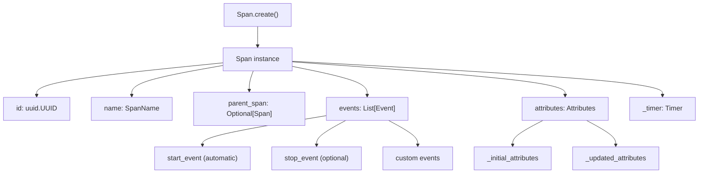
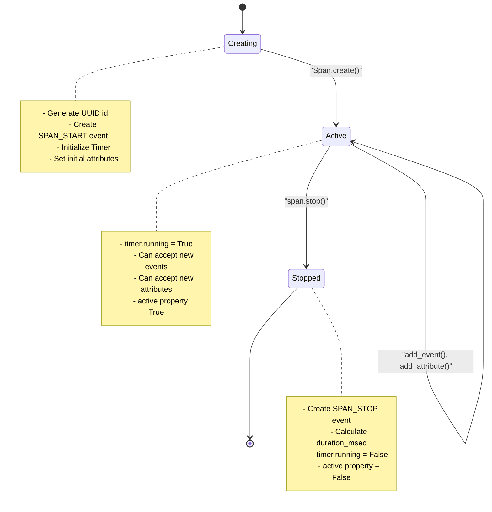
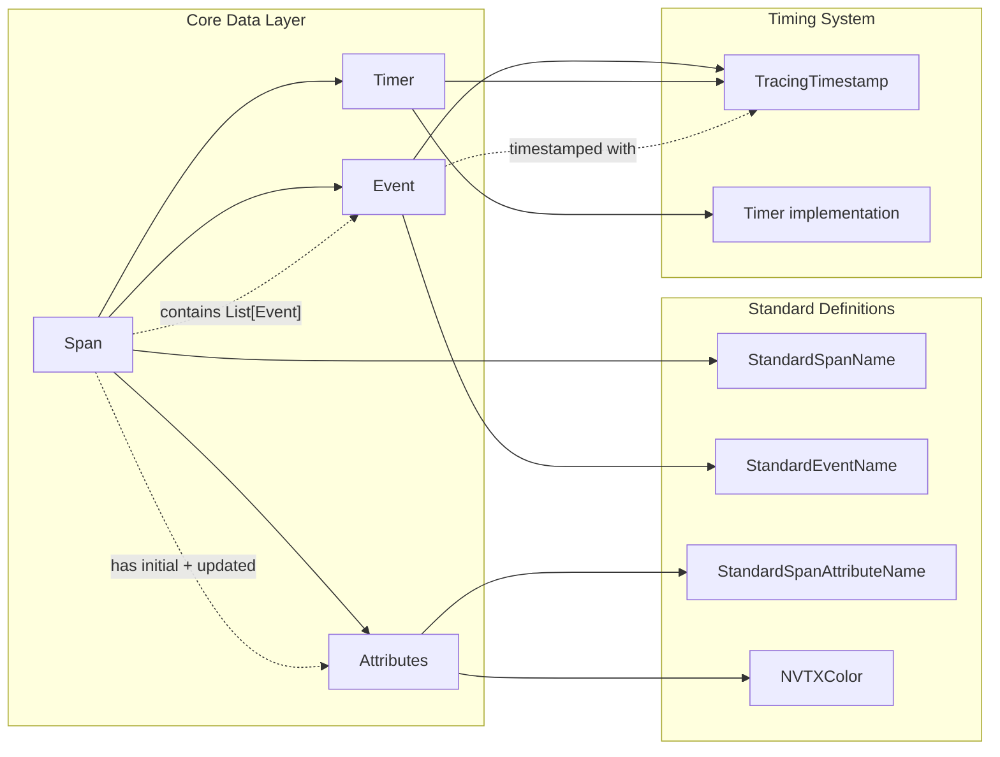
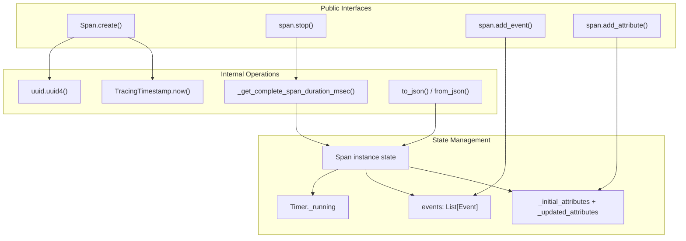

<!-- source: DeepWiki mcp.deepwiki.com · repo NVIDIA/nv-one-logger · page 2.2 Core Components · fetched 2026-10-26 -->

# Core Components

Relevant source files

The following files were used as context for generating this wiki page:

- [nv_one_logger/one_logger_core/src/nv_one_logger/core/span.py](nv_one_logger/one_logger_core/src/nv_one_logger/core/span.py)
- [nv_one_logger/one_logger_core/tests/nv_one_logger/core/internal/test_version.py](nv_one_logger/one_logger_core/tests/nv_one_logger/core/internal/test_version.py)

This section documents the core internal components that form the foundation of the `one_logger_core` package. These components provide the fundamental data structures, lifecycle management, and abstractions used throughout the logging system.

For information about the user-facing APIs that utilize these components, see [API and Usage](#2.1). For details about the export system that serializes these components, see [Export System](#2.3).

## Core Data Structures

The core package revolves around three primary data structures that represent the fundamental units of telemetry data:

### Span Class

The `Span` class represents a unit of work or operation in the distributed tracing system. Each span contains:

- **Unique identification**: UUID-based `id` property for span identification
- **Hierarchical structure**: Optional `parent_span` property for building span trees  
- **Temporal boundaries**: Automatic `start_event` and optional `stop_event` for lifecycle tracking
- **Metadata collection**: `attributes` for key-value metadata and `events` for timestamped records
- **State management**: `active` property indicating whether the span is currently running

**Span Creation and Management**

Sources: [nv_one_logger/one_logger_core/src/nv_one_logger/core/span.py:178-203]()

### Event and Attribute Systems

**Events** represent timestamped occurrences within a span, while **Attributes** store key-value metadata. The system includes:

- `Event` objects with `StandardEventName.SPAN_START` and `StandardEventName.SPAN_STOP` for lifecycle events
- `Attributes` collections supporting both initial span attributes and runtime updates  
- `AttributeValue` types for storing various data types as span metadata
- `TracingTimestamp` integration for precise timing measurements

Sources: [nv_one_logger/one_logger_core/src/nv_one_logger/core/span.py:9-12]()

## Span Lifecycle Management  

The span lifecycle follows a well-defined state machine with automatic event generation and timer integration:

**Key Lifecycle Methods**

- `Span.create()`: Static factory method that initializes span with `start_event` and starts internal `Timer`
- `span.stop()`: Terminates span by adding `stop_event`, stopping timer, and calculating `DURATION_MSEC` attribute
- `span.add_event()`: Adds timestamped events during active span lifecycle
- `span.add_attribute()`: Updates span metadata, stored in `_updated_attributes` collection

Sources: [nv_one_logger/one_logger_core/src/nv_one_logger/core/span.py:205-219](), [nv_one_logger/one_logger_core/src/nv_one_logger/core/span.py:221-243]()

## Standard Naming Conventions

The core package defines standardized naming enums to ensure consistency across the telemetry system:

| Enum Class | Purpose | Key Values |
|------------|---------|------------|
| `StandardSpanName` | Common span names across domains | `APPLICATION` |
| `StandardSpanAttributeName` | Generic span attributes | `DURATION_MSEC`, `NVTX_COLOR` |  
| `StandardEventName` | Lifecycle and common events | `SPAN_START`, `SPAN_STOP` |
| `NVTXColor` | NVTX marker color assignments | `GREEN`, `BLUE`, `YELLOW`, `PURPLE`, etc. |

**Type Definitions**

The system uses `SpanName: TypeAlias = Union[Enum, str]` to allow both enum-based and string-based span names, with enums preferred for type safety.

Sources: [nv_one_logger/one_logger_core/src/nv_one_logger/core/span.py:15-57]()

## Component Relationships

Sources: [nv_one_logger/one_logger_core/src/nv_one_logger/core/span.py:1-13]()

## Internal Architecture

The core components implement a layered architecture with clear separation of concerns:

**Key Implementation Details**

- **UUID Generation**: Each span receives a unique `uuid.UUID` identifier via `uuid.uuid4()`
- **Timestamp Management**: Integration with `TracingTimestamp.now()` for precise timing
- **Attribute Separation**: Tracks `_initial_attributes` set at creation separately from `_updated_attributes` added later
- **Timer Integration**: Internal `Timer` object manages span timing and duration calculation
- **JSON Serialization**: Built-in `to_json()` and `from_json()` methods for persistence and export

Sources: [nv_one_logger/one_logger_core/src/nv_one_logger/core/span.py:71-111](), [nv_one_logger/one_logger_core/src/nv_one_logger/core/span.py:245-281](), [nv_one_logger/one_logger_core/src/nv_one_logger/core/span.py:295-307]()

---

