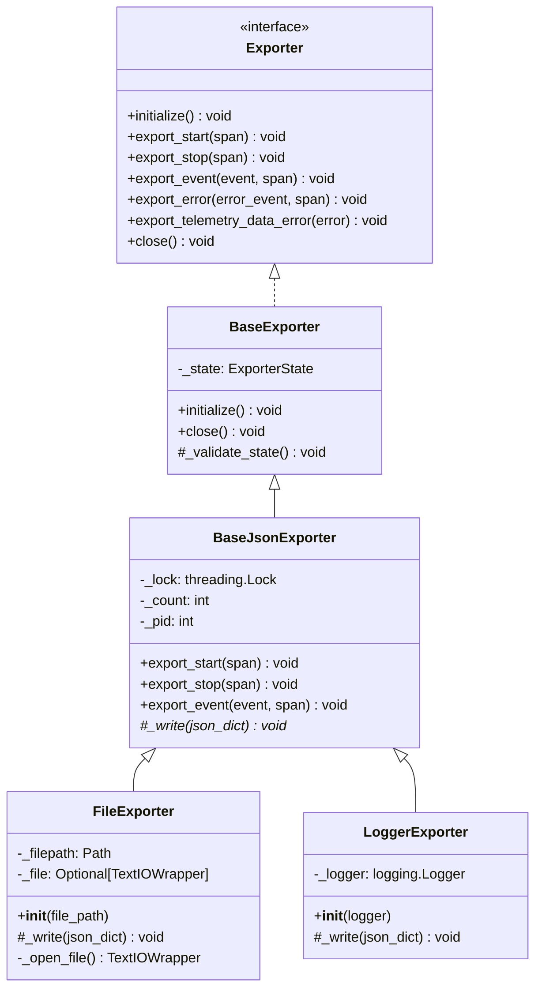
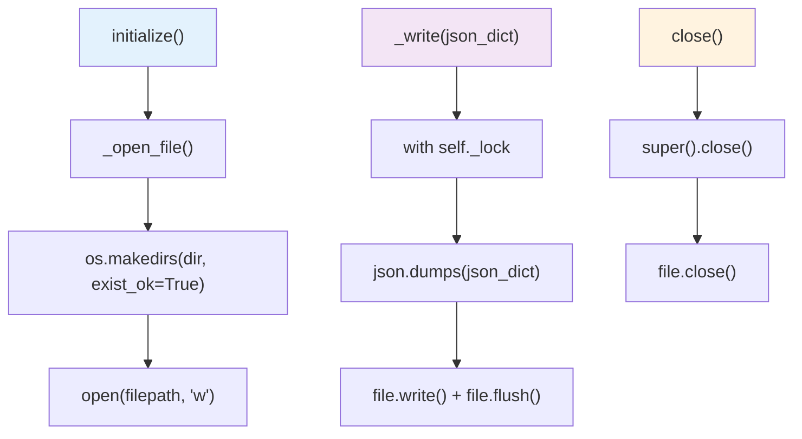
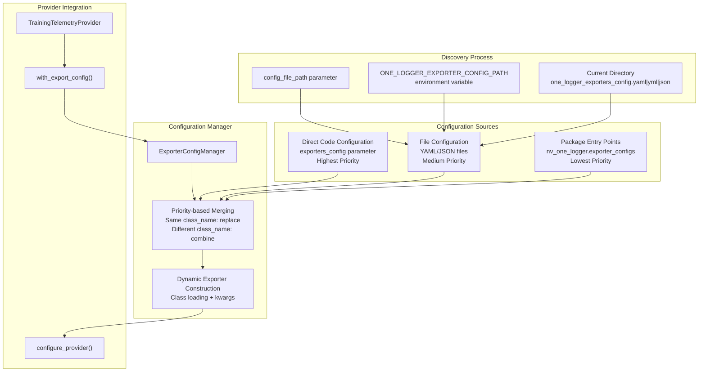

<!-- source: DeepWiki mcp.deepwiki.com · repo NVIDIA/nv-one-logger · page 2.3 Export System · fetched 2026-10-26 -->

# Export System

<details>
<summary>Relevant source files</summary>

The following files were used as context for generating this wiki page:

- [nv_one_logger/one_logger_core/src/nv_one_logger/exporter/README.md](nv_one_logger/one_logger_core/src/nv_one_logger/exporter/README.md)
- [nv_one_logger/one_logger_core/src/nv_one_logger/exporter/__init__.py](nv_one_logger/one_logger_core/src/nv_one_logger/exporter/__init__.py)
- [nv_one_logger/one_logger_core/src/nv_one_logger/exporter/file_exporter.py](nv_one_logger/one_logger_core/src/nv_one_logger/exporter/file_exporter.py)

</details>


The Export System provides the core infrastructure for delivering telemetry data from nv-one-logger to external systems. It defines standard interfaces, base implementations, built-in exporters, and a flexible configuration management system that supports multiple configuration sources with priority-based merging.

This document covers the exporter architecture, built-in exporters (`FileExporter`, `LoggerExporter`), and the declarative configuration system. For information about backend-specific exporters like OpenTelemetry and Weights & Biases, see [Backend Integrations](#4).

## Core Architecture

The Export System follows a protocol-based architecture with base classes providing common functionality and lifecycle management.

**Exporter Architecture**


Sources: [nv_one_logger/one_logger_core/src/nv_one_logger/exporter/README.md:33-57]()

### Exporter Protocol

The `Exporter` protocol defines the core contract implemented by all exporters:

| Method | Purpose | Error Handling |
|--------|---------|----------------|
| `initialize()` | Prepare resources | Should raise `ExportError` on failure |
| `export_start(span)` | Handle span start | Should raise `ExportError` on export failure |
| `export_stop(span)` | Handle span completion | Should raise `ExportError` on export failure |
| `export_event(event, span)` | Handle custom events | Should raise `ExportError` on export failure |
| `export_error(error_event, span)` | Handle application errors | Should raise `ExportError` on export failure |
| `export_telemetry_data_error(error)` | Handle schema/validation issues | Should raise `ExportError` on export failure |
| `close()` | Release resources | Must not raise exceptions |

Sources: [nv_one_logger/one_logger_core/src/nv_one_logger/exporter/README.md:33-43]()

### Base Classes

`BaseExporter` provides lifecycle state management, ensuring correct usage patterns:
- Validates state transitions: not-initialized → ready → closed
- Guards all export methods with state validation

`BaseJsonExporter` handles JSON serialization and record generation:
- Converts spans and events to JSON-compatible dictionaries
- Adds incremental `count` and `pid` fields
- Emits `RecordType` values: `START`, `STOP`, `COMPLETE`, `EVENT`, `APPLICATION_ERROR`, `TELEMETRY_DATA_ERROR`
- Optimizes single-span scenarios by emitting `COMPLETE` records when possible
- Delegates actual output via abstract `_write(json_dict)` method

Sources: [nv_one_logger/one_logger_core/src/nv_one_logger/exporter/README.md:45-56]()

## Built-in Exporters

### FileExporter

`FileExporter` writes telemetry data as JSON Lines to a file, providing persistent storage with thread-safe operations.

**FileExporter Implementation Details**


Key features:
- **Automatic directory creation**: Creates parent directories if missing [nv_one_logger/one_logger_core/src/nv_one_logger/exporter/file_exporter.py:56-59]()
- **Thread-safe writes**: Uses internal lock for concurrent access [nv_one_logger/one_logger_core/src/nv_one_logger/exporter/file_exporter.py:68-71]()
- **JSON Lines format**: One JSON object per line for easy ingestion [nv_one_logger/one_logger_core/src/nv_one_logger/exporter/file_exporter.py:67-71]()

Constructor: `FileExporter(file_path: Path)`

Sources: [nv_one_logger/one_logger_core/src/nv_one_logger/exporter/README.md:83-103](), [nv_one_logger/one_logger_core/src/nv_one_logger/exporter/file_exporter.py:17-74]()

### LoggerExporter

`LoggerExporter` outputs telemetry data to Python's standard logging system as formatted key-value pairs, suitable for human-readable logs.

Key characteristics:
- **Immediate output**: Designed for real-time, human-readable logging
- **Logger integration**: Uses provided `logging.Logger` instance
- **Key-value format**: Emits structured key=value formatted strings

Constructor: `LoggerExporter(logger: logging.Logger)`

**Note**: `LoggerExporter` requires a `logging.Logger` instance and cannot be constructed via the configuration manager. Use programmatic wiring with `.with_exporter()`.

Sources: [nv_one_logger/one_logger_core/src/nv_one_logger/exporter/README.md:62-82]()

## Configuration System

The Export Configuration Manager provides declarative exporter setup through multiple configuration sources with priority-based merging.

**Configuration Architecture and Flow**


Sources: [nv_one_logger/one_logger_core/src/nv_one_logger/exporter/README.md:129-143](), [nv_one_logger/one_logger_core/src/nv_one_logger/exporter/README.md:213-222]()

### Configuration Data Model

The `ExporterConfig` dataclass defines the structure for exporter configuration:

```python
@dataclass
class ExporterConfig:
    class_name: str              # e.g. "nv_one_logger.exporter.file_exporter.FileExporter"
    config: Dict[str, Any] = {}  # Constructor kwargs
    enabled: bool = True
```

Sources: [nv_one_logger/one_logger_core/src/nv_one_logger/exporter/README.md:204-211]()

### Configuration Sources and Priority

The configuration manager merges configurations from three sources in priority order:

1. **Direct Configuration** (Highest): Passed to `with_export_config(exporters_config=...)`
2. **File Configuration** (Medium): YAML/JSON files discovered or explicitly specified
3. **Package Configuration** (Lowest): Entry points from installed packages

**Merging Rules**:
- Same `class_name`: Higher priority replaces lower (config is shallow-merged)
- Different `class_name`: All configurations are included

Sources: [nv_one_logger/one_logger_core/src/nv_one_logger/exporter/README.md:213-222]()

### File Configuration Format

Configuration files support both YAML and JSON formats:

**YAML Format**:
```yaml
exporters:
  - class_name: "nv_one_logger.exporter.file_exporter.FileExporter"
    config:
      file_path: "/tmp/app.log"
    enabled: true
```

**JSON Format**:
```json
{
  "exporters": [
    {
      "class_name": "nv_one_logger.exporter.file_exporter.FileExporter",
      "config": { "file_path": "/tmp/app.log" },
      "enabled": true
    }
  ]
}
```

**File Discovery Order**:
1. Explicit path: `with_export_config(config_file_path=...)`
2. Environment variable: `ONE_LOGGER_EXPORTER_CONFIG_PATH`
3. Current directory: `one_logger_exporters_config.yaml|yml|json`

Sources: [nv_one_logger/one_logger_core/src/nv_one_logger/exporter/README.md:224-252]()

### Package Entry Points

Packages can provide default configurations through Python entry points using the group `nv_one_logger.exporter_configs`:

**Poetry Configuration**:
```toml
[tool.poetry.plugins."nv_one_logger.exporter_configs"]
my_file_exporter = "my_team_exporter_config.configs:MyFileExporterConfig"
```

**Entry Point Implementation**:
```python
class MyFileExporterConfig:
    @staticmethod
    def get_default_config():
        return {
            "class_name": "nv_one_logger.exporter.file_exporter.FileExporter",
            "config": {"file_path": "/tmp/my_team_app.log"},
            "enabled": True,
        }
```

Sources: [nv_one_logger/one_logger_core/src/nv_one_logger/exporter/README.md:253-310]()

## Usage Patterns

### Programmatic Configuration

Direct exporter registration with the provider:

```python
from nv_one_logger.training_telemetry.api.training_telemetry_provider import TrainingTelemetryProvider
from nv_one_logger.exporter.file_exporter import FileExporter
from pathlib import Path

provider = TrainingTelemetryProvider.instance()
provider.with_exporter(FileExporter(file_path=Path("/tmp/metrics.jsonl")))
provider.configure_provider()
```

Sources: [nv_one_logger/one_logger_core/src/nv_one_logger/exporter/README.md:107-125]()

### Declarative Configuration

Using the configuration manager for flexible setup:

```python
# Basic usage with discovery
provider = TrainingTelemetryProvider.instance()
provider.with_export_config().configure_provider()

# Explicit file configuration
provider.with_export_config(
    config_file_path="one_logger_exporters_config.yaml"
).configure_provider()

# Direct configuration override
provider.with_export_config(exporters_config=[
    {
        "class_name": "nv_one_logger.exporter.file_exporter.FileExporter",
        "config": {"file_path": "/tmp/override.log"},
        "enabled": True
    }
]).configure_provider()
```

Sources: [nv_one_logger/one_logger_core/src/nv_one_logger/exporter/README.md:160-198](), [nv_one_logger/one_logger_core/src/nv_one_logger/exporter/README.md:312-334]()

### Error Handling

Exporters follow standard error handling patterns:
- Raise `ExportError` for recoverable export failures
- Always call `close()` to flush and release resources
- `BaseJsonExporter` logs warnings for unfinished spans at close

Sources: [nv_one_logger/one_logger_core/src/nv_one_logger/exporter/README.md:338-342]()

---

