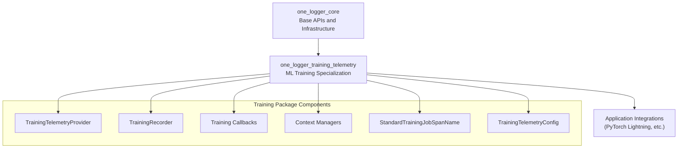
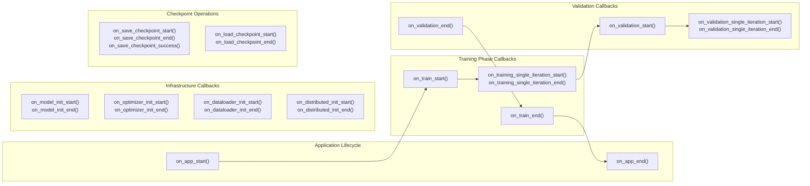

<!-- source: DeepWiki mcp.deepwiki.com · repo NVIDIA/nv-one-logger · page 3 Training Telemetry Package · fetched 2026-10-26 -->

# Training Telemetry Package

<details>
<summary>Relevant source files</summary>

The following files were used as context for generating this wiki page:

- [nv_one_logger/one_logger_training_telemetry/pyproject.toml](nv_one_logger/one_logger_training_telemetry/pyproject.toml)
- [nv_one_logger/one_logger_training_telemetry/src/nv_one_logger/training_telemetry/api/__init__.py](nv_one_logger/one_logger_training_telemetry/src/nv_one_logger/training_telemetry/api/__init__.py)

</details>


## Purpose and Scope

The Training Telemetry Package (`one_logger_training_telemetry`) provides machine learning training-specific telemetry APIs, spans, and events designed for ML workflows. This package extends the foundational [Core Package](#2) with specialized functionality for tracking training job lifecycle events, checkpointing operations, and training metrics.

For information about the foundational logging APIs and core components, see [Core Package](#2). For application-specific integrations like PyTorch Lightning, see [Application Integrations](#5).

## Architecture and Positioning

The training telemetry package serves as a domain-specific extension layer between the core logging foundation and application integrations:



Sources: [nv_one_logger/one_logger_training_telemetry/pyproject.toml:1-110]()

## Package Structure and Dependencies

The training telemetry package maintains its own release cycle while depending on the core package:

| Component | Purpose | Core Dependency |
|-----------|---------|------------------|
| `TrainingTelemetryProvider` | Main configuration and provider interface | Extends `OneLoggerProvider` |
| `TrainingRecorder` | Training-specific recording functionality | Uses core recorder infrastructure |
| Training callbacks | Lifecycle event handlers for ML workflows | Built on core span/event system |
| Context managers | Training-specific context management | Extends core `timed_span` patterns |

The package explicitly depends on `nv-one-logger-core ^2.1.0` and adds ML-specific dependencies like `StrEnum` for training state enumeration.

Sources: [nv_one_logger/one_logger_training_telemetry/pyproject.toml:15-20]()

## Core API Components

### Training Lifecycle Callbacks

The package provides a comprehensive set of callback functions for different phases of ML training:



Sources: [nv_one_logger/one_logger_training_telemetry/src/nv_one_logger/training_telemetry/api/__init__.py:6-32]()

### Context Managers and Configuration

The package provides specialized context managers and configuration for training workflows:

```mermaid
graph TB
    subgraph "Context Managers"
        Application["application()")
        TrainingLoop["training_loop()"]
        TrainingIteration["training_iteration()"]
        CheckpointSave["checkpoint_save()"]
    end
    
    subgraph "Configuration Classes"
        TrainingConfig["TrainingTelemetryConfig"]
        CheckpointStrategy["CheckPointStrategy"]
    end
    
    subgraph "Core Components"
        Provider["TrainingTelemetryProvider"]
        Recorder["TrainingRecorder"]
        Spans["StandardTrainingJobSpanName"]
    end
    
    Application --> TrainingLoop
    TrainingLoop --> TrainingIteration
    TrainingIteration --> CheckpointSave
    
    TrainingConfig --> Provider
    CheckpointStrategy --> Provider
    Provider --> Recorder
    Recorder --> Spans
```

Sources: [nv_one_logger/one_logger_training_telemetry/src/nv_one_logger/training_telemetry/api/__init__.py:33-43]()

## Key Classes and Their Roles

| Class | Purpose | Key Methods/Attributes |
|-------|---------|----------------------|
| `TrainingTelemetryProvider` | Main entry point for training telemetry configuration | Configuration management, exporter setup |
| `TrainingRecorder` | Handles recording of training-specific spans and events | Training span lifecycle, metrics recording |
| `TrainingTelemetryConfig` | Configuration class for training telemetry settings | Export configuration, training parameters |
| `CheckPointStrategy` | Enumeration of checkpoint saving strategies | Strategy definitions for checkpoint timing |
| `StandardTrainingJobSpanName` | Enumeration of standard training span names | Consistent span naming across training workflows |

## Integration with Core Package

The training telemetry package extends the core package's capabilities by:

1. **Specialized Spans**: Defines training-specific span types through `StandardTrainingJobSpanName`
2. **Training Context**: Provides context managers that wrap core `timed_span` functionality with training semantics
3. **Callback System**: Implements a callback-based event system for training lifecycle management
4. **Configuration Extensions**: Extends core configuration with training-specific settings via `TrainingTelemetryConfig`

The package maintains backward compatibility with core APIs while adding domain-specific functionality for ML training workflows. Applications can use either the core APIs directly or leverage the training-specific abstractions for more streamlined ML telemetry integration.

Sources: [nv_one_logger/one_logger_training_telemetry/src/nv_one_logger/training_telemetry/api/__init__.py:1-44]()

---

