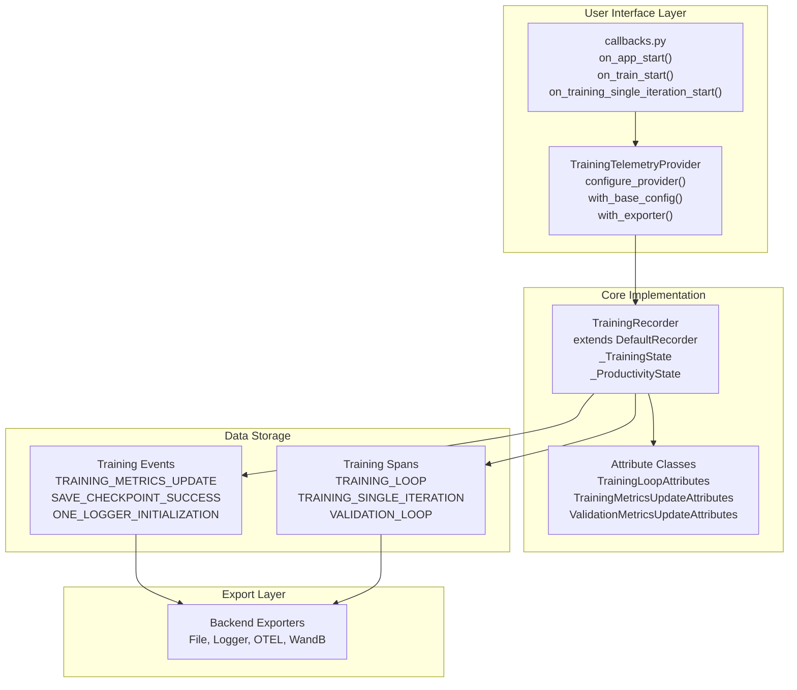

<!-- source: DeepWiki mcp.deepwiki.com · repo NVIDIA/nv-one-logger · page 3.1 Training Telemetry APIs · fetched 2026-10-26 -->

# Training Telemetry APIs

<details>
<summary>Relevant source files</summary>

The following files were used as context for generating this wiki page:

- [nv_one_logger/one_logger_training_telemetry/src/nv_one_logger/training_telemetry/api/attributes.py](nv_one_logger/one_logger_training_telemetry/src/nv_one_logger/training_telemetry/api/attributes.py)
- [nv_one_logger/one_logger_training_telemetry/src/nv_one_logger/training_telemetry/api/callbacks.py](nv_one_logger/one_logger_training_telemetry/src/nv_one_logger/training_telemetry/api/callbacks.py)
- [nv_one_logger/one_logger_training_telemetry/src/nv_one_logger/training_telemetry/api/training_recorder.py](nv_one_logger/one_logger_training_telemetry/src/nv_one_logger/training_telemetry/api/training_recorder.py)
- [nv_one_logger/one_logger_training_telemetry/src/nv_one_logger/training_telemetry/api/training_telemetry_provider.py](nv_one_logger/one_logger_training_telemetry/src/nv_one_logger/training_telemetry/api/training_telemetry_provider.py)

</details>


This document covers the training-specific APIs provided by the `one_logger_training_telemetry` package. These APIs extend the core OneLogger functionality with machine learning training-specific telemetry capabilities, including training iterations, validation loops, checkpoint operations, and performance metrics.

For general OneLogger usage and core APIs, see [Core Package APIs](#2.1). For backend integrations that work with training telemetry data, see [Backend Integrations](#4).

## Architecture Overview

The training telemetry APIs are built around three main components that work together to provide comprehensive ML training observability:



Sources: [training_telemetry/api/training_telemetry_provider.py:43-423](), [training_telemetry/api/training_recorder.py:187-1069](), [training_telemetry/api/callbacks.py:1-414](), [training_telemetry/api/attributes.py:1-1250]()

## Main API Components

### TrainingTelemetryProvider

The `TrainingTelemetryProvider` is a singleton that serves as the main entry point for training telemetry configuration. It follows a builder pattern for incremental configuration:

| Method | Purpose | Returns |
|--------|---------|---------|
| `with_base_config()` | Set base configuration | Provider instance |
| `with_config_override()` | Override specific config fields | Provider instance |
| `with_exporter()` | Add telemetry exporters | Provider instance |
| `with_export_config()` | Configure exporters from config | Provider instance |
| `configure_provider()` | Finalize configuration | None |

The provider creates and manages a `TrainingRecorder` instance that handles the actual telemetry recording.

Sources: [training_telemetry/api/training_telemetry_provider.py:43-147](), [training_telemetry/api/training_telemetry_provider.py:160-323]()

### TrainingRecorder

The `TrainingRecorder` extends `DefaultRecorder` with training-specific functionality. It maintains internal state through two key classes:

- `_TrainingState`: Tracks training progress, metrics, and timers
- `_ProductivityState`: Tracks work that has been successfully checkpointed

Key recording methods include:
- Application lifecycle: `on_app_start()`, `on_app_end()`
- Training phases: `on_training_loop_start()`, `on_training_single_iteration_start()`
- Validation: `on_validation_start()`, `on_validation_single_iteration_start()`
- Checkpoints: `on_save_checkpoint_start()`, `on_save_checkpoint_success()`

Sources: [training_telemetry/api/training_recorder.py:187-217](), [training_telemetry/api/training_recorder.py:94-185]()

## Training Lifecycle Callbacks

The callback functions provide a user-friendly interface for instrumenting training code. These functions safely wrap the recorder methods and handle error cases:

```mermaid
graph LR
    subgraph "Application Lifecycle"
        AppStart["on_app_start()"] --> DistInit["on_distributed_init_start()"]
        DistInit --> ModelInit["on_model_init_start()"]
        ModelInit --> DataInit["on_dataloader_init_start()"]
        DataInit --> TrainStart["on_train_start()"]
    end
    
    subgraph "Training Loop"
        TrainStart --> TrainIter["on_training_single_iteration_start()"]
        TrainIter --> TrainIterEnd["on_training_single_iteration_end()"]
        TrainIterEnd --> TrainIter
        TrainIterEnd --> ValidStart["on_validation_start()"]
        ValidStart --> ValidIter["on_validation_single_iteration_start()"]
        ValidIter --> ValidIterEnd["on_validation_single_iteration_end()"]
        ValidIterEnd --> ValidEnd["on_validation_end()"]
        ValidEnd --> Checkpoint["on_save_checkpoint_start()"]
        Checkpoint --> CheckpointSuccess["on_save_checkpoint_success()"]
    end
    
    subgraph "Completion"
        TrainIterEnd --> TrainEnd["on_train_end()"]
        TrainEnd --> AppEnd["on_app_end()"]
    end
```



### Key Callback Categories

**Application Setup Callbacks:**
- `on_app_start()`: Initialize application span and post initialization event
- `on_distributed_init_start()`: Track distributed training setup
- `on_model_init_start()`: Track model initialization
- `on_dataloader_init_start()`: Track data loading setup

**Training Loop Callbacks:**
- `on_train_start()`: Initialize training loop with target iterations/samples
- `on_training_single_iteration_start()`: Mark start of individual training step
- `on_training_single_iteration_end()`: Complete training step and update metrics

**Validation Callbacks:**
- `on_validation_start()`: Begin validation phase
- `on_validation_single_iteration_start()`: Track individual validation steps

**Checkpoint Callbacks:**
- `on_save_checkpoint_start()`: Begin checkpoint save operation
- `on_save_checkpoint_success()`: Mark successful checkpoint completion

All callbacks are decorated with `@safely_execute` to prevent telemetry errors from disrupting training.

Sources: [training_telemetry/api/callbacks.py:23-414]()

## Training Attributes System

The training telemetry system uses structured attribute classes to capture detailed metrics and metadata. These classes extend the base `Attributes` class and provide type-safe access to training-specific data:

### Core Attribute Classes

| Class | Purpose | Key Metrics |
|-------|---------|-------------|
| `TrainingLoopAttributes` | Training loop configuration | iterations_start, samples_start, targets |
| `TrainingMetricsUpdateAttributes` | Multi-iteration training metrics | avg_iteration_time, throughput, FLOPS |
| `ValidationMetricsUpdateAttributes` | Validation metrics | iteration times, intervals |
| `CheckpointSaveSpanAttributes` | Checkpoint operation metadata | strategy, iteration, attempt_count |
| `SaveCheckpointSuccessEventAttributes` | Checkpoint success details | productivity metrics, timestamps |

### Metrics Collection

The system automatically collects comprehensive training metrics:

**Performance Metrics:**
- Iteration timing (avg, min, max, total)
- Forward/backward pass timing
- Data loading time
- Throughput (samples/sec, tokens/sec, FLOPS)

**Progress Tracking:**
- Training iterations completed
- Samples processed
- Tokens processed (if sequence length known)
- Floating-point operations completed

**Productivity Metrics:**
- Work completed since last successful checkpoint
- Training time for productive work
- Validation time for productive work

Sources: [training_telemetry/api/attributes.py:19-895](), [training_telemetry/api/training_recorder.py:752-793]()

## Configuration and Setup

### Basic Setup Pattern

```python
# 1. Create training telemetry config
config = TrainingTelemetryConfig(
    perf_tag="my_model_v1",
    global_batch_size=64,
    log_every_n_train_iterations=100
)

# 2. Configure provider with exporters
(TrainingTelemetryProvider.instance()
    .with_base_config(config)
    .with_exporter(FileExporter())
    .with_export_config(exporters_config=[...])
    .configure_provider())
```

### Exporter Configuration

The training telemetry provider supports multiple configuration methods:

**Direct Configuration:**
```python
provider.with_exporter(LoggerExporter())
provider.with_exporter(OtelExporter())
```

**Config-based Setup:**
```python
provider.with_export_config(
    exporters_config=[
        {"type": "file", "file_path": "/logs/training.jsonl"},
        {"type": "wandb", "project": "my_project"}
    ]
)
```

**Export Filtering:**
By default, high-frequency spans like `TRAINING_SINGLE_ITERATION` are blacklisted to reduce data volume. This can be customized:

```python
provider.with_export_customization(
    export_customization_mode=ExportCustomizationMode.WHITELIST_SPANS,
    span_name_filter=[StandardTrainingJobSpanName.TRAINING_LOOP]
)
```

### Default Blacklisted Spans

The following spans are excluded from export by default due to high frequency:
- `TRAINING_SINGLE_ITERATION`
- `VALIDATION_SINGLE_ITERATION` 
- `TESTING_SINGLE_ITERATION`
- `DATA_LOADING`
- `MODEL_FORWARD`
- `ZERO_GRAD`
- `MODEL_BACKWARD`
- `OPTIMIZER_UPDATE`

Sources: [training_telemetry/api/training_telemetry_provider.py:25-34](), [training_telemetry/api/training_telemetry_provider.py:248-279](), [training_telemetry/api/training_telemetry_provider.py:221-246]()

---

