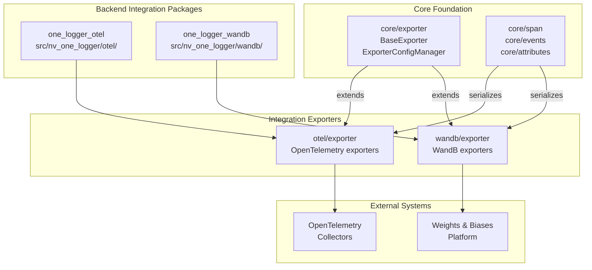
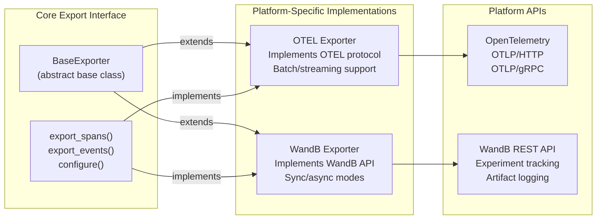
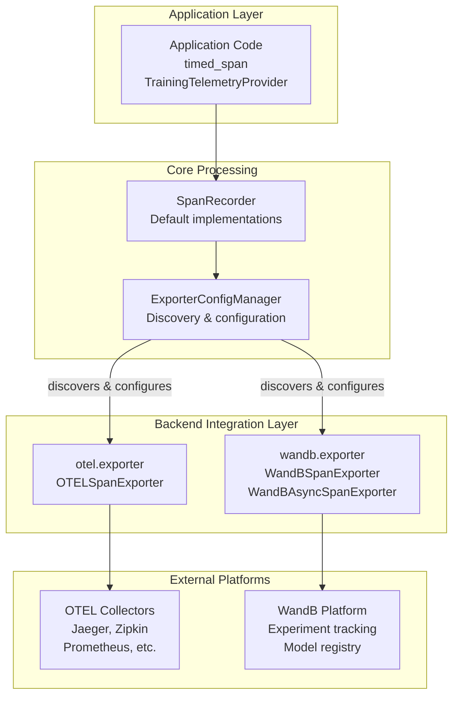
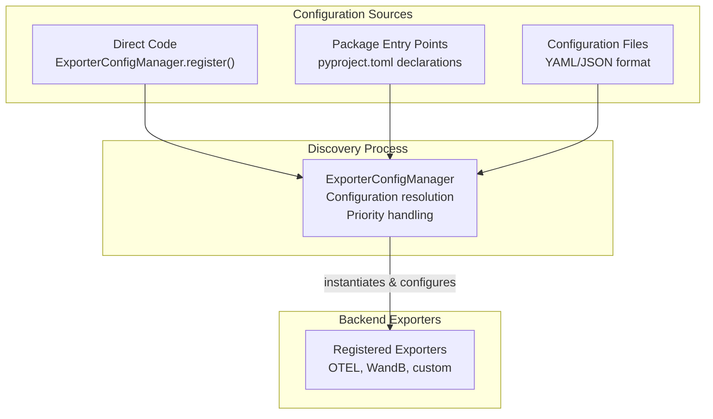
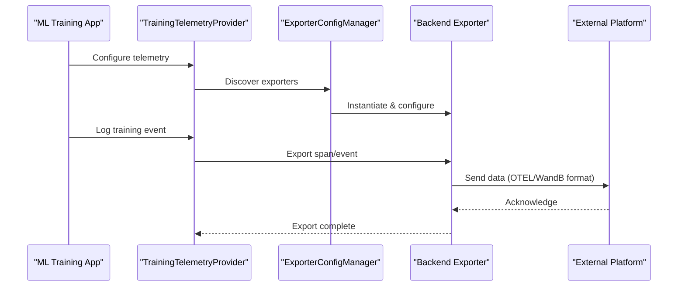

<!-- source: DeepWiki mcp.deepwiki.com · repo NVIDIA/nv-one-logger · page 4 Backend Integrations · fetched 2026-10-26 -->

# Backend Integrations

Relevant source files

The following files were used as context for generating this wiki page:

- [README.md](README.md)

## Purpose and Scope

Backend Integrations enable nv-one-logger to export telemetry data to external platforms and observability systems. This document provides an overview of the backend integration architecture and the available integration packages that extend the core logging functionality.

This page covers the general architecture and principles of backend integrations. For specific implementation details, see [OpenTelemetry Integration](#4.1) and [Weights & Biases Integration](#4.2). For information about the core export system that backend integrations extend, see [Export System](#2.3).

## Backend Integration Architecture

Backend integrations are implemented as separate packages that extend the core export system. Each integration package provides specialized exporters that can send telemetry data to specific external platforms while maintaining compatibility with the core logging APIs.

### Integration Package Structure

**Sources:** [README.md:23-27](), [README.md:42-46]()

### Extensibility Pattern

Backend integrations follow a consistent pattern where they extend the base exporter classes from `one_logger_core` and implement platform-specific serialization and transmission logic.

**Sources:** [README.md:67-68](), [README.md:83-91]()

## Export System Extension Points

Backend integrations leverage the core export system's extensibility mechanisms to register and configure their exporters.

### Exporter Registration

The `ExporterConfigManager` from the core package provides the registration mechanism that backend integrations use to make their exporters discoverable.

| Extension Point | Purpose | Usage |
|----------------|---------|--------|
| Entry Points | Package-based discovery | Register exporters via `pyproject.toml` |
| Direct Registration | Programmatic registration | Register exporters in code |
| Configuration Files | Declarative setup | YAML/JSON configuration |

### Data Flow Architecture

**Sources:** [README.md:17-19](), [README.md:24-25](), [README.md:43-44]()

## Available Backend Integrations

nv-one-logger currently provides two main backend integration packages, each targeting different observability and experimentation ecosystems.

### OpenTelemetry Integration (`one_logger_otel`)

The OpenTelemetry integration package provides OTEL-compatible exporters that enable integration with the broader OpenTelemetry ecosystem.

**Key Features:**
- OTEL protocol compatibility
- Support for OTEL collectors and compatible backends
- Standard OpenTelemetry span and trace formats
- Integration with existing OTEL infrastructure

**Package Location:** `nv_one_logger/one_logger_otel/src/nv_one_logger/otel/`

### Weights & Biases Integration (`one_logger_wandb`)

The Weights & Biases integration package provides exporters for sending telemetry data to the WandB platform for experiment tracking and model management.

**Key Features:**
- Synchronous and asynchronous export modes
- WandB experiment tracking integration
- Support for WandB's visualization and collaboration tools
- ML-optimized data serialization

**Package Location:** `nv_one_logger/one_logger_wandb/src/nv_one_logger/wandb/`

**Sources:** [README.md:82-91]()

## Configuration and Discovery

Backend integrations are discovered and configured through the core export system's configuration mechanisms. This provides flexibility in how users can configure and use different backends.

### Configuration Methods

### Integration with Training Telemetry

Backend integrations work seamlessly with the training telemetry system, allowing ML practitioners to export training metrics and events to their preferred observability platforms.

**Sources:** [README.md:73-78](), [README.md:95-99]()

The backend integration system provides a flexible and extensible foundation for connecting nv-one-logger with various observability and experimentation platforms, while maintaining clean separation between core functionality and platform-specific implementations.

---

