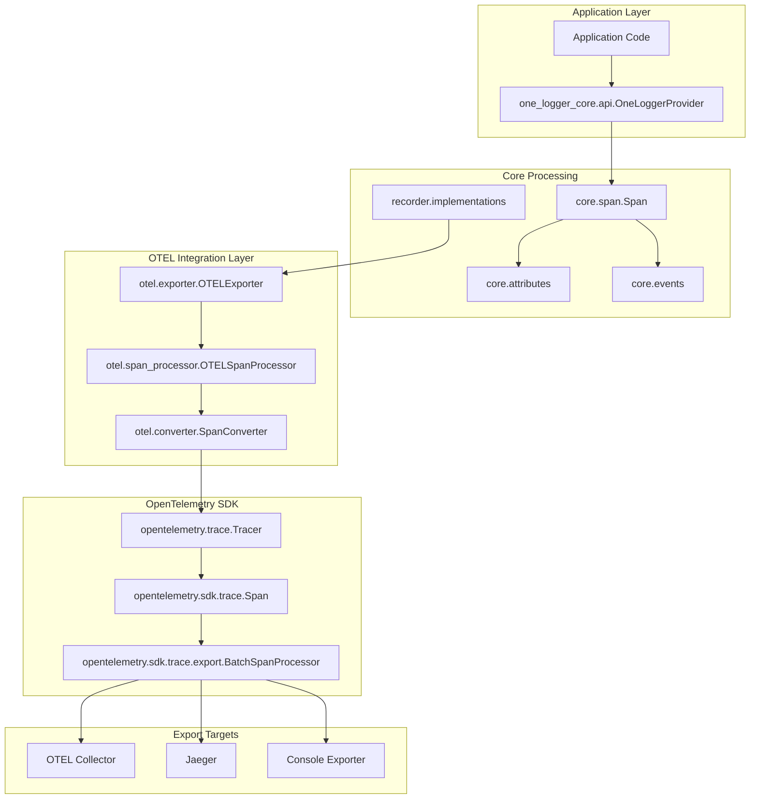
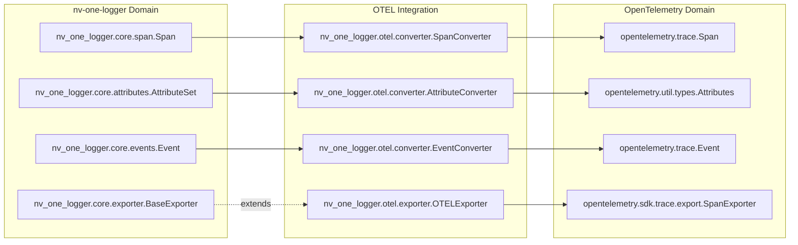
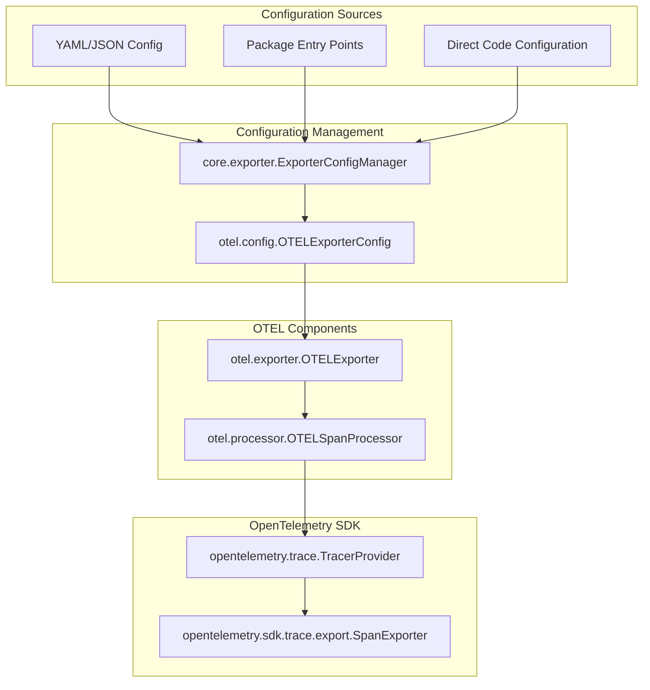
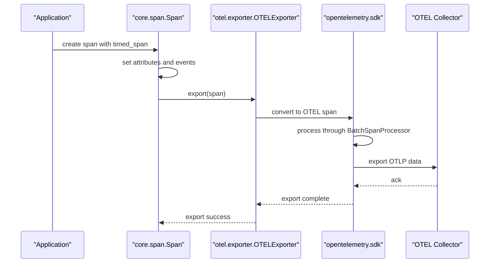
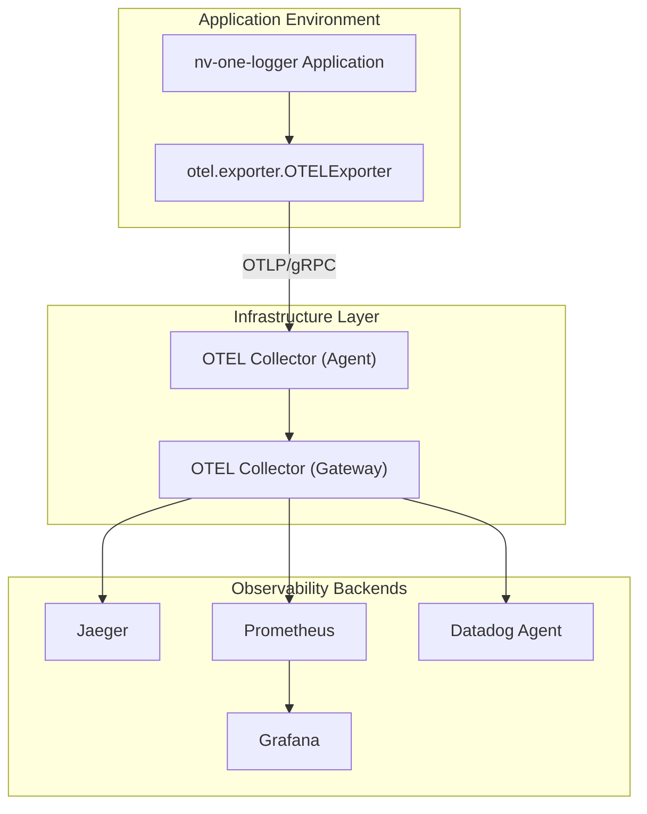

<!-- source: DeepWiki mcp.deepwiki.com · repo NVIDIA/nv-one-logger · page 4.1 OpenTelemetry Integration · fetched 2026-10-26 -->

# OpenTelemetry Integration

Relevant source files

The following files were used as context for generating this wiki page:

- [nv_one_logger/one_logger_otel/poetry.lock](nv_one_logger/one_logger_otel/poetry.lock)
- [nv_one_logger/one_logger_otel/pyproject.toml](nv_one_logger/one_logger_otel/pyproject.toml)

This document covers the `one_logger_otel` package, which provides OpenTelemetry-compatible exporters and integration with the OTEL ecosystem. This package serves as a backend integration layer that extends the core logging functionality to work seamlessly with OpenTelemetry collectors and observability platforms.

For information about the foundational logging APIs and core components, see [Core Package](#2). For details about training-specific telemetry features, see [Training Telemetry Package](#3).

## Package Overview

The `nv-one-logger-otel` package bridges the nv-one-logger system with the OpenTelemetry ecosystem by providing OTEL-compatible exporters and span processors. It extends the base exporter functionality from `one_logger_core` to serialize and transmit telemetry data in OpenTelemetry-compatible formats.

### Key Dependencies

The package integrates with several critical dependencies to provide OpenTelemetry compatibility:

| Dependency | Version | Purpose |
|------------|---------|---------|
| `opentelemetry-api` | ^1.32.1 | Core OpenTelemetry API interfaces |
| `opentelemetry-sdk` | ^1.32.1 | OpenTelemetry SDK implementation |
| `nv-one-logger-core` | ^2.1.0 | Base logging infrastructure |

Sources: [nv_one_logger/one_logger_otel/pyproject.toml:15-21]()

## Architecture Overview

The OpenTelemetry integration follows a layered architecture that transforms nv-one-logger telemetry data into OpenTelemetry-compatible formats for export to OTEL collectors.

Sources: High-level system diagrams, [nv_one_logger/one_logger_otel/pyproject.toml:1-21]()

## Component Integration Pattern

The OTEL integration implements a converter pattern that transforms nv-one-logger data structures into OpenTelemetry equivalents while preserving semantic meaning and timing information.

Sources: High-level system diagrams, architectural patterns from core integration

## Configuration and Setup

The OTEL integration supports multiple configuration approaches to accommodate different deployment scenarios and observability requirements.

### Exporter Configuration Types

The package likely supports several standard OpenTelemetry exporter configurations:

| Exporter Type | Target | Configuration |
|---------------|--------|---------------|
| OTLP | OTEL Collector | Endpoint, headers, compression |
| Jaeger | Jaeger backend | Agent endpoint, service name |
| Console | Standard output | Format options |
| Zipkin | Zipkin backend | Endpoint, service name |

### Integration with ExporterConfigManager

The OTEL package integrates with the core `ExporterConfigManager` to provide declarative configuration support through YAML/JSON files and package entry points.

Sources: [nv_one_logger/one_logger_otel/pyproject.toml:15-21](), core export system architecture

## Span and Event Mapping

The integration preserves the semantic meaning of nv-one-logger spans and events by mapping them to appropriate OpenTelemetry equivalents with proper attribute propagation.

### Span Lifecycle Integration

Sources: Core span lifecycle, OTEL integration patterns

## Deployment Integration

The OTEL package is designed to work with existing OpenTelemetry infrastructure and observability platforms commonly used in production environments.

### Collector Integration Patterns

Sources: OpenTelemetry deployment patterns, [nv_one_logger/one_logger_otel/pyproject.toml:2-4]()

## Package Metadata and Build Configuration

The package is configured as an independent component within the nv-one-logger monorepo with specific versioning and dependency management.

### Build and Distribution

The package uses Poetry for dependency management and follows semantic versioning aligned with the core package versions. The build system supports automated CI/CD pipelines for staging and production deployments.

Sources: [nv_one_logger/one_logger_otel/pyproject.toml:1-11](), [nv_one_logger/one_logger_otel/pyproject.toml:23-25](), [nv_one_logger/one_logger_otel/pyproject.toml:105-112]()

---

