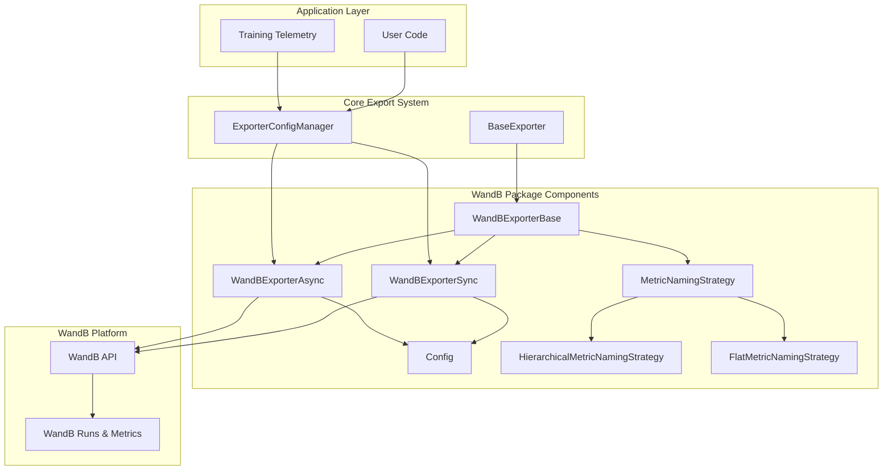
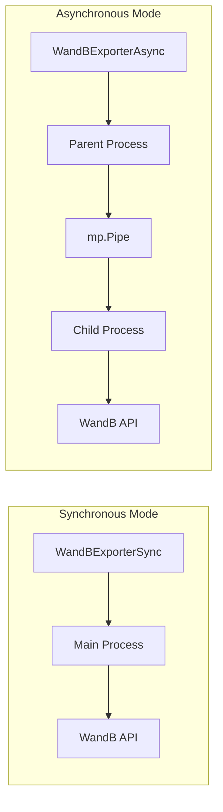
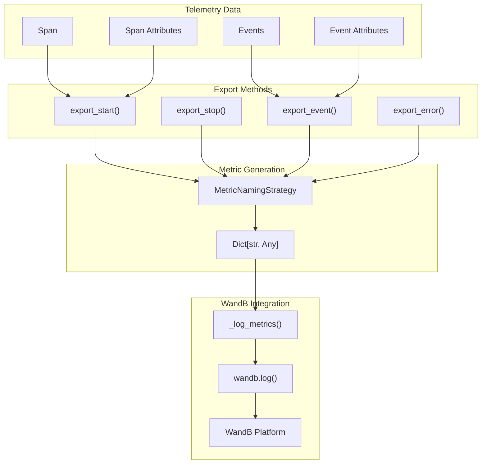
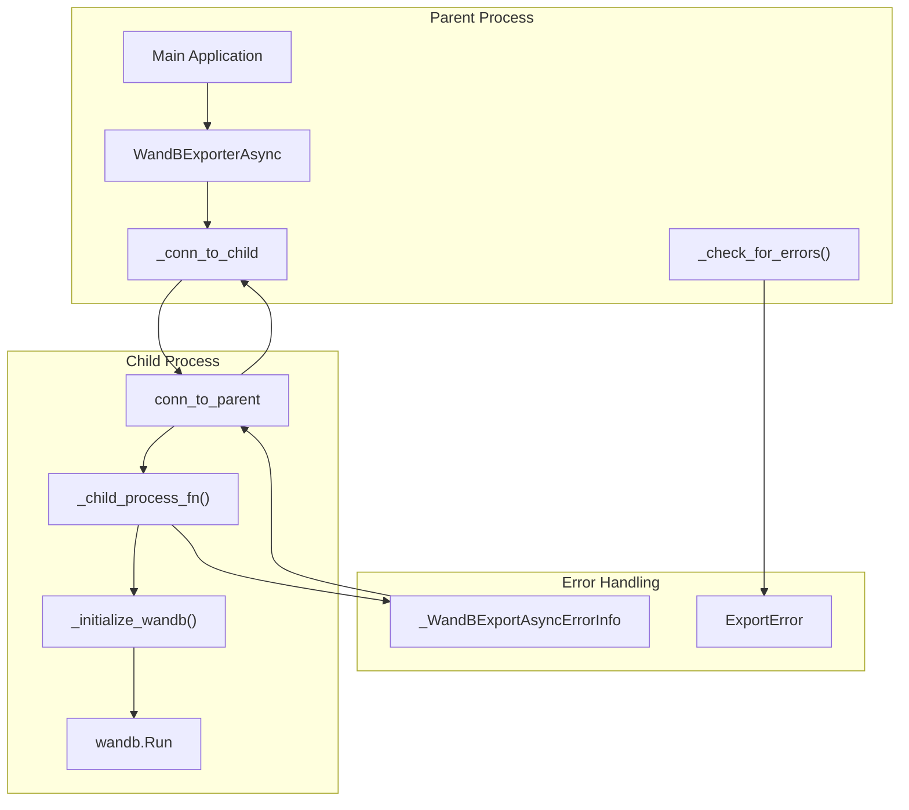

<!-- source: DeepWiki mcp.deepwiki.com · repo NVIDIA/nv-one-logger · page 4.2 Weights & Biases Integration · fetched 2026-10-26 -->

# Weights & Biases Integration

<details>
<summary>Relevant source files</summary>

The following files were used as context for generating this wiki page:

- [nv_one_logger/one_logger_wandb/pyproject.toml](nv_one_logger/one_logger_wandb/pyproject.toml)
- [nv_one_logger/one_logger_wandb/src/nv_one_logger/wandb/exporter/wandb_exporter.py](nv_one_logger/one_logger_wandb/src/nv_one_logger/wandb/exporter/wandb_exporter.py)
- [nv_one_logger/one_logger_wandb/tests/nv_one_logger/wandb/exporter/test_wandb_exporter_sync.py](nv_one_logger/one_logger_wandb/tests/nv_one_logger/wandb/exporter/test_wandb_exporter_sync.py)

</details>


This document covers the `one_logger_wandb` package, which provides integration between nv-one-logger and Weights & Biases (WandB) for experiment tracking and metric logging. The package exports telemetry data from spans and events as metrics to WandB platforms.

For information about other backend integrations, see [OpenTelemetry Integration](#4.1). For core export system concepts, see [Export System](#2.3).

## Architecture Overview

The WandB integration extends the base export system to send telemetry data to Weights & Biases. Since WandB is designed for experiment tracking rather than distributed tracing, the integration maps span attributes and event data to WandB metrics.



Sources: [nv_one_logger/one_logger_wandb/src/nv_one_logger/wandb/exporter/wandb_exporter.py:1-499](), [nv_one_logger/one_logger_wandb/pyproject.toml:1-116]()

## Core Components

### Configuration

The `Config` class defines WandB connection and project settings:

| Parameter | Type | Default | Description |
|-----------|------|---------|-------------|
| `entity` | str | Required | WandB username or team name |
| `host` | str | "https://api.wandb.ai" | WandB server URL |
| `api_key` | str | "" | WandB authentication key |
| `project` | str | "one-logger-tracking" | WandB project name |
| `run_name` | str | Generated UUID | Display name for the WandB run |
| `save_dir` | str | "./wandb" | Local metadata directory |
| `tags` | List[str] | ["e2e_metrics_enabled"] | Run tags for organization |

Sources: [nv_one_logger/one_logger_wandb/src/nv_one_logger/wandb/exporter/wandb_exporter.py:23-51]()

### Exporter Implementations

The package provides two exporter implementations with different execution models:



**WandBExporterSync**: Blocks on each export call until data is sent to WandB. Simple but may impact application performance.

**WandBExporterAsync**: Uses a separate child process with pipe communication to send data asynchronously. Avoids blocking the main application and prevents conflicts with user WandB instances.

Sources: [nv_one_logger/one_logger_wandb/src/nv_one_logger/wandb/exporter/wandb_exporter.py:282-324](), [nv_one_logger/one_logger_wandb/src/nv_one_logger/wandb/exporter/wandb_exporter.py:335-499]()

### Metric Naming Strategies

Since WandB stores metrics rather than spans/events, the integration uses naming strategies to map attributes to metric names:

**HierarchicalMetricNamingStrategy** (default): Creates hierarchical metric names by joining span, event, and attribute names with a separator (default "."):
- Span attribute: `span_name.attribute_name`
- Event attribute: `span_name.event_name.attribute_name`

**FlatMetricNamingStrategy**: Uses only the attribute name as the metric name, ignoring span and event context.

Sources: [nv_one_logger/one_logger_wandb/src/nv_one_logger/wandb/exporter/wandb_exporter.py:103-154]()

## Data Flow and Export Process

The export process transforms span/event data into WandB metrics:



Each export method follows this pattern:
1. Extract attributes from spans/events
2. Apply metric naming strategy to generate metric names
3. Create metrics dictionary with timestamp metadata
4. Send to WandB via `_log_metrics()`

Sources: [nv_one_logger/one_logger_wandb/src/nv_one_logger/wandb/exporter/wandb_exporter.py:198-242](), [nv_one_logger/one_logger_wandb/src/nv_one_logger/wandb/exporter/wandb_exporter.py:320-324]()

## Asynchronous Process Management

The `WandBExporterAsync` implementation uses multiprocessing for non-blocking exports:



The async implementation handles:
- **Process lifecycle**: Creates child process on `initialize()`, terminates on `close()`
- **Error propagation**: Child process sends error information back to parent via pipe
- **Environment isolation**: Modifies WandB environment variables to prevent conflicts

Sources: [nv_one_logger/one_logger_wandb/src/nv_one_logger/wandb/exporter/wandb_exporter.py:362-432](), [nv_one_logger/one_logger_wandb/src/nv_one_logger/wandb/exporter/wandb_exporter.py:374-415]()

## Integration Patterns

### Direct Usage

```python
from nv_one_logger.wandb.exporter.wandb_exporter import WandBExporterSync, Config

config = Config(
    entity="my-team",
    project="my-experiment",
    api_key="your-api-key"
)

exporter = WandBExporterSync(config)
```

### Configuration-Based Setup

The exporter integrates with the core `ExporterConfigManager` system for declarative configuration. Users can configure WandB exporters through YAML files or package entry points.

### Training Telemetry Integration

When used with the training telemetry package, span attributes like training metrics, model parameters, and performance data are automatically exported as WandB metrics with appropriate naming.

Sources: [nv_one_logger/one_logger_wandb/src/nv_one_logger/wandb/exporter/wandb_exporter.py:293-301](), [nv_one_logger/one_logger_wandb/pyproject.toml:15-25]()

## Error Handling and Data Mapping

### Error Event Handling

The `export_error()` method doesn't send error events to WandB since WandB lacks native error reporting capabilities. Error events are silently ignored.

### Telemetry Data Error Reporting

`TelemetryDataError` instances are mapped to WandB metrics using the standard event name `TELEMETRY_DATA_ERROR` with the error type as the metric value.

### Metric Timestamping

All metrics include an `app_last_log_time` field with the current timestamp in milliseconds since epoch for temporal tracking.

Sources: [nv_one_logger/one_logger_wandb/src/nv_one_logger/wandb/exporter/wandb_exporter.py:245-265](), [nv_one_logger/one_logger_wandb/src/nv_one_logger/wandb/exporter/wandb_exporter.py:162-164](), [nv_one_logger/one_logger_wandb/tests/nv_one_logger/wandb/exporter/test_wandb_exporter_sync.py:316-325]()

---

