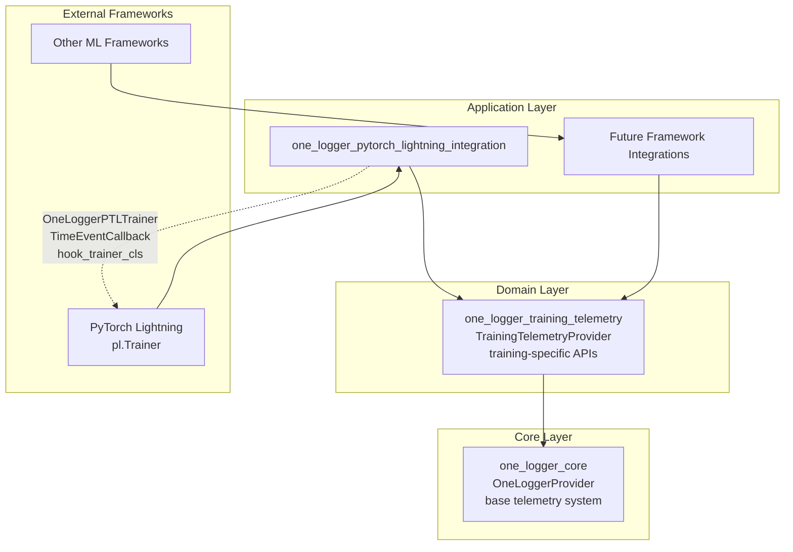
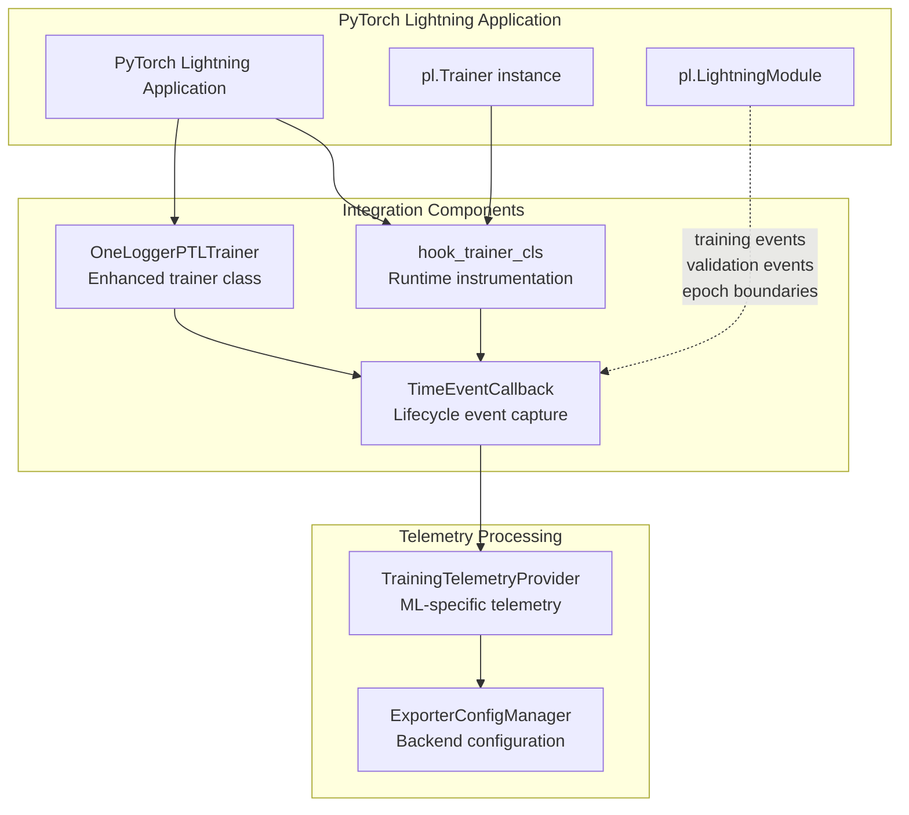
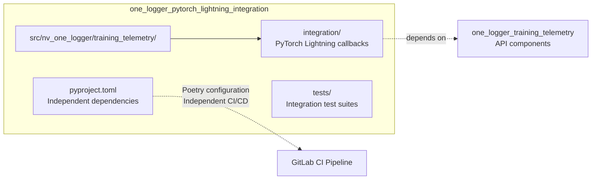
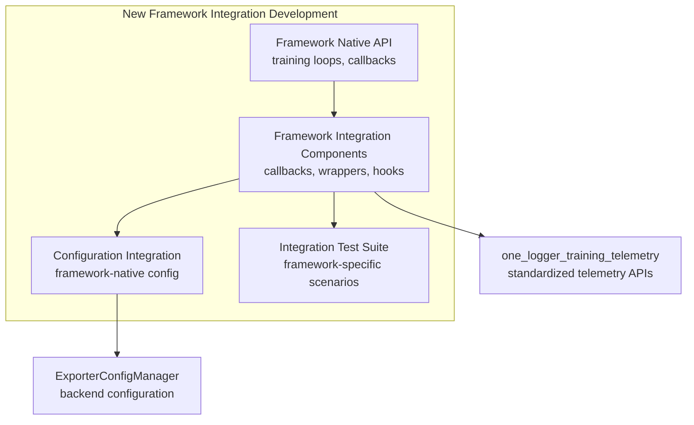

<!-- source: DeepWiki mcp.deepwiki.com · repo NVIDIA/nv-one-logger · page 5 Application Integrations · fetched 2026-10-26 -->

# Application Integrations

Relevant source files

The following files were used as context for generating this wiki page:

- [README.md](README.md)

This document covers the application-layer integrations in the nv-one-logger system. Application integrations provide ready-to-use components that seamlessly integrate telemetry collection into specific ML frameworks and applications. These integrations sit at the highest layer of the nv-one-logger architecture, offering framework-specific APIs and automation to minimize integration effort for end users.

For detailed information about the PyTorch Lightning integration implementation, see [PyTorch Lightning Integration](#5.1).

## Purpose and Architecture

Application integrations serve as bridges between popular ML frameworks and the nv-one-logger telemetry system. Rather than requiring users to manually instrument their code with telemetry calls, these integrations provide framework-specific components that automatically capture relevant events and metrics during model training and inference.

### Integration Layer Architecture

Sources: [README.md:93-99]()

### Integration Patterns

Application integrations in nv-one-logger follow consistent patterns to provide seamless framework integration:

| Integration Pattern | Description | Example Components |
|-------------------|-------------|-------------------|
| **Callback Integration** | Framework-specific callbacks that hook into training lifecycle events | `TimeEventCallback` for PyTorch Lightning |
| **Wrapper Classes** | Enhanced versions of framework classes with built-in telemetry | `OneLoggerPTLTrainer` extending `pl.Trainer` |
| **Hook Functions** | Utility functions that automatically instrument existing framework instances | `hook_trainer_cls` for runtime trainer enhancement |

## Current Integrations

### PyTorch Lightning Integration

The `one_logger_pytorch_lightning_integration` package provides comprehensive integration with PyTorch Lightning, offering multiple approaches for telemetry collection:

Sources: [README.md:36-40](), [README.md:95-99]()

## Integration Implementation Structure

### Package Organization

The application integrations follow the established monorepo structure with independent packaging and CI/CD:

Sources: [README.md:36-40](), [README.md:52-60]()

### Dependency Management

Application integrations maintain clean dependency boundaries:

- **Direct Dependencies**: Framework-specific packages (e.g., `pytorch-lightning`)
- **Internal Dependencies**: `one_logger_training_telemetry` for domain-specific APIs
- **Transitive Dependencies**: `one_logger_core` through the training telemetry layer

This layered approach ensures that application integrations remain focused on their specific framework while leveraging the full telemetry capabilities of the underlying system.

## Extension Points for Future Integrations

The application integration layer is designed for extensibility. Future integrations can follow the established patterns:

### Framework Integration Checklist

| Component Type | Purpose | Implementation Approach |
|---------------|---------|----------------------|
| **Lifecycle Callbacks** | Capture framework-specific events | Implement framework callback interfaces |
| **Wrapper Classes** | Provide enhanced framework classes | Extend or compose framework base classes |
| **Configuration Integration** | Integrate with framework config systems | Support framework-native configuration patterns |
| **Testing Infrastructure** | Ensure reliable integration behavior | Framework-specific test fixtures and scenarios |

### Integration Development Pattern

This architecture ensures that each framework integration maintains its specific idioms while providing consistent telemetry capabilities across all supported frameworks.

Sources: [README.md:52-78]()

---

