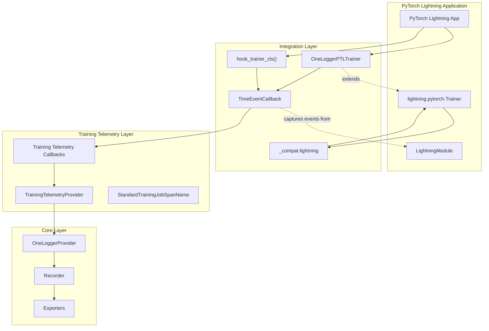
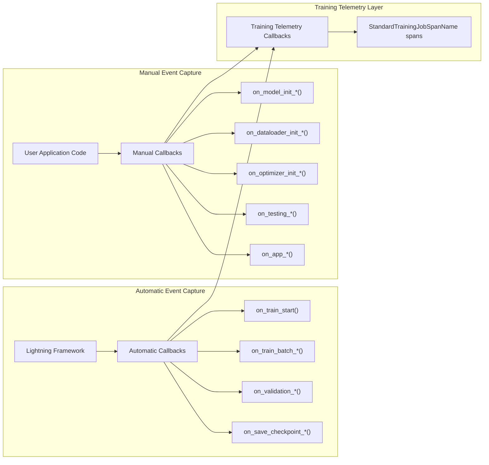
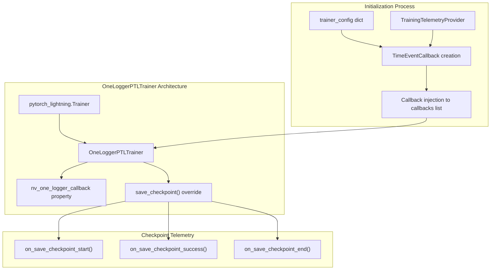
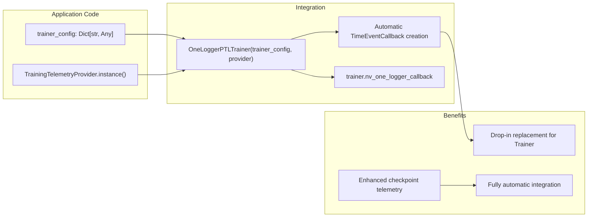
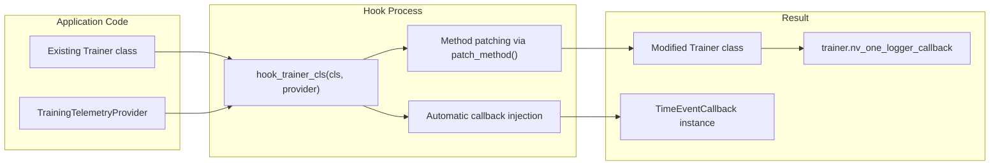
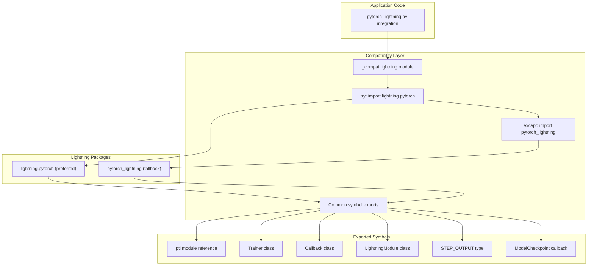

<!-- source: DeepWiki mcp.deepwiki.com · repo NVIDIA/nv-one-logger · page 5.1 PyTorch Lightning Integration · fetched 2026-10-26 -->

# PyTorch Lightning Integration

Relevant source files

The following files were used as context for generating this wiki page:

- [nv_one_logger/one_logger_pytorch_lightning_integration/pyproject.toml](nv_one_logger/one_logger_pytorch_lightning_integration/pyproject.toml)
- [nv_one_logger/one_logger_pytorch_lightning_integration/src/nv_one_logger/training_telemetry/integration/_compat/lightning.py](nv_one_logger/one_logger_pytorch_lightning_integration/src/nv_one_logger/training_telemetry/integration/_compat/lightning.py)
- [nv_one_logger/one_logger_pytorch_lightning_integration/src/nv_one_logger/training_telemetry/integration/pytorch_lightning.py](nv_one_logger/one_logger_pytorch_lightning_integration/src/nv_one_logger/training_telemetry/integration/pytorch_lightning.py)
- [nv_one_logger/one_logger_pytorch_lightning_integration/tests/nv_one_logger/training_telemetry/integration/test_pytorch_lightning.py](nv_one_logger/one_logger_pytorch_lightning_integration/tests/nv_one_logger/training_telemetry/integration/test_pytorch_lightning.py)

This document covers the PyTorch Lightning integration package (`one_logger_pytorch_lightning_integration`) that provides ready-to-use components for integrating nv-one-logger telemetry with PyTorch Lightning training workflows. The integration automatically captures training lifecycle events and forwards them to the training telemetry system.

For information about the underlying training telemetry APIs, see [Training Telemetry APIs](#3.1). For details about backend integrations that export the captured telemetry data, see [Backend Integrations](#4).

## Architecture Overview

The PyTorch Lightning integration sits at the application layer of the nv-one-logger system, providing framework-specific hooks that automatically capture training events without requiring manual instrumentation.

**Sources:** [nv_one_logger/one_logger_pytorch_lightning_integration/src/nv_one_logger/training_telemetry/integration/pytorch_lightning.py:1-305](), [nv_one_logger/one_logger_pytorch_lightning_integration/src/nv_one_logger/training_telemetry/integration/_compat/lightning.py:1-22]()

## Core Components

### TimeEventCallback

The `TimeEventCallback` class is the primary component that implements PyTorch Lightning's `Callback` interface to capture training lifecycle events.

| Component | Purpose | Key Methods |
|-----------|---------|-------------|
| `TimeEventCallback` | Captures training events via Lightning callbacks | `on_train_start()`, `on_train_batch_start()`, `on_validation_start()` |
| Automatic callbacks | Called by Lightning framework | `on_train_start()`, `on_train_end()`, validation callbacks |
| Manual callbacks | Must be called explicitly by application | `on_model_init_start()`, `on_dataloader_init_start()`, `on_testing_start()` |

**Sources:** [nv_one_logger/one_logger_pytorch_lightning_integration/src/nv_one_logger/training_telemetry/integration/pytorch_lightning.py:47-187]()

### OneLoggerPTLTrainer

The `OneLoggerPTLTrainer` class extends PyTorch Lightning's `Trainer` to provide automatic telemetry integration with enhanced checkpoint monitoring capabilities.

**Sources:** [nv_one_logger/one_logger_pytorch_lightning_integration/src/nv_one_logger/training_telemetry/integration/pytorch_lightning.py:251-305]()

## Integration Patterns

The integration provides two main patterns for incorporating telemetry into PyTorch Lightning applications:

### Pattern 1: OneLoggerPTLTrainer (Recommended)

### Pattern 2: hook_trainer_cls Function

**Sources:** [nv_one_logger/one_logger_pytorch_lightning_integration/src/nv_one_logger/training_telemetry/integration/pytorch_lightning.py:189-249]()

## Compatibility Layer

The integration includes a compatibility layer that bridges the transition from the legacy `pytorch_lightning` package to the modern `lightning.pytorch` package structure.

**Sources:** [nv_one_logger/one_logger_pytorch_lightning_integration/src/nv_one_logger/training_telemetry/integration/_compat/lightning.py:8-21]()

## Callback Event Flow

The integration captures training events through a comprehensive set of callback hooks that map to different phases of the training lifecycle.

```mermaid
graph TD
    subgraph "Training Lifecycle Events"
        AppStart["on_app_start()"]
        TrainStart["on_train_start()"]
        TrainBatchStart["on_train_batch_start()"]
        TrainBatchEnd["on_train_batch_end()"]
        ValStart["on_validation_start()"]
        ValBatchStart["on_validation_batch_start()"]
        ValBatchEnd["on_validation_batch_end()"]
        ValEnd["on_validation_end()"]
        CheckpointStart["on_save_checkpoint_start()"]
        CheckpointSuccess["on_save_checkpoint_success()"]
        CheckpointEnd["on_save_checkpoint_end()"]
        TrainEnd["on_train_end()"]
        AppEnd["on_app_end()"]
    end
    
    subgraph "Training Telemetry Callbacks"
        TTCallbacks["training_telemetry.api.callbacks"]
        SpanManagement["Span lifecycle management"]
        EventRecording["Event and attribute recording"]
    end
    
    AppStart --> TTCallbacks
    TrainStart --> TTCallbacks
    TrainBatchStart --> TTCallbacks
    TrainBatchEnd --> TTCallbacks
    ValStart --> TTCallbacks
    ValBatchStart --> TTCallbacks
    ValBatchEnd --> TTCallbacks
    ValEnd --> TTCallbacks
    CheckpointStart --> TTCallbacks
    CheckpointSuccess --> TTCallbacks
    CheckpointEnd --> TTCallbacks
    TrainEnd --> TTCallbacks
    AppEnd --> TTCallbacks
    
    TTCallbacks --> SpanManagement
    TTCallbacks --> EventRecording
```

**Sources:** [nv_one_logger/one_logger_pytorch_lightning_integration/src/nv_one_logger/training_telemetry/integration/pytorch_lightning.py:9-33](), [nv_one_logger/one_logger_pytorch_lightning_integration/src/nv_one_logger/training_telemetry/integration/pytorch_lightning.py:70-187]()

## Configuration and Dependencies

The PyTorch Lightning integration package has specific dependencies and configuration requirements:

| Dependency | Version Requirement | Purpose |
|------------|-------------------|---------|
| `lightning` | `>=2.2.0` | Core PyTorch Lightning framework |
| `nv-one-logger-core` | `^2.1.0` | Base logging functionality |
| `nv-one-logger-training-telemetry` | `^2.1.0` | Training-specific telemetry APIs |
| `StrEnum` | `^0.4.0` | Enum support for Python < 3.11 |
| `python` | `>=3.9,<3.14` | Python runtime compatibility |

The integration requires a `TrainingTelemetryProvider` to be configured with appropriate `TrainingTelemetryConfig` before training begins. The callback system validates this configuration during `on_train_start()` and raises `OneLoggerError` if the configuration is missing.

**Sources:** [nv_one_logger/one_logger_pytorch_lightning_integration/pyproject.toml:15-27](), [nv_one_logger/one_logger_pytorch_lightning_integration/src/nv_one_logger/training_telemetry/integration/pytorch_lightning.py:72-79]()

---

