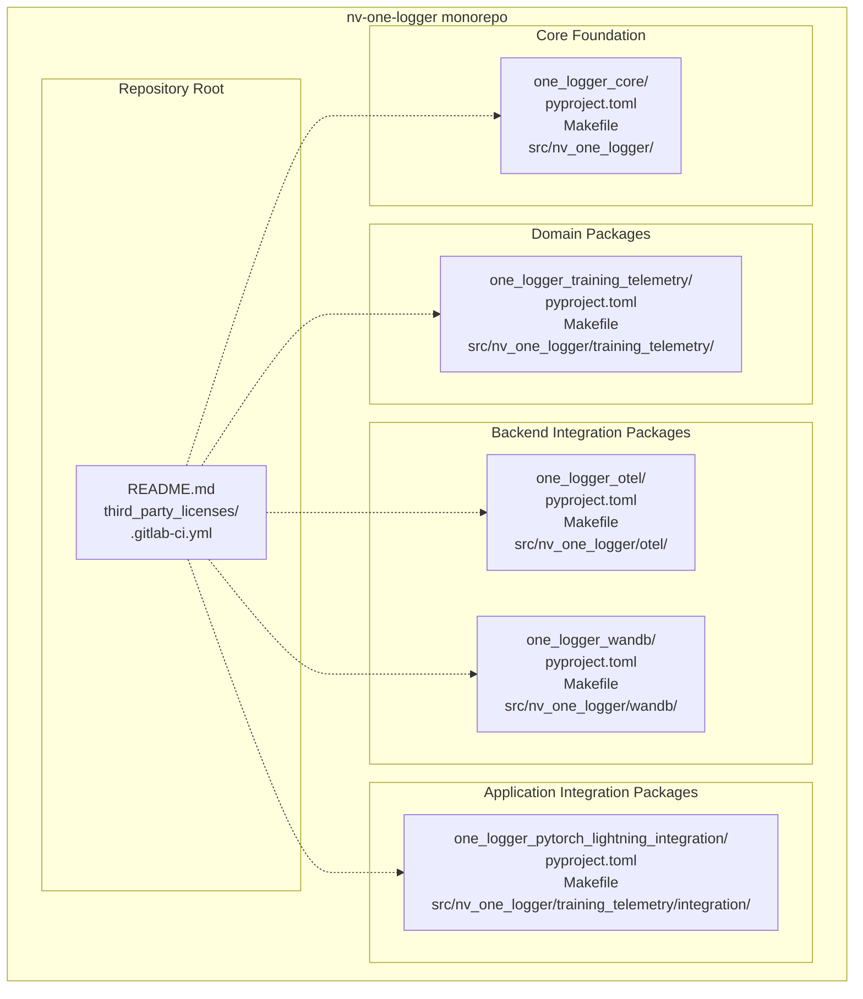
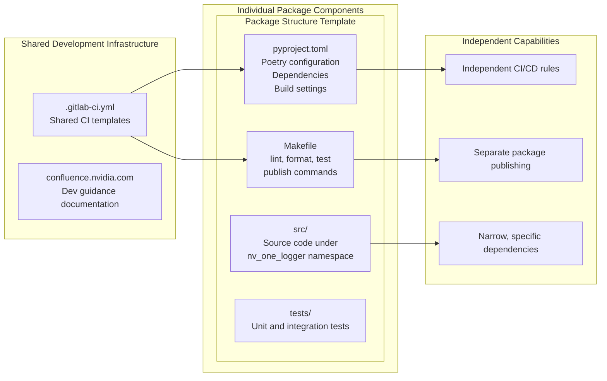
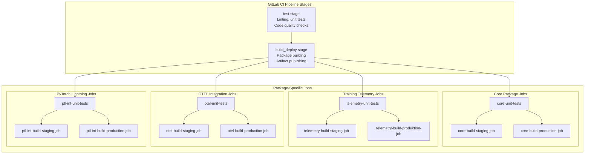
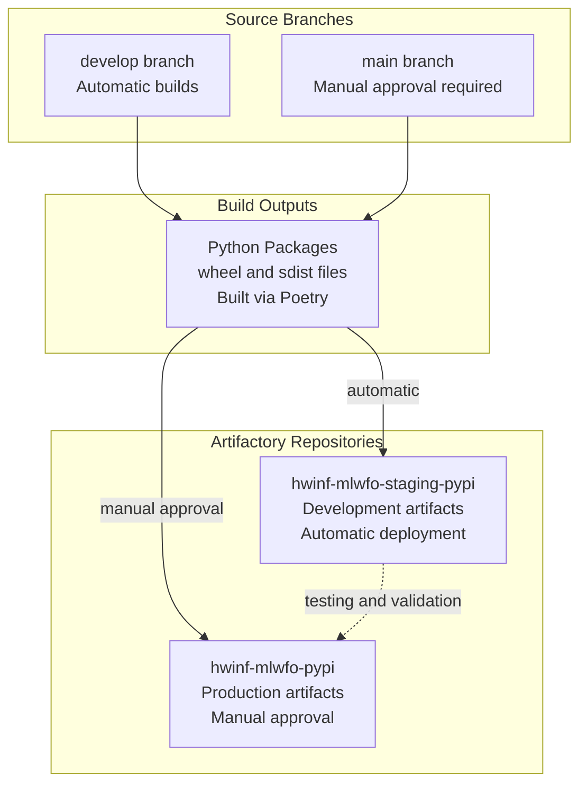
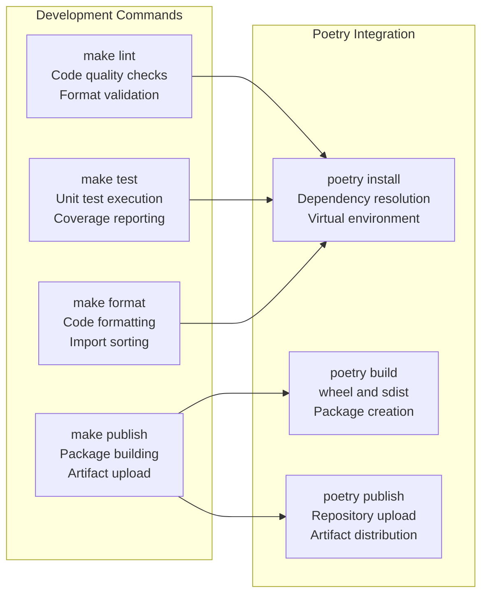
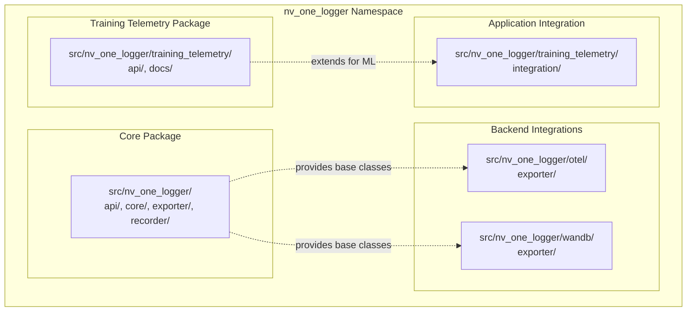
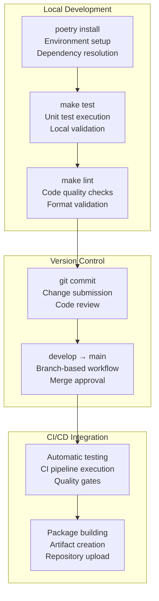

<!-- source: DeepWiki mcp.deepwiki.com · repo NVIDIA/nv-one-logger · page 6 Development and Deployment · fetched 2026-10-26 -->

# Development and Deployment

Relevant source files

The following files were used as context for generating this wiki page:

- [README.md](README.md)

This page documents the development practices, CI/CD pipelines, and deployment procedures for the nv-one-logger monorepo. It covers the monorepo structure, build processes, dependency management, and deployment workflows used to maintain and distribute the five independent packages within the repository.

For information about the overall system architecture and package relationships, see [Overview](#1). For details about CI/CD pipeline configuration, see [CI/CD Pipeline](#6.1). For dependency management specifics, see [Dependencies and Configuration](#6.2).

## Monorepo Development Structure

The nv-one-logger repository is organized as a monorepo containing five independent packages, each with its own development lifecycle while sharing common development practices and tooling.

### Repository Organization

Each package follows a consistent structure with standardized tooling and configuration files that enable independent development and deployment.

**Sources**: [README.md:1-106]()

### Package Independence and Shared Practices

This structure allows narrow dependencies while making development and code review easier by keeping everything in one repository.

**Sources**: [README.md:5-8](), [README.md:52-60]()

## CI/CD Pipeline Architecture

The monorepo uses GitLab CI/CD with a multi-stage pipeline that builds and deploys each package independently while sharing common infrastructure and templates.

### Pipeline Stage Structure

Each package maintains independent test and build jobs while sharing the overall pipeline structure and deployment targets.

**Sources**: GitLab CI configuration (referenced in high-level diagrams)

### Deployment Flow and Artifact Management

The deployment process uses different repositories for staging and production environments, with automatic deployment to staging and manual approval for production releases.

**Sources**: GitLab CI configuration (referenced in high-level diagrams)

## Build and Development Process

Each package uses standardized build tooling and development workflows based on Poetry and Make automation.

### Package Build Configuration

| Component | Purpose | Configuration File |
|-----------|---------|-------------------|
| Poetry | Dependency management, packaging | `pyproject.toml` |
| Make | Development automation | `Makefile` |
| Testing | Unit and integration tests | `tests/` directory |
| Linting | Code quality, formatting | Poetry dev dependencies |

### Development Automation

All packages share this consistent development workflow through standardized `Makefile` automation and `pyproject.toml` configuration.

**Sources**: [README.md:59]()

### Namespace and Source Organization

All packages share the `nv_one_logger` namespace while maintaining separate source directories and independent functionality.

**Sources**: [README.md:14-46](), [README.md:55]()

## Development Workflow

The monorepo supports both individual package development and cross-package integration through its shared structure and independent deployment capabilities.

### Package Development Lifecycle

This workflow ensures code quality and package integrity while maintaining independent development cycles for each component.

**Sources**: [README.md:103-105]()

---

