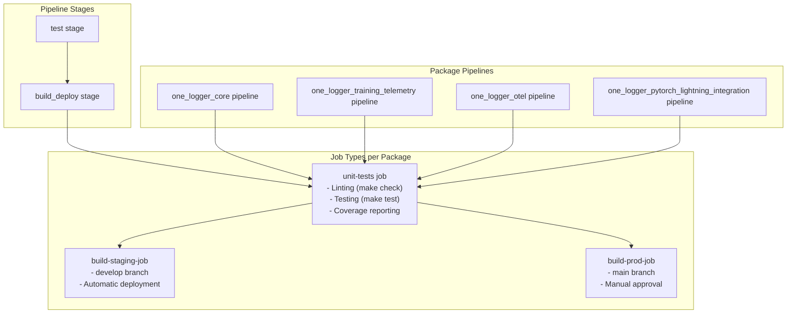
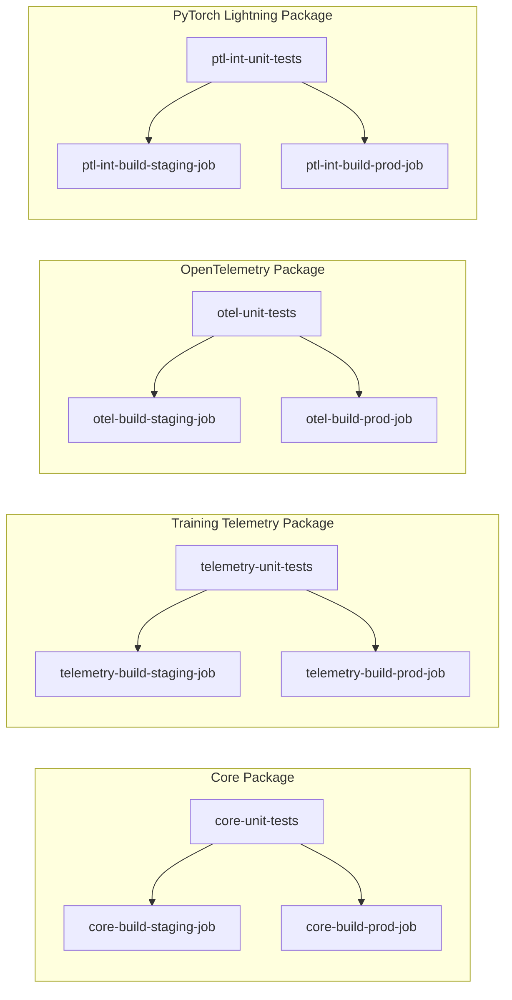
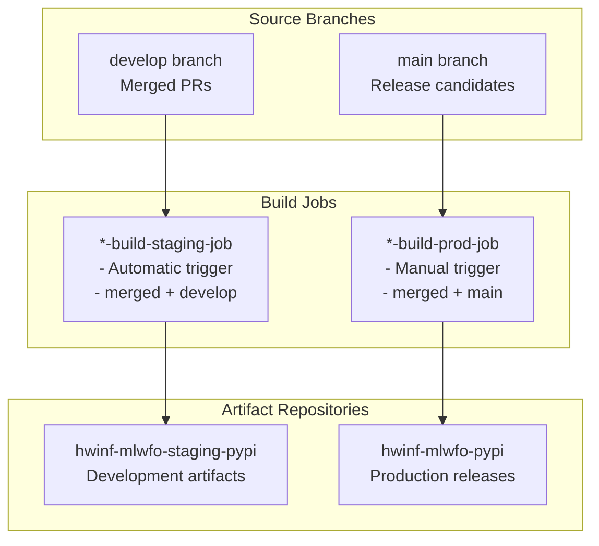
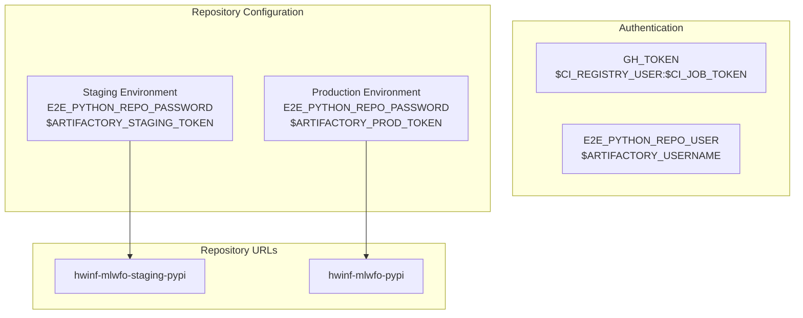
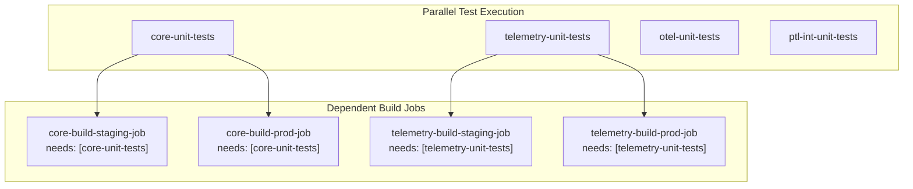

<!-- source: DeepWiki mcp.deepwiki.com · repo NVIDIA/nv-one-logger · page 6.1 CI/CD Pipeline · fetched 2026-10-26 -->

# CI/CD Pipeline

<details>
<summary>Relevant source files</summary>

The following files were used as context for generating this wiki page:

- [nv_one_logger/one_logger_core/.gitlab-ci.yml](nv_one_logger/one_logger_core/.gitlab-ci.yml)
- [nv_one_logger/one_logger_otel/.gitlab-ci.yml](nv_one_logger/one_logger_otel/.gitlab-ci.yml)
- [nv_one_logger/one_logger_pytorch_lightning_integration/.gitlab-ci.yml](nv_one_logger/one_logger_pytorch_lightning_integration/.gitlab-ci.yml)
- [nv_one_logger/one_logger_training_telemetry/.gitlab-ci.yml](nv_one_logger/one_logger_training_telemetry/.gitlab-ci.yml)

</details>


This document describes the GitLab CI/CD pipeline architecture for the nv-one-logger monorepo. The pipeline provides independent build and deployment workflows for each package component while maintaining consistent patterns and quality gates across all components.

For information about project dependencies and Poetry configuration, see [Dependencies and Configuration](#6.2).

## Pipeline Architecture

The nv-one-logger monorepo implements a decentralized CI/CD approach where each package maintains its own `.gitlab-ci.yml` configuration file while following consistent patterns. This design enables independent release cycles for each component while ensuring quality and consistency across the entire system.

### Pipeline Structure



Sources: [nv_one_logger/one_logger_core/.gitlab-ci.yml:6-8](), [nv_one_logger/one_logger_otel/.gitlab-ci.yml:6-8](), [nv_one_logger/one_logger_pytorch_lightning_integration/.gitlab-ci.yml:6-8](), [nv_one_logger/one_logger_training_telemetry/.gitlab-ci.yml:6-8]()

### Individual Package Jobs

Each package defines three primary jobs that follow a consistent naming convention and dependency structure:



Sources: [nv_one_logger/one_logger_core/.gitlab-ci.yml:10-88](), [nv_one_logger/one_logger_training_telemetry/.gitlab-ci.yml:10-88](), [nv_one_logger/one_logger_otel/.gitlab-ci.yml:10-88](), [nv_one_logger/one_logger_pytorch_lightning_integration/.gitlab-ci.yml:10-88]()

## Branch Strategy and Deployment Targets

The pipeline implements a two-tier deployment strategy that maps Git branches to different artifact repositories:

| Branch | Deployment Target | Trigger | Artifactory Repository |
|--------|------------------|---------|----------------------|
| `develop` | Staging | Automatic | `hwinf-mlwfo-staging-pypi` |
| `main` | Production | Manual | `hwinf-mlwfo-pypi` |

### Branch-to-Repository Mapping



Sources: [nv_one_logger/one_logger_core/.gitlab-ci.yml:44-47](), [nv_one_logger/one_logger_core/.gitlab-ci.yml:13-16](), [nv_one_logger/one_logger_core/.gitlab-ci.yml:31](), [nv_one_logger/one_logger_core/.gitlab-ci.yml:62]()

## Test Stage Process

Each package runs identical test procedures with minor variations in Python version and tooling:

### Test Job Configuration

| Package | Job Name | Python Version | Additional Tools |
|---------|----------|----------------|------------------|
| `one_logger_core` | `core-unit-tests` | 3.8 | None |
| `one_logger_training_telemetry` | `telemetry-unit-tests` | 3.8 | `poetry-plugin-export` |
| `one_logger_otel` | `otel-unit-tests` | 3.8 | `poetry-plugin-export` |
| `one_logger_pytorch_lightning_integration` | `ptl-int-unit-tests` | 3.9 | `poetry-plugin-export` |

### Test Execution Steps

The test jobs execute the following standardized steps:

1. **Environment Setup**: Install Poetry 1.8.5 and wheel package
2. **Linting and Formatting**: Execute `make check` for code quality validation
3. **Test Execution**: Run `make test` for comprehensive test suite
4. **Coverage Reporting**: Generate coverage reports using regex pattern `/TOTAL.*\s+(\d+%)$/`

Sources: [nv_one_logger/one_logger_core/.gitlab-ci.yml:73-88](), [nv_one_logger/one_logger_training_telemetry/.gitlab-ci.yml:73-88](), [nv_one_logger/one_logger_otel/.gitlab-ci.yml:73-88](), [nv_one_logger/one_logger_pytorch_lightning_integration/.gitlab-ci.yml:73-88]()

## Build and Deploy Stage Process

The build and deploy stage performs package versioning, building, and publication to Artifactory repositories. Each build job follows identical patterns with environment-specific configuration.

### Build Job Environment Variables



Sources: [nv_one_logger/one_logger_core/.gitlab-ci.yml:29-33](), [nv_one_logger/one_logger_core/.gitlab-ci.yml:60-64]()

### Build Process Steps

Each build job executes the following sequence:

1. **Environment Preparation**: Install Poetry 1.8.5, wheel, and jq utilities
2. **Repository Configuration**: Add PyPI source and navigate to package directory  
3. **Authentication Setup**: Configure Git token and Artifactory credentials
4. **Version Management**: Execute `make ci_tag` for automated version tagging
5. **Package Publication**: Run `make publish` to build and upload to Artifactory

### Make Target Integration

The pipeline integrates with standardized Makefile targets:

| Make Target | Purpose |
|-------------|---------|
| `make check` | Code linting and formatting validation |
| `make test` | Unit test execution and coverage reporting |
| `make ci_tag` | Automated version tagging for releases |
| `make publish` | Package building and Artifactory publication |

Sources: [nv_one_logger/one_logger_core/.gitlab-ci.yml:84-86](), [nv_one_logger/one_logger_core/.gitlab-ci.yml:36-38]()

## Runner and Resource Configuration

All jobs use consistent resource allocation and runner configuration:

### Resource Limits

```yaml
variables:
  E2E_CI: 1
  KUBERNETES_MEMORY_LIMIT: 2048Mi
  KUBERNETES_CPU_LIMIT: 1000m
```

### Runner Tags

All jobs execute on runners tagged with `hwinf-mlwfo` to ensure consistent execution environment.

Sources: [nv_one_logger/one_logger_core/.gitlab-ci.yml:1-4](), [nv_one_logger/one_logger_core/.gitlab-ci.yml:40](), [nv_one_logger/one_logger_core/.gitlab-ci.yml:71](), [nv_one_logger/one_logger_core/.gitlab-ci.yml:88]()

## Pipeline Dependencies and Parallelization

The pipeline uses DAG (Directed Acyclic Graph) dependencies to enable stage parallelism while maintaining quality gates:



This design allows all unit test jobs to run in parallel while ensuring build jobs only execute after their corresponding tests pass successfully.

Sources: [nv_one_logger/one_logger_core/.gitlab-ci.yml:12](), [nv_one_logger/one_logger_core/.gitlab-ci.yml:44](), [nv_one_logger/one_logger_training_telemetry/.gitlab-ci.yml:12](), [nv_one_logger/one_logger_training_telemetry/.gitlab-ci.yml:44]()

---

