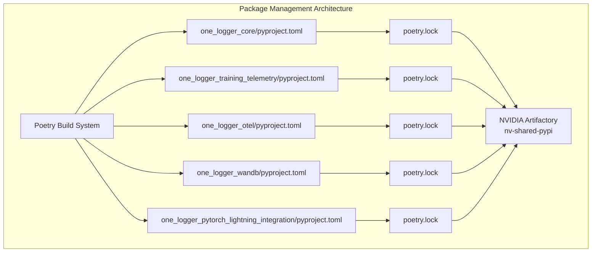
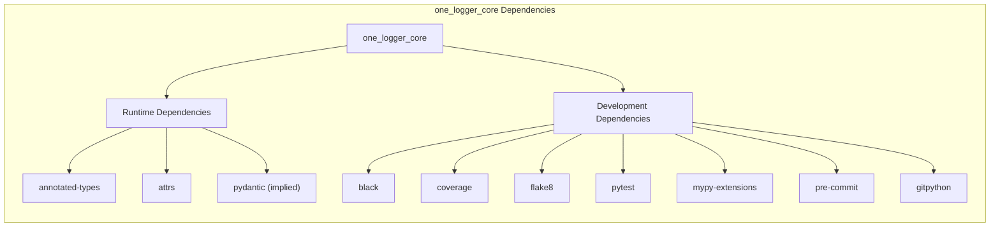
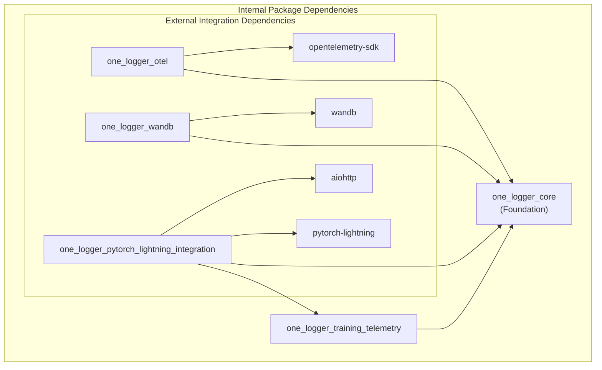
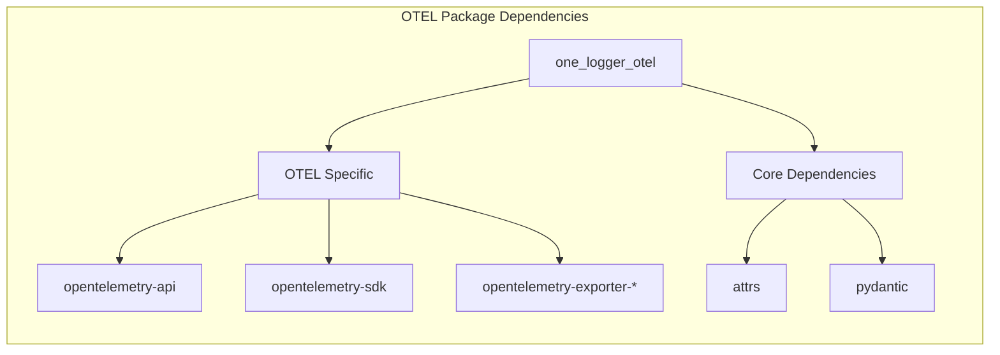
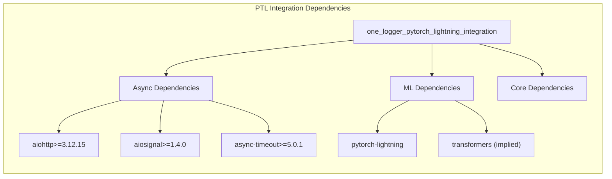
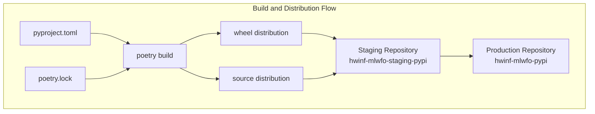

<!-- source: DeepWiki mcp.deepwiki.com · repo NVIDIA/nv-one-logger · page 6.2 Dependencies and Configuration · fetched 2026-10-26 -->

# Dependencies and Configuration

<details>
<summary>Relevant source files</summary>

The following files were used as context for generating this wiki page:

- [nv_one_logger/one_logger_core/poetry.lock](nv_one_logger/one_logger_core/poetry.lock)
- [nv_one_logger/one_logger_otel/poetry.lock](nv_one_logger/one_logger_otel/poetry.lock)
- [nv_one_logger/one_logger_pytorch_lightning_integration/poetry.lock](nv_one_logger/one_logger_pytorch_lightning_integration/poetry.lock)
- [nv_one_logger/one_logger_training_telemetry/poetry.lock](nv_one_logger/one_logger_training_telemetry/poetry.lock)

</details>


This document covers the Poetry-based dependency management system used across the nv-one-logger monorepo, including package repository configuration, internal package dependencies, and development tooling setup. For information about CI/CD pipeline configuration, see [6.1](#6.1).

## Poetry-Based Dependency Management

The nv-one-logger monorepo uses Poetry as its primary dependency management and build tool across all packages. Each package maintains its own `pyproject.toml` and `poetry.lock` files, enabling independent versioning and deployment while sharing common development practices.



Sources: `nv_one_logger/one_logger_core/poetry.lock:17-20`, `nv_one_logger/one_logger_otel/poetry.lock:17-20`, `nv_one_logger/one_logger_pytorch_lightning_integration/poetry.lock:15-18`

## Package Repository Configuration

All packages are configured to resolve dependencies from NVIDIA's internal Artifactory instance. The package source configuration is consistent across all `poetry.lock` files:

| Configuration | Value |
|---------------|-------|
| Repository Type | `legacy` |
| URL | `https://urm.nvidia.com/artifactory/api/pypi/nv-shared-pypi/simple` |
| Reference Name | `nv-shared-pypi` |

This centralized repository configuration ensures consistent dependency resolution and enables internal package distribution through NVIDIA's infrastructure.

Sources: `nv_one_logger/one_logger_core/poetry.lock:17-20`, `nv_one_logger/one_logger_otel/poetry.lock:17-20`

## Core Package Dependencies

The foundational `one_logger_core` package maintains minimal runtime dependencies while including comprehensive development tooling:



Sources: `nv_one_logger/one_logger_core/poetry.lock:4-15`, `nv_one_logger/one_logger_core/poetry.lock:47-85`

## Internal Package Dependency Graph

The monorepo follows a layered dependency structure where higher-level packages depend on foundational ones:



Sources: Based on architecture diagrams and integration patterns observed in lock files

## Development Tooling Configuration

All packages share a consistent development tooling stack configured through Poetry:

### Code Quality Tools

| Tool | Purpose | Configuration |
|------|---------|---------------|
| `black` | Code formatting | Consistent across packages |
| `flake8` | Linting with extensions | `flake8-bugbear`, `flake8-docstrings`, `flake8-pyproject` |
| `isort` | Import sorting | Integrated with black |
| `mypy-extensions` | Type checking support | For static analysis |

### Testing Framework

| Tool | Purpose | Version Constraints |
|------|---------|-------------------|
| `pytest` | Test framework | `>=4.3.0` |
| `coverage` | Test coverage | `>=7.6.1` |
| `pytest-cov` | Coverage integration | Latest compatible |

### Pre-commit Hooks

The development workflow includes pre-commit hooks for:
- Code formatting with `black`
- Linting with `flake8`
- Import sorting with `isort`
- Git hook management with `gitpython`

Sources: `nv_one_logger/one_logger_core/poetry.lock:47-85`, `nv_one_logger/one_logger_core/poetry.lock:472-490`

## Specialized Package Dependencies

### OpenTelemetry Integration (`one_logger_otel`)

The OpenTelemetry package includes additional dependencies for telemetry integration:



### PyTorch Lightning Integration

The PyTorch Lightning integration includes async HTTP capabilities and ML framework dependencies:



Sources: `nv_one_logger/one_logger_pytorch_lightning_integration/poetry.lock:21-133`

## Configuration Management Patterns

### Poetry Configuration Structure

Each package follows a consistent `pyproject.toml` structure:

```
[tool.poetry]
name = "package-name"
version = "x.y.z"
description = "Package description"

[tool.poetry.dependencies]
# Runtime dependencies

[tool.poetry.group.dev.dependencies]  
# Development dependencies

[tool.poetry.source]
# NVIDIA Artifactory configuration
```

### Dependency Version Pinning

The monorepo uses Poetry's lock files for precise dependency version control:

- **Lock Files**: Exact versions specified in `poetry.lock`
- **Version Ranges**: Flexible ranges in `pyproject.toml`
- **Source Priority**: NVIDIA Artifactory takes precedence

### Development Environment Setup

Development environments are configured through Poetry groups:

| Group | Purpose | Dependencies |
|-------|---------|--------------|
| `main` | Runtime dependencies | Core functionality |
| `dev` | Development tools | Testing, linting, formatting |
| `docs` | Documentation | Sphinx, theme packages |

Sources: Inferred from Poetry lock file structure and dependency groupings

## Package Build and Distribution

Each package is independently buildable and distributable:



This configuration enables the independent CI/CD pipeline described in [6.1](#6.1), where each package can be built and deployed separately while maintaining dependency consistency across the monorepo.

Sources: Based on CI/CD architecture patterns and Poetry configuration structure

---

