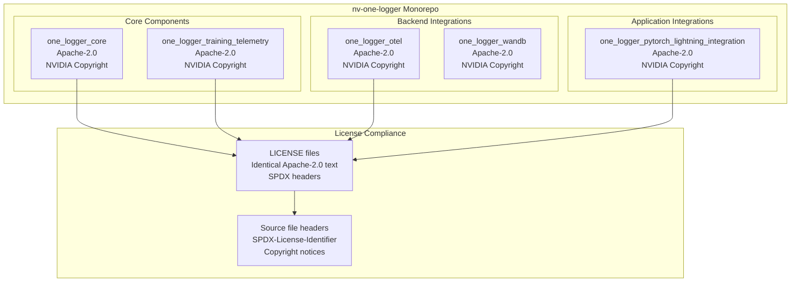
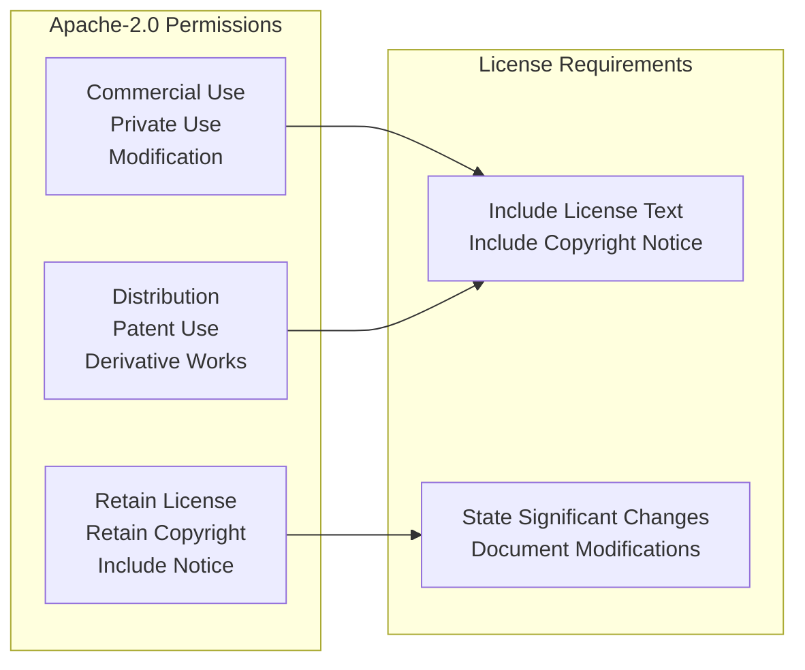

<!-- source: DeepWiki mcp.deepwiki.com · repo NVIDIA/nv-one-logger · page 7 Licensing · fetched 2026-10-26 -->

# Licensing

<details>
<summary>Relevant source files</summary>

The following files were used as context for generating this wiki page:

- [nv_one_logger/one_logger_core/LICENSE](nv_one_logger/one_logger_core/LICENSE)
- [nv_one_logger/one_logger_otel/LICENSE](nv_one_logger/one_logger_otel/LICENSE)
- [nv_one_logger/one_logger_pytorch_lightning_integration/LICENSE](nv_one_logger/one_logger_pytorch_lightning_integration/LICENSE)
- [nv_one_logger/one_logger_training_telemetry/LICENSE](nv_one_logger/one_logger_training_telemetry/LICENSE)

</details>


This document covers the licensing terms and compliance requirements for all components of the nv-one-logger system. It explains how the Apache-2.0 license applies across the monorepo structure and what rights and obligations this provides to users and contributors.

For information about development practices and contribution guidelines, see page 6.

## License Overview

The entire nv-one-logger system is licensed under the Apache License, Version 2.0. All components within the monorepo share identical licensing terms, ensuring consistent legal obligations and rights across all packages.

### Monorepo Licensing Structure



**Sources:** [nv_one_logger/one_logger_core/LICENSE:1-15](), [nv_one_logger/one_logger_otel/LICENSE:1-15](), [nv_one_logger/one_logger_pytorch_lightning_integration/LICENSE:1-15](), [nv_one_logger/one_logger_training_telemetry/LICENSE:1-15]()

## Component Licensing Details

Each package within the nv-one-logger monorepo contains an identical `LICENSE` file with standardized SPDX headers and Apache-2.0 license text.

| Component | License File | Copyright Holder | License Type |
|-----------|--------------|------------------|--------------|
| `one_logger_core` | [nv_one_logger/one_logger_core/LICENSE]() | NVIDIA CORPORATION & AFFILIATES | Apache-2.0 |
| `one_logger_training_telemetry` | [nv_one_logger/one_logger_training_telemetry/LICENSE]() | NVIDIA CORPORATION & AFFILIATES | Apache-2.0 |
| `one_logger_otel` | [nv_one_logger/one_logger_otel/LICENSE]() | NVIDIA CORPORATION & AFFILIATES | Apache-2.0 |
| `one_logger_pytorch_lightning_integration` | [nv_one_logger/one_logger_pytorch_lightning_integration/LICENSE]() | NVIDIA CORPORATION & AFFILIATES | Apache-2.0 |

### SPDX Header Structure

All LICENSE files begin with standardized SPDX headers that provide machine-readable license identification:

```
SPDX-FileCopyrightText: Copyright (c) 2025 NVIDIA CORPORATION & AFFILIATES. All rights reserved.
SPDX-License-Identifier: Apache-2.0
```

**Sources:** [nv_one_logger/one_logger_core/LICENSE:1-2](), [nv_one_logger/one_logger_otel/LICENSE:1-2](), [nv_one_logger/one_logger_pytorch_lightning_integration/LICENSE:1-2](), [nv_one_logger/one_logger_training_telemetry/LICENSE:1-2]()

## Apache-2.0 License Terms

The Apache License, Version 2.0 provides the following key provisions for users and developers:

### Permitted Use



**Sources:** [nv_one_logger/one_logger_core/LICENSE:4-14]()

### Rights Granted

The Apache-2.0 license grants users the following rights:

- **Use**: Run the software for any purpose, including commercial use
- **Study**: Examine how the software works and adapt it to your needs
- **Modify**: Make changes to the source code
- **Distribute**: Share copies of the original or modified software
- **Patent Grant**: Implicit patent license for any patents covering the software

### Obligations

Users must comply with the following requirements:

- **License Inclusion**: Include a copy of the Apache-2.0 license with any distribution
- **Copyright Preservation**: Retain all copyright, patent, trademark, and attribution notices
- **Change Documentation**: Clearly state any modifications made to the original software
- **Derivative Work Licensing**: License any derivative works under compatible terms

**Sources:** [nv_one_logger/one_logger_core/LICENSE:4-14]()

## License Text Location

The complete Apache-2.0 license text is available at the official Apache Software Foundation URL referenced in all LICENSE files: `http://www.apache.org/licenses/LICENSE-2.0`

### Standard License Terms

The license files contain the standard Apache-2.0 disclaimer:

> Unless required by applicable law or agreed to in writing, software distributed under the License is distributed on an "AS IS" BASIS, WITHOUT WARRANTIES OR CONDITIONS OF ANY KIND, either express or implied. See the License for the specific language governing permissions and limitations under the License.

**Sources:** [nv_one_logger/one_logger_core/LICENSE:10-14]()

## Compliance Requirements

### For End Users

When using nv-one-logger components in applications:

1. **Include License**: Distribute the `LICENSE` file with your application if redistributing the software
2. **Preserve Notices**: Keep all copyright and license headers intact
3. **Document Changes**: If modifying the source code, document significant changes

### For Developers

When contributing to or extending nv-one-logger:

1. **Maintain Headers**: Ensure all new files include appropriate SPDX headers
2. **License Compatibility**: Use Apache-2.0 compatible licenses for any dependencies
3. **Attribution**: Maintain the NVIDIA copyright notice in all derivative works

### For Redistributors

When packaging or redistributing nv-one-logger components:

1. **Complete License**: Include the full LICENSE file with distribution packages
2. **Source Availability**: Ensure source code availability if required by your distribution method
3. **Notice Preservation**: Maintain all NOTICE files and attribution requirements

**Sources:** [nv_one_logger/one_logger_core/LICENSE:1-15](), [nv_one_logger/one_logger_otel/LICENSE:1-15](), [nv_one_logger/one_logger_pytorch_lightning_integration/LICENSE:1-15](), [nv_one_logger/one_logger_training_telemetry/LICENSE:1-15]()