# Page: Overview

# Overview

<details>
<summary>Relevant source files</summary>

The following files were used as context for generating this wiki page:

- [README.md](README.md)

</details>


## Purpose and Scope

This document provides an overview of the `nv-one-logger` monorepo, a comprehensive logging and telemetry system designed for machine learning and general application telemetry. The system provides a foundational core library with specialized extensions for different domains and backend integrations. This overview covers the monorepo architecture, component relationships, and how the different packages work together to provide a flexible telemetry solution.

For specific implementation details of individual packages, see [Core Package (one_logger_core)](#2), [Training Telemetry Package](#3), [Backend Integrations](#4), and [Application Integrations](#5). For development and deployment procedures, see [Development and Deployment](#6).

## Monorepo Architecture

The `nv-one-logger` system is organized as a monorepo containing five independent Python packages that share common development practices while maintaining separate CI/CD pipelines and release cycles. Each package serves a specific architectural role within the larger telemetry ecosystem.

### Package Structure and Dependencies

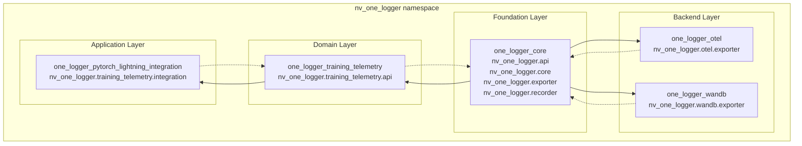

**Sources:** [README.md:1-106]()

### Component Relationships and Data Flow

The following diagram shows the key classes and modules that enable data flow between components:

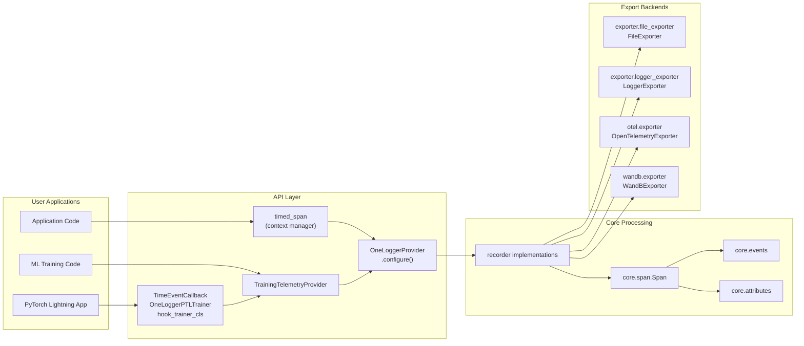

**Sources:** [README.md:14-46](), [README.md:63-100]()

## Package Overview

The monorepo contains five packages organized by architectural responsibility:

| Package | Purpose | Key Modules | Dependencies |
|---------|---------|-------------|--------------|
| `one_logger_core` | Foundation logging functionality | `api`, `core`, `exporter`, `recorder` | None (base layer) |
| `one_logger_training_telemetry` | ML training telemetry specialization | `training_telemetry.api` | `one_logger_core` |
| `one_logger_otel` | OpenTelemetry integration | `otel.exporter` | `one_logger_core` |
| `one_logger_wandb` | Weights & Biases integration | `wandb.exporter` | `one_logger_core` |
| `one_logger_pytorch_lightning_integration` | PyTorch Lightning callbacks | `training_telemetry.integration` | `one_logger_training_telemetry` |

**Sources:** [README.md:63-100]()

### Development Structure

Each package follows a consistent development structure that enables independent evolution while maintaining shared practices:

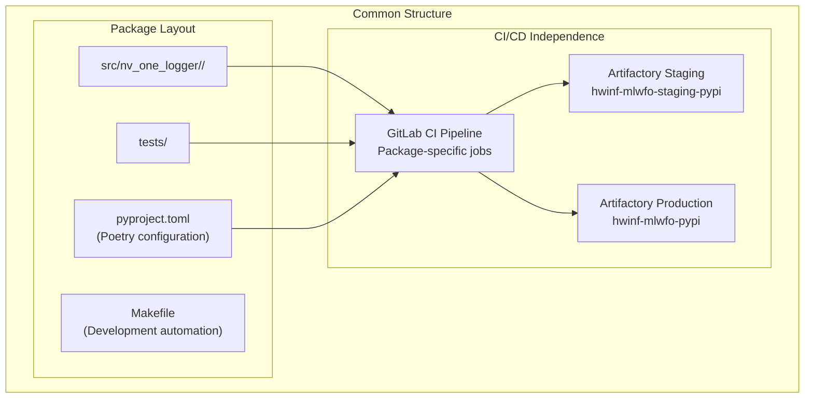

**Sources:** [README.md:52-60]()

### Namespace Organization

All packages share the `nv_one_logger` Python namespace, allowing for consistent imports and logical organization:

- **Core APIs**: `from nv_one_logger.api import timed_span, OneLoggerProvider`
- **Training APIs**: `from nv_one_logger.training_telemetry.api import TrainingTelemetryProvider`
- **Backend Exporters**: `from nv_one_logger.otel.exporter import OpenTelemetryExporter`
- **Integration Callbacks**: `from nv_one_logger.training_telemetry.integration import TimeEventCallback`

This namespace design enables users to import functionality from different packages seamlessly while maintaining clear package boundaries and dependencies.

**Sources:** [README.md:14-46](), [README.md:55]()

## Key Architectural Patterns

The system employs several key patterns that enable flexibility and maintainability:

1. **Layered Dependencies**: Foundation → Domain → Backend/Application layers prevent circular dependencies
2. **Extensible Exporters**: Base exporter classes in `one_logger_core` enable custom backend implementations
3. **Configuration Management**: Declarative configuration through `ExporterConfigManager` supports multiple configuration sources
4. **Independent Deployment**: Each package has its own CI/CD pipeline enabling independent release cycles
5. **Shared Namespace**: Common `nv_one_logger` namespace provides consistent user experience across packages

**Sources:** [README.md:5-8]()

---

# Page: Core Package (one_logger_core)

# Core Package (one_logger_core)

<details>
<summary>Relevant source files</summary>

The following files were used as context for generating this wiki page:

- [nv_one_logger/one_logger_core/pyproject.toml](nv_one_logger/one_logger_core/pyproject.toml)
- [nv_one_logger/one_logger_core/src/nv_one_logger/api/__init__.py](nv_one_logger/one_logger_core/src/nv_one_logger/api/__init__.py)

</details>


## Purpose and Scope

The `one_logger_core` package provides the foundational logging and telemetry infrastructure for the nv-one-logger ecosystem. It defines the core abstractions, APIs, and data structures that all other packages in the monorepo build upon. This package handles span lifecycle management, event recording, attribute management, and the base export system that enables telemetry data to be sent to various backends.

For ML training-specific telemetry functionality, see [Training Telemetry Package](#3). For backend-specific integrations like OpenTelemetry and Weights & Biases, see [Backend Integrations](#4). For application-layer integrations, see [Application Integrations](#5).

## Package Structure and Architecture

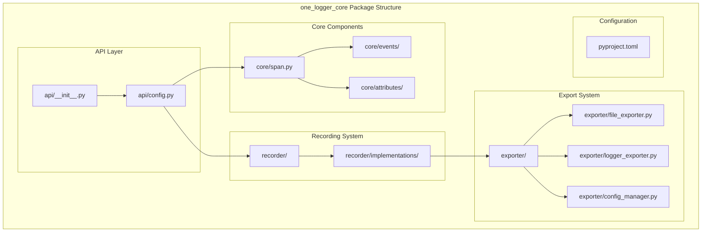

**Sources:** [nv_one_logger/one_logger_core/pyproject.toml:1-110](), [nv_one_logger/one_logger_core/src/nv_one_logger/api/__init__.py:1-10]()

## Core Components and Code Entity Mapping

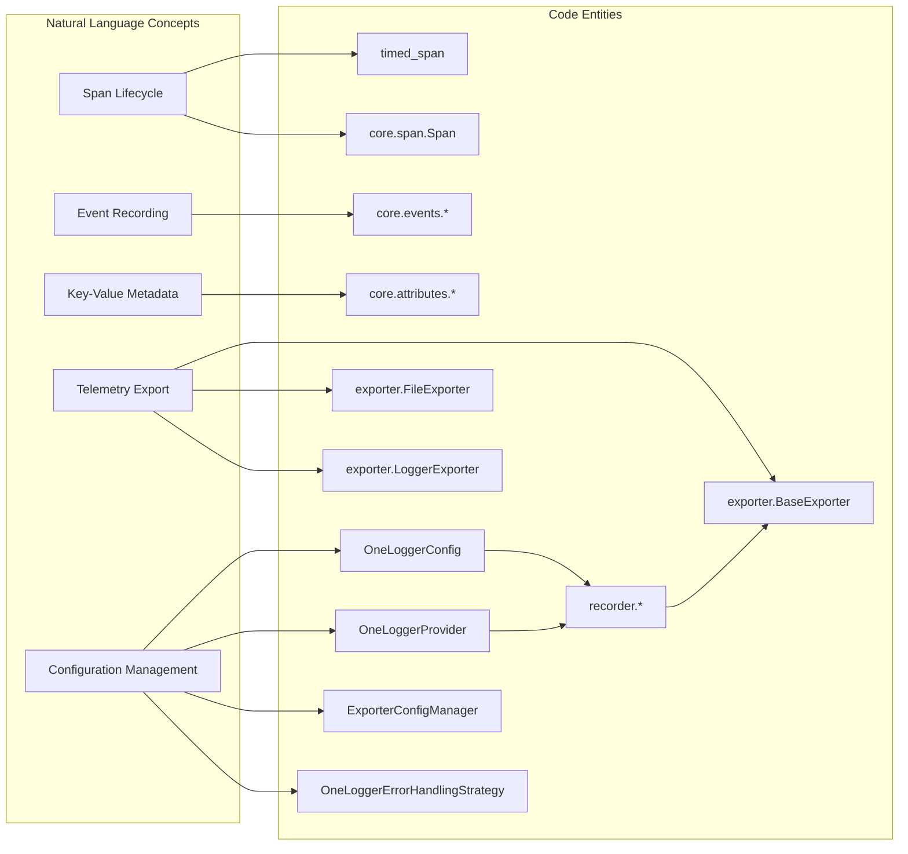

**Sources:** [nv_one_logger/one_logger_core/src/nv_one_logger/api/__init__.py:9]()

## API Layer

The API layer provides the primary interface for users to interact with the logging system. The main entry points are exposed through the `api` module:

| Component | Purpose | Location |
|-----------|---------|----------|
| `OneLoggerConfig` | Configuration container for logger setup | `api/config.py` |
| `OneLoggerProvider` | Main provider class for logger instances | `api/config.py` |
| `OneLoggerErrorHandlingStrategy` | Error handling strategy enumeration | `api/config.py` |
| `timed_span` | Context manager for span creation | `api/` (implied from architecture) |

The `timed_span` context manager serves as the primary user-facing API for creating spans, while `OneLoggerProvider` handles the configuration and instantiation of the logging infrastructure.

**Sources:** [nv_one_logger/one_logger_core/src/nv_one_logger/api/__init__.py:9]()

## Export System Architecture

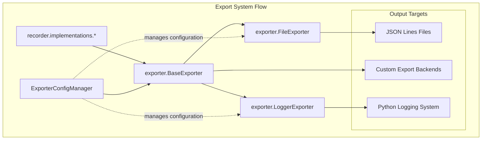

The export system provides a pluggable architecture where different exporters can be configured declaratively. The `BaseExporter` class defines the interface that all exporters must implement, while built-in implementations handle common use cases like file output and Python logging integration.

**Sources:** Based on architecture diagrams and implied structure from pyproject.toml

## Dependencies and Configuration

The core package has minimal external dependencies to maintain broad compatibility:

| Dependency | Version Constraint | Purpose |
|------------|-------------------|---------|
| `pydantic` | `^2.10.6` | Data validation and serialization |
| `overrides` | `^7.7.0` | Method override decorators |
| `StrEnum` | `^0.4.0` | String enumeration support |
| `toml` | `^0.10.2` | Configuration file parsing |
| `typing-extensions` | `^4.12.2` | Enhanced type annotations |

The package supports Python 3.8+ and uses Poetry for dependency management. The configuration supports strict typing with MyPy and comprehensive testing with pytest coverage requirements set to 80%.

**Sources:** [nv_one_logger/one_logger_core/pyproject.toml:15-22](), [nv_one_logger/one_logger_core/pyproject.toml:60-76](), [nv_one_logger/one_logger_core/pyproject.toml:94-95]()

## Package Metadata

- **Package Name:** `nv-one-logger-core`
- **Version:** `2.1.0`
- **License:** Apache-2.0
- **Source Structure:** Code located in `src/nv_one_logger/` with packages included from this location
- **Repository:** https://github.com/NVIDIA/nv-one-logger

The package is published to NVIDIA's internal Artifactory repositories for both staging and production deployments.

**Sources:** [nv_one_logger/one_logger_core/pyproject.toml:1-10](), [nv_one_logger/one_logger_core/pyproject.toml:106-109]()

---

# Page: API and Usage

# API and Usage

<details>
<summary>Relevant source files</summary>

The following files were used as context for generating this wiki page:

- [nv_one_logger/one_logger_core/src/nv_one_logger/api/timed_span.py](nv_one_logger/one_logger_core/src/nv_one_logger/api/timed_span.py)
- [nv_one_logger/one_logger_core/tests/nv_one_logger/api/test_timed_span.py](nv_one_logger/one_logger_core/tests/nv_one_logger/api/test_timed_span.py)

</details>


This document covers the main user-facing APIs in the `one_logger_core` package, focusing on the `timed_span` context manager and `OneLoggerProvider` configuration system. These are the primary interfaces that applications use to integrate logging and telemetry functionality.

For training-specific telemetry APIs, see [Training Telemetry APIs](#3.1). For backend integration details, see [Backend Integrations](#4).

## Core API Components

The `one_logger_core` package provides three main API components for user applications:

| Component | Purpose | Location |
|-----------|---------|----------|
| `timed_span` | Context manager for span lifecycle | `nv_one_logger.api.timed_span` |
| `OneLoggerProvider` | Global configuration and recorder management | `nv_one_logger.api.one_logger_provider` |
| `get_recorder` | Direct access to recorder instance | `nv_one_logger.api.timed_span` |

### API Component Architecture

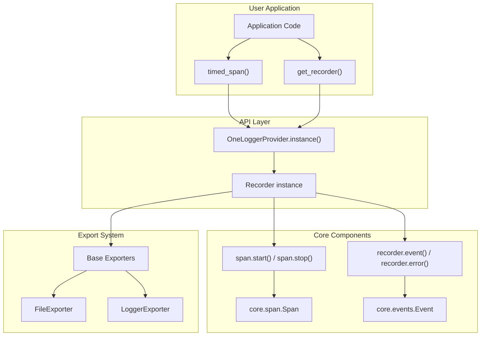

**Sources:** [nv_one_logger/one_logger_core/src/nv_one_logger/api/timed_span.py:15-21](), [nv_one_logger/one_logger_core/src/nv_one_logger/api/timed_span.py:84-94]()

## Basic Usage Pattern

### Initialization

Applications must configure the `OneLoggerProvider` once per process before using the `timed_span` context manager:

```python
from nv_one_logger.api.one_logger_provider import OneLoggerProvider
from nv_one_logger.recorder.default_recorder import DefaultRecorder

def main():
    # One-time initialization
    recorder = DefaultRecorder(exporters=[...])
    OneLoggerProvider.instance().configure(recorder)
```

### Span Creation

The `timed_span` context manager automatically handles span lifecycle:

```python
from nv_one_logger.api.timed_span import timed_span
from nv_one_logger.core.attributes import Attributes

def business_function():
    with timed_span(name="foo", start_event_attributes=Attributes({"key": "value"})):
        # Business logic executes within span context
        pass
```

### Basic Usage Flow

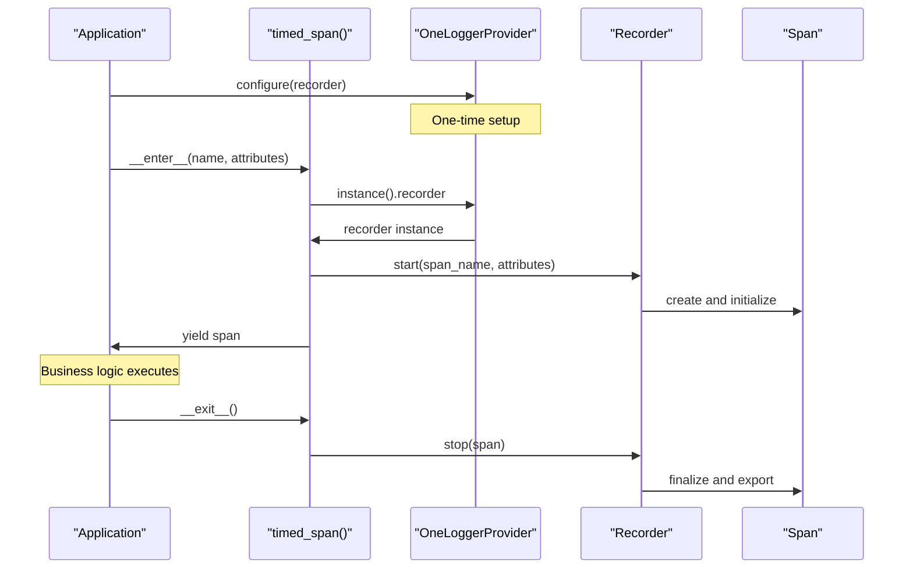

**Sources:** [nv_one_logger/one_logger_core/src/nv_one_logger/api/timed_span.py:45-54](), [nv_one_logger/one_logger_core/src/nv_one_logger/api/timed_span.py:84-94]()

## Advanced Usage Patterns

### Direct Recorder Access

Applications can access the recorder directly for event recording and error handling:

```python
from nv_one_logger.api.timed_span import get_recorder, timed_span
from nv_one_logger.core.events import Event

def advanced_function():
    with timed_span(name="application", span_attributes=Attributes({"app_tag": "value"})) as span:
        # Record custom events
        get_recorder().event(span, Event.create(...))
        
        # Record errors conditionally
        if error_condition:
            get_recorder().error(span, "Error in function", error_details)
```

### Nested Spans

The API supports nested span contexts:

```python
def nested_operations():
    with timed_span("outer_span", span_attributes=Attributes({"level": "outer"})):
        # Outer span operations
        
        with timed_span("inner_span", span_attributes=Attributes({"level": "inner"})):
            # Inner span operations
            pass
```

### Advanced API Flow

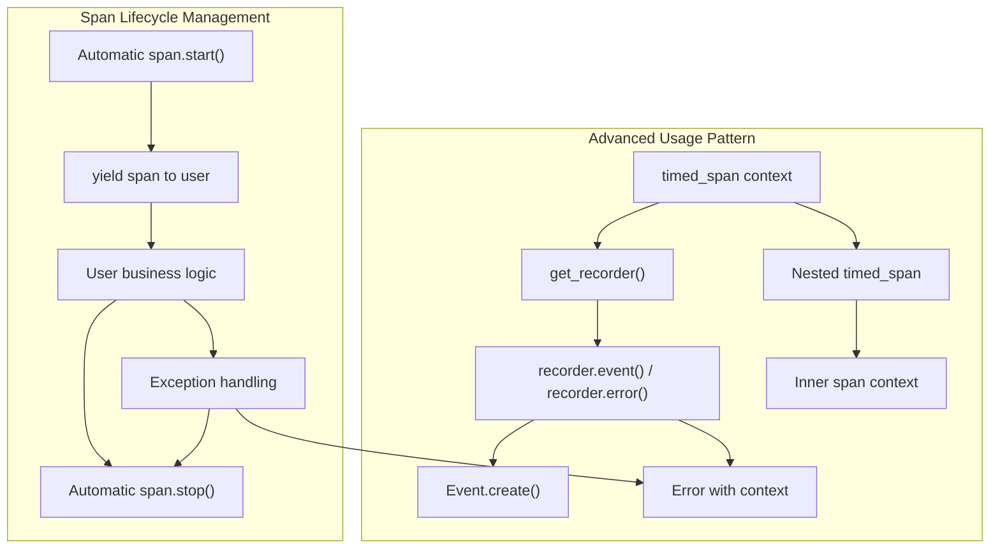

**Sources:** [nv_one_logger/one_logger_core/src/nv_one_logger/api/timed_span.py:65-81](), [nv_one_logger/one_logger_core/tests/nv_one_logger/api/test_timed_span.py:64-82]()

## Error Handling

The `timed_span` context manager automatically captures and records exceptions:

```python
def error_prone_function():
    with timed_span("risky_operation"):
        # If exception occurs, it's automatically recorded
        raise ValueError("Something went wrong")
        # Exception is re-raised after recording
```

The error handling mechanism:
1. Catches any exception in the span context
2. Records the error via `recorder.error(span, message, exception)`  
3. Re-raises the original exception
4. Ensures `recorder.stop(span)` is called in the finally block

**Sources:** [nv_one_logger/one_logger_core/src/nv_one_logger/api/timed_span.py:88-94](), [nv_one_logger/one_logger_core/tests/nv_one_logger/api/test_timed_span.py:83-98]()

## Configuration Requirements

### Provider Configuration

The `OneLoggerProvider` must be configured exactly once per process:

| Requirement | Details |
|-------------|---------|
| **Timing** | Before first `timed_span` usage |
| **Frequency** | Once per process |
| **Location** | Application startup (e.g., `main()` function) |
| **Error Handling** | Throws `OneLoggerError` if configured multiple times |

### Configuration Validation

The API includes runtime validation:
- `timed_span` asserts that a recorder is configured before span creation
- `OneLoggerProvider.configure()` prevents multiple configuration attempts
- Missing configuration results in clear error messages

**Sources:** [nv_one_logger/one_logger_core/src/nv_one_logger/api/timed_span.py:84-86](), [nv_one_logger/one_logger_core/tests/nv_one_logger/api/test_timed_span.py:100-104]()

---

# Page: Core Components

# Core Components

<details>
<summary>Relevant source files</summary>

The following files were used as context for generating this wiki page:

- [nv_one_logger/one_logger_core/src/nv_one_logger/core/span.py](nv_one_logger/one_logger_core/src/nv_one_logger/core/span.py)
- [nv_one_logger/one_logger_core/tests/nv_one_logger/core/internal/test_version.py](nv_one_logger/one_logger_core/tests/nv_one_logger/core/internal/test_version.py)

</details>


This section documents the core internal components that form the foundation of the `one_logger_core` package. These components provide the fundamental data structures, lifecycle management, and abstractions used throughout the logging system.

For information about the user-facing APIs that utilize these components, see [API and Usage](#2.1). For details about the export system that serializes these components, see [Export System](#2.3).

## Core Data Structures

The core package revolves around three primary data structures that represent the fundamental units of telemetry data:

### Span Class

The `Span` class represents a unit of work or operation in the distributed tracing system. Each span contains:

- **Unique identification**: UUID-based `id` property for span identification
- **Hierarchical structure**: Optional `parent_span` property for building span trees  
- **Temporal boundaries**: Automatic `start_event` and optional `stop_event` for lifecycle tracking
- **Metadata collection**: `attributes` for key-value metadata and `events` for timestamped records
- **State management**: `active` property indicating whether the span is currently running

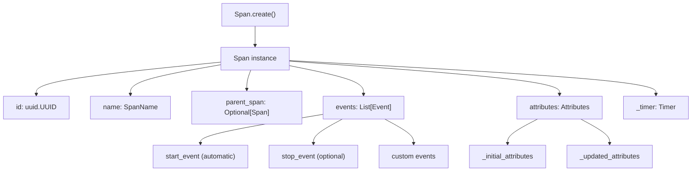

**Span Creation and Management**

Sources: [nv_one_logger/one_logger_core/src/nv_one_logger/core/span.py:178-203]()

### Event and Attribute Systems

**Events** represent timestamped occurrences within a span, while **Attributes** store key-value metadata. The system includes:

- `Event` objects with `StandardEventName.SPAN_START` and `StandardEventName.SPAN_STOP` for lifecycle events
- `Attributes` collections supporting both initial span attributes and runtime updates  
- `AttributeValue` types for storing various data types as span metadata
- `TracingTimestamp` integration for precise timing measurements

Sources: [nv_one_logger/one_logger_core/src/nv_one_logger/core/span.py:9-12]()

## Span Lifecycle Management  

The span lifecycle follows a well-defined state machine with automatic event generation and timer integration:

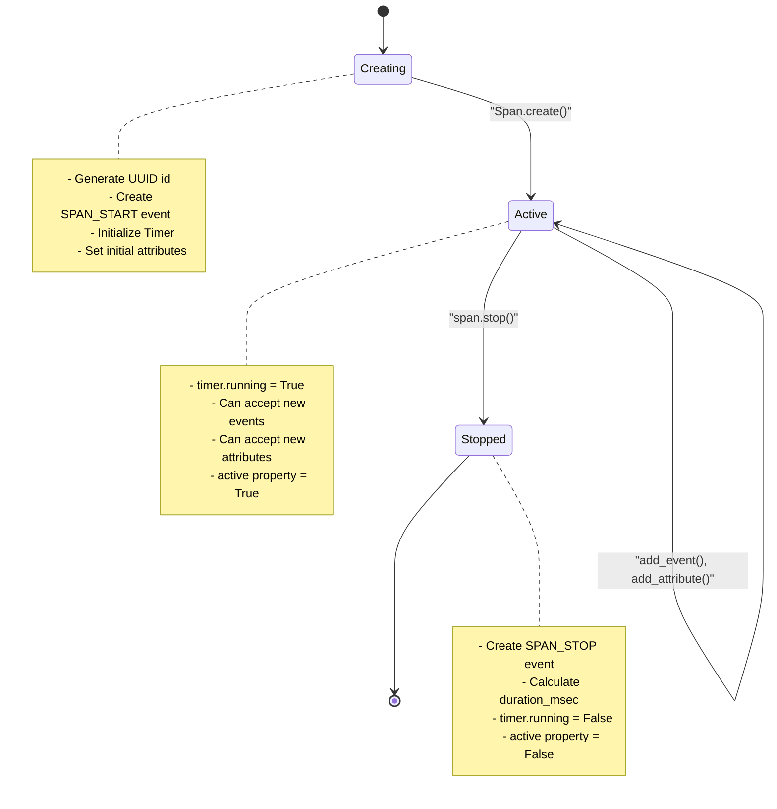

**Key Lifecycle Methods**

- `Span.create()`: Static factory method that initializes span with `start_event` and starts internal `Timer`
- `span.stop()`: Terminates span by adding `stop_event`, stopping timer, and calculating `DURATION_MSEC` attribute
- `span.add_event()`: Adds timestamped events during active span lifecycle
- `span.add_attribute()`: Updates span metadata, stored in `_updated_attributes` collection

Sources: [nv_one_logger/one_logger_core/src/nv_one_logger/core/span.py:205-219](), [nv_one_logger/one_logger_core/src/nv_one_logger/core/span.py:221-243]()

## Standard Naming Conventions

The core package defines standardized naming enums to ensure consistency across the telemetry system:

| Enum Class | Purpose | Key Values |
|------------|---------|------------|
| `StandardSpanName` | Common span names across domains | `APPLICATION` |
| `StandardSpanAttributeName` | Generic span attributes | `DURATION_MSEC`, `NVTX_COLOR` |  
| `StandardEventName` | Lifecycle and common events | `SPAN_START`, `SPAN_STOP` |
| `NVTXColor` | NVTX marker color assignments | `GREEN`, `BLUE`, `YELLOW`, `PURPLE`, etc. |

**Type Definitions**

The system uses `SpanName: TypeAlias = Union[Enum, str]` to allow both enum-based and string-based span names, with enums preferred for type safety.

Sources: [nv_one_logger/one_logger_core/src/nv_one_logger/core/span.py:15-57]()

## Component Relationships

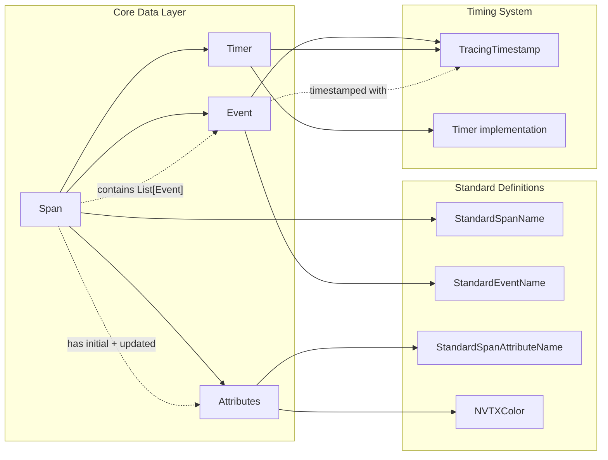

Sources: [nv_one_logger/one_logger_core/src/nv_one_logger/core/span.py:1-13]()

## Internal Architecture

The core components implement a layered architecture with clear separation of concerns:

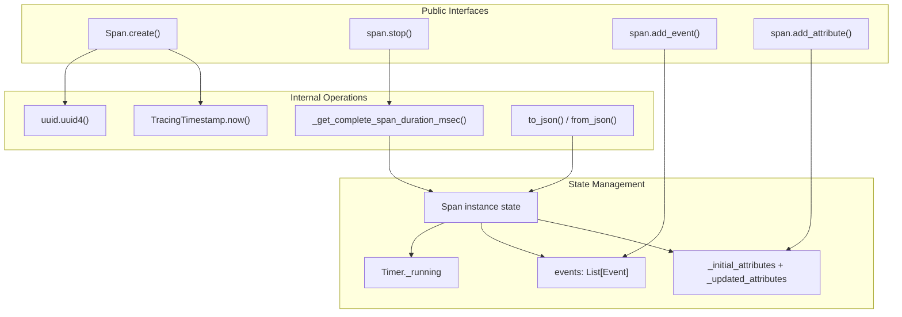

**Key Implementation Details**

- **UUID Generation**: Each span receives a unique `uuid.UUID` identifier via `uuid.uuid4()`
- **Timestamp Management**: Integration with `TracingTimestamp.now()` for precise timing
- **Attribute Separation**: Tracks `_initial_attributes` set at creation separately from `_updated_attributes` added later
- **Timer Integration**: Internal `Timer` object manages span timing and duration calculation
- **JSON Serialization**: Built-in `to_json()` and `from_json()` methods for persistence and export

Sources: [nv_one_logger/one_logger_core/src/nv_one_logger/core/span.py:71-111](), [nv_one_logger/one_logger_core/src/nv_one_logger/core/span.py:245-281](), [nv_one_logger/one_logger_core/src/nv_one_logger/core/span.py:295-307]()

---

# Page: Export System

# Export System

<details>
<summary>Relevant source files</summary>

The following files were used as context for generating this wiki page:

- [nv_one_logger/one_logger_core/src/nv_one_logger/exporter/README.md](nv_one_logger/one_logger_core/src/nv_one_logger/exporter/README.md)
- [nv_one_logger/one_logger_core/src/nv_one_logger/exporter/__init__.py](nv_one_logger/one_logger_core/src/nv_one_logger/exporter/__init__.py)
- [nv_one_logger/one_logger_core/src/nv_one_logger/exporter/file_exporter.py](nv_one_logger/one_logger_core/src/nv_one_logger/exporter/file_exporter.py)

</details>


The Export System provides the core infrastructure for delivering telemetry data from nv-one-logger to external systems. It defines standard interfaces, base implementations, built-in exporters, and a flexible configuration management system that supports multiple configuration sources with priority-based merging.

This document covers the exporter architecture, built-in exporters (`FileExporter`, `LoggerExporter`), and the declarative configuration system. For information about backend-specific exporters like OpenTelemetry and Weights & Biases, see [Backend Integrations](#4).

## Core Architecture

The Export System follows a protocol-based architecture with base classes providing common functionality and lifecycle management.

**Exporter Architecture**
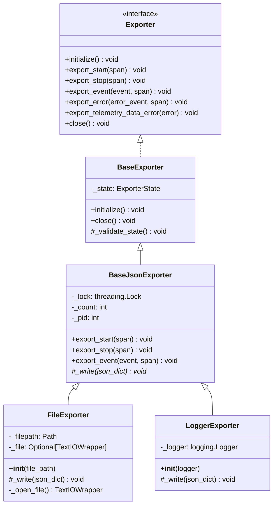

Sources: [nv_one_logger/one_logger_core/src/nv_one_logger/exporter/README.md:33-57]()

### Exporter Protocol

The `Exporter` protocol defines the core contract implemented by all exporters:

| Method | Purpose | Error Handling |
|--------|---------|----------------|
| `initialize()` | Prepare resources | Should raise `ExportError` on failure |
| `export_start(span)` | Handle span start | Should raise `ExportError` on export failure |
| `export_stop(span)` | Handle span completion | Should raise `ExportError` on export failure |
| `export_event(event, span)` | Handle custom events | Should raise `ExportError` on export failure |
| `export_error(error_event, span)` | Handle application errors | Should raise `ExportError` on export failure |
| `export_telemetry_data_error(error)` | Handle schema/validation issues | Should raise `ExportError` on export failure |
| `close()` | Release resources | Must not raise exceptions |

Sources: [nv_one_logger/one_logger_core/src/nv_one_logger/exporter/README.md:33-43]()

### Base Classes

`BaseExporter` provides lifecycle state management, ensuring correct usage patterns:
- Validates state transitions: not-initialized → ready → closed
- Guards all export methods with state validation

`BaseJsonExporter` handles JSON serialization and record generation:
- Converts spans and events to JSON-compatible dictionaries
- Adds incremental `count` and `pid` fields
- Emits `RecordType` values: `START`, `STOP`, `COMPLETE`, `EVENT`, `APPLICATION_ERROR`, `TELEMETRY_DATA_ERROR`
- Optimizes single-span scenarios by emitting `COMPLETE` records when possible
- Delegates actual output via abstract `_write(json_dict)` method

Sources: [nv_one_logger/one_logger_core/src/nv_one_logger/exporter/README.md:45-56]()

## Built-in Exporters

### FileExporter

`FileExporter` writes telemetry data as JSON Lines to a file, providing persistent storage with thread-safe operations.

**FileExporter Implementation Details**
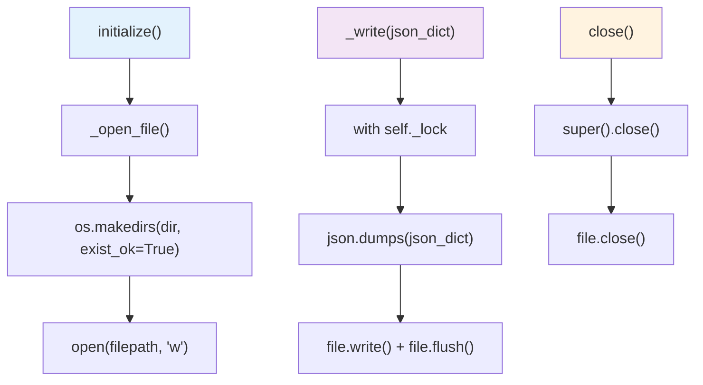

Key features:
- **Automatic directory creation**: Creates parent directories if missing [nv_one_logger/one_logger_core/src/nv_one_logger/exporter/file_exporter.py:56-59]()
- **Thread-safe writes**: Uses internal lock for concurrent access [nv_one_logger/one_logger_core/src/nv_one_logger/exporter/file_exporter.py:68-71]()
- **JSON Lines format**: One JSON object per line for easy ingestion [nv_one_logger/one_logger_core/src/nv_one_logger/exporter/file_exporter.py:67-71]()

Constructor: `FileExporter(file_path: Path)`

Sources: [nv_one_logger/one_logger_core/src/nv_one_logger/exporter/README.md:83-103](), [nv_one_logger/one_logger_core/src/nv_one_logger/exporter/file_exporter.py:17-74]()

### LoggerExporter

`LoggerExporter` outputs telemetry data to Python's standard logging system as formatted key-value pairs, suitable for human-readable logs.

Key characteristics:
- **Immediate output**: Designed for real-time, human-readable logging
- **Logger integration**: Uses provided `logging.Logger` instance
- **Key-value format**: Emits structured key=value formatted strings

Constructor: `LoggerExporter(logger: logging.Logger)`

**Note**: `LoggerExporter` requires a `logging.Logger` instance and cannot be constructed via the configuration manager. Use programmatic wiring with `.with_exporter()`.

Sources: [nv_one_logger/one_logger_core/src/nv_one_logger/exporter/README.md:62-82]()

## Configuration System

The Export Configuration Manager provides declarative exporter setup through multiple configuration sources with priority-based merging.

**Configuration Architecture and Flow**
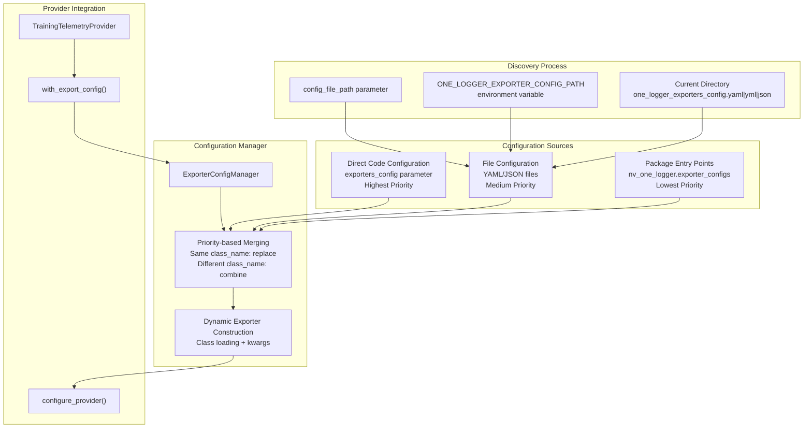

Sources: [nv_one_logger/one_logger_core/src/nv_one_logger/exporter/README.md:129-143](), [nv_one_logger/one_logger_core/src/nv_one_logger/exporter/README.md:213-222]()

### Configuration Data Model

The `ExporterConfig` dataclass defines the structure for exporter configuration:

```python
@dataclass
class ExporterConfig:
    class_name: str              # e.g. "nv_one_logger.exporter.file_exporter.FileExporter"
    config: Dict[str, Any] = {}  # Constructor kwargs
    enabled: bool = True
```

Sources: [nv_one_logger/one_logger_core/src/nv_one_logger/exporter/README.md:204-211]()

### Configuration Sources and Priority

The configuration manager merges configurations from three sources in priority order:

1. **Direct Configuration** (Highest): Passed to `with_export_config(exporters_config=...)`
2. **File Configuration** (Medium): YAML/JSON files discovered or explicitly specified
3. **Package Configuration** (Lowest): Entry points from installed packages

**Merging Rules**:
- Same `class_name`: Higher priority replaces lower (config is shallow-merged)
- Different `class_name`: All configurations are included

Sources: [nv_one_logger/one_logger_core/src/nv_one_logger/exporter/README.md:213-222]()

### File Configuration Format

Configuration files support both YAML and JSON formats:

**YAML Format**:
```yaml
exporters:
  - class_name: "nv_one_logger.exporter.file_exporter.FileExporter"
    config:
      file_path: "/tmp/app.log"
    enabled: true
```

**JSON Format**:
```json
{
  "exporters": [
    {
      "class_name": "nv_one_logger.exporter.file_exporter.FileExporter",
      "config": { "file_path": "/tmp/app.log" },
      "enabled": true
    }
  ]
}
```

**File Discovery Order**:
1. Explicit path: `with_export_config(config_file_path=...)`
2. Environment variable: `ONE_LOGGER_EXPORTER_CONFIG_PATH`
3. Current directory: `one_logger_exporters_config.yaml|yml|json`

Sources: [nv_one_logger/one_logger_core/src/nv_one_logger/exporter/README.md:224-252]()

### Package Entry Points

Packages can provide default configurations through Python entry points using the group `nv_one_logger.exporter_configs`:

**Poetry Configuration**:
```toml
[tool.poetry.plugins."nv_one_logger.exporter_configs"]
my_file_exporter = "my_team_exporter_config.configs:MyFileExporterConfig"
```

**Entry Point Implementation**:
```python
class MyFileExporterConfig:
    @staticmethod
    def get_default_config():
        return {
            "class_name": "nv_one_logger.exporter.file_exporter.FileExporter",
            "config": {"file_path": "/tmp/my_team_app.log"},
            "enabled": True,
        }
```

Sources: [nv_one_logger/one_logger_core/src/nv_one_logger/exporter/README.md:253-310]()

## Usage Patterns

### Programmatic Configuration

Direct exporter registration with the provider:

```python
from nv_one_logger.training_telemetry.api.training_telemetry_provider import TrainingTelemetryProvider
from nv_one_logger.exporter.file_exporter import FileExporter
from pathlib import Path

provider = TrainingTelemetryProvider.instance()
provider.with_exporter(FileExporter(file_path=Path("/tmp/metrics.jsonl")))
provider.configure_provider()
```

Sources: [nv_one_logger/one_logger_core/src/nv_one_logger/exporter/README.md:107-125]()

### Declarative Configuration

Using the configuration manager for flexible setup:

```python
# Basic usage with discovery
provider = TrainingTelemetryProvider.instance()
provider.with_export_config().configure_provider()

# Explicit file configuration
provider.with_export_config(
    config_file_path="one_logger_exporters_config.yaml"
).configure_provider()

# Direct configuration override
provider.with_export_config(exporters_config=[
    {
        "class_name": "nv_one_logger.exporter.file_exporter.FileExporter",
        "config": {"file_path": "/tmp/override.log"},
        "enabled": True
    }
]).configure_provider()
```

Sources: [nv_one_logger/one_logger_core/src/nv_one_logger/exporter/README.md:160-198](), [nv_one_logger/one_logger_core/src/nv_one_logger/exporter/README.md:312-334]()

### Error Handling

Exporters follow standard error handling patterns:
- Raise `ExportError` for recoverable export failures
- Always call `close()` to flush and release resources
- `BaseJsonExporter` logs warnings for unfinished spans at close

Sources: [nv_one_logger/one_logger_core/src/nv_one_logger/exporter/README.md:338-342]()

---

# Page: Training Telemetry Package

# Training Telemetry Package

<details>
<summary>Relevant source files</summary>

The following files were used as context for generating this wiki page:

- [nv_one_logger/one_logger_training_telemetry/pyproject.toml](nv_one_logger/one_logger_training_telemetry/pyproject.toml)
- [nv_one_logger/one_logger_training_telemetry/src/nv_one_logger/training_telemetry/api/__init__.py](nv_one_logger/one_logger_training_telemetry/src/nv_one_logger/training_telemetry/api/__init__.py)

</details>


## Purpose and Scope

The Training Telemetry Package (`one_logger_training_telemetry`) provides machine learning training-specific telemetry APIs, spans, and events designed for ML workflows. This package extends the foundational [Core Package](#2) with specialized functionality for tracking training job lifecycle events, checkpointing operations, and training metrics.

For information about the foundational logging APIs and core components, see [Core Package](#2). For application-specific integrations like PyTorch Lightning, see [Application Integrations](#5).

## Architecture and Positioning

The training telemetry package serves as a domain-specific extension layer between the core logging foundation and application integrations:

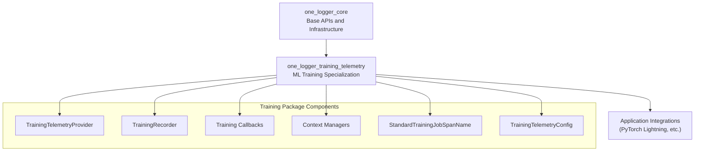

Sources: [nv_one_logger/one_logger_training_telemetry/pyproject.toml:1-110]()

## Package Structure and Dependencies

The training telemetry package maintains its own release cycle while depending on the core package:

| Component | Purpose | Core Dependency |
|-----------|---------|------------------|
| `TrainingTelemetryProvider` | Main configuration and provider interface | Extends `OneLoggerProvider` |
| `TrainingRecorder` | Training-specific recording functionality | Uses core recorder infrastructure |
| Training callbacks | Lifecycle event handlers for ML workflows | Built on core span/event system |
| Context managers | Training-specific context management | Extends core `timed_span` patterns |

The package explicitly depends on `nv-one-logger-core ^2.1.0` and adds ML-specific dependencies like `StrEnum` for training state enumeration.

Sources: [nv_one_logger/one_logger_training_telemetry/pyproject.toml:15-20]()

## Core API Components

### Training Lifecycle Callbacks

The package provides a comprehensive set of callback functions for different phases of ML training:

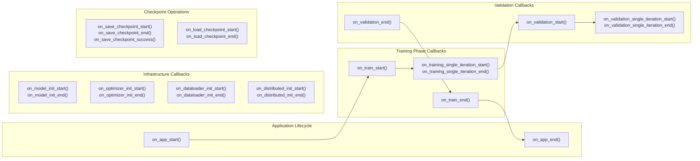

Sources: [nv_one_logger/one_logger_training_telemetry/src/nv_one_logger/training_telemetry/api/__init__.py:6-32]()

### Context Managers and Configuration

The package provides specialized context managers and configuration for training workflows:

```mermaid
graph TB
    subgraph "Context Managers"
        Application["application()")
        TrainingLoop["training_loop()"]
        TrainingIteration["training_iteration()"]
        CheckpointSave["checkpoint_save()"]
    end
    
    subgraph "Configuration Classes"
        TrainingConfig["TrainingTelemetryConfig"]
        CheckpointStrategy["CheckPointStrategy"]
    end
    
    subgraph "Core Components"
        Provider["TrainingTelemetryProvider"]
        Recorder["TrainingRecorder"]
        Spans["StandardTrainingJobSpanName"]
    end
    
    Application --> TrainingLoop
    TrainingLoop --> TrainingIteration
    TrainingIteration --> CheckpointSave
    
    TrainingConfig --> Provider
    CheckpointStrategy --> Provider
    Provider --> Recorder
    Recorder --> Spans
```

Sources: [nv_one_logger/one_logger_training_telemetry/src/nv_one_logger/training_telemetry/api/__init__.py:33-43]()

## Key Classes and Their Roles

| Class | Purpose | Key Methods/Attributes |
|-------|---------|----------------------|
| `TrainingTelemetryProvider` | Main entry point for training telemetry configuration | Configuration management, exporter setup |
| `TrainingRecorder` | Handles recording of training-specific spans and events | Training span lifecycle, metrics recording |
| `TrainingTelemetryConfig` | Configuration class for training telemetry settings | Export configuration, training parameters |
| `CheckPointStrategy` | Enumeration of checkpoint saving strategies | Strategy definitions for checkpoint timing |
| `StandardTrainingJobSpanName` | Enumeration of standard training span names | Consistent span naming across training workflows |

## Integration with Core Package

The training telemetry package extends the core package's capabilities by:

1. **Specialized Spans**: Defines training-specific span types through `StandardTrainingJobSpanName`
2. **Training Context**: Provides context managers that wrap core `timed_span` functionality with training semantics
3. **Callback System**: Implements a callback-based event system for training lifecycle management
4. **Configuration Extensions**: Extends core configuration with training-specific settings via `TrainingTelemetryConfig`

The package maintains backward compatibility with core APIs while adding domain-specific functionality for ML training workflows. Applications can use either the core APIs directly or leverage the training-specific abstractions for more streamlined ML telemetry integration.

Sources: [nv_one_logger/one_logger_training_telemetry/src/nv_one_logger/training_telemetry/api/__init__.py:1-44]()

---

# Page: Training Telemetry APIs

# Training Telemetry APIs

<details>
<summary>Relevant source files</summary>

The following files were used as context for generating this wiki page:

- [nv_one_logger/one_logger_training_telemetry/src/nv_one_logger/training_telemetry/api/attributes.py](nv_one_logger/one_logger_training_telemetry/src/nv_one_logger/training_telemetry/api/attributes.py)
- [nv_one_logger/one_logger_training_telemetry/src/nv_one_logger/training_telemetry/api/callbacks.py](nv_one_logger/one_logger_training_telemetry/src/nv_one_logger/training_telemetry/api/callbacks.py)
- [nv_one_logger/one_logger_training_telemetry/src/nv_one_logger/training_telemetry/api/training_recorder.py](nv_one_logger/one_logger_training_telemetry/src/nv_one_logger/training_telemetry/api/training_recorder.py)
- [nv_one_logger/one_logger_training_telemetry/src/nv_one_logger/training_telemetry/api/training_telemetry_provider.py](nv_one_logger/one_logger_training_telemetry/src/nv_one_logger/training_telemetry/api/training_telemetry_provider.py)

</details>


This document covers the training-specific APIs provided by the `one_logger_training_telemetry` package. These APIs extend the core OneLogger functionality with machine learning training-specific telemetry capabilities, including training iterations, validation loops, checkpoint operations, and performance metrics.

For general OneLogger usage and core APIs, see [Core Package APIs](#2.1). For backend integrations that work with training telemetry data, see [Backend Integrations](#4).

## Architecture Overview

The training telemetry APIs are built around three main components that work together to provide comprehensive ML training observability:

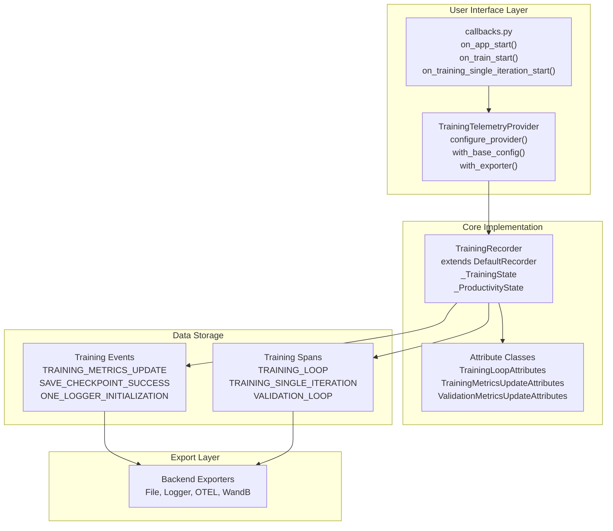

Sources: [training_telemetry/api/training_telemetry_provider.py:43-423](), [training_telemetry/api/training_recorder.py:187-1069](), [training_telemetry/api/callbacks.py:1-414](), [training_telemetry/api/attributes.py:1-1250]()

## Main API Components

### TrainingTelemetryProvider

The `TrainingTelemetryProvider` is a singleton that serves as the main entry point for training telemetry configuration. It follows a builder pattern for incremental configuration:

| Method | Purpose | Returns |
|--------|---------|---------|
| `with_base_config()` | Set base configuration | Provider instance |
| `with_config_override()` | Override specific config fields | Provider instance |
| `with_exporter()` | Add telemetry exporters | Provider instance |
| `with_export_config()` | Configure exporters from config | Provider instance |
| `configure_provider()` | Finalize configuration | None |

The provider creates and manages a `TrainingRecorder` instance that handles the actual telemetry recording.

Sources: [training_telemetry/api/training_telemetry_provider.py:43-147](), [training_telemetry/api/training_telemetry_provider.py:160-323]()

### TrainingRecorder

The `TrainingRecorder` extends `DefaultRecorder` with training-specific functionality. It maintains internal state through two key classes:

- `_TrainingState`: Tracks training progress, metrics, and timers
- `_ProductivityState`: Tracks work that has been successfully checkpointed

Key recording methods include:
- Application lifecycle: `on_app_start()`, `on_app_end()`
- Training phases: `on_training_loop_start()`, `on_training_single_iteration_start()`
- Validation: `on_validation_start()`, `on_validation_single_iteration_start()`
- Checkpoints: `on_save_checkpoint_start()`, `on_save_checkpoint_success()`

Sources: [training_telemetry/api/training_recorder.py:187-217](), [training_telemetry/api/training_recorder.py:94-185]()

## Training Lifecycle Callbacks

The callback functions provide a user-friendly interface for instrumenting training code. These functions safely wrap the recorder methods and handle error cases:

```mermaid
graph LR
    subgraph "Application Lifecycle"
        AppStart["on_app_start()"] --> DistInit["on_distributed_init_start()"]
        DistInit --> ModelInit["on_model_init_start()"]
        ModelInit --> DataInit["on_dataloader_init_start()"]
        DataInit --> TrainStart["on_train_start()"]
    end
    
    subgraph "Training Loop"
        TrainStart --> TrainIter["on_training_single_iteration_start()"]
        TrainIter --> TrainIterEnd["on_training_single_iteration_end()"]
        TrainIterEnd --> TrainIter
        TrainIterEnd --> ValidStart["on_validation_start()"]
        ValidStart --> ValidIter["on_validation_single_iteration_start()"]
        ValidIter --> ValidIterEnd["on_validation_single_iteration_end()"]
        ValidIterEnd --> ValidEnd["on_validation_end()"]
        ValidEnd --> Checkpoint["on_save_checkpoint_start()"]
        Checkpoint --> CheckpointSuccess["on_save_checkpoint_success()"]
    end
    
    subgraph "Completion"
        TrainIterEnd --> TrainEnd["on_train_end()"]
        TrainEnd --> AppEnd["on_app_end()"]
    end
```

### Key Callback Categories

**Application Setup Callbacks:**
- `on_app_start()`: Initialize application span and post initialization event
- `on_distributed_init_start()`: Track distributed training setup
- `on_model_init_start()`: Track model initialization
- `on_dataloader_init_start()`: Track data loading setup

**Training Loop Callbacks:**
- `on_train_start()`: Initialize training loop with target iterations/samples
- `on_training_single_iteration_start()`: Mark start of individual training step
- `on_training_single_iteration_end()`: Complete training step and update metrics

**Validation Callbacks:**
- `on_validation_start()`: Begin validation phase
- `on_validation_single_iteration_start()`: Track individual validation steps

**Checkpoint Callbacks:**
- `on_save_checkpoint_start()`: Begin checkpoint save operation
- `on_save_checkpoint_success()`: Mark successful checkpoint completion

All callbacks are decorated with `@safely_execute` to prevent telemetry errors from disrupting training.

Sources: [training_telemetry/api/callbacks.py:23-414]()

## Training Attributes System

The training telemetry system uses structured attribute classes to capture detailed metrics and metadata. These classes extend the base `Attributes` class and provide type-safe access to training-specific data:

### Core Attribute Classes

| Class | Purpose | Key Metrics |
|-------|---------|-------------|
| `TrainingLoopAttributes` | Training loop configuration | iterations_start, samples_start, targets |
| `TrainingMetricsUpdateAttributes` | Multi-iteration training metrics | avg_iteration_time, throughput, FLOPS |
| `ValidationMetricsUpdateAttributes` | Validation metrics | iteration times, intervals |
| `CheckpointSaveSpanAttributes` | Checkpoint operation metadata | strategy, iteration, attempt_count |
| `SaveCheckpointSuccessEventAttributes` | Checkpoint success details | productivity metrics, timestamps |

### Metrics Collection

The system automatically collects comprehensive training metrics:

**Performance Metrics:**
- Iteration timing (avg, min, max, total)
- Forward/backward pass timing
- Data loading time
- Throughput (samples/sec, tokens/sec, FLOPS)

**Progress Tracking:**
- Training iterations completed
- Samples processed
- Tokens processed (if sequence length known)
- Floating-point operations completed

**Productivity Metrics:**
- Work completed since last successful checkpoint
- Training time for productive work
- Validation time for productive work

Sources: [training_telemetry/api/attributes.py:19-895](), [training_telemetry/api/training_recorder.py:752-793]()

## Configuration and Setup

### Basic Setup Pattern

```python
# 1. Create training telemetry config
config = TrainingTelemetryConfig(
    perf_tag="my_model_v1",
    global_batch_size=64,
    log_every_n_train_iterations=100
)

# 2. Configure provider with exporters
(TrainingTelemetryProvider.instance()
    .with_base_config(config)
    .with_exporter(FileExporter())
    .with_export_config(exporters_config=[...])
    .configure_provider())
```

### Exporter Configuration

The training telemetry provider supports multiple configuration methods:

**Direct Configuration:**
```python
provider.with_exporter(LoggerExporter())
provider.with_exporter(OtelExporter())
```

**Config-based Setup:**
```python
provider.with_export_config(
    exporters_config=[
        {"type": "file", "file_path": "/logs/training.jsonl"},
        {"type": "wandb", "project": "my_project"}
    ]
)
```

**Export Filtering:**
By default, high-frequency spans like `TRAINING_SINGLE_ITERATION` are blacklisted to reduce data volume. This can be customized:

```python
provider.with_export_customization(
    export_customization_mode=ExportCustomizationMode.WHITELIST_SPANS,
    span_name_filter=[StandardTrainingJobSpanName.TRAINING_LOOP]
)
```

### Default Blacklisted Spans

The following spans are excluded from export by default due to high frequency:
- `TRAINING_SINGLE_ITERATION`
- `VALIDATION_SINGLE_ITERATION` 
- `TESTING_SINGLE_ITERATION`
- `DATA_LOADING`
- `MODEL_FORWARD`
- `ZERO_GRAD`
- `MODEL_BACKWARD`
- `OPTIMIZER_UPDATE`

Sources: [training_telemetry/api/training_telemetry_provider.py:25-34](), [training_telemetry/api/training_telemetry_provider.py:248-279](), [training_telemetry/api/training_telemetry_provider.py:221-246]()

---

# Page: Backend Integrations

# Backend Integrations

<details>
<summary>Relevant source files</summary>

The following files were used as context for generating this wiki page:

- [README.md](README.md)

</details>


## Purpose and Scope

Backend Integrations enable nv-one-logger to export telemetry data to external platforms and observability systems. This document provides an overview of the backend integration architecture and the available integration packages that extend the core logging functionality.

This page covers the general architecture and principles of backend integrations. For specific implementation details, see [OpenTelemetry Integration](#4.1) and [Weights & Biases Integration](#4.2). For information about the core export system that backend integrations extend, see [Export System](#2.3).

## Backend Integration Architecture

Backend integrations are implemented as separate packages that extend the core export system. Each integration package provides specialized exporters that can send telemetry data to specific external platforms while maintaining compatibility with the core logging APIs.

### Integration Package Structure

```mermaid
graph TB
    subgraph "Core Foundation"
        CoreExporter["core/exporter<br/>BaseExporter<br/>ExporterConfigManager"]
        CoreComponents["core/span<br/>core/events<br/>core/attributes"]
    end
    
    subgraph "Backend Integration Packages"
        OtelPackage["one_logger_otel<br/>src/nv_one_logger/otel/"]
        WandbPackage["one_logger_wandb<br/>src/nv_one_logger/wandb/"]
    end
    
    subgraph "Integration Exporters"
        OtelExporter["otel/exporter<br/>OpenTelemetry exporters"]
        WandbExporter["wandb/exporter<br/>WandB exporters"]
    end
    
    subgraph "External Systems"
        OtelCollector["OpenTelemetry<br/>Collectors"]
        WandbPlatform["Weights & Biases<br/>Platform"]
    end
    
    CoreExporter -->|"extends"| OtelExporter
    CoreExporter -->|"extends"| WandbExporter
    
    OtelPackage --> OtelExporter
    WandbPackage --> WandbExporter
    
    OtelExporter --> OtelCollector
    WandbExporter --> WandbPlatform
    
    CoreComponents -->|"serializes"| OtelExporter
    CoreComponents -->|"serializes"| WandbExporter
```

**Sources:** [README.md:23-27](), [README.md:42-46]()

### Extensibility Pattern

Backend integrations follow a consistent pattern where they extend the base exporter classes from `one_logger_core` and implement platform-specific serialization and transmission logic.

```mermaid
graph LR
    subgraph "Core Export Interface"
        BaseExporter["BaseExporter<br/>(abstract base class)"]
        ExportMethod["export_spans()<br/>export_events()<br/>configure()"]
    end
    
    subgraph "Platform-Specific Implementations"
        OtelImpl["OTEL Exporter<br/>Implements OTEL protocol<br/>Batch/streaming support"]
        WandbImpl["WandB Exporter<br/>Implements WandB API<br/>Sync/async modes"]
    end
    
    subgraph "Platform APIs"
        OtelAPI["OpenTelemetry<br/>OTLP/HTTP<br/>OTLP/gRPC"]
        WandbAPI["WandB REST API<br/>Experiment tracking<br/>Artifact logging"]
    end
    
    BaseExporter -->|"extends"| OtelImpl
    BaseExporter -->|"extends"| WandbImpl
    ExportMethod -->|"implements"| OtelImpl
    ExportMethod -->|"implements"| WandbImpl
    
    OtelImpl --> OtelAPI
    WandbImpl --> WandbAPI
```

**Sources:** [README.md:67-68](), [README.md:83-91]()

## Export System Extension Points

Backend integrations leverage the core export system's extensibility mechanisms to register and configure their exporters.

### Exporter Registration

The `ExporterConfigManager` from the core package provides the registration mechanism that backend integrations use to make their exporters discoverable.

| Extension Point | Purpose | Usage |
|----------------|---------|--------|
| Entry Points | Package-based discovery | Register exporters via `pyproject.toml` |
| Direct Registration | Programmatic registration | Register exporters in code |
| Configuration Files | Declarative setup | YAML/JSON configuration |

### Data Flow Architecture

```mermaid
flowchart TD
    subgraph "Application Layer"
        App["Application Code<br/>timed_span<br/>TrainingTelemetryProvider"]
    end
    
    subgraph "Core Processing"
        SpanRecorder["SpanRecorder<br/>Default implementations"]
        ExportManager["ExporterConfigManager<br/>Discovery & configuration"]
    end
    
    subgraph "Backend Integration Layer"
        OtelExporter["otel.exporter<br/>OTELSpanExporter"]
        WandbExporter["wandb.exporter<br/>WandBSpanExporter<br/>WandBAsyncSpanExporter"]
    end
    
    subgraph "External Platforms"
        OtelBackend["OTEL Collectors<br/>Jaeger, Zipkin<br/>Prometheus, etc."]
        WandbBackend["WandB Platform<br/>Experiment tracking<br/>Model registry"]
    end
    
    App --> SpanRecorder
    SpanRecorder --> ExportManager
    ExportManager -->|"discovers & configures"| OtelExporter
    ExportManager -->|"discovers & configures"| WandbExporter
    
    OtelExporter --> OtelBackend
    WandbExporter --> WandbBackend
```

**Sources:** [README.md:17-19](), [README.md:24-25](), [README.md:43-44]()

## Available Backend Integrations

nv-one-logger currently provides two main backend integration packages, each targeting different observability and experimentation ecosystems.

### OpenTelemetry Integration (`one_logger_otel`)

The OpenTelemetry integration package provides OTEL-compatible exporters that enable integration with the broader OpenTelemetry ecosystem.

**Key Features:**
- OTEL protocol compatibility
- Support for OTEL collectors and compatible backends
- Standard OpenTelemetry span and trace formats
- Integration with existing OTEL infrastructure

**Package Location:** `nv_one_logger/one_logger_otel/src/nv_one_logger/otel/`

### Weights & Biases Integration (`one_logger_wandb`)

The Weights & Biases integration package provides exporters for sending telemetry data to the WandB platform for experiment tracking and model management.

**Key Features:**
- Synchronous and asynchronous export modes
- WandB experiment tracking integration
- Support for WandB's visualization and collaboration tools
- ML-optimized data serialization

**Package Location:** `nv_one_logger/one_logger_wandb/src/nv_one_logger/wandb/`

**Sources:** [README.md:82-91]()

## Configuration and Discovery

Backend integrations are discovered and configured through the core export system's configuration mechanisms. This provides flexibility in how users can configure and use different backends.

### Configuration Methods

```mermaid
graph TB
    subgraph "Configuration Sources"
        DirectCode["Direct Code<br/>ExporterConfigManager.register()"]
        EntryPoints["Package Entry Points<br/>pyproject.toml declarations"]
        ConfigFiles["Configuration Files<br/>YAML/JSON format"]
    end
    
    subgraph "Discovery Process"
        ConfigManager["ExporterConfigManager<br/>Configuration resolution<br/>Priority handling"]
    end
    
    subgraph "Backend Exporters"
        RegisteredExporters["Registered Exporters<br/>OTEL, WandB, custom"]
    end
    
    DirectCode --> ConfigManager
    EntryPoints --> ConfigManager
    ConfigFiles --> ConfigManager
    
    ConfigManager -->|"instantiates & configures"| RegisteredExporters
```

### Integration with Training Telemetry

Backend integrations work seamlessly with the training telemetry system, allowing ML practitioners to export training metrics and events to their preferred observability platforms.

```mermaid
sequenceDiagram
    participant App as "ML Training App"
    participant TTProvider as "TrainingTelemetryProvider"
    participant ConfigManager as "ExporterConfigManager"
    participant Backend as "Backend Exporter"
    participant Platform as "External Platform"
    
    App->>TTProvider: Configure telemetry
    TTProvider->>ConfigManager: Discover exporters
    ConfigManager->>Backend: Instantiate & configure
    
    App->>TTProvider: Log training event
    TTProvider->>Backend: Export span/event
    Backend->>Platform: Send data (OTEL/WandB format)
    Platform-->>Backend: Acknowledge
    Backend-->>TTProvider: Export complete
```

**Sources:** [README.md:73-78](), [README.md:95-99]()

The backend integration system provides a flexible and extensible foundation for connecting nv-one-logger with various observability and experimentation platforms, while maintaining clean separation between core functionality and platform-specific implementations.

---

# Page: OpenTelemetry Integration

# OpenTelemetry Integration

<details>
<summary>Relevant source files</summary>

The following files were used as context for generating this wiki page:

- [nv_one_logger/one_logger_otel/poetry.lock](nv_one_logger/one_logger_otel/poetry.lock)
- [nv_one_logger/one_logger_otel/pyproject.toml](nv_one_logger/one_logger_otel/pyproject.toml)

</details>


This document covers the `one_logger_otel` package, which provides OpenTelemetry-compatible exporters and integration with the OTEL ecosystem. This package serves as a backend integration layer that extends the core logging functionality to work seamlessly with OpenTelemetry collectors and observability platforms.

For information about the foundational logging APIs and core components, see [Core Package](#2). For details about training-specific telemetry features, see [Training Telemetry Package](#3).

## Package Overview

The `nv-one-logger-otel` package bridges the nv-one-logger system with the OpenTelemetry ecosystem by providing OTEL-compatible exporters and span processors. It extends the base exporter functionality from `one_logger_core` to serialize and transmit telemetry data in OpenTelemetry-compatible formats.

### Key Dependencies

The package integrates with several critical dependencies to provide OpenTelemetry compatibility:

| Dependency | Version | Purpose |
|------------|---------|---------|
| `opentelemetry-api` | ^1.32.1 | Core OpenTelemetry API interfaces |
| `opentelemetry-sdk` | ^1.32.1 | OpenTelemetry SDK implementation |
| `nv-one-logger-core` | ^2.1.0 | Base logging infrastructure |

Sources: [nv_one_logger/one_logger_otel/pyproject.toml:15-21]()

## Architecture Overview

The OpenTelemetry integration follows a layered architecture that transforms nv-one-logger telemetry data into OpenTelemetry-compatible formats for export to OTEL collectors.

```mermaid
graph TB
    subgraph "Application Layer"
        App["Application Code"]
        CoreAPI["one_logger_core.api.OneLoggerProvider"]
    end
    
    subgraph "Core Processing"
        CoreSpan["core.span.Span"]
        CoreAttrs["core.attributes"]
        CoreEvents["core.events"]
        Recorder["recorder.implementations"]
    end
    
    subgraph "OTEL Integration Layer"
        OTELExporter["otel.exporter.OTELExporter"]
        OTELSpanProcessor["otel.span_processor.OTELSpanProcessor"]
        OTELConverter["otel.converter.SpanConverter"]
    end
    
    subgraph "OpenTelemetry SDK"
        OTELTracer["opentelemetry.trace.Tracer"]
        OTELSpanSDK["opentelemetry.sdk.trace.Span"]
        OTELBatchProcessor["opentelemetry.sdk.trace.export.BatchSpanProcessor"]
    end
    
    subgraph "Export Targets"
        OTELCollector["OTEL Collector"]
        Jaeger["Jaeger"]
        Console["Console Exporter"]
    end
    
    App --> CoreAPI
    CoreAPI --> CoreSpan
    CoreSpan --> CoreAttrs
    CoreSpan --> CoreEvents
    Recorder --> OTELExporter
    OTELExporter --> OTELSpanProcessor
    OTELSpanProcessor --> OTELConverter
    OTELConverter --> OTELTracer
    OTELTracer --> OTELSpanSDK
    OTELSpanSDK --> OTELBatchProcessor
    OTELBatchProcessor --> OTELCollector
    OTELBatchProcessor --> Jaeger
    OTELBatchProcessor --> Console
```

Sources: High-level system diagrams, [nv_one_logger/one_logger_otel/pyproject.toml:1-21]()

## Component Integration Pattern

The OTEL integration implements a converter pattern that transforms nv-one-logger data structures into OpenTelemetry equivalents while preserving semantic meaning and timing information.

```mermaid
graph LR
    subgraph "nv-one-logger Domain"
        NVSpan["nv_one_logger.core.span.Span"]
        NVAttrs["nv_one_logger.core.attributes.AttributeSet"]
        NVEvents["nv_one_logger.core.events.Event"]
        BaseExporter["nv_one_logger.core.exporter.BaseExporter"]
    end
    
    subgraph "OTEL Integration"
        OTELExporter["nv_one_logger.otel.exporter.OTELExporter"]
        SpanConverter["nv_one_logger.otel.converter.SpanConverter"]
        AttributeConverter["nv_one_logger.otel.converter.AttributeConverter"]
        EventConverter["nv_one_logger.otel.converter.EventConverter"]
    end
    
    subgraph "OpenTelemetry Domain"
        OTELSpan["opentelemetry.trace.Span"]
        OTELAttrs["opentelemetry.util.types.Attributes"]
        OTELEvent["opentelemetry.trace.Event"]
        OTELExporterSDK["opentelemetry.sdk.trace.export.SpanExporter"]
    end
    
    BaseExporter -.->|"extends"| OTELExporter
    NVSpan --> SpanConverter
    NVAttrs --> AttributeConverter
    NVEvents --> EventConverter
    
    SpanConverter --> OTELSpan
    AttributeConverter --> OTELAttrs
    EventConverter --> OTELEvent
    
    OTELExporter --> OTELExporterSDK
```

Sources: High-level system diagrams, architectural patterns from core integration

## Configuration and Setup

The OTEL integration supports multiple configuration approaches to accommodate different deployment scenarios and observability requirements.

### Exporter Configuration Types

The package likely supports several standard OpenTelemetry exporter configurations:

| Exporter Type | Target | Configuration |
|---------------|--------|---------------|
| OTLP | OTEL Collector | Endpoint, headers, compression |
| Jaeger | Jaeger backend | Agent endpoint, service name |
| Console | Standard output | Format options |
| Zipkin | Zipkin backend | Endpoint, service name |

### Integration with ExporterConfigManager

The OTEL package integrates with the core `ExporterConfigManager` to provide declarative configuration support through YAML/JSON files and package entry points.

```mermaid
graph TD
    subgraph "Configuration Sources"
        ConfigFile["YAML/JSON Config"]
        EntryPoints["Package Entry Points"]
        DirectConfig["Direct Code Configuration"]
    end
    
    subgraph "Configuration Management"
        ExporterConfigManager["core.exporter.ExporterConfigManager"]
        OTELConfig["otel.config.OTELExporterConfig"]
    end
    
    subgraph "OTEL Components"
        OTELExporter["otel.exporter.OTELExporter"]
        OTELProcessor["otel.processor.OTELSpanProcessor"]
    end
    
    subgraph "OpenTelemetry SDK"
        TracerProvider["opentelemetry.trace.TracerProvider"]
        SpanExporter["opentelemetry.sdk.trace.export.SpanExporter"]
    end
    
    ConfigFile --> ExporterConfigManager
    EntryPoints --> ExporterConfigManager
    DirectConfig --> ExporterConfigManager
    
    ExporterConfigManager --> OTELConfig
    OTELConfig --> OTELExporter
    OTELExporter --> OTELProcessor
    OTELProcessor --> TracerProvider
    TracerProvider --> SpanExporter
```

Sources: [nv_one_logger/one_logger_otel/pyproject.toml:15-21](), core export system architecture

## Span and Event Mapping

The integration preserves the semantic meaning of nv-one-logger spans and events by mapping them to appropriate OpenTelemetry equivalents with proper attribute propagation.

### Span Lifecycle Integration

```mermaid
sequenceDiagram
    participant App as "Application"
    participant Core as "core.span.Span"
    participant OTEL as "otel.exporter.OTELExporter"
    participant SDK as "opentelemetry.sdk"
    participant Collector as "OTEL Collector"
    
    App->>Core: create span with timed_span
    Core->>Core: set attributes and events
    Core->>OTEL: export(span)
    OTEL->>SDK: convert to OTEL span
    SDK->>SDK: process through BatchSpanProcessor
    SDK->>Collector: export OTLP data
    Collector-->>SDK: ack
    SDK-->>OTEL: export complete
    OTEL-->>Core: export success
```

Sources: Core span lifecycle, OTEL integration patterns

## Deployment Integration

The OTEL package is designed to work with existing OpenTelemetry infrastructure and observability platforms commonly used in production environments.

### Collector Integration Patterns

```mermaid
graph TB
    subgraph "Application Environment"
        App["nv-one-logger Application"]
        OTELExporter["otel.exporter.OTELExporter"]
    end
    
    subgraph "Infrastructure Layer"
        OTELAgent["OTEL Collector (Agent)"]
        OTELGateway["OTEL Collector (Gateway)"]
    end
    
    subgraph "Observability Backends"
        Jaeger["Jaeger"]
        Prometheus["Prometheus"]
        Grafana["Grafana"]
        DatadogAgent["Datadog Agent"]
    end
    
    App --> OTELExporter
    OTELExporter -->|"OTLP/gRPC"| OTELAgent
    OTELAgent --> OTELGateway
    
    OTELGateway --> Jaeger
    OTELGateway --> Prometheus
    OTELGateway --> DatadogAgent
    
    Prometheus --> Grafana
```

Sources: OpenTelemetry deployment patterns, [nv_one_logger/one_logger_otel/pyproject.toml:2-4]()

## Package Metadata and Build Configuration

The package is configured as an independent component within the nv-one-logger monorepo with specific versioning and dependency management.

### Build and Distribution

The package uses Poetry for dependency management and follows semantic versioning aligned with the core package versions. The build system supports automated CI/CD pipelines for staging and production deployments.

Sources: [nv_one_logger/one_logger_otel/pyproject.toml:1-11](), [nv_one_logger/one_logger_otel/pyproject.toml:23-25](), [nv_one_logger/one_logger_otel/pyproject.toml:105-112]()

---

# Page: Weights & Biases Integration

# Weights & Biases Integration

<details>
<summary>Relevant source files</summary>

The following files were used as context for generating this wiki page:

- [nv_one_logger/one_logger_wandb/pyproject.toml](nv_one_logger/one_logger_wandb/pyproject.toml)
- [nv_one_logger/one_logger_wandb/src/nv_one_logger/wandb/exporter/wandb_exporter.py](nv_one_logger/one_logger_wandb/src/nv_one_logger/wandb/exporter/wandb_exporter.py)
- [nv_one_logger/one_logger_wandb/tests/nv_one_logger/wandb/exporter/test_wandb_exporter_sync.py](nv_one_logger/one_logger_wandb/tests/nv_one_logger/wandb/exporter/test_wandb_exporter_sync.py)

</details>


This document covers the `one_logger_wandb` package, which provides integration between nv-one-logger and Weights & Biases (WandB) for experiment tracking and metric logging. The package exports telemetry data from spans and events as metrics to WandB platforms.

For information about other backend integrations, see [OpenTelemetry Integration](#4.1). For core export system concepts, see [Export System](#2.3).

## Architecture Overview

The WandB integration extends the base export system to send telemetry data to Weights & Biases. Since WandB is designed for experiment tracking rather than distributed tracing, the integration maps span attributes and event data to WandB metrics.

```mermaid
graph TB
    subgraph "Core Export System"
        BaseExporter["BaseExporter"]
        ExporterConfigManager["ExporterConfigManager"]
    end
    
    subgraph "WandB Package Components"
        WandBExporterBase["WandBExporterBase"]
        WandBExporterSync["WandBExporterSync"]
        WandBExporterAsync["WandBExporterAsync"]
        Config["Config"]
        MetricNamingStrategy["MetricNamingStrategy"]
        HierarchicalMetricNamingStrategy["HierarchicalMetricNamingStrategy"]
        FlatMetricNamingStrategy["FlatMetricNamingStrategy"]
    end
    
    subgraph "WandB Platform"
        WandBAPI["WandB API"]
        WandBRuns["WandB Runs & Metrics"]
    end
    
    subgraph "Application Layer"
        UserCode["User Code"]
        TrainingTelemetry["Training Telemetry"]
    end
    
    BaseExporter --> WandBExporterBase
    WandBExporterBase --> WandBExporterSync
    WandBExporterBase --> WandBExporterAsync
    
    WandBExporterSync --> Config
    WandBExporterAsync --> Config
    WandBExporterBase --> MetricNamingStrategy
    MetricNamingStrategy --> HierarchicalMetricNamingStrategy
    MetricNamingStrategy --> FlatMetricNamingStrategy
    
    WandBExporterSync --> WandBAPI
    WandBExporterAsync --> WandBAPI
    WandBAPI --> WandBRuns
    
    UserCode --> ExporterConfigManager
    TrainingTelemetry --> ExporterConfigManager
    ExporterConfigManager --> WandBExporterSync
    ExporterConfigManager --> WandBExporterAsync
```

Sources: [nv_one_logger/one_logger_wandb/src/nv_one_logger/wandb/exporter/wandb_exporter.py:1-499](), [nv_one_logger/one_logger_wandb/pyproject.toml:1-116]()

## Core Components

### Configuration

The `Config` class defines WandB connection and project settings:

| Parameter | Type | Default | Description |
|-----------|------|---------|-------------|
| `entity` | str | Required | WandB username or team name |
| `host` | str | "https://api.wandb.ai" | WandB server URL |
| `api_key` | str | "" | WandB authentication key |
| `project` | str | "one-logger-tracking" | WandB project name |
| `run_name` | str | Generated UUID | Display name for the WandB run |
| `save_dir` | str | "./wandb" | Local metadata directory |
| `tags` | List[str] | ["e2e_metrics_enabled"] | Run tags for organization |

Sources: [nv_one_logger/one_logger_wandb/src/nv_one_logger/wandb/exporter/wandb_exporter.py:23-51]()

### Exporter Implementations

The package provides two exporter implementations with different execution models:

```mermaid
graph LR
    subgraph "Synchronous Mode"
        WandBExporterSync["WandBExporterSync"]
        SyncProcess["Main Process"]
        WandBExporterSync --> SyncProcess
        SyncProcess --> WandBAPI1["WandB API"]
    end
    
    subgraph "Asynchronous Mode"
        WandBExporterAsync["WandBExporterAsync"]
        ParentProcess["Parent Process"]
        ChildProcess["Child Process"]
        Pipe["mp.Pipe"]
        
        WandBExporterAsync --> ParentProcess
        ParentProcess --> Pipe
        Pipe --> ChildProcess
        ChildProcess --> WandBAPI2["WandB API"]
    end
```

**WandBExporterSync**: Blocks on each export call until data is sent to WandB. Simple but may impact application performance.

**WandBExporterAsync**: Uses a separate child process with pipe communication to send data asynchronously. Avoids blocking the main application and prevents conflicts with user WandB instances.

Sources: [nv_one_logger/one_logger_wandb/src/nv_one_logger/wandb/exporter/wandb_exporter.py:282-324](), [nv_one_logger/one_logger_wandb/src/nv_one_logger/wandb/exporter/wandb_exporter.py:335-499]()

### Metric Naming Strategies

Since WandB stores metrics rather than spans/events, the integration uses naming strategies to map attributes to metric names:

**HierarchicalMetricNamingStrategy** (default): Creates hierarchical metric names by joining span, event, and attribute names with a separator (default "."):
- Span attribute: `span_name.attribute_name`
- Event attribute: `span_name.event_name.attribute_name`

**FlatMetricNamingStrategy**: Uses only the attribute name as the metric name, ignoring span and event context.

Sources: [nv_one_logger/one_logger_wandb/src/nv_one_logger/wandb/exporter/wandb_exporter.py:103-154]()

## Data Flow and Export Process

The export process transforms span/event data into WandB metrics:

```mermaid
graph TD
    subgraph "Telemetry Data"
        Span["Span"]
        SpanAttributes["Span Attributes"]
        Events["Events"]
        EventAttributes["Event Attributes"]
    end
    
    subgraph "Export Methods"
        export_start["export_start()"]
        export_stop["export_stop()"]
        export_event["export_event()"]
        export_error["export_error()"]
    end
    
    subgraph "Metric Generation"
        MetricNaming["MetricNamingStrategy"]
        MetricsDict["Dict[str, Any]"]
    end
    
    subgraph "WandB Integration"
        _log_metrics["_log_metrics()"]
        wandb_log["wandb.log()"]
        WandBPlatform["WandB Platform"]
    end
    
    Span --> export_start
    SpanAttributes --> export_start
    Events --> export_event
    EventAttributes --> export_event
    
    export_start --> MetricNaming
    export_stop --> MetricNaming
    export_event --> MetricNaming
    export_error --> MetricNaming
    
    MetricNaming --> MetricsDict
    MetricsDict --> _log_metrics
    _log_metrics --> wandb_log
    wandb_log --> WandBPlatform
```

Each export method follows this pattern:
1. Extract attributes from spans/events
2. Apply metric naming strategy to generate metric names
3. Create metrics dictionary with timestamp metadata
4. Send to WandB via `_log_metrics()`

Sources: [nv_one_logger/one_logger_wandb/src/nv_one_logger/wandb/exporter/wandb_exporter.py:198-242](), [nv_one_logger/one_logger_wandb/src/nv_one_logger/wandb/exporter/wandb_exporter.py:320-324]()

## Asynchronous Process Management

The `WandBExporterAsync` implementation uses multiprocessing for non-blocking exports:

```mermaid
graph TD
    subgraph "Parent Process"
        MainApp["Main Application"]
        WandBExporterAsync["WandBExporterAsync"]
        _conn_to_child["_conn_to_child"]
        _check_for_errors["_check_for_errors()"]
    end
    
    subgraph "Child Process"
        _child_process_fn["_child_process_fn()"]
        conn_to_parent["conn_to_parent"]
        wandb_run["wandb.Run"]
        _initialize_wandb["_initialize_wandb()"]
    end
    
    subgraph "Error Handling"
        ErrorInfo["_WandBExportAsyncErrorInfo"]
        ExportError["ExportError"]
    end
    
    MainApp --> WandBExporterAsync
    WandBExporterAsync --> _conn_to_child
    _conn_to_child --> conn_to_parent
    
    conn_to_parent --> _child_process_fn
    _child_process_fn --> _initialize_wandb
    _initialize_wandb --> wandb_run
    
    _child_process_fn --> ErrorInfo
    ErrorInfo --> conn_to_parent
    conn_to_parent --> _conn_to_child
    _check_for_errors --> ExportError
```

The async implementation handles:
- **Process lifecycle**: Creates child process on `initialize()`, terminates on `close()`
- **Error propagation**: Child process sends error information back to parent via pipe
- **Environment isolation**: Modifies WandB environment variables to prevent conflicts

Sources: [nv_one_logger/one_logger_wandb/src/nv_one_logger/wandb/exporter/wandb_exporter.py:362-432](), [nv_one_logger/one_logger_wandb/src/nv_one_logger/wandb/exporter/wandb_exporter.py:374-415]()

## Integration Patterns

### Direct Usage

```python
from nv_one_logger.wandb.exporter.wandb_exporter import WandBExporterSync, Config

config = Config(
    entity="my-team",
    project="my-experiment",
    api_key="your-api-key"
)

exporter = WandBExporterSync(config)
```

### Configuration-Based Setup

The exporter integrates with the core `ExporterConfigManager` system for declarative configuration. Users can configure WandB exporters through YAML files or package entry points.

### Training Telemetry Integration

When used with the training telemetry package, span attributes like training metrics, model parameters, and performance data are automatically exported as WandB metrics with appropriate naming.

Sources: [nv_one_logger/one_logger_wandb/src/nv_one_logger/wandb/exporter/wandb_exporter.py:293-301](), [nv_one_logger/one_logger_wandb/pyproject.toml:15-25]()

## Error Handling and Data Mapping

### Error Event Handling

The `export_error()` method doesn't send error events to WandB since WandB lacks native error reporting capabilities. Error events are silently ignored.

### Telemetry Data Error Reporting

`TelemetryDataError` instances are mapped to WandB metrics using the standard event name `TELEMETRY_DATA_ERROR` with the error type as the metric value.

### Metric Timestamping

All metrics include an `app_last_log_time` field with the current timestamp in milliseconds since epoch for temporal tracking.

Sources: [nv_one_logger/one_logger_wandb/src/nv_one_logger/wandb/exporter/wandb_exporter.py:245-265](), [nv_one_logger/one_logger_wandb/src/nv_one_logger/wandb/exporter/wandb_exporter.py:162-164](), [nv_one_logger/one_logger_wandb/tests/nv_one_logger/wandb/exporter/test_wandb_exporter_sync.py:316-325]()

---

# Page: Application Integrations

# Application Integrations

<details>
<summary>Relevant source files</summary>

The following files were used as context for generating this wiki page:

- [README.md](README.md)

</details>


This document covers the application-layer integrations in the nv-one-logger system. Application integrations provide ready-to-use components that seamlessly integrate telemetry collection into specific ML frameworks and applications. These integrations sit at the highest layer of the nv-one-logger architecture, offering framework-specific APIs and automation to minimize integration effort for end users.

For detailed information about the PyTorch Lightning integration implementation, see [PyTorch Lightning Integration](#5.1).

## Purpose and Architecture

Application integrations serve as bridges between popular ML frameworks and the nv-one-logger telemetry system. Rather than requiring users to manually instrument their code with telemetry calls, these integrations provide framework-specific components that automatically capture relevant events and metrics during model training and inference.

### Integration Layer Architecture

```mermaid
graph TB
    subgraph "Application Layer"
        PTLIntegration["one_logger_pytorch_lightning_integration"]
        FutureIntegrations["Future Framework Integrations"]
    end
    
    subgraph "Domain Layer"
        TrainingTelemetry["one_logger_training_telemetry<br/>TrainingTelemetryProvider<br/>training-specific APIs"]
    end
    
    subgraph "Core Layer"
        CoreSystem["one_logger_core<br/>OneLoggerProvider<br/>base telemetry system"]
    end
    
    subgraph "External Frameworks"
        PTLTrainer["PyTorch Lightning<br/>pl.Trainer"]
        OtherFrameworks["Other ML Frameworks"]
    end
    
    PTLTrainer --> PTLIntegration
    OtherFrameworks --> FutureIntegrations
    
    PTLIntegration --> TrainingTelemetry
    FutureIntegrations --> TrainingTelemetry
    
    TrainingTelemetry --> CoreSystem
    
    PTLIntegration -.->|"OneLoggerPTLTrainer<br/>TimeEventCallback<br/>hook_trainer_cls"| PTLTrainer
```

Sources: [README.md:93-99]()

### Integration Patterns

Application integrations in nv-one-logger follow consistent patterns to provide seamless framework integration:

| Integration Pattern | Description | Example Components |
|-------------------|-------------|-------------------|
| **Callback Integration** | Framework-specific callbacks that hook into training lifecycle events | `TimeEventCallback` for PyTorch Lightning |
| **Wrapper Classes** | Enhanced versions of framework classes with built-in telemetry | `OneLoggerPTLTrainer` extending `pl.Trainer` |
| **Hook Functions** | Utility functions that automatically instrument existing framework instances | `hook_trainer_cls` for runtime trainer enhancement |

## Current Integrations

### PyTorch Lightning Integration

The `one_logger_pytorch_lightning_integration` package provides comprehensive integration with PyTorch Lightning, offering multiple approaches for telemetry collection:

```mermaid
graph TB
    subgraph "PyTorch Lightning Application"
        PLApp["PyTorch Lightning Application"]
        PLTrainer["pl.Trainer instance"]
        PLModule["pl.LightningModule"]
    end
    
    subgraph "Integration Components"
        OneLoggerPTLTrainer["OneLoggerPTLTrainer<br/>Enhanced trainer class"]
        TimeEventCallback["TimeEventCallback<br/>Lifecycle event capture"]
        HookTrainerCls["hook_trainer_cls<br/>Runtime instrumentation"]
    end
    
    subgraph "Telemetry Processing"
        TrainingProvider["TrainingTelemetryProvider<br/>ML-specific telemetry"]
        ExporterConfig["ExporterConfigManager<br/>Backend configuration"]
    end
    
    PLApp --> OneLoggerPTLTrainer
    PLApp --> HookTrainerCls
    PLTrainer --> HookTrainerCls
    
    OneLoggerPTLTrainer --> TimeEventCallback
    HookTrainerCls --> TimeEventCallback
    
    TimeEventCallback --> TrainingProvider
    TrainingProvider --> ExporterConfig
    
    PLModule -.->|"training events<br/>validation events<br/>epoch boundaries"| TimeEventCallback
```

Sources: [README.md:36-40](), [README.md:95-99]()

## Integration Implementation Structure

### Package Organization

The application integrations follow the established monorepo structure with independent packaging and CI/CD:

```mermaid
graph LR
    subgraph "one_logger_pytorch_lightning_integration"
        SrcDir["src/nv_one_logger/training_telemetry/"]
        IntegrationDir["integration/<br/>PyTorch Lightning callbacks"]
        TestsDir["tests/<br/>Integration test suites"]
        PyProject["pyproject.toml<br/>Independent dependencies"]
    end
    
    SrcDir --> IntegrationDir
    
    IntegrationDir -.->|"depends on"| TrainingTelemetryAPI["one_logger_training_telemetry<br/>API components"]
    PyProject -.->|"Poetry configuration<br/>Independent CI/CD"| BuildSystem["GitLab CI Pipeline"]
```

Sources: [README.md:36-40](), [README.md:52-60]()

### Dependency Management

Application integrations maintain clean dependency boundaries:

- **Direct Dependencies**: Framework-specific packages (e.g., `pytorch-lightning`)
- **Internal Dependencies**: `one_logger_training_telemetry` for domain-specific APIs
- **Transitive Dependencies**: `one_logger_core` through the training telemetry layer

This layered approach ensures that application integrations remain focused on their specific framework while leveraging the full telemetry capabilities of the underlying system.

## Extension Points for Future Integrations

The application integration layer is designed for extensibility. Future integrations can follow the established patterns:

### Framework Integration Checklist

| Component Type | Purpose | Implementation Approach |
|---------------|---------|----------------------|
| **Lifecycle Callbacks** | Capture framework-specific events | Implement framework callback interfaces |
| **Wrapper Classes** | Provide enhanced framework classes | Extend or compose framework base classes |
| **Configuration Integration** | Integrate with framework config systems | Support framework-native configuration patterns |
| **Testing Infrastructure** | Ensure reliable integration behavior | Framework-specific test fixtures and scenarios |

### Integration Development Pattern

```mermaid
graph TB
    subgraph "New Framework Integration Development"
        FrameworkAPI["Framework Native API<br/>training loops, callbacks"]
        IntegrationLayer["Framework Integration Components<br/>callbacks, wrappers, hooks"]
        ConfigLayer["Configuration Integration<br/>framework-native config"]
        TestLayer["Integration Test Suite<br/>framework-specific scenarios"]
    end
    
    FrameworkAPI --> IntegrationLayer
    IntegrationLayer --> ConfigLayer
    IntegrationLayer --> TestLayer
    
    IntegrationLayer --> TrainingTelemetryAPI["one_logger_training_telemetry<br/>standardized telemetry APIs"]
    ConfigLayer --> ExporterConfigManager["ExporterConfigManager<br/>backend configuration"]
```

This architecture ensures that each framework integration maintains its specific idioms while providing consistent telemetry capabilities across all supported frameworks.

Sources: [README.md:52-78]()

---

# Page: PyTorch Lightning Integration

# PyTorch Lightning Integration

<details>
<summary>Relevant source files</summary>

The following files were used as context for generating this wiki page:

- [nv_one_logger/one_logger_pytorch_lightning_integration/pyproject.toml](nv_one_logger/one_logger_pytorch_lightning_integration/pyproject.toml)
- [nv_one_logger/one_logger_pytorch_lightning_integration/src/nv_one_logger/training_telemetry/integration/_compat/lightning.py](nv_one_logger/one_logger_pytorch_lightning_integration/src/nv_one_logger/training_telemetry/integration/_compat/lightning.py)
- [nv_one_logger/one_logger_pytorch_lightning_integration/src/nv_one_logger/training_telemetry/integration/pytorch_lightning.py](nv_one_logger/one_logger_pytorch_lightning_integration/src/nv_one_logger/training_telemetry/integration/pytorch_lightning.py)
- [nv_one_logger/one_logger_pytorch_lightning_integration/tests/nv_one_logger/training_telemetry/integration/test_pytorch_lightning.py](nv_one_logger/one_logger_pytorch_lightning_integration/tests/nv_one_logger/training_telemetry/integration/test_pytorch_lightning.py)

</details>


This document covers the PyTorch Lightning integration package (`one_logger_pytorch_lightning_integration`) that provides ready-to-use components for integrating nv-one-logger telemetry with PyTorch Lightning training workflows. The integration automatically captures training lifecycle events and forwards them to the training telemetry system.

For information about the underlying training telemetry APIs, see [Training Telemetry APIs](#3.1). For details about backend integrations that export the captured telemetry data, see [Backend Integrations](#4).

## Architecture Overview

The PyTorch Lightning integration sits at the application layer of the nv-one-logger system, providing framework-specific hooks that automatically capture training events without requiring manual instrumentation.

```mermaid
graph TB
    subgraph "PyTorch Lightning Application"
        PTLApp["PyTorch Lightning App"]
        PTLTrainer["lightning.pytorch.Trainer"]
        PTLModule["LightningModule"]
    end
    
    subgraph "Integration Layer"
        OneLoggerPTLTrainer["OneLoggerPTLTrainer"]
        TimeEventCallback["TimeEventCallback"] 
        HookTrainerCls["hook_trainer_cls()"]
        CompatLayer["_compat.lightning"]
    end
    
    subgraph "Training Telemetry Layer"
        TTProvider["TrainingTelemetryProvider"]
        TTCallbacks["Training Telemetry Callbacks"]
        TTSpans["StandardTrainingJobSpanName"]
    end
    
    subgraph "Core Layer"
        CoreProvider["OneLoggerProvider"]
        CoreRecorder["Recorder"]
        CoreExporters["Exporters"]
    end
    
    PTLApp --> OneLoggerPTLTrainer
    PTLApp --> HookTrainerCls
    PTLTrainer --> CompatLayer
    OneLoggerPTLTrainer --> TimeEventCallback
    HookTrainerCls --> TimeEventCallback
    CompatLayer --> PTLTrainer
    
    TimeEventCallback --> TTCallbacks
    TTCallbacks --> TTProvider
    TTProvider --> CoreProvider
    CoreProvider --> CoreRecorder
    CoreRecorder --> CoreExporters
    
    TimeEventCallback -.->|"captures events from"| PTLModule
    OneLoggerPTLTrainer -.->|"extends"| PTLTrainer
```

**Sources:** [nv_one_logger/one_logger_pytorch_lightning_integration/src/nv_one_logger/training_telemetry/integration/pytorch_lightning.py:1-305](), [nv_one_logger/one_logger_pytorch_lightning_integration/src/nv_one_logger/training_telemetry/integration/_compat/lightning.py:1-22]()

## Core Components

### TimeEventCallback

The `TimeEventCallback` class is the primary component that implements PyTorch Lightning's `Callback` interface to capture training lifecycle events.

| Component | Purpose | Key Methods |
|-----------|---------|-------------|
| `TimeEventCallback` | Captures training events via Lightning callbacks | `on_train_start()`, `on_train_batch_start()`, `on_validation_start()` |
| Automatic callbacks | Called by Lightning framework | `on_train_start()`, `on_train_end()`, validation callbacks |
| Manual callbacks | Must be called explicitly by application | `on_model_init_start()`, `on_dataloader_init_start()`, `on_testing_start()` |

```mermaid
graph LR
    subgraph "Automatic Event Capture"
        PTLFramework["Lightning Framework"] --> AutoCallbacks["Automatic Callbacks"]
        AutoCallbacks --> TrainStart["on_train_start()"]
        AutoCallbacks --> TrainBatch["on_train_batch_*()"]
        AutoCallbacks --> ValidationEvents["on_validation_*()"]
        AutoCallbacks --> CheckpointEvents["on_save_checkpoint_*()"]
    end
    
    subgraph "Manual Event Capture"
        UserCode["User Application Code"] --> ManualCallbacks["Manual Callbacks"]
        ManualCallbacks --> ModelInit["on_model_init_*()"]
        ManualCallbacks --> DataloaderInit["on_dataloader_init_*()"]
        ManualCallbacks --> OptimizerInit["on_optimizer_init_*()"]
        ManualCallbacks --> TestingEvents["on_testing_*()"]
        ManualCallbacks --> AppLifecycle["on_app_*()"]
    end
    
    subgraph "Training Telemetry Layer"
        AutoCallbacks --> TTCallbacks["Training Telemetry Callbacks"]
        ManualCallbacks --> TTCallbacks
        TTCallbacks --> TTSpans["StandardTrainingJobSpanName spans"]
    end
```

**Sources:** [nv_one_logger/one_logger_pytorch_lightning_integration/src/nv_one_logger/training_telemetry/integration/pytorch_lightning.py:47-187]()

### OneLoggerPTLTrainer

The `OneLoggerPTLTrainer` class extends PyTorch Lightning's `Trainer` to provide automatic telemetry integration with enhanced checkpoint monitoring capabilities.

```mermaid
graph TB
    subgraph "OneLoggerPTLTrainer Architecture"
        PTLTrainer["pytorch_lightning.Trainer"]
        OneLoggerPTLTrainer["OneLoggerPTLTrainer"]
        TimeEventCallbackProp["nv_one_logger_callback property"]
        SaveCheckpointOverride["save_checkpoint() override"]
    end
    
    subgraph "Initialization Process"
        TrainerConfig["trainer_config dict"]
        TTProvider["TrainingTelemetryProvider"]
        CallbackCreation["TimeEventCallback creation"]
        CallbackInjection["Callback injection to callbacks list"]
    end
    
    subgraph "Checkpoint Telemetry"
        SaveCheckpointStart["on_save_checkpoint_start()"]
        SaveCheckpointSuccess["on_save_checkpoint_success()"]
        SaveCheckpointEnd["on_save_checkpoint_end()"]
    end
    
    PTLTrainer --> OneLoggerPTLTrainer
    OneLoggerPTLTrainer --> TimeEventCallbackProp
    OneLoggerPTLTrainer --> SaveCheckpointOverride
    
    TrainerConfig --> CallbackCreation
    TTProvider --> CallbackCreation
    CallbackCreation --> CallbackInjection
    CallbackInjection --> OneLoggerPTLTrainer
    
    SaveCheckpointOverride --> SaveCheckpointStart
    SaveCheckpointOverride --> SaveCheckpointSuccess
    SaveCheckpointOverride --> SaveCheckpointEnd
```

**Sources:** [nv_one_logger/one_logger_pytorch_lightning_integration/src/nv_one_logger/training_telemetry/integration/pytorch_lightning.py:251-305]()

## Integration Patterns

The integration provides two main patterns for incorporating telemetry into PyTorch Lightning applications:

### Pattern 1: OneLoggerPTLTrainer (Recommended)

```mermaid
graph LR
    subgraph "Application Code"
        TrainerConfig["trainer_config: Dict[str, Any]"]
        TTProvider["TrainingTelemetryProvider.instance()"]
    end
    
    subgraph "Integration"
        OneLoggerPTLTrainer["OneLoggerPTLTrainer(trainer_config, provider)"]
        AutoCallback["Automatic TimeEventCallback creation"]
        CallbackProperty["trainer.nv_one_logger_callback"]
    end
    
    subgraph "Benefits"
        DropInReplacement["Drop-in replacement for Trainer"]
        CheckpointTelemetry["Enhanced checkpoint telemetry"]
        AutomaticIntegration["Fully automatic integration"]
    end
    
    TrainerConfig --> OneLoggerPTLTrainer
    TTProvider --> OneLoggerPTLTrainer
    OneLoggerPTLTrainer --> AutoCallback
    OneLoggerPTLTrainer --> CallbackProperty
    AutoCallback --> DropInReplacement
    CheckpointTelemetry --> AutomaticIntegration
```

### Pattern 2: hook_trainer_cls Function

```mermaid
graph LR
    subgraph "Application Code"
        ExistingTrainer["Existing Trainer class"]
        TTProvider["TrainingTelemetryProvider"]
    end
    
    subgraph "Hook Process"
        HookFunction["hook_trainer_cls(cls, provider)"]
        MethodPatching["Method patching via patch_method()"]
        CallbackInjection["Automatic callback injection"]
    end
    
    subgraph "Result"
        HookedTrainer["Modified Trainer class"]
        TelemetryCallback["TimeEventCallback instance"]
        CallbackProperty["trainer.nv_one_logger_callback"]
    end
    
    ExistingTrainer --> HookFunction
    TTProvider --> HookFunction
    HookFunction --> MethodPatching
    HookFunction --> CallbackInjection
    MethodPatching --> HookedTrainer
    CallbackInjection --> TelemetryCallback
    HookedTrainer --> CallbackProperty
```

**Sources:** [nv_one_logger/one_logger_pytorch_lightning_integration/src/nv_one_logger/training_telemetry/integration/pytorch_lightning.py:189-249]()

## Compatibility Layer

The integration includes a compatibility layer that bridges the transition from the legacy `pytorch_lightning` package to the modern `lightning.pytorch` package structure.

```mermaid
graph TB
    subgraph "Application Code"
        IntegrationModule["pytorch_lightning.py integration"]
    end
    
    subgraph "Compatibility Layer"
        CompatModule["_compat.lightning module"]
        ImportTry["try: import lightning.pytorch"]
        ImportFallback["except: import pytorch_lightning"]
        CommonExports["Common symbol exports"]
    end
    
    subgraph "Lightning Packages"
        ModernLightning["lightning.pytorch (preferred)"]
        LegacyLightning["pytorch_lightning (fallback)"]
    end
    
    subgraph "Exported Symbols"
        PTL["ptl module reference"]
        Trainer["Trainer class"]
        Callback["Callback class"]
        LightningModule["LightningModule class"]
        StepOutput["STEP_OUTPUT type"]
        ModelCheckpoint["ModelCheckpoint callback"]
    end
    
    IntegrationModule --> CompatModule
    CompatModule --> ImportTry
    ImportTry --> ModernLightning
    ImportTry --> ImportFallback
    ImportFallback --> LegacyLightning
    
    ModernLightning --> CommonExports
    LegacyLightning --> CommonExports
    CommonExports --> PTL
    CommonExports --> Trainer
    CommonExports --> Callback
    CommonExports --> LightningModule
    CommonExports --> StepOutput
    CommonExports --> ModelCheckpoint
```

**Sources:** [nv_one_logger/one_logger_pytorch_lightning_integration/src/nv_one_logger/training_telemetry/integration/_compat/lightning.py:8-21]()

## Callback Event Flow

The integration captures training events through a comprehensive set of callback hooks that map to different phases of the training lifecycle.

```mermaid
graph TD
    subgraph "Training Lifecycle Events"
        AppStart["on_app_start()"]
        TrainStart["on_train_start()"]
        TrainBatchStart["on_train_batch_start()"]
        TrainBatchEnd["on_train_batch_end()"]
        ValStart["on_validation_start()"]
        ValBatchStart["on_validation_batch_start()"]
        ValBatchEnd["on_validation_batch_end()"]
        ValEnd["on_validation_end()"]
        CheckpointStart["on_save_checkpoint_start()"]
        CheckpointSuccess["on_save_checkpoint_success()"]
        CheckpointEnd["on_save_checkpoint_end()"]
        TrainEnd["on_train_end()"]
        AppEnd["on_app_end()"]
    end
    
    subgraph "Training Telemetry Callbacks"
        TTCallbacks["training_telemetry.api.callbacks"]
        SpanManagement["Span lifecycle management"]
        EventRecording["Event and attribute recording"]
    end
    
    AppStart --> TTCallbacks
    TrainStart --> TTCallbacks
    TrainBatchStart --> TTCallbacks
    TrainBatchEnd --> TTCallbacks
    ValStart --> TTCallbacks
    ValBatchStart --> TTCallbacks
    ValBatchEnd --> TTCallbacks
    ValEnd --> TTCallbacks
    CheckpointStart --> TTCallbacks
    CheckpointSuccess --> TTCallbacks
    CheckpointEnd --> TTCallbacks
    TrainEnd --> TTCallbacks
    AppEnd --> TTCallbacks
    
    TTCallbacks --> SpanManagement
    TTCallbacks --> EventRecording
```

**Sources:** [nv_one_logger/one_logger_pytorch_lightning_integration/src/nv_one_logger/training_telemetry/integration/pytorch_lightning.py:9-33](), [nv_one_logger/one_logger_pytorch_lightning_integration/src/nv_one_logger/training_telemetry/integration/pytorch_lightning.py:70-187]()

## Configuration and Dependencies

The PyTorch Lightning integration package has specific dependencies and configuration requirements:

| Dependency | Version Requirement | Purpose |
|------------|-------------------|---------|
| `lightning` | `>=2.2.0` | Core PyTorch Lightning framework |
| `nv-one-logger-core` | `^2.1.0` | Base logging functionality |
| `nv-one-logger-training-telemetry` | `^2.1.0` | Training-specific telemetry APIs |
| `StrEnum` | `^0.4.0` | Enum support for Python < 3.11 |
| `python` | `>=3.9,<3.14` | Python runtime compatibility |

The integration requires a `TrainingTelemetryProvider` to be configured with appropriate `TrainingTelemetryConfig` before training begins. The callback system validates this configuration during `on_train_start()` and raises `OneLoggerError` if the configuration is missing.

**Sources:** [nv_one_logger/one_logger_pytorch_lightning_integration/pyproject.toml:15-27](), [nv_one_logger/one_logger_pytorch_lightning_integration/src/nv_one_logger/training_telemetry/integration/pytorch_lightning.py:72-79]()

---

# Page: Development and Deployment

# Development and Deployment

<details>
<summary>Relevant source files</summary>

The following files were used as context for generating this wiki page:

- [README.md](README.md)

</details>


This page documents the development practices, CI/CD pipelines, and deployment procedures for the nv-one-logger monorepo. It covers the monorepo structure, build processes, dependency management, and deployment workflows used to maintain and distribute the five independent packages within the repository.

For information about the overall system architecture and package relationships, see [Overview](#1). For details about CI/CD pipeline configuration, see [CI/CD Pipeline](#6.1). For dependency management specifics, see [Dependencies and Configuration](#6.2).

## Monorepo Development Structure

The nv-one-logger repository is organized as a monorepo containing five independent packages, each with its own development lifecycle while sharing common development practices and tooling.

### Repository Organization

```mermaid
graph TB
    subgraph "nv-one-logger monorepo"
        subgraph "Core Foundation"
            CoreProject["one_logger_core/<br/>pyproject.toml<br/>Makefile<br/>src/nv_one_logger/"]
        end
        
        subgraph "Domain Packages" 
            TrainingProject["one_logger_training_telemetry/<br/>pyproject.toml<br/>Makefile<br/>src/nv_one_logger/training_telemetry/"]
        end
        
        subgraph "Backend Integration Packages"
            OTELProject["one_logger_otel/<br/>pyproject.toml<br/>Makefile<br/>src/nv_one_logger/otel/"]
            WandBProject["one_logger_wandb/<br/>pyproject.toml<br/>Makefile<br/>src/nv_one_logger/wandb/"]
        end
        
        subgraph "Application Integration Packages"
            PTLProject["one_logger_pytorch_lightning_integration/<br/>pyproject.toml<br/>Makefile<br/>src/nv_one_logger/training_telemetry/integration/"]
        end
        
        subgraph "Repository Root"
            RootFiles["README.md<br/>third_party_licenses/<br/>.gitlab-ci.yml"]
        end
    end
    
    RootFiles -.-> CoreProject
    RootFiles -.-> TrainingProject  
    RootFiles -.-> OTELProject
    RootFiles -.-> WandBProject
    RootFiles -.-> PTLProject
```

Each package follows a consistent structure with standardized tooling and configuration files that enable independent development and deployment.

**Sources**: [README.md:1-106]()

### Package Independence and Shared Practices

```mermaid
graph LR
    subgraph "Shared Development Infrastructure"
        GitLabCI[".gitlab-ci.yml<br/>Shared CI templates"]
        DevGuidance["confluence.nvidia.com<br/>Dev guidance documentation"]
    end
    
    subgraph "Individual Package Components"
        subgraph "Package Structure Template"
            PyProject["pyproject.toml<br/>Poetry configuration<br/>Dependencies<br/>Build settings"]
            Makefile["Makefile<br/>lint, format, test<br/>publish commands"]
            SrcDir["src/<br/>Source code under<br/>nv_one_logger namespace"]
            TestsDir["tests/<br/>Unit and integration tests"]
        end
    end
    
    subgraph "Independent Capabilities"  
        CIRules["Independent CI/CD rules"]
        Publishing["Separate package publishing"]
        Dependencies["Narrow, specific dependencies"]
    end
    
    GitLabCI --> PyProject
    GitLabCI --> Makefile
    PyProject --> CIRules
    Makefile --> Publishing
    SrcDir --> Dependencies
```

This structure allows narrow dependencies while making development and code review easier by keeping everything in one repository.

**Sources**: [README.md:5-8](), [README.md:52-60]()

## CI/CD Pipeline Architecture

The monorepo uses GitLab CI/CD with a multi-stage pipeline that builds and deploys each package independently while sharing common infrastructure and templates.

### Pipeline Stage Structure

```mermaid
graph TD
    subgraph "GitLab CI Pipeline Stages"
        TestStage["test stage<br/>Linting, unit tests<br/>Code quality checks"]
        BuildDeployStage["build_deploy stage<br/>Package building<br/>Artifact publishing"]
    end
    
    subgraph "Package-Specific Jobs"
        subgraph "Core Package Jobs"
            CoreTest["core-unit-tests"]
            CoreBuildStaging["core-build-staging-job"]  
            CoreBuildProd["core-build-production-job"]
        end
        
        subgraph "Training Telemetry Jobs"
            TelemetryTest["telemetry-unit-tests"]
            TelemetryBuildStaging["telemetry-build-staging-job"]
            TelemetryBuildProd["telemetry-build-production-job"]
        end
        
        subgraph "OTEL Integration Jobs"
            OTELTest["otel-unit-tests"] 
            OTELBuildStaging["otel-build-staging-job"]
            OTELBuildProd["otel-build-production-job"]
        end
        
        subgraph "PyTorch Lightning Jobs"
            PTLTest["ptl-int-unit-tests"]
            PTLBuildStaging["ptl-int-build-staging-job"]
            PTLBuildProd["ptl-int-build-production-job"]
        end
    end
    
    TestStage --> BuildDeployStage
    BuildDeployStage --> CoreTest
    BuildDeployStage --> TelemetryTest
    BuildDeployStage --> OTELTest  
    BuildDeployStage --> PTLTest
    
    CoreTest --> CoreBuildStaging
    CoreTest --> CoreBuildProd
    TelemetryTest --> TelemetryBuildStaging
    TelemetryTest --> TelemetryBuildProd
    OTELTest --> OTELBuildStaging
    OTELTest --> OTELBuildProd
    PTLTest --> PTLBuildStaging
    PTLTest --> PTLBuildProd
```

Each package maintains independent test and build jobs while sharing the overall pipeline structure and deployment targets.

**Sources**: GitLab CI configuration (referenced in high-level diagrams)

### Deployment Flow and Artifact Management

```mermaid
graph TB
    subgraph "Source Branches"
        DevelopBranch["develop branch<br/>Automatic builds"]
        MainBranch["main branch<br/>Manual approval required"]
    end
    
    subgraph "Build Outputs"  
        PackageArtifacts["Python Packages<br/>wheel and sdist files<br/>Built via Poetry"]
    end
    
    subgraph "Artifactory Repositories"
        StagingRepo["hwinf-mlwfo-staging-pypi<br/>Development artifacts<br/>Automatic deployment"]
        ProductionRepo["hwinf-mlwfo-pypi<br/>Production artifacts<br/>Manual approval"]  
    end
    
    DevelopBranch --> PackageArtifacts
    MainBranch --> PackageArtifacts
    
    PackageArtifacts -->|automatic| StagingRepo
    PackageArtifacts -->|manual approval| ProductionRepo
    
    StagingRepo -.->|testing and validation| ProductionRepo
```

The deployment process uses different repositories for staging and production environments, with automatic deployment to staging and manual approval for production releases.

**Sources**: GitLab CI configuration (referenced in high-level diagrams)

## Build and Development Process

Each package uses standardized build tooling and development workflows based on Poetry and Make automation.

### Package Build Configuration

| Component | Purpose | Configuration File |
|-----------|---------|-------------------|
| Poetry | Dependency management, packaging | `pyproject.toml` |
| Make | Development automation | `Makefile` |
| Testing | Unit and integration tests | `tests/` directory |
| Linting | Code quality, formatting | Poetry dev dependencies |

### Development Automation

```mermaid
graph LR
    subgraph "Development Commands"
        LintCmd["make lint<br/>Code quality checks<br/>Format validation"]
        TestCmd["make test<br/>Unit test execution<br/>Coverage reporting"] 
        FormatCmd["make format<br/>Code formatting<br/>Import sorting"]
        PublishCmd["make publish<br/>Package building<br/>Artifact upload"]
    end
    
    subgraph "Poetry Integration"
        PoetryInstall["poetry install<br/>Dependency resolution<br/>Virtual environment"]
        PoetryBuild["poetry build<br/>wheel and sdist<br/>Package creation"]
        PoetryPublish["poetry publish<br/>Repository upload<br/>Artifact distribution"]
    end
    
    LintCmd --> PoetryInstall
    TestCmd --> PoetryInstall  
    FormatCmd --> PoetryInstall
    PublishCmd --> PoetryBuild
    PublishCmd --> PoetryPublish
```

All packages share this consistent development workflow through standardized `Makefile` automation and `pyproject.toml` configuration.

**Sources**: [README.md:59]()

### Namespace and Source Organization

```mermaid
graph TD
    subgraph "nv_one_logger Namespace"
        subgraph "Core Package"
            CoreSrc["src/nv_one_logger/<br/>api/, core/, exporter/, recorder/"]
        end
        
        subgraph "Training Telemetry Package" 
            TrainingSrc["src/nv_one_logger/training_telemetry/<br/>api/, docs/"]
        end
        
        subgraph "Backend Integrations"
            OTELSrc["src/nv_one_logger/otel/<br/>exporter/"]
            WandBSrc["src/nv_one_logger/wandb/<br/>exporter/"]
        end
        
        subgraph "Application Integration"
            PTLSrc["src/nv_one_logger/training_telemetry/<br/>integration/"]
        end
    end
    
    CoreSrc -.->|provides base classes| OTELSrc
    CoreSrc -.->|provides base classes| WandBSrc
    TrainingSrc -.->|extends for ML| PTLSrc
```

All packages share the `nv_one_logger` namespace while maintaining separate source directories and independent functionality.

**Sources**: [README.md:14-46](), [README.md:55]()

## Development Workflow

The monorepo supports both individual package development and cross-package integration through its shared structure and independent deployment capabilities.

### Package Development Lifecycle

```mermaid
graph TB
    subgraph "Local Development"
        LocalSetup["poetry install<br/>Environment setup<br/>Dependency resolution"]
        LocalTest["make test<br/>Unit test execution<br/>Local validation"] 
        LocalLint["make lint<br/>Code quality checks<br/>Format validation"]
    end
    
    subgraph "Version Control"
        CommitChanges["git commit<br/>Change submission<br/>Code review"]
        BranchStrategy["develop → main<br/>Branch-based workflow<br/>Merge approval"]
    end
    
    subgraph "CI/CD Integration"
        AutoTest["Automatic testing<br/>CI pipeline execution<br/>Quality gates"]
        AutoBuild["Package building<br/>Artifact creation<br/>Repository upload"]
    end
    
    LocalSetup --> LocalTest
    LocalTest --> LocalLint
    LocalLint --> CommitChanges
    CommitChanges --> BranchStrategy
    BranchStrategy --> AutoTest
    AutoTest --> AutoBuild
```

This workflow ensures code quality and package integrity while maintaining independent development cycles for each component.

**Sources**: [README.md:103-105]()

---

# Page: CI/CD Pipeline

# CI/CD Pipeline

<details>
<summary>Relevant source files</summary>

The following files were used as context for generating this wiki page:

- [nv_one_logger/one_logger_core/.gitlab-ci.yml](nv_one_logger/one_logger_core/.gitlab-ci.yml)
- [nv_one_logger/one_logger_otel/.gitlab-ci.yml](nv_one_logger/one_logger_otel/.gitlab-ci.yml)
- [nv_one_logger/one_logger_pytorch_lightning_integration/.gitlab-ci.yml](nv_one_logger/one_logger_pytorch_lightning_integration/.gitlab-ci.yml)
- [nv_one_logger/one_logger_training_telemetry/.gitlab-ci.yml](nv_one_logger/one_logger_training_telemetry/.gitlab-ci.yml)

</details>


This document describes the GitLab CI/CD pipeline architecture for the nv-one-logger monorepo. The pipeline provides independent build and deployment workflows for each package component while maintaining consistent patterns and quality gates across all components.

For information about project dependencies and Poetry configuration, see [Dependencies and Configuration](#6.2).

## Pipeline Architecture

The nv-one-logger monorepo implements a decentralized CI/CD approach where each package maintains its own `.gitlab-ci.yml` configuration file while following consistent patterns. This design enables independent release cycles for each component while ensuring quality and consistency across the entire system.

### Pipeline Structure

```mermaid
graph TD
    subgraph "Pipeline Stages"
        TestStage["test stage"]
        BuildDeployStage["build_deploy stage"]
    end
    
    subgraph "Package Pipelines"
        CorePipeline["one_logger_core pipeline"]
        TelemetryPipeline["one_logger_training_telemetry pipeline"] 
        OtelPipeline["one_logger_otel pipeline"]
        PtlPipeline["one_logger_pytorch_lightning_integration pipeline"]
    end
    
    subgraph "Job Types per Package"
        UnitTests["unit-tests job<br/>- Linting (make check)<br/>- Testing (make test)<br/>- Coverage reporting"]
        StagingBuild["build-staging-job<br/>- develop branch<br/>- Automatic deployment"]
        ProdBuild["build-prod-job<br/>- main branch<br/>- Manual approval"]
    end
    
    TestStage --> BuildDeployStage
    BuildDeployStage --> UnitTests
    UnitTests --> StagingBuild
    UnitTests --> ProdBuild
    
    CorePipeline --> UnitTests
    TelemetryPipeline --> UnitTests
    OtelPipeline --> UnitTests
    PtlPipeline --> UnitTests
```

Sources: [nv_one_logger/one_logger_core/.gitlab-ci.yml:6-8](), [nv_one_logger/one_logger_otel/.gitlab-ci.yml:6-8](), [nv_one_logger/one_logger_pytorch_lightning_integration/.gitlab-ci.yml:6-8](), [nv_one_logger/one_logger_training_telemetry/.gitlab-ci.yml:6-8]()

### Individual Package Jobs

Each package defines three primary jobs that follow a consistent naming convention and dependency structure:

```mermaid
graph LR
    subgraph "Core Package"
        CoreTests["core-unit-tests"]
        CoreStaging["core-build-staging-job"]
        CoreProd["core-build-prod-job"]
        CoreTests --> CoreStaging
        CoreTests --> CoreProd
    end
    
    subgraph "Training Telemetry Package"
        TelemetryTests["telemetry-unit-tests"]
        TelemetryStaging["telemetry-build-staging-job"]
        TelemetryProd["telemetry-build-prod-job"]
        TelemetryTests --> TelemetryStaging
        TelemetryTests --> TelemetryProd
    end
    
    subgraph "OpenTelemetry Package"
        OtelTests["otel-unit-tests"]
        OtelStaging["otel-build-staging-job"]
        OtelProd["otel-build-prod-job"]
        OtelTests --> OtelStaging
        OtelTests --> OtelProd
    end
    
    subgraph "PyTorch Lightning Package"
        PtlTests["ptl-int-unit-tests"]
        PtlStaging["ptl-int-build-staging-job"] 
        PtlProd["ptl-int-build-prod-job"]
        PtlTests --> PtlStaging
        PtlTests --> PtlProd
    end
```

Sources: [nv_one_logger/one_logger_core/.gitlab-ci.yml:10-88](), [nv_one_logger/one_logger_training_telemetry/.gitlab-ci.yml:10-88](), [nv_one_logger/one_logger_otel/.gitlab-ci.yml:10-88](), [nv_one_logger/one_logger_pytorch_lightning_integration/.gitlab-ci.yml:10-88]()

## Branch Strategy and Deployment Targets

The pipeline implements a two-tier deployment strategy that maps Git branches to different artifact repositories:

| Branch | Deployment Target | Trigger | Artifactory Repository |
|--------|------------------|---------|----------------------|
| `develop` | Staging | Automatic | `hwinf-mlwfo-staging-pypi` |
| `main` | Production | Manual | `hwinf-mlwfo-pypi` |

### Branch-to-Repository Mapping

```mermaid
graph TD
    subgraph "Source Branches"
        DevelopBranch["develop branch<br/>Merged PRs"]
        MainBranch["main branch<br/>Release candidates"]
    end
    
    subgraph "Build Jobs"
        StagingJobs["*-build-staging-job<br/>- Automatic trigger<br/>- merged + develop"]
        ProdJobs["*-build-prod-job<br/>- Manual trigger<br/>- merged + main"]
    end
    
    subgraph "Artifact Repositories" 
        StagingRepo["hwinf-mlwfo-staging-pypi<br/>Development artifacts"]
        ProdRepo["hwinf-mlwfo-pypi<br/>Production releases"]
    end
    
    DevelopBranch --> StagingJobs
    MainBranch --> ProdJobs
    StagingJobs --> StagingRepo
    ProdJobs --> ProdRepo
```

Sources: [nv_one_logger/one_logger_core/.gitlab-ci.yml:44-47](), [nv_one_logger/one_logger_core/.gitlab-ci.yml:13-16](), [nv_one_logger/one_logger_core/.gitlab-ci.yml:31](), [nv_one_logger/one_logger_core/.gitlab-ci.yml:62]()

## Test Stage Process

Each package runs identical test procedures with minor variations in Python version and tooling:

### Test Job Configuration

| Package | Job Name | Python Version | Additional Tools |
|---------|----------|----------------|------------------|
| `one_logger_core` | `core-unit-tests` | 3.8 | None |
| `one_logger_training_telemetry` | `telemetry-unit-tests` | 3.8 | `poetry-plugin-export` |
| `one_logger_otel` | `otel-unit-tests` | 3.8 | `poetry-plugin-export` |
| `one_logger_pytorch_lightning_integration` | `ptl-int-unit-tests` | 3.9 | `poetry-plugin-export` |

### Test Execution Steps

The test jobs execute the following standardized steps:

1. **Environment Setup**: Install Poetry 1.8.5 and wheel package
2. **Linting and Formatting**: Execute `make check` for code quality validation
3. **Test Execution**: Run `make test` for comprehensive test suite
4. **Coverage Reporting**: Generate coverage reports using regex pattern `/TOTAL.*\s+(\d+%)$/`

Sources: [nv_one_logger/one_logger_core/.gitlab-ci.yml:73-88](), [nv_one_logger/one_logger_training_telemetry/.gitlab-ci.yml:73-88](), [nv_one_logger/one_logger_otel/.gitlab-ci.yml:73-88](), [nv_one_logger/one_logger_pytorch_lightning_integration/.gitlab-ci.yml:73-88]()

## Build and Deploy Stage Process

The build and deploy stage performs package versioning, building, and publication to Artifactory repositories. Each build job follows identical patterns with environment-specific configuration.

### Build Job Environment Variables

```mermaid
graph TD
    subgraph "Authentication"
        GithubToken["GH_TOKEN<br/>$CI_REGISTRY_USER:$CI_JOB_TOKEN"]
        ArtifactoryUser["E2E_PYTHON_REPO_USER<br/>$ARTIFACTORY_USERNAME"]
    end
    
    subgraph "Repository Configuration"
        StagingConfig["Staging Environment<br/>E2E_PYTHON_REPO_PASSWORD<br/>$ARTIFACTORY_STAGING_TOKEN"]
        ProdConfig["Production Environment<br/>E2E_PYTHON_REPO_PASSWORD<br/>$ARTIFACTORY_PROD_TOKEN"]
    end
    
    subgraph "Repository URLs"
        StagingURL["hwinf-mlwfo-staging-pypi"]
        ProdURL["hwinf-mlwfo-pypi"]
    end
    
    StagingConfig --> StagingURL
    ProdConfig --> ProdURL
```

Sources: [nv_one_logger/one_logger_core/.gitlab-ci.yml:29-33](), [nv_one_logger/one_logger_core/.gitlab-ci.yml:60-64]()

### Build Process Steps

Each build job executes the following sequence:

1. **Environment Preparation**: Install Poetry 1.8.5, wheel, and jq utilities
2. **Repository Configuration**: Add PyPI source and navigate to package directory  
3. **Authentication Setup**: Configure Git token and Artifactory credentials
4. **Version Management**: Execute `make ci_tag` for automated version tagging
5. **Package Publication**: Run `make publish` to build and upload to Artifactory

### Make Target Integration

The pipeline integrates with standardized Makefile targets:

| Make Target | Purpose |
|-------------|---------|
| `make check` | Code linting and formatting validation |
| `make test` | Unit test execution and coverage reporting |
| `make ci_tag` | Automated version tagging for releases |
| `make publish` | Package building and Artifactory publication |

Sources: [nv_one_logger/one_logger_core/.gitlab-ci.yml:84-86](), [nv_one_logger/one_logger_core/.gitlab-ci.yml:36-38]()

## Runner and Resource Configuration

All jobs use consistent resource allocation and runner configuration:

### Resource Limits

```yaml
variables:
  E2E_CI: 1
  KUBERNETES_MEMORY_LIMIT: 2048Mi
  KUBERNETES_CPU_LIMIT: 1000m
```

### Runner Tags

All jobs execute on runners tagged with `hwinf-mlwfo` to ensure consistent execution environment.

Sources: [nv_one_logger/one_logger_core/.gitlab-ci.yml:1-4](), [nv_one_logger/one_logger_core/.gitlab-ci.yml:40](), [nv_one_logger/one_logger_core/.gitlab-ci.yml:71](), [nv_one_logger/one_logger_core/.gitlab-ci.yml:88]()

## Pipeline Dependencies and Parallelization

The pipeline uses DAG (Directed Acyclic Graph) dependencies to enable stage parallelism while maintaining quality gates:

```mermaid
graph TD
    subgraph "Parallel Test Execution"
        CoreTest["core-unit-tests"]
        TelemetryTest["telemetry-unit-tests"] 
        OtelTest["otel-unit-tests"]
        PtlTest["ptl-int-unit-tests"]
    end
    
    subgraph "Dependent Build Jobs"
        CoreStaging["core-build-staging-job<br/>needs: [core-unit-tests]"]
        CoreProd["core-build-prod-job<br/>needs: [core-unit-tests]"]
        TelemetryStaging["telemetry-build-staging-job<br/>needs: [telemetry-unit-tests]"]
        TelemetryProd["telemetry-build-prod-job<br/>needs: [telemetry-unit-tests]"]
    end
    
    CoreTest --> CoreStaging
    CoreTest --> CoreProd
    TelemetryTest --> TelemetryStaging
    TelemetryTest --> TelemetryProd
```

This design allows all unit test jobs to run in parallel while ensuring build jobs only execute after their corresponding tests pass successfully.

Sources: [nv_one_logger/one_logger_core/.gitlab-ci.yml:12](), [nv_one_logger/one_logger_core/.gitlab-ci.yml:44](), [nv_one_logger/one_logger_training_telemetry/.gitlab-ci.yml:12](), [nv_one_logger/one_logger_training_telemetry/.gitlab-ci.yml:44]()

---

# Page: Dependencies and Configuration

# Dependencies and Configuration

<details>
<summary>Relevant source files</summary>

The following files were used as context for generating this wiki page:

- [nv_one_logger/one_logger_core/poetry.lock](nv_one_logger/one_logger_core/poetry.lock)
- [nv_one_logger/one_logger_otel/poetry.lock](nv_one_logger/one_logger_otel/poetry.lock)
- [nv_one_logger/one_logger_pytorch_lightning_integration/poetry.lock](nv_one_logger/one_logger_pytorch_lightning_integration/poetry.lock)
- [nv_one_logger/one_logger_training_telemetry/poetry.lock](nv_one_logger/one_logger_training_telemetry/poetry.lock)

</details>


This document covers the Poetry-based dependency management system used across the nv-one-logger monorepo, including package repository configuration, internal package dependencies, and development tooling setup. For information about CI/CD pipeline configuration, see [6.1](#6.1).

## Poetry-Based Dependency Management

The nv-one-logger monorepo uses Poetry as its primary dependency management and build tool across all packages. Each package maintains its own `pyproject.toml` and `poetry.lock` files, enabling independent versioning and deployment while sharing common development practices.

```mermaid
graph TD
    subgraph "Package Management Architecture"
        Poetry["Poetry Build System"] --> CorePyproject["one_logger_core/pyproject.toml"]
        Poetry --> TrainingPyproject["one_logger_training_telemetry/pyproject.toml"]
        Poetry --> OtelPyproject["one_logger_otel/pyproject.toml"]
        Poetry --> WandBPyproject["one_logger_wandb/pyproject.toml"]
        Poetry --> PTLPyproject["one_logger_pytorch_lightning_integration/pyproject.toml"]
        
        CorePyproject --> CoreLock["poetry.lock"]
        TrainingPyproject --> TrainingLock["poetry.lock"]
        OtelPyproject --> OtelLock["poetry.lock"]
        WandBPyproject --> WandBLock["poetry.lock"]
        PTLPyproject --> PTLLock["poetry.lock"]
        
        CoreLock --> NVArtifactory["NVIDIA Artifactory<br/>nv-shared-pypi"]
        TrainingLock --> NVArtifactory
        OtelLock --> NVArtifactory
        WandBLock --> NVArtifactory
        PTLLock --> NVArtifactory
    end
```

Sources: `nv_one_logger/one_logger_core/poetry.lock:17-20`, `nv_one_logger/one_logger_otel/poetry.lock:17-20`, `nv_one_logger/one_logger_pytorch_lightning_integration/poetry.lock:15-18`

## Package Repository Configuration

All packages are configured to resolve dependencies from NVIDIA's internal Artifactory instance. The package source configuration is consistent across all `poetry.lock` files:

| Configuration | Value |
|---------------|-------|
| Repository Type | `legacy` |
| URL | `https://urm.nvidia.com/artifactory/api/pypi/nv-shared-pypi/simple` |
| Reference Name | `nv-shared-pypi` |

This centralized repository configuration ensures consistent dependency resolution and enables internal package distribution through NVIDIA's infrastructure.

Sources: `nv_one_logger/one_logger_core/poetry.lock:17-20`, `nv_one_logger/one_logger_otel/poetry.lock:17-20`

## Core Package Dependencies

The foundational `one_logger_core` package maintains minimal runtime dependencies while including comprehensive development tooling:

```mermaid
graph LR
    subgraph "one_logger_core Dependencies"
        Core["one_logger_core"] --> Runtime["Runtime Dependencies"]
        Core --> Development["Development Dependencies"]
        
        Runtime --> AnnotatedTypes["annotated-types"]
        Runtime --> Attrs["attrs"]
        Runtime --> Pydantic["pydantic (implied)"]
        
        Development --> Black["black"]
        Development --> Coverage["coverage"]
        Development --> Flake8["flake8"]
        Development --> Pytest["pytest"]
        Development --> MyPy["mypy-extensions"]
        Development --> PreCommit["pre-commit"]
        Development --> GitPython["gitpython"]
    end
```

Sources: `nv_one_logger/one_logger_core/poetry.lock:4-15`, `nv_one_logger/one_logger_core/poetry.lock:47-85`

## Internal Package Dependency Graph

The monorepo follows a layered dependency structure where higher-level packages depend on foundational ones:

```mermaid
graph TB
    subgraph "Internal Package Dependencies"
        Core["one_logger_core<br/>(Foundation)"] 
        
        Training["one_logger_training_telemetry"] --> Core
        OTEL["one_logger_otel"] --> Core
        WandB["one_logger_wandb"] --> Core
        
        PTL["one_logger_pytorch_lightning_integration"] --> Training
        PTL --> Core
        
        subgraph "External Integration Dependencies"
            OTEL --> OpenTelemetrySDK["opentelemetry-sdk"]
            WandB --> WandBClient["wandb"]
            PTL --> PyTorchLightning["pytorch-lightning"]
            PTL --> AIOHttp["aiohttp"]
        end
    end
```

Sources: Based on architecture diagrams and integration patterns observed in lock files

## Development Tooling Configuration

All packages share a consistent development tooling stack configured through Poetry:

### Code Quality Tools

| Tool | Purpose | Configuration |
|------|---------|---------------|
| `black` | Code formatting | Consistent across packages |
| `flake8` | Linting with extensions | `flake8-bugbear`, `flake8-docstrings`, `flake8-pyproject` |
| `isort` | Import sorting | Integrated with black |
| `mypy-extensions` | Type checking support | For static analysis |

### Testing Framework

| Tool | Purpose | Version Constraints |
|------|---------|-------------------|
| `pytest` | Test framework | `>=4.3.0` |
| `coverage` | Test coverage | `>=7.6.1` |
| `pytest-cov` | Coverage integration | Latest compatible |

### Pre-commit Hooks

The development workflow includes pre-commit hooks for:
- Code formatting with `black`
- Linting with `flake8`
- Import sorting with `isort`
- Git hook management with `gitpython`

Sources: `nv_one_logger/one_logger_core/poetry.lock:47-85`, `nv_one_logger/one_logger_core/poetry.lock:472-490`

## Specialized Package Dependencies

### OpenTelemetry Integration (`one_logger_otel`)

The OpenTelemetry package includes additional dependencies for telemetry integration:

```mermaid
graph LR
    subgraph "OTEL Package Dependencies"
        OTELPkg["one_logger_otel"] --> CoreDeps["Core Dependencies"]
        OTELPkg --> OTELSpecific["OTEL Specific"]
        
        OTELSpecific --> OpenTelemetryAPI["opentelemetry-api"]
        OTELSpecific --> OpenTelemetrySDK["opentelemetry-sdk"]
        OTELSpecific --> OpenTelemetryExporter["opentelemetry-exporter-*"]
        
        CoreDeps --> Attrs["attrs"]
        CoreDeps --> Pydantic["pydantic"]
    end
```

### PyTorch Lightning Integration

The PyTorch Lightning integration includes async HTTP capabilities and ML framework dependencies:

```mermaid
graph LR
    subgraph "PTL Integration Dependencies"
        PTLPkg["one_logger_pytorch_lightning_integration"] --> AsyncDeps["Async Dependencies"]
        PTLPkg --> MLDeps["ML Dependencies"]
        PTLPkg --> CoreDeps["Core Dependencies"]
        
        AsyncDeps --> AIOHttp["aiohttp>=3.12.15"]
        AsyncDeps --> AIOSignal["aiosignal>=1.4.0"]
        AsyncDeps --> AsyncTimeout["async-timeout>=5.0.1"]
        
        MLDeps --> PyTorchLightning["pytorch-lightning"]
        MLDeps --> Transformers["transformers (implied)"]
    end
```

Sources: `nv_one_logger/one_logger_pytorch_lightning_integration/poetry.lock:21-133`

## Configuration Management Patterns

### Poetry Configuration Structure

Each package follows a consistent `pyproject.toml` structure:

```
[tool.poetry]
name = "package-name"
version = "x.y.z"
description = "Package description"

[tool.poetry.dependencies]
# Runtime dependencies

[tool.poetry.group.dev.dependencies]  
# Development dependencies

[tool.poetry.source]
# NVIDIA Artifactory configuration
```

### Dependency Version Pinning

The monorepo uses Poetry's lock files for precise dependency version control:

- **Lock Files**: Exact versions specified in `poetry.lock`
- **Version Ranges**: Flexible ranges in `pyproject.toml`
- **Source Priority**: NVIDIA Artifactory takes precedence

### Development Environment Setup

Development environments are configured through Poetry groups:

| Group | Purpose | Dependencies |
|-------|---------|--------------|
| `main` | Runtime dependencies | Core functionality |
| `dev` | Development tools | Testing, linting, formatting |
| `docs` | Documentation | Sphinx, theme packages |

Sources: Inferred from Poetry lock file structure and dependency groupings

## Package Build and Distribution

Each package is independently buildable and distributable:

```mermaid
graph TD
    subgraph "Build and Distribution Flow"
        PyProject["pyproject.toml"] --> PoetryBuild["poetry build"]
        PoetryLock["poetry.lock"] --> PoetryBuild
        
        PoetryBuild --> WheelDist["wheel distribution"]
        PoetryBuild --> TarDist["source distribution"]
        
        WheelDist --> StagingRepo["Staging Repository<br/>hwinf-mlwfo-staging-pypi"]
        TarDist --> StagingRepo
        
        StagingRepo --> ProdRepo["Production Repository<br/>hwinf-mlwfo-pypi"]
    end
```

This configuration enables the independent CI/CD pipeline described in [6.1](#6.1), where each package can be built and deployed separately while maintaining dependency consistency across the monorepo.

Sources: Based on CI/CD architecture patterns and Poetry configuration structure

---

# Page: Licensing

# Licensing

<details>
<summary>Relevant source files</summary>

The following files were used as context for generating this wiki page:

- [nv_one_logger/one_logger_core/LICENSE](nv_one_logger/one_logger_core/LICENSE)
- [nv_one_logger/one_logger_otel/LICENSE](nv_one_logger/one_logger_otel/LICENSE)
- [nv_one_logger/one_logger_pytorch_lightning_integration/LICENSE](nv_one_logger/one_logger_pytorch_lightning_integration/LICENSE)
- [nv_one_logger/one_logger_training_telemetry/LICENSE](nv_one_logger/one_logger_training_telemetry/LICENSE)

</details>


This document covers the licensing terms and compliance requirements for all components of the nv-one-logger system. It explains how the Apache-2.0 license applies across the monorepo structure and what rights and obligations this provides to users and contributors.

For information about development practices and contribution guidelines, see page 6.

## License Overview

The entire nv-one-logger system is licensed under the Apache License, Version 2.0. All components within the monorepo share identical licensing terms, ensuring consistent legal obligations and rights across all packages.

### Monorepo Licensing Structure

```mermaid
graph TD
    subgraph "nv-one-logger Monorepo"
        subgraph "Core Components"
            Core["one_logger_core<br/>Apache-2.0<br/>NVIDIA Copyright"]
            Training["one_logger_training_telemetry<br/>Apache-2.0<br/>NVIDIA Copyright"]
        end
        
        subgraph "Backend Integrations"
            OTEL["one_logger_otel<br/>Apache-2.0<br/>NVIDIA Copyright"]
            WandB["one_logger_wandb<br/>Apache-2.0<br/>NVIDIA Copyright"]
        end
        
        subgraph "Application Integrations"
            PTL["one_logger_pytorch_lightning_integration<br/>Apache-2.0<br/>NVIDIA Copyright"]
        end
    end
    
    subgraph "License Compliance"
        LicenseFile["LICENSE files<br/>Identical Apache-2.0 text<br/>SPDX headers"]
        SPDXHeaders["Source file headers<br/>SPDX-License-Identifier<br/>Copyright notices"]
    end
    
    Core --> LicenseFile
    Training --> LicenseFile
    OTEL --> LicenseFile
    PTL --> LicenseFile
    
    LicenseFile --> SPDXHeaders
```

**Sources:** [nv_one_logger/one_logger_core/LICENSE:1-15](), [nv_one_logger/one_logger_otel/LICENSE:1-15](), [nv_one_logger/one_logger_pytorch_lightning_integration/LICENSE:1-15](), [nv_one_logger/one_logger_training_telemetry/LICENSE:1-15]()

## Component Licensing Details

Each package within the nv-one-logger monorepo contains an identical `LICENSE` file with standardized SPDX headers and Apache-2.0 license text.

| Component | License File | Copyright Holder | License Type |
|-----------|--------------|------------------|--------------|
| `one_logger_core` | [nv_one_logger/one_logger_core/LICENSE]() | NVIDIA CORPORATION & AFFILIATES | Apache-2.0 |
| `one_logger_training_telemetry` | [nv_one_logger/one_logger_training_telemetry/LICENSE]() | NVIDIA CORPORATION & AFFILIATES | Apache-2.0 |
| `one_logger_otel` | [nv_one_logger/one_logger_otel/LICENSE]() | NVIDIA CORPORATION & AFFILIATES | Apache-2.0 |
| `one_logger_pytorch_lightning_integration` | [nv_one_logger/one_logger_pytorch_lightning_integration/LICENSE]() | NVIDIA CORPORATION & AFFILIATES | Apache-2.0 |

### SPDX Header Structure

All LICENSE files begin with standardized SPDX headers that provide machine-readable license identification:

```
SPDX-FileCopyrightText: Copyright (c) 2025 NVIDIA CORPORATION & AFFILIATES. All rights reserved.
SPDX-License-Identifier: Apache-2.0
```

**Sources:** [nv_one_logger/one_logger_core/LICENSE:1-2](), [nv_one_logger/one_logger_otel/LICENSE:1-2](), [nv_one_logger/one_logger_pytorch_lightning_integration/LICENSE:1-2](), [nv_one_logger/one_logger_training_telemetry/LICENSE:1-2]()

## Apache-2.0 License Terms

The Apache License, Version 2.0 provides the following key provisions for users and developers:

### Permitted Use

```mermaid
graph LR
    subgraph "Apache-2.0 Permissions"
        Use["Commercial Use<br/>Private Use<br/>Modification"]
        Distribution["Distribution<br/>Patent Use<br/>Derivative Works"]
        Rights["Retain License<br/>Retain Copyright<br/>Include Notice"]
    end
    
    subgraph "License Requirements"
        Attribution["Include License Text<br/>Include Copyright Notice"]
        StateChanges["State Significant Changes<br/>Document Modifications"]
    end
    
    Use --> Attribution
    Distribution --> Attribution
    Rights --> StateChanges
```

**Sources:** [nv_one_logger/one_logger_core/LICENSE:4-14]()

### Rights Granted

The Apache-2.0 license grants users the following rights:

- **Use**: Run the software for any purpose, including commercial use
- **Study**: Examine how the software works and adapt it to your needs
- **Modify**: Make changes to the source code
- **Distribute**: Share copies of the original or modified software
- **Patent Grant**: Implicit patent license for any patents covering the software

### Obligations

Users must comply with the following requirements:

- **License Inclusion**: Include a copy of the Apache-2.0 license with any distribution
- **Copyright Preservation**: Retain all copyright, patent, trademark, and attribution notices
- **Change Documentation**: Clearly state any modifications made to the original software
- **Derivative Work Licensing**: License any derivative works under compatible terms

**Sources:** [nv_one_logger/one_logger_core/LICENSE:4-14]()

## License Text Location

The complete Apache-2.0 license text is available at the official Apache Software Foundation URL referenced in all LICENSE files: `http://www.apache.org/licenses/LICENSE-2.0`

### Standard License Terms

The license files contain the standard Apache-2.0 disclaimer:

> Unless required by applicable law or agreed to in writing, software distributed under the License is distributed on an "AS IS" BASIS, WITHOUT WARRANTIES OR CONDITIONS OF ANY KIND, either express or implied. See the License for the specific language governing permissions and limitations under the License.

**Sources:** [nv_one_logger/one_logger_core/LICENSE:10-14]()

## Compliance Requirements

### For End Users

When using nv-one-logger components in applications:

1. **Include License**: Distribute the `LICENSE` file with your application if redistributing the software
2. **Preserve Notices**: Keep all copyright and license headers intact
3. **Document Changes**: If modifying the source code, document significant changes

### For Developers

When contributing to or extending nv-one-logger:

1. **Maintain Headers**: Ensure all new files include appropriate SPDX headers
2. **License Compatibility**: Use Apache-2.0 compatible licenses for any dependencies
3. **Attribution**: Maintain the NVIDIA copyright notice in all derivative works

### For Redistributors

When packaging or redistributing nv-one-logger components:

1. **Complete License**: Include the full LICENSE file with distribution packages
2. **Source Availability**: Ensure source code availability if required by your distribution method
3. **Notice Preservation**: Maintain all NOTICE files and attribution requirements

**Sources:** [nv_one_logger/one_logger_core/LICENSE:1-15](), [nv_one_logger/one_logger_otel/LICENSE:1-15](), [nv_one_logger/one_logger_pytorch_lightning_integration/LICENSE:1-15](), [nv_one_logger/one_logger_training_telemetry/LICENSE:1-15]()