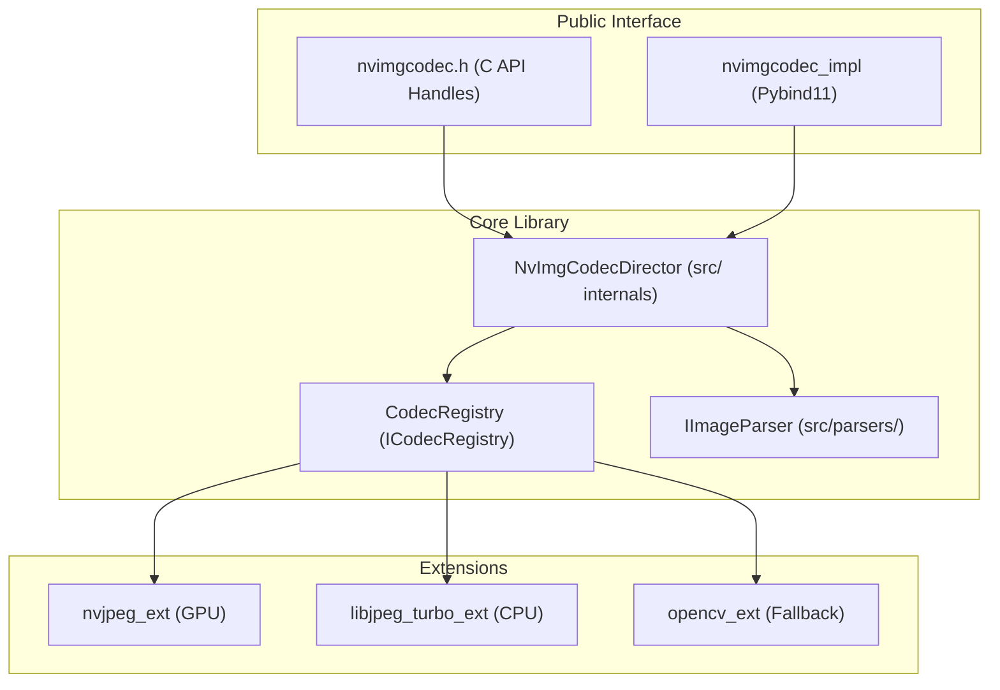
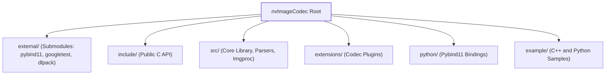

<!-- source: DeepWiki mcp.deepwiki.com · repo NVIDIA/nvImageCodec · page 1 nvImageCodec Overview · fetched 2026-10-26 -->

# nvImageCodec Overview

Relevant source files

The following files were used as context for generating this wiki page:

- [.gitmodules](.gitmodules)
- [Acknowledgements.txt](Acknowledgements.txt)
- [CMakeLists.txt](CMakeLists.txt)
- [LICENSE.txt](LICENSE.txt)
- [README.md](README.md)
- [VERSION.txt](VERSION.txt)

The **nvImageCodec** is an open-source library providing a unified interface for accelerated image codecs [README.md:17-18](). It is designed as a modular framework where specific codec implementations are delivered via extension plugins, allowing for seamless transitions between high-performance GPU-accelerated paths and reliable CPU fallbacks [README.md:18-24]().

## Key Features

- **Unified API**: A single interface for both decoding and encoding across various image formats [README.md:22-22]().
- **Batch Processing**: Supports variable shapes and heterogeneous image formats within a single batch [README.md:23-23]().
- **Automatic Fallback**: Intelligent codec prioritization that automatically falls back to alternative implementations (e.g., CPU) if the primary (e.g., GPU) codec is unavailable or unsupported for a specific bitstream [README.md:24-24]().
- **Zero-Copy Interop**: Direct integration with deep learning frameworks including **PyTorch**, **CuPy**, and **CV-CUDA** via DLPack [README.md:27-27]().
- **Extensibility**: A plugin-based architecture for adding new hardware or software codecs [README.md:18-18]().

## System Architecture

The library is centered around a "Director" pattern that manages the lifecycle of the codec registry and orchestrates the flow of image data through various parsers and backends.

### Code Entity Mapping
The following diagram illustrates how high-level system components map to specific entities within the codebase.

**Component to Code Entity Map**

Sources: [README.md:17-30](), [CMakeLists.txt:20-49](), [include/nvimgcodec.h:1-100]().

## Supported Formats and Codecs

nvImageCodec categorizes its support into native GPU-accelerated extensions and 3rd-party CPU fallback extensions.

### Native Extensions
| Extension | Format | Features |
| :--- | :--- | :--- |
| `nvjpeg_ext` | JPEG | Hardware/CUDA Decoder, Hardware Encoder (Jetson Thor), Lossless support [README.md:32-37]() |
| `nvjpeg2k_ext`| JPEG 2000 | CUDA Decoder/Encoder (including HT-JPEG2000) [README.md:39-42]() |
| `nvtiff_ext` | TIFF | CUDA Decoder/Encoder [README.md:44-47]() |
| `nvbmp_ext`  | BMP | CPU-based reference reader/writer [README.md:49-52]() |
| `nvpnm_ext`  | PNM | CPU-based reference writer (PPM, PBM, PGM) [README.md:54-56]() |

### Fallback Extensions
| Extension | Format | Description |
| :--- | :--- | :--- |
| `libturbo-jpeg_ext` | JPEG | High-performance CPU JPEG decoding [README.md:60-62]() |
| `libtiff_ext` | TIFF | CPU TIFF decoding [README.md:64-66]() |
| `opencv_ext` | Multi | Fallback for JPEG, JPEG2K, PNG, BMP, PNM, TIFF, WebP [README.md:68-76]() |

## Platform Requirements

The library targets modern NVIDIA GPU environments with the following minimum requirements:

- **Operating Systems**: Linux (Ubuntu 20.04+, RHEL 8/9, Debian 12) and Windows (x86_64, WSL2) [README.md:83-102]().
- **Hardware**: NVIDIA GPU with Driver >= 530.30.02 (Linux) or >= 531.14 (Windows) [README.md:98-102]().
- **Software**: 
    - CUDA Toolkit >= 12.1 [README.md:103]().
    - GCC >= 14.0 [README.md:104]().
    - Python >= 3.9 [README.md:105]().

## Installation

The library can be installed via binary packages or Python wheels. The Python packages are split by CUDA version.

| Environment | Command |
| :--- | :--- |
| CUDA 12.x | `pip install nvidia-nvimgcodec-cu12` |
| CUDA 13.x | `pip install nvidia-nvimgcodec-cu13` |
| Jetson (Tegra) | `pip install nvidia-nvimgcodec-tegra-cu12` |

To install with all GPU-accelerated extensions (nvJPEG, nvJPEG2K, nvTIFF), use the `[all]` extra:
`pip install nvidia-nvimgcodec-cu12[all]` [README.md:120-125]().

For detailed installation instructions, including manual library setup and Conda instructions, see [Getting Started](#1.1).

## Project Structure

**Source Code Organization**

Sources: [.gitmodules:1-18](), [CMakeLists.txt:78-100](), [README.md:22-28]().

## Documentation Map

- **[Getting Started](#1.1)**: Step-by-step installation, platform prerequisites, and your first "Hello World" decode.
- **[Contributing and Community](#1.2)**: How to report bugs, request features, and contribute to the codebase.
- **Architecture and Core Library**: Deep dive into the `NvImgCodecDirector`, the C API, and the internal plugin framework.
- **Codec Extensions**: Details on individual codec implementations and how to write your own extension.
- **Python API**: Reference for the Python `Decoder` and `Encoder` classes and framework integrations.
- **Testing**: Information on the GoogleTest (C++) and pytest (Python) suites.

Sources: [README.md:17-30](), [CMakeLists.txt:1-100](), [VERSION.txt:1]()

---

