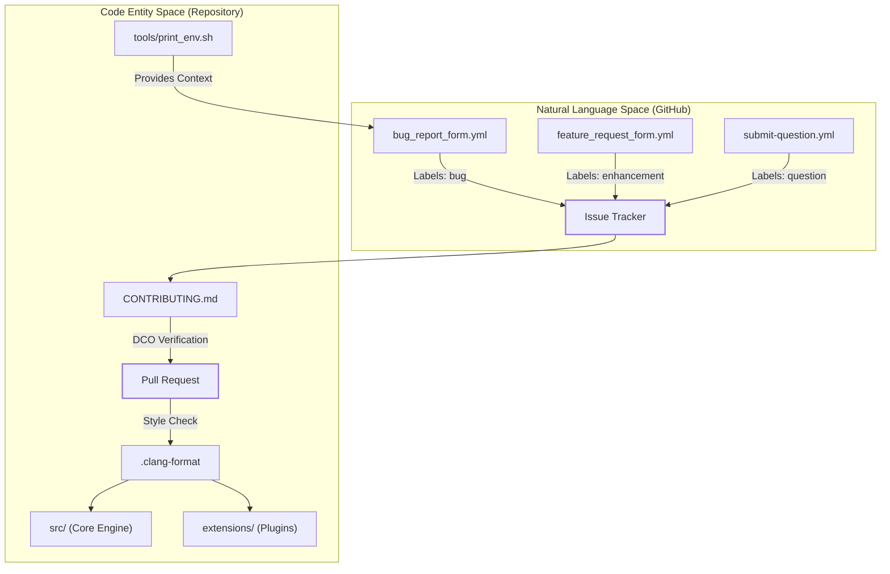

<!-- source: DeepWiki mcp.deepwiki.com · repo NVIDIA/nvImageCodec · page 1.2 Contributing and Community · fetched 2026-10-26 -->

# Contributing and Community

Relevant source files

The following files were used as context for generating this wiki page:

- [.clang-format](.clang-format)
- [.github/ISSUE_TEMPLATE/bug_report_form.yml](.github/ISSUE_TEMPLATE/bug_report_form.yml)
- [.github/ISSUE_TEMPLATE/config.yml](.github/ISSUE_TEMPLATE/config.yml)
- [.github/ISSUE_TEMPLATE/feature_request_form.yml](.github/ISSUE_TEMPLATE/feature_request_form.yml)
- [.github/ISSUE_TEMPLATE/submit-question.yml](.github/ISSUE_TEMPLATE/submit-question.yml)
- [CONTRIBUTING.md](CONTRIBUTING.md)
- [SECURITY.rst](SECURITY.rst)

This page outlines the guidelines and procedures for participating in the nvImageCodec open-source project. It covers the legal requirements for code contributions, the standardized processes for reporting issues and requesting features, and the technical coding standards maintained across the repository.

## Contribution Workflow and Legal Requirements

The nvImageCodec project is developed internally by NVIDIA and periodically released to the public. External contributions are accepted provided they adhere to specific legal and procedural requirements [CONTRIBUTING.md:1-6]().

### Developer Certificate of Origin (DCO)
All contributors must agree to the **Developer Certificate of Origin (DCO) Version 1.1**. By submitting a contribution, you certify that you created the work, have the right to submit it under the Apache License Version 2.0, or are basing it on work covered by an appropriate open-source license [CONTRIBUTING.md:9-29]().

### Contribution Process
Before submitting code, all enhancements, bug fixes, or changes must be initiated by creating a GitHub Issue [CONTRIBUTING.md:5-6]().

| Step | Action | Description |
| :--- | :--- | :--- |
| 1 | **Issue Creation** | File a Bug Report or Feature Request using the GitHub templates. |
| 2 | **DCO Agreement** | Ensure your commits are signed off to certify compliance with the DCO. |
| 3 | **License** | All contributions must be licensed under **Apache License 2.0** [CONTRIBUTING.md:3-4](). |

**Sources:** [CONTRIBUTING.md:1-30]()

## Community Interaction and Issue Tracking

The project uses GitHub Issues to manage bugs, feature requests, and general questions. Each type of interaction is governed by a specific template to ensure maintainers receive the necessary technical context.

### Bug Reports
Bug reports require environment-specific details to facilitate reproduction.
*   **Version:** The specific nvImageCodec version (e.g., 0.9.0) [.github/ISSUE_TEMPLATE/bug_report_form.yml:27-33]().
*   **Minimum Reproducible Example (MVR):** A shell-rendered code snippet that demonstrates the failure [.github/ISSUE_TEMPLATE/bug_report_form.yml:45-50]().
*   **Environment Details:** Output from the `tools/print_env.sh` script [.github/ISSUE_TEMPLATE/bug_report_form.yml:52-57]().
*   **Logs:** Relevant error output and logs [.github/ISSUE_TEMPLATE/bug_report_form.yml:59-64]().

### Feature Requests
Requests for new functionality are triaged based on criticality:
*   **Must have:** Adoption is impossible without it.
*   **Should have:** Performance or usability is inferior without it.
*   **Nice to have:** Enhances existing use cases [.github/ISSUE_TEMPLATE/feature_request_form.yml:38-47]().

Users are encouraged to use the **User Story** format ("As a <persona>, I <want to>, <so that>") or the **EARS** format for system perspectives [.github/ISSUE_TEMPLATE/feature_request_form.yml:57-69]().

### General Questions
For general inquiries that do not involve bugs or features, the `submit-question.yml` template is used to categorize the issue with the `question` label [.github/ISSUE_TEMPLATE/submit-question.yml:16-19]().

**Sources:** [.github/ISSUE_TEMPLATE/bug_report_form.yml:1-78](), [.github/ISSUE_TEMPLATE/feature_request_form.yml:1-106](), [.github/ISSUE_TEMPLATE/submit-question.yml:1-41]()

## Security Policy

NVIDIA maintains a strict policy for reporting security vulnerabilities. **Do not use GitHub Issues for security reports** [.github/ISSUE_TEMPLATE/config.yml:8-12]().

Vulnerabilities should be reported via:
*   **Web:** [NVIDIA Security Vulnerability Submission Form](https://www.nvidia.com/object/submit-security-vulnerability.html) [SECURITY.rst:11-12]().
*   **Email:** `psirt@nvidia.com` using the NVIDIA public PGP key [SECURITY.rst:19-20]().

**Sources:** [SECURITY.rst:1-23](), [.github/ISSUE_TEMPLATE/config.yml:1-12]()

## Coding Standards

The project enforces strict C++ coding standards via `.clang-format` to maintain consistency across the core library and extensions.

### C++ Style Configuration
The codebase follows the **LLVM** base style with specific modifications for the nvImageCodec environment [.clang-format:2-3]().

| Parameter | Value |
| :--- | :--- |
| **Language Standard** | C++17 [.clang-format:9]() |
| **Column Limit** | 140 characters [.clang-format:3]() |
| **Indentation** | 4 spaces, no tabs [.clang-format:4, 13]() |
| **Brace Wrapping** | Mozilla style [.clang-format:11]() |
| **Pointer Alignment** | Left (e.g., `Type* var`) [.clang-format:41]() |

### Macro Handling
Specific macros used for error handling and API definitions are recognized by the formatter to prevent layout corruption:
*   **Macro Blocks:** `NVIMGCODECAPI_TRY` and `NVIMGCODECAPI_CATCH` are treated as block delimiters [.clang-format:55-56]().
*   **Typename Macros:** `CHECK_NULL` is treated as a type-related macro [.clang-format:57]()

### Include Sorting
Includes are categorized and sorted to prevent circular dependencies and maintain readability:
1.  `<ext/.*\.h>` (Priority 2) [.clang-format:16-17]()
2.  Standard system headers `<.*\.h>` (Priority 1) [.clang-format:18-19]()
3.  Other angle-bracket includes `<.*` (Priority 2) [.clang-format:20-21]()
4.  Project-local includes (Priority 3) [.clang-format:22-23]()

**Sources:** [.clang-format:1-58]()

## Data Flow: Issue Triage to Code

The following diagram illustrates how community input (Natural Language Space) translates into code entities and repository changes (Code Entity Space).

### Community Input to Code Entity Mapping

**Sources:** [.github/ISSUE_TEMPLATE/bug_report_form.yml:16-18](), [.github/ISSUE_TEMPLATE/feature_request_form.yml:16-18](), [.github/ISSUE_TEMPLATE/submit-question.yml:16-18](), [CONTRIBUTING.md:1-10](), [.clang-format:1-10]()

## Summary of Formatting Rules

The following table summarizes the `clang-format` rules for developers contributing C++ code to `src/` or `extensions/`.

| Feature | Setting | Code Reference |
| :--- | :--- | :--- |
| **Template Breaking** | Always break before template declarations | [.clang-format:35]() |
| **Constructor Init** | Break before comma, all on next line if needed | [.clang-format:25, 39]() |
| **Namespace** | Compact namespaces enabled; fix comments | [.clang-format:10, 53]() |
| **Short Functions** | Only allowed inline | [.clang-format:30]() |
| **Binary Operators** | No breaking before operators | [.clang-format:38]() |

**Sources:** [.clang-format:10-53]()

---

