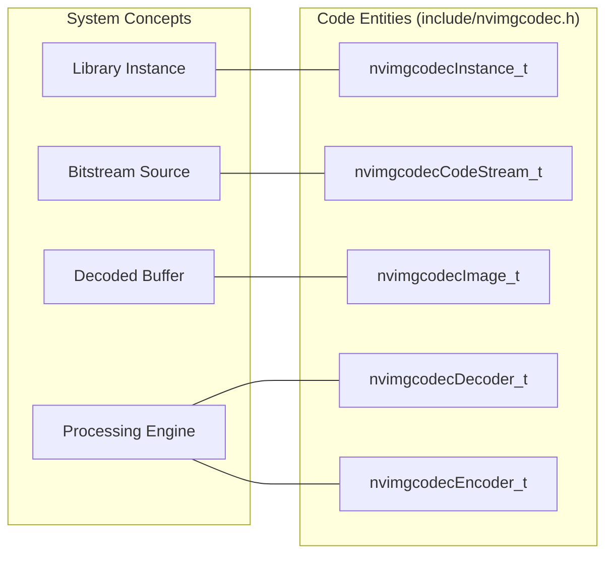

<!-- source: DeepWiki mcp.deepwiki.com · repo NVIDIA/nvImageCodec · page 2.1 Public C API · fetched 2026-10-26 -->

# Public C API

<details>
<summary>Relevant source files</summary>

The following files were used as context for generating this wiki page:

- [.clang-format](.clang-format)
- [CMakeLists.txt](CMakeLists.txt)
- [README.md](README.md)

</details>


The `nvImageCodec` public C API provides a unified, low-level interface for image decoding and encoding. It is designed to be consumed by both C and C++ applications, as well as serve as the foundation for higher-level language bindings like Python. The API is defined in `include/nvimgcodec.h` and utilizes opaque handles to manage the lifecycle of library objects, ensuring a stable ABI and encapsulation of internal logic.

## Error Handling and Status Codes

The API uses a consistent error-handling pattern. Most functions return an `nvimgcodecStatus_t` enum to indicate success or the specific nature of a failure [include/nvimgcodec.h:55-83]().

### Status Codes
Common status codes include:
*   `NVIMGCODEC_STATUS_SUCCESS`: The operation completed successfully.
*   `NVIMGCODEC_STATUS_NOT_INITIALIZED`: The library or instance has not been properly initialized.
*   `NVIMGCODEC_STATUS_INVALID_PARAMETER`: An invalid argument was passed to a function.
*   `NVIMGCODEC_STATUS_BAD_DERIVED`: A failure occurred in a derived class or extension.
*   `NVIMGCODEC_STATUS_ALLOCATOR_FAILURE`: Memory allocation failed.
*   `NVIMGCODEC_STATUS_EXTENSION_NOT_FOUND`: A requested codec extension could not be located.

### Error Handling Macros
To simplify error management in C++ and ensure consistent behavior across the library, the API provides `NVIMGCODECAPI_TRY` and `NVIMGCODECAPI_CATCH` macros [include/nvimgcodec.h:116-136](). These macros wrap internal logic, catching exceptions and converting them into the appropriate `nvimgcodecStatus_t` return codes.

**Sources:**
- [include/nvimgcodec.h:55-83]() (Status enum definition)
- [include/nvimgcodec.h:116-136]() (Try/Catch macro definitions)

---

## Opaque Handle Types

The C API manages resources through opaque handles. This pattern prevents users from directly accessing internal memory layouts, allowing the library to evolve without breaking binary compatibility.

| Handle Type | Description |
| :--- | :--- |
| `nvimgcodecInstance_t` | The root object representing the library instance. Manages the codec registry and global state [include/nvimgcodec.h:145](). |
| `nvimgcodecDecoder_t` | A handle to a decoder object capable of processing one or more bitstreams into image buffers [include/nvimgcodec.h:147](). |
| `nvimgcodecEncoder_t` | A handle to an encoder object used to compress image buffers into bitstreams [include/nvimgcodec.h:148](). |
| `nvimgcodecCodeStream_t` | Represents an encoded image bitstream (e.g., a JPEG file in memory or on disk) [include/nvimgcodec.h:150](). |
| `nvimgcodecImage_t` | Represents a decoded image, containing pixel data and format metadata [include/nvimgcodec.h:149](). |

### Handle Relationship Diagram
This diagram illustrates how the handles interact during a typical decoding workflow.

"C API Handle Interactions"
```mermaid
graph TD
    subgraph "Application Space"
        [App] --> |"nvimgcodecInstanceCreate"| INST["nvimgcodecInstance_t"]
    end

    subgraph "Core Objects"
        INST --> |"nvimgcodecDecoderCreate"| DEC["nvimgcodecDecoder_t"]
        INST --> |"nvimgcodecCodeStreamCreate"| CS["nvimgcodecCodeStream_t"]
    end

    subgraph "Data Flow"
        DEC --> |"nvimgcodecDecoderDecode"| CS
        CS --> |"Produces"| IMG["nvimgcodecImage_t"]
    end
```

**Sources:**
- [include/nvimgcodec.h:145-151]() (Handle type definitions)

---

## Key Structure Types

The API uses various descriptor structures to configure the behavior of decoders, encoders, and image formats.

### Instance Selection
The `nvimgcodecInstanceCreateInfo_t` structure is used during `nvimgcodecInstanceCreate` to specify which extensions to load and global settings like logging levels [include/nvimgcodec.h:476-488]().

### Image Descriptors
The `nvimgcodecImageInfo_t` structure defines the physical properties of an image, including its resolution, color space, and sample format [include/nvimgcodec.h:353-372]().

### Execution Parameters
*   **`nvimgcodecDecodeParams_t`**: Controls decoding behavior, such as specifying the target backend (CPU vs GPU) and applying transformations like cropping or padding [include/nvimgcodec.h:651-660]().
*   **`nvimgcodecExecutionParams_t`**: Configures the execution environment, including the CUDA stream to be used for asynchronous operations and the thread pool size for CPU tasks [include/nvimgcodec.h:520-531]().

**Sources:**
- [include/nvimgcodec.h:353-372]() (ImageInfo structure)
- [include/nvimgcodec.h:476-488]() (InstanceCreateInfo structure)
- [include/nvimgcodec.h:520-531]() (ExecutionParams structure)
- [include/nvimgcodec.h:651-660]() (DecodeParams structure)

---

## Core Function Reference

The following table highlights the primary functions for managing the lifecycle of the library and performing image operations.

| Function | Purpose |
| :--- | :--- |
| `nvimgcodecInstanceCreate` | Initializes the library and returns a new instance handle [include/nvimgcodec.h:495](). |
| `nvimgcodecInstanceDestroy` | Shuts down the library instance and releases all associated resources [include/nvimgcodec.h:505](). |
| `nvimgcodecDecoderCreate` | Creates a decoder object with specific execution parameters [include/nvimgcodec.h:666](). |
| `nvimgcodecDecoderDecode` | Performs the decoding of a batch of code streams into a batch of images [include/nvimgcodec.h:689](). |
| `nvimgcodecEncoderCreate` | Creates an encoder object for a specific image format [include/nvimgcodec.h:733](). |
| `nvimgcodecEncoderEncode` | Compresses image data into one or more code streams [include/nvimgcodec.h:754](). |

### System Name to Code Entity Mapping
This diagram bridges the conceptual "System Names" used in documentation with the specific "Code Entities" in `include/nvimgcodec.h`.

"API Mapping: Natural Language to Code"


**Sources:**
- [include/nvimgcodec.h:495-505]() (Instance management functions)
- [include/nvimgcodec.h:666-689]() (Decoder management functions)
- [include/nvimgcodec.h:733-754]() (Encoder management functions)

---

## Implementation Details and Data Flow

When an application calls `nvimgcodecDecoderDecode`, the following sequence occurs within the C API layer:

1.  **Validation**: The library validates the handles and parameters using the `NVIMGCODECAPI_TRY` block [include/nvimgcodec.h:116]().
2.  **Dispatch**: The `nvimgcodecDecoder_t` handle (which internally maps to a C++ `ImageGenericDecoder`) determines the appropriate codec extension based on the bitstream metadata in the `nvimgcodecCodeStream_t`.
3.  **Asynchronous Execution**: If a CUDA stream is provided in the `nvimgcodecExecutionParams_t`, the work is dispatched to the GPU. The function may return before the GPU has finished processing if the implementation is asynchronous.
4.  **Result Reporting**: The status of each individual image in a batch is reported via `nvimgcodecProcessingStatus_t` [include/nvimgcodec.h:86-111]().

**Sources:**
- [include/nvimgcodec.h:86-111]() (Processing status codes)
- [include/nvimgcodec.h:520-531]() (Execution parameters for streams)
- [include/nvimgcodec.h:689-700]() (Decode function signature)

---

