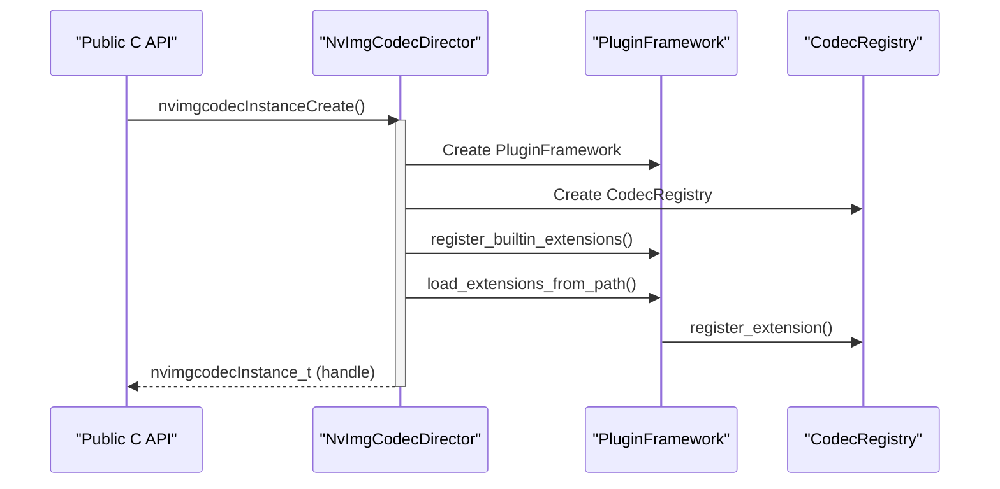

<!-- source: DeepWiki mcp.deepwiki.com · repo NVIDIA/nvImageCodec · page 2.2 Core Engine: Director, Registry, and Plugin Framework · fetched 2026-10-26 -->

# Core Engine: Director, Registry, and Plugin Framework

<details>
<summary>Relevant source files</summary>

The following files were used as context for generating this wiki page:

- [.gitmodules](.gitmodules)
- [CMakeLists.txt](CMakeLists.txt)

</details>


This section provides a deep dive into the internal orchestration of the nvImageCodec library. It covers how the library manages its lifecycle, discovers extensions, and maintains a registry of available codecs and parsers.

## NvImgCodecDirector: Instance Lifecycle

The `NvImgCodecDirector` is the central management entity of the library. It implements the `IInstance` interface and serves as the primary entry point for creating decoders, encoders, and managing the overall state of a library instance.

### Implementation Details
When a user calls `nvimgcodecInstanceCreate`, the library instantiates a `NvImgCodecDirector`. This object is responsible for:
*   **Initialization**: Setting up the logging system and the `PluginFramework` [src/nvimgcodec_director.cpp:45-60]().
*   **Resource Management**: Managing the `CodecRegistry`, `IoStreamFactory`, and `ThreadPool` [src/nvimgcodec_director.cpp:62-80]().
*   **Extension Loading**: Orchestrating the discovery of built-in and dynamic extensions via the `PluginFramework` [src/nvimgcodec_director.cpp:95-110]().

### Data Flow: Instance Initialization
The following diagram illustrates the sequence of object creation when a new instance is initialized.

**Instance Creation Sequence**

Sources: [src/nvimgcodec_director.cpp:45-120](), [src/plugin_framework.cpp:30-55]()

---

## CodecRegistry: Lookup and Dispatch

The `CodecRegistry` (implementing `ICodecRegistry`) acts as a central database for all registered image parsers, decoders, and encoders. It is used by the `ImageGenericDecoder` and `ImageGenericEncoder` to find the most suitable implementation for a given image format.

### Key Responsibilities
*   **Parser Management**: Stores `IImageParser` instances and provides a `get_parser_by_id` method [src/codec_registry.h:45-50]().
*   **Codec Discovery**: Maintains a list of `ICodec` implementations.
*   **Format Matching**: When a bitstream is processed, the registry uses parsers to identify the format and then looks up the corresponding codec [src/codec_registry.cpp:150-180]().

### Registry Structure
| Component | Interface | Role |
| :--- | :--- | :--- |
| **Parser** | `IImageParser` | Identifies image format and extracts metadata (e.g., JPEG, PNG) |
| **Codec** | `ICodec` | Factory for creating specific decoders/encoders |
| **Extension** | `IExtension` | A logical grouping of parsers and codecs (e.g., `nvJPEG` extension) |

Sources: [src/codec_registry.h:25-60](), [src/codec_registry.cpp:40-100]()

---

## Plugin Framework: Dynamic Extensions

The `PluginFramework` is the mechanism that allows nvImageCodec to be extended without recompiling the core library. It supports both statically linked "built-in" extensions and dynamically loaded modules.

### Extension Discovery
The framework searches for dynamic libraries (e.g., `.so` or `.dll` files) in specified paths. For each library found, it:
1.  Loads the library using `dlopen` (or `LoadLibrary` on Windows) [src/plugin_framework.cpp:180-200]().
2.  Looks for the entry point symbol: `get_nvimgcodec_extension_desc` [src/plugin_framework.cpp:210-220]().
3.  Calls this function to receive a `nvimgcodecExtensionDesc_t` structure containing metadata and function pointers.
4.  Initializes the extension and registers its codecs/parsers into the `CodecRegistry`.

### Plugin Loading Architecture
This diagram shows the relationship between the `PluginFramework`, the filesystem, and the internal `CodecRegistry`.

**Plugin Loading and Registration**
```mermaid
graph TD
    subgraph "PluginFramework System"
        PF["PluginFramework"]
        DL["DynamicLoader (dlopen/dlsym)"]
    end

    subgraph "External Modules"
        EXT1["libnvimgcodec_nvjpeg.so"]
        EXT2["libnvimgcodec_opencv.so"]
    end

    subgraph "Internal Registry"
        CR["CodecRegistry"]
        P1["IImageParser (JPEG)"]
        C1["ICodec (nvJPEG)"]
    end

    PF -->| "1. Scan Path" | EXT1
    PF -->| "2. Load" | DL
    DL -->| "3. Symbol Lookup" | EXT1
    EXT1 -->| "4. Return nvimgcodecExtensionDesc_t" | PF
    PF -->| "5. register_extension()" | CR
    CR --> P1
    CR --> C1
```
Sources: [src/plugin_framework.cpp:150-250](), [src/nvimgcodec_director.cpp:100-115]()

---

## Key Interfaces: ICodec and ICodecRegistry

The system relies on a set of abstract interfaces to decouple the core engine from specific codec implementations.

### ICodec Interface
Every codec extension must implement the `ICodec` interface. Its primary role is to act as a factory for decoders and encoders.
*   `create_decoder()`: Returns an `IDecoder` instance tailored for the specific backend (e.g., GPU vs CPU) [src/interface/icodec.h:35-40]().
*   `create_encoder()`: Returns an `IEncoder` instance [src/interface/icodec.h:42-45]().
*   `get_codec_id()`: Returns a unique string identifier (e.g., "nvjpeg") [src/interface/icodec.h:30-32]().

### ICodecRegistry Interface
The `ICodecRegistry` provides the lookup logic used during the pipeline execution.
*   `register_extension()`: Adds a new extension and its associated codecs to the system [src/interface/icodec_registry.h:40-45]().
*   `find_codecs()`: Returns a list of codecs that support a specific image format, allowing the `Director` to implement fallback logic [src/interface/icodec_registry.h:50-55]().

### Mapping System Names to Code Entities
The following table maps conceptual components to their specific C++ class implementations and file locations.

| System Component | C++ Class | Header File |
| :--- | :--- | :--- |
| **Instance Handle** | `NvImgCodecDirector` | [src/nvimgcodec_director.h]() |
| **Extension Manager** | `PluginFramework` | [src/plugin_framework.h]() |
| **Codec Database** | `CodecRegistry` | [src/codec_registry.h]() |
| **Dynamic Loading** | `DynamicLoader` | [src/dynamic_loader.h]() |

Sources: [src/interface/icodec.h:20-50](), [src/interface/icodec_registry.h:25-60](), [src/nvimgcodec_director.h:30-45]()

---

