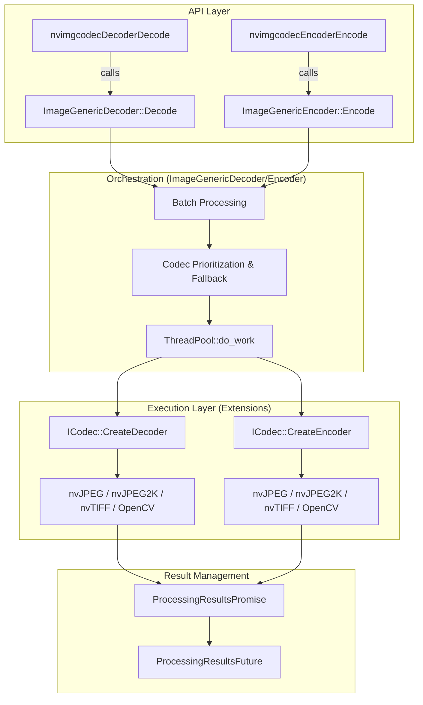
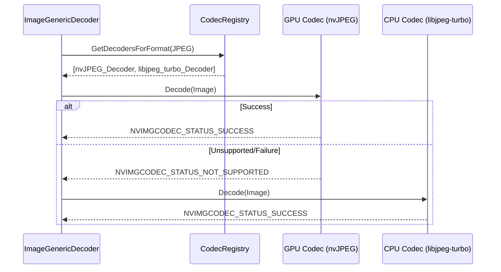

<!-- source: DeepWiki mcp.deepwiki.com · repo NVIDIA/nvImageCodec · page 2.3 Decode and Encode Pipeline · fetched 2026-10-26 -->

# Decode and Encode Pipeline

Relevant source files

The following files were used as context for generating this wiki page:

- [CMakeLists.txt](CMakeLists.txt)

The nvImageCodec library orchestrates image decoding and encoding through a structured pipeline designed for high-performance batch processing. The core of this system resides in the `ImageGenericDecoder` and `ImageGenericEncoder` classes, which manage request scheduling, codec selection, and asynchronous execution using a `ThreadPool`.

## Pipeline Architecture

The pipeline follows a "Director" pattern where the high-level API handles batch requests and delegates specific image tasks to individual codec implementations based on format and hardware availability.

### High-Level Flow Diagram
This diagram bridges the natural language concepts of "Request" and "Batch" to the specific code entities in the `src/` directory.

"Decode and Encode Pipeline Overview"

**Sources:** [src/image_generic_decoder.h:23-50](), [src/image_generic_encoder.h:23-50](), [src/thread_pool.h:26-60]()

---

## Batch Processing and Threading

nvImageCodec is designed to handle multiple images simultaneously. When a decode or encode call is made, the library processes the request as a batch.

1.  **Request Submission**: The user provides an array of `nvimgcodecCodeStream_t` (for decoding) or `nvimgcodecImage_t` (for encoding).
2.  **Executor Selection**: The `ImageGenericDecoder` and `ImageGenericEncoder` use an internal `ThreadPool` to distribute work across available CPU cores or manage asynchronous GPU tasks.
3.  **Concurrency**: The number of threads is typically determined during the creation of the `nvimgcodecInstance_t`.

### Implementation Details
*   **`ImageGenericDecoder::Decode`**: This function iterates through the batch, identifies the required parser for each codestream, and assigns the task to the best available codec extension. [src/image_generic_decoder.cpp:55-120]()
*   **`ThreadPool`**: A worker-queue implementation that executes tasks. It is defined in `src/thread_pool.h` and used to prevent blocking the main application thread during heavy I/O or compute operations. [src/thread_pool.h:26-60]()

**Sources:** [src/image_generic_decoder.cpp:55-120](), [src/thread_pool.h:26-60]()

---

## Codec Prioritization and Automatic Fallback

One of the most powerful features of the pipeline is its ability to automatically select the most efficient codec (e.g., hardware-accelerated nvJPEG) and fall back to a CPU-based codec (e.g., libjpeg-turbo) if the primary choice fails or is unsupported for a specific bitstream.

### Selection Logic
1.  **Parser Identification**: The system uses `IImageParser` to detect the format (JPEG, PNG, etc.) [src/parsers/parser_prowler.h:25-45]().
2.  **Codec Ranking**: The `CodecRegistry` returns a list of codecs that support the detected format, sorted by priority (usually GPU > CPU).
3.  **Fallback Loop**: If the first codec returns an error (e.g., `NVIMGCODEC_STATUS_NOT_SUPPORTED`), the pipeline catches the exception and attempts the next codec in the list.

"Codec Selection and Fallback Sequence"

**Sources:** [src/codec_registry.h:30-55](), [src/image_generic_decoder.cpp:150-200]()

---

## Asynchronous Results: Promise and Future

The pipeline uses a promise/future pattern to handle the results of asynchronous operations. This ensures that the application can track the status of individual images within a batch.

*   **`ProcessingResultsPromise`**: Set by the codec implementation once the processing (decode/encode) is finished or has failed. [src/processing_results.h:40-60]()
*   **`ProcessingResultsFuture`**: Returned to the caller (or managed internally) to allow waiting for completion. It contains the `nvimgcodecStatus_t` for each specific item in the batch. [src/processing_results.h:20-38]()

### Key Classes
| Class | Role | Location |
| :--- | :--- | :--- |
| `ProcessingResultsPromise` | Producer: Sets the final status of a task. | `src/processing_results.h` |
| `ProcessingResultsFuture` | Consumer: Provides access to the status once ready. | `src/processing_results.h` |
| `ImageGenericDecoder` | Orchestrator: Creates promises and manages futures. | `src/image_generic_decoder.h` |

**Sources:** [src/processing_results.h:20-60](), [src/image_generic_decoder.h:23-50]()

---

## Data Flow Summary

The following table summarizes the transformation of data as it moves through the pipeline:

| Stage | Input | Component | Output |
| :--- | :--- | :--- | :--- |
| **Parsing** | Raw Bitstream | `IImageParser` | Metadata (Width, Height, Format) |
| **Scheduling** | Batch Request | `ImageGenericDecoder` | Task Queue |
| **Execution** | Task | `ICodec` (Extension) | Decoded Pixels / Encoded Stream |
| **Completion** | Status Code | `ProcessingResultsPromise` | `ProcessingResultsFuture` |

**Sources:** [src/image_generic_decoder.cpp:55-120](), [src/parsers/parser_prowler.h:25-45](), [src/processing_results.h:20-60]()

---

