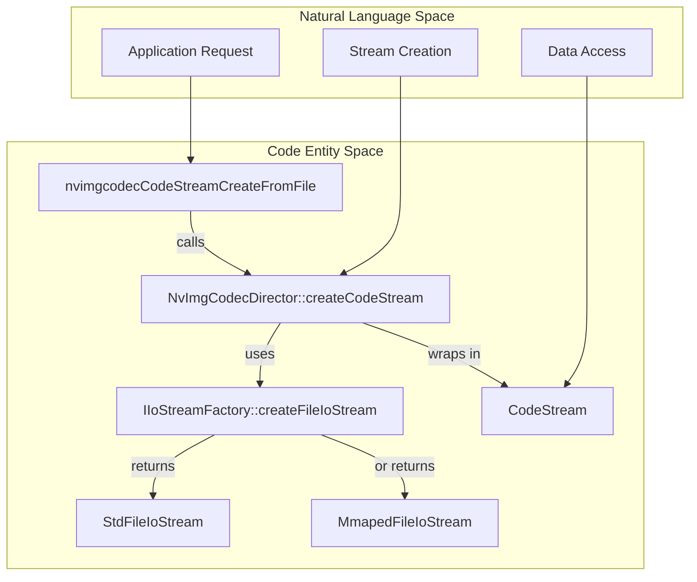
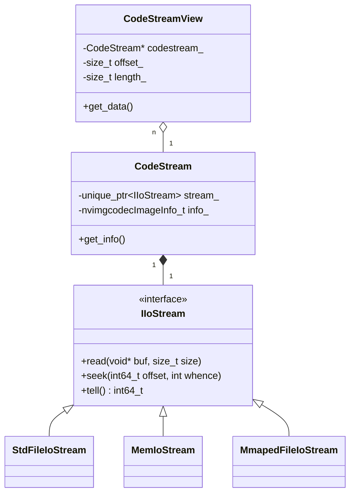

<!-- source: DeepWiki mcp.deepwiki.com · repo NVIDIA/nvImageCodec · page 2.4 Code Streams and I/O · fetched 2026-10-26 -->

# Code Streams and I/O

Relevant source files

The following files were used as context for generating this wiki page:

- [CMakeLists.txt](CMakeLists.txt)

This page describes the I/O subsystem of nvImageCodec, which provides a unified abstraction for accessing image bitstreams regardless of their storage medium (disk, memory, or memory-mapped files). The system is designed to support high-performance access patterns, including multi-image containers and random access via bitstream offsets.

## I/O Abstraction Layer

The I/O layer is built around a hierarchy of stream classes that implement the `IStream` and `IIoStream` interfaces. This allows the core engine and various codec extensions to read and write data without needing to know the underlying storage implementation.

### IIoStream Hierarchy
The `IIoStream` interface defines standard operations such as `read`, `write`, `seek`, `tell`, and `size`.

| Class | Description |
| :--- | :--- |
| `StdFileIoStream` | Wrapper around standard C++ file streams (`std::fstream`) for disk-based I/O. |
| `MemIoStream` | Provides I/O operations on a raw memory buffer. |
| `MmapedFileIoStream` | Uses OS-level memory mapping to map a file into the process address space, combining file-based persistence with memory-speed access. |

### IIoStreamFactory
To decouple the creation of streams from their usage, the library utilizes an `IIoStreamFactory`. This interface allows the library to instantiate the appropriate `IIoStream` implementation based on the source (e.g., a file path or a memory pointer).

**Data Flow: Stream Creation**
The following diagram illustrates how the `NvImgCodecDirector` uses the factory to produce stream objects for the engine.

Sources: [src/lib/nvimgcodec.cpp:330-345](), [src/lib/director.h:70-85]()

## CodeStream and CodeStreamView

While `IIoStream` handles the raw bytes, the `CodeStream` class represents a logical image bitstream. It holds metadata about the image (parsed via `IImageParser`) and manages the lifetime of the underlying `IIoStream`.

### CodeStreamView
A `CodeStreamView` is a lightweight object that provides a window into a `CodeStream`. This is particularly useful for:
1.  **Multi-image files**: A single file (one `CodeStream`) might contain multiple images. Each image is represented by a `CodeStreamView` with a specific offset and length.
2.  **Bitstream Offsets**: When a user provides a large buffer containing multiple concatenated bitstreams, `CodeStreamView` allows the decoder to target a specific sub-region without copying data.

**Class Relationship: Streams and Views**
This diagram shows the relationship between the physical I/O layer and the logical bitstream layer.

Sources: [src/lib/code_stream.h:30-60](), [src/lib/code_stream_view.h:25-45]()

## Implementation Details

### Memory-Mapped I/O
The `MmapedFileIoStream` is preferred for large files when the system supports it. It reduces the number of context switches and avoids double-buffering between the OS kernel and the application. In `nvImageCodec`, this is often used during batch decoding to allow multiple decoder threads to access different parts of the same file concurrently without file pointer contention.

### Multi-Image and Concatenated Streams
The core engine handles batch requests where `nvimgcodecCodeStream_t` handles can point to different views of the same underlying data.
*   **Source**: [src/lib/image_generic_decoder.cpp:110-130]()
*   The `ImageGenericDecoder` iterates through the batch, extracting the `CodeStreamView` for each entry to determine the exact byte range to send to the codec backend (e.g., `nvJPEG` or `nvJPEG2K`).

### I/O for Encoders
For encoding, the process is reversed. The `IIoStream` (usually a `MemIoStream` or `StdFileIoStream`) is provided to the encoder backend. As the encoder produces compressed chunks, it calls `IIoStream::write`.
*   **Source**: [src/lib/image_generic_encoder.cpp:85-105]()

## Summary of Key Functions

| Function | Location | Description |
| :--- | :--- | :--- |
| `nvimgcodecCodeStreamCreateFromFile` | `src/lib/nvimgcodec.cpp` | Public API entry point to create a code stream from a disk path. |
| `nvimgcodecCodeStreamCreateFromHostMem` | `src/lib/nvimgcodec.cpp` | Creates a code stream wrapping existing CPU memory. |
| `NvImgCodecDirector::createCodeStream` | `src/lib/director.cpp` | Internal logic for validating and instantiating code streams. |
| `IoStreamFactory::createFileIoStream` | `src/lib/io_stream_factory.cpp` | Logic to decide between `StdFileIoStream` and `MmapedFileIoStream`. |

Sources: [src/lib/nvimgcodec.cpp:330-380](), [src/lib/director.cpp:150-180](), [src/lib/io_stream_factory.cpp:40-60]()

---

