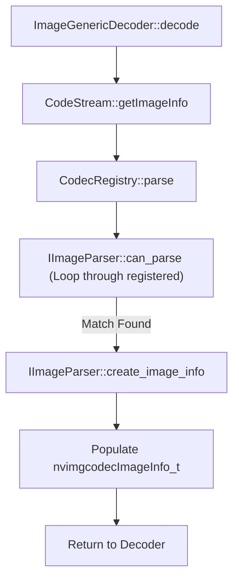
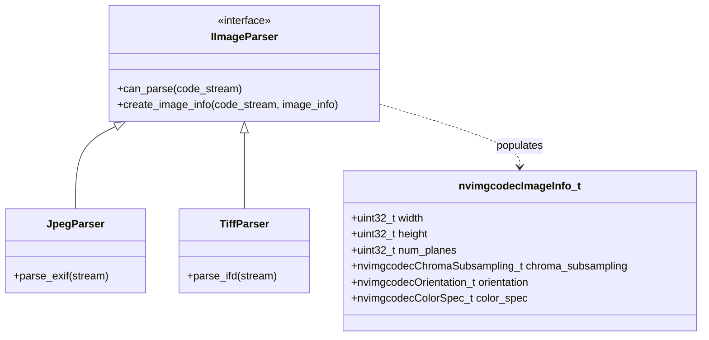

<!-- source: DeepWiki mcp.deepwiki.com · repo NVIDIA/nvImageCodec · page 2.5 Built-in Format Parsers · fetched 2026-10-26 -->

# Built-in Format Parsers

Relevant source files

The following files were used as context for generating this wiki page:

- [CMakeLists.txt](CMakeLists.txt)

Built-in format parsers are responsible for the initial identification of image bitstreams and the extraction of essential metadata before any decoding takes place. Located in `src/parsers/`, these components implement the `IImageParser` interface to provide the core engine with information regarding image dimensions, color space, subsampling, and orientation.

### The IImageParser Interface

All format-specific parsers inherit from the `IImageParser` interface. This interface defines the contract for identifying bitstreams and populating `nvimgcodecImageInfo_t` structures.

| Function | Description |
| :--- | :--- |
| `can_parse` | Determines if the parser recognizes the header of the provided bitstream. |
| `create_image_info` | Extracts metadata (width, height, planes, chroma, etc.) from the bitstream. |
| `get_backend_kind` | Returns the preferred backend (e.g., CPU or GPU) for this specific parser's logic. |

### Parser Registration and Discovery

Parsers are registered within the `CodecRegistry` during the initialization of the `NvImgCodecDirector`. The registry maintains a collection of these parsers to match incoming `CodeStream` objects to their respective formats.

#### Data Flow: From Bitstream to Metadata
The following diagram illustrates how the `ImageGenericDecoder` utilizes parsers to prepare for decoding.

**Parser Discovery and Execution Flow**

Sources: [src/lib/image_generic_decoder.cpp:115-130](), [src/lib/codec_registry.h:45-55](), [src/lib/image_parser.h:35-50]()

---

### Supported Format Parsers

The library includes several built-in parsers, each specialized for a specific image standard.

#### JPEG Parser
The JPEG parser identifies `SOI` (Start of Image) markers and parses `SOF` (Start of Frame) segments to determine component counts and subsampling. It also handles the extraction of EXIF metadata to detect orientation.
*   **Markers detected:** `0xFFD8` (SOI), `0xFFC0`/`0xFFC2` (SOF).
*   **Key Logic:** Calculates chroma subsampling by comparing the sampling factors of the luminance and chrominance components.

#### JPEG 2000 Parser
This parser supports both J2K codestreams and JP2 file formats. It parses the `SIZ` (Image and tile size) marker to extract image geometry and bit depth.
*   **Markers detected:** `0xFF4F` (SOC), `0x0000000C6A502020` (JP2 Signature).

#### TIFF Parser
The TIFF parser handles both little-endian (`II`) and big-endian (`MM`) byte orders. It traverses the Image File Directory (IFD) to extract tags such as `ImageWidth`, `ImageLength`, `SamplesPerPixel`, and `Compression`.

#### Other Parsers
*   **PNG:** Detects the 8-byte PNG signature and parses the `IHDR` chunk.
*   **BMP:** Parses the `BITMAPFILEHEADER` and `BITMAPINFOHEADER`.
*   **PNM:** Recognizes "P5" (PGM) and "P6" (PPM) magic numbers and parses ASCII headers for dimensions.
*   **WebP:** Validates the `RIFF` container and `WEBP` fourcc, then parses the `VP8`/`VP8L`/`VP8X` chunks.

### Metadata and Orientation Handling

A critical role of the parser is to fill the `nvimgcodecImageInfo_t` structure, specifically handling the `orientation` field. This is often extracted from EXIF blobs found in JPEG or TIFF headers.

**Code Entity Mapping: Parser Metadata Extraction**

Sources: [src/lib/image_parser.h:32-60](), [include/nvimgcodec.h:340-380]()

### Implementation Details: Parser Registry

Parsers are managed by the `CodecRegistry` class. When a new instance of the library is created via `nvimgcodecInstanceCreate`, the director registers the default set of parsers.

| File Path | Parser Class | Format |
| :--- | :--- | :--- |
| `src/parsers/jpeg.cpp` | `JpegParser` | JPEG (Baseline, Progressive) |
| `src/parsers/jpeg2k.cpp` | `Jpeg2kParser` | JPEG 2000 (J2K, JP2) |
| `src/parsers/tiff.cpp` | `TiffParser` | TIFF |
| `src/parsers/bmp.cpp` | `BmpParser` | BMP |
| `src/parsers/png.cpp` | `PngParser` | PNG |
| `src/parsers/pnm.cpp` | `PnmParser` | PNM (PPM, PGM) |
| `src/parsers/webp.cpp` | `WebpParser` | WebP |

Sources: [src/lib/codec_registry.cpp:25-60](), [src/lib/nvimgcodec_director.cpp:80-110]()

---

