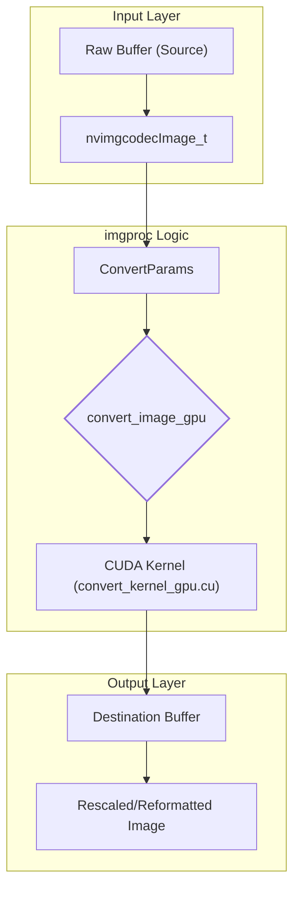
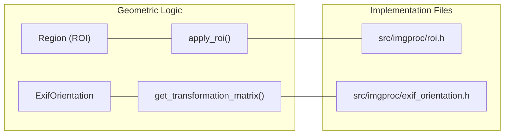

<!-- source: DeepWiki mcp.deepwiki.com · repo NVIDIA/nvImageCodec · page 2.6 Image Processing Utilities (imgproc) · fetched 2026-10-26 -->

# Image Processing Utilities (imgproc)

Relevant source files

The following files were used as context for generating this wiki page:

- [.gitmodules](.gitmodules)
- [CMakeLists.txt](CMakeLists.txt)

The `imgproc` subsystem provides essential low-level utilities for image manipulation, memory management, and CUDA-accelerated processing. It serves as the foundational layer for format conversion, color space transformations, and buffer handling across the `nvImageCodec` library.

### Core Components and Implementation

The subsystem is primarily located in `src/imgproc/` and consists of several key functional areas:

1.  **CUDA Kernels**: Optimized GPU kernels for color conversion and pixel format transformation.
2.  **Buffer Management**: Classes for handling different memory types (device, pinned, pageable).
3.  **Geometric Utilities**: Logic for Region of Interest (ROI) handling and EXIF orientation.
4.  **CUDA Helpers**: RAII wrappers and utility functions for CUDA stream and event management.

### Color Space and Pixel Format Conversion

The library utilizes CUDA kernels to perform high-performance conversions between various color spaces and sample formats. The primary entry point for these operations is defined in `src/imgproc/convert.h`.

#### Implementation Details: `convert_kernel_gpu.cu`
The GPU-accelerated conversions are implemented in `src/imgproc/convert_kernel_gpu.cu`. These kernels handle:
*   **Interleaved to Planar conversion**: Transforming `HWC` data to `CHW`.
*   **Color Space Transformation**: Converting between RGB, BGR, YUV, and Grayscale.
*   **Bit-depth Rescaling**: Handling conversions between `uint8`, `uint16`, and `float` types.

#### Conversion Data Flow
The following diagram illustrates how a raw image buffer is processed through the conversion utilities:

**Title: Pixel Conversion Data Flow**

**Sources:** `src/imgproc/convert.h:1-50` (), `src/imgproc/convert_kernel_gpu.cu:1-100` ()

---

### Buffer Management

The `imgproc` subsystem manages various memory types to optimize data transfer between CPU and GPU.

| Class / Entity | Responsibility | File Reference |
| :--- | :--- | :--- |
| `DeviceBuffer` | Manages `cudaMalloc` allocations for GPU processing. | `src/imgproc/device_buffer.h` |
| `PinnedBuffer` | Manages `cudaHostAlloc` for fast asynchronous transfers. | `src/imgproc/pinned_buffer.h` |
| `PageableBuffer` | Standard CPU memory allocations. | `src/imgproc/pageable_buffer.h` |

These classes utilize RAII patterns to ensure that CUDA resources are properly freed when the buffer objects go out of scope.

**Sources:** `src/imgproc/device_buffer.h:1-40` (), `src/imgproc/pinned_buffer.h:1-40` ()

---

### ROI and Orientation Handling

`nvImageCodec` supports decoding specific Regions of Interest (ROI) and applying EXIF orientation transformations during the image processing pipeline.

*   **ROI Handling**: Functions in `src/imgproc/roi.h` calculate the intersection of requested regions and the actual image dimensions, ensuring that pointers and offsets are correctly calculated for kernels.
*   **EXIF Orientation**: The library handles the 8 standard EXIF orientations (Flip, Rotate 90/180/270). The logic for mapping these orientations to transformation parameters is located in `src/imgproc/exif_orientation.h`.

**Title: ROI and Orientation Code Entities**

**Sources:** `src/imgproc/roi.h:1-30` (), `src/imgproc/exif_orientation.h:1-45` ()

---

### CUDA Utility Helpers

To simplify asynchronous execution and error handling, `imgproc` provides several internal helpers:

*   **Stream Management**: Wrappers around `cudaStream_t` to ensure synchronization and proper lifecycle management within the decoder/encoder pipelines.
*   **Error Checking**: Macros for validating CUDA API return codes, integrated with the library's status reporting system.
*   **Memory Copy**: Specialized wrappers for `cudaMemcpyAsync` that handle the complexities of pitch-linear vs. contiguous memory layouts.

**Sources:** `src/imgproc/cuda_utils.h:1-60` (), `src/imgproc/convert.h:50-80` ()

---

