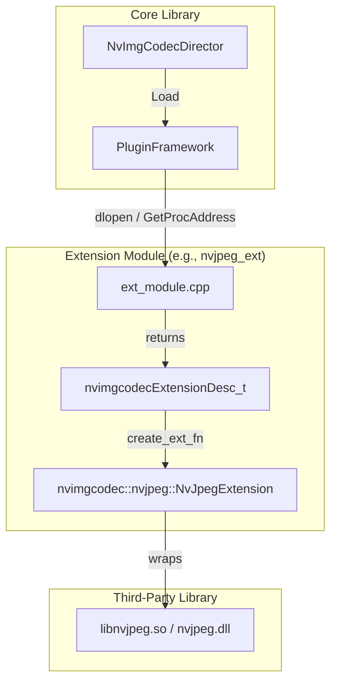

<!-- source: DeepWiki mcp.deepwiki.com · repo NVIDIA/nvImageCodec · page 3 Codec Extensions · fetched 2026-10-26 -->

# Codec Extensions

Relevant source files

The following files were used as context for generating this wiki page:

- [Acknowledgements.txt](Acknowledgements.txt)
- [CMakeLists.txt](CMakeLists.txt)

The `nvImageCodec` library is designed as an extensible framework where the actual image decoding and encoding logic is decoupled from the core engine. This is achieved through a plugin-based architecture where different codecs are implemented as standalone extensions. These extensions can be either GPU-accelerated for high-performance processing or CPU-based to provide broad format support and robust fallbacks.

## Extension Module Structure

Extensions in `nvImageCodec` are typically structured as dynamic libraries that are discovered and loaded at runtime by the `PluginFramework` [src/plugin_framework.h:26-30](). Each extension must implement a standard entry point and provide a descriptor that defines its capabilities.

### Entry Point and Descriptor
The primary interface between the core library and an extension is the `nvimgcodecExtensionDesc_t` structure. This descriptor contains metadata about the extension, including its name, version, and the functions used to create or destroy the extension instance.

The standard entry point for an extension module is typically found in a file named `ext_module.cpp`. This file implements the `nvimgcodecGetExtensionDesc` function, which the core library calls after loading the shared object to register the extension's decoders, encoders, and parsers.

### Directory Layout
The extensions are organized within the `extensions/` directory of the source tree. Each sub-directory represents a specific backend or library integration:

*   **GPU Backends:** `extensions/nvjpeg/`, `extensions/nvjpeg2k/`, `extensions/nvtiff/`.
*   **CPU Backends:** `extensions/libjpeg_turbo/`, `extensions/libtiff/`, `extensions/opencv/`, `extensions/nvbmp/`, `extensions/nvpnm/`.

### Extension Registration Flow
The following diagram illustrates how an extension module bridges the gap between the core `nvimgcodec` library and specific third-party codec libraries.

**Extension Registration Architecture**

**Sources:** [CMakeLists.txt:91-98](), [src/plugin_framework.h:26-50]()

## GPU-Accelerated Extensions

The primary goal of `nvImageCodec` is to provide high-performance image I/O using NVIDIA GPUs. The library includes specialized extensions for formats that benefit significantly from hardware acceleration.

*   **nvJPEG:** High-performance JPEG decoding and encoding using both CUDA kernels and dedicated hardware (JPEG decoders) available on modern NVIDIA GPUs.
*   **nvJPEG2K:** Support for JPEG 2000, including the high-throughput (HT-JPEG2000) variant.
*   **nvTIFF:** CUDA-accelerated TIFF processing.

These extensions often utilize a dynamic linking strategy [CMakeLists.txt:144-148]() to load the underlying NVIDIA libraries (`nvjpeg.so`, `nvjpeg2k.so`, etc.) only when needed, reducing the initial memory footprint and dependency requirements.

For details, see [GPU-Accelerated Extensions: nvJPEG, nvJPEG2K, nvTIFF](#3.1).

**Sources:** [CMakeLists.txt:91-93](), [CMakeLists.txt:144-148]()

## CPU Fallback Extensions

To ensure that the library can handle a wide variety of formats and gracefully handle cases where GPU resources are unavailable or unsupported for a specific bitstream, `nvImageCodec` includes several CPU-based extensions.

*   **libjpeg-turbo:** A high-speed CPU JPEG codec.
*   **libtiff:** The standard library for TIFF image manipulation.
*   **OpenCV:** Used as a multi-format fallback for codecs like PNG and WebP.
*   **nvBMP / nvPNM:** Lightweight CPU implementations for BMP and PNM formats.

The core engine uses a prioritization mechanism to select the most efficient available extension. Typically, GPU extensions are preferred, with CPU extensions serving as the secondary "fallback" layer.

For details, see [CPU Fallback Extensions: libjpeg-turbo, libtiff, OpenCV, nvBMP, nvPNM](#3.2).

**Sources:** [CMakeLists.txt:94-98]()

## Build Configuration

The inclusion of these extensions is controlled via CMake options. Developers can toggle specific extensions based on their environment or deployment requirements.

| CMake Option | Description | Default |
| :--- | :--- | :--- |
| `BUILD_EXTENSIONS` | Global toggle for all extensions | `ON` |
| `BUILD_NVJPEG_EXT` | Build nvJPEG (GPU) extension | `ON` |
| `BUILD_NVJPEG2K_EXT` | Build nvJPEG2000 (GPU) extension | `ON` |
| `BUILD_NVTIFF_EXT` | Build nvTIFF (GPU) extension | `ON` |
| `BUILD_LIBJPEG_TURBO_EXT` | Build libjpeg-turbo (CPU) extension | `ON` |
| `BUILD_OPENCV_EXT` | Build OpenCV (CPU) extension | `ON` |

**Sources:** [CMakeLists.txt:88-118]()

---

