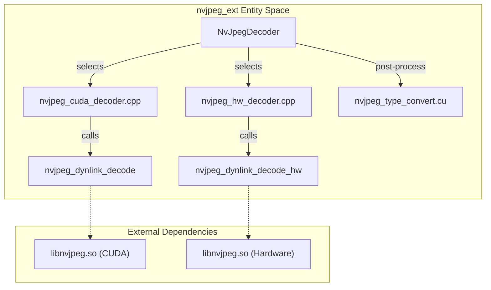
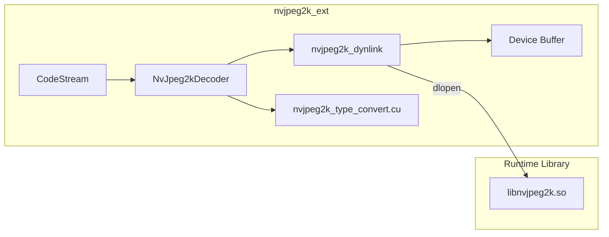
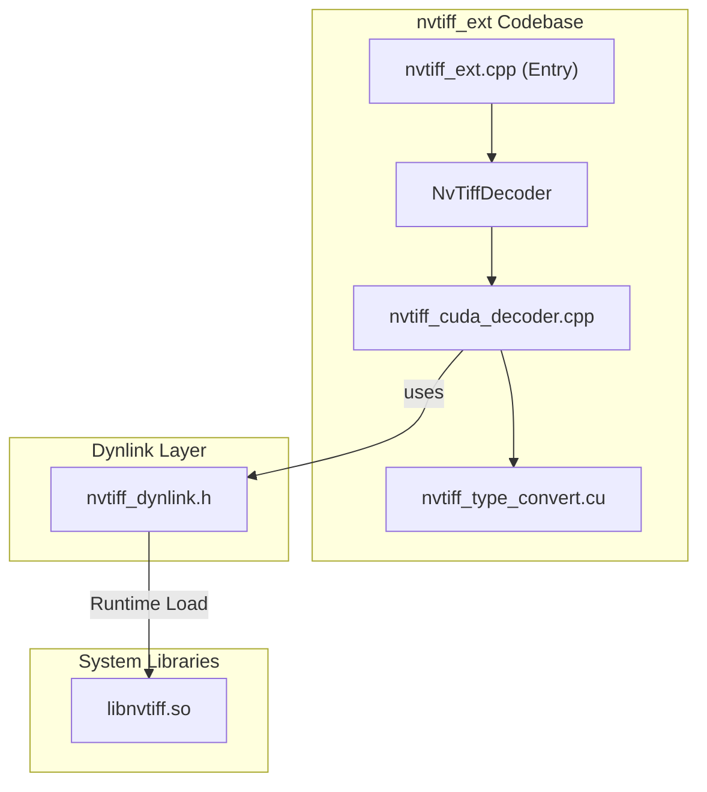

<!-- source: DeepWiki mcp.deepwiki.com · repo NVIDIA/nvImageCodec · page 3.1 GPU-Accelerated Extensions: nvJPEG, nvJPEG2K, nvTIFF · fetched 2026-10-26 -->

# GPU-Accelerated Extensions: nvJPEG, nvJPEG2K, nvTIFF

Relevant source files

The following files were used as context for generating this wiki page:

- [Acknowledgements.txt](Acknowledgements.txt)
- [CMakeLists.txt](CMakeLists.txt)

The `nvImageCodec` library leverages high-performance GPU-accelerated extensions to provide low-latency image decoding and encoding. These extensions utilize specialized NVIDIA hardware (NVDEC/JPEG) and CUDA kernels to outperform traditional CPU-based libraries. The three primary GPU extensions are `nvjpeg_ext`, `nvjpeg2k_ext`, and `nvtiff_ext`.

## Overview of GPU Extensions

Each GPU extension is implemented as a standalone module that is dynamically loaded by the core library's `PluginFramework`. They follow a common internal structure to handle different hardware capabilities and data types.

### Internal Components
*   **CUDA Decoder/Encoder**: Implements the decoding/encoding logic using CUDA kernels for general-purpose GPU acceleration.
*   **HW Decoder**: Specifically for JPEG, this utilizes dedicated hardware JPEG engines available on certain NVIDIA GPU architectures (e.g., Ampere).
*   **Type Convert**: Specialized kernels for handling bit-depth conversion, color space transformations (e.g., YUV to RGB), and format normalization during the pipeline.

### Dynamic Linking Strategy
To ensure maximum portability and minimize deployment dependencies, these extensions employ a dynamic linking strategy. They do not link against `nvjpeg.so`, `nvjpeg2k.so`, or `nvtiff.so` at compile time. Instead, they use a `dynlink` layer to load these libraries at runtime via `dlopen` (on Linux) or `LoadLibrary` (on Windows).

| Extension | Library Loaded at Runtime | Primary Features |
| :--- | :--- | :--- |
| `nvjpeg_ext` | `libnvjpeg.so` | Baseline JPEG, Lossless JPEG, HW acceleration |
| `nvjpeg2k_ext` | `libnvjpeg2k.so` | JPEG2000, HT-JPEG2000 (High Throughput) |
| `nvtiff_ext` | `libnvtiff.so` | TIFF (Uncompressed, LZW, Deflate, Packbits) |

**Sources:**
- [CMakeLists.txt:144-148]()
- [CMakeLists.txt:91-93]()

---

## nvJPEG Extension (nvjpeg_ext)

The `nvjpeg_ext` provides comprehensive support for JPEG formats. It distinguishes between standard lossy JPEG (using `nvjpegDecode`) and Lossless JPEG.

### Data Flow and Architecture
The extension utilizes a `NvJpegDecoder` class which orchestrates between the `nvjpeg_cuda_decoder` and the `nvjpeg_hw_decoder`.

**nvJPEG Internal Mapping**

**Sources:**
- [CMakeLists.txt:91-91]()
- [CMakeLists.txt:146-146]()

---

## nvJPEG2000 Extension (nvjpeg2k_ext)

The `nvjpeg2k_ext` extension targets the JPEG 2000 standard, including support for the high-performance HT-JPEG2000 (JPH) variant. It is particularly effective for high-bit-depth medical and satellite imagery.

### Key Implementation Details
The extension implements the `NvJpeg2kDecoder` and `NvJpeg2kEncoder` classes. It manages CUDA streams and device memory to handle the wavelet-based nature of JPEG2000 efficiently.

**nvJPEG2K Data Flow**

**Sources:**
- [CMakeLists.txt:92-92]()
- [CMakeLists.txt:147-147]()

---

## nvTIFF Extension (nvtiff_ext)

The `nvtiff_ext` allows for GPU-accelerated decoding and encoding of TIFF files. Unlike standard `libtiff`, it parallelizes the decompression of TIFF strips and tiles across CUDA cores.

### Structure and Compression Support
The extension handles multiple compression schemes by interfacing with the `nvTIFF` library. It is especially powerful for "BigTIFF" and multi-page TIFF files used in digital pathology.

**Code Entity Mapping: nvTIFF Extension**

**Sources:**
- [CMakeLists.txt:93-93]()
- [CMakeLists.txt:119-122]()
- [CMakeLists.txt:148-148]()

---

## Build and Configuration

The GPU extensions can be toggled during the CMake configuration phase. By default, they are enabled if a CUDA toolkit is detected.

### CMake Options
| Option | Description | Default |
| :--- | :--- | :--- |
| `BUILD_NVJPEG_EXT` | Build the nvJPEG extension | `ON` |
| `BUILD_NVJPEG2K_EXT` | Build the nvJPEG2K extension | `ON` |
| `BUILD_NVTIFF_EXT` | Build the nvTIFF extension | `ON` |
| `WITH_DYNAMIC_LINK` | Use `dlopen` for all GPU libraries | `ON` |

When `WITH_DYNAMIC_LINK` is enabled, the resulting binaries do not have a hard DT_NEEDED entry for the NVIDIA codec libraries, allowing the application to run (with CPU fallbacks) even if the GPU libraries are missing from the system path.

**Sources:**
- [CMakeLists.txt:91-93]()
- [CMakeLists.txt:144-148]()

---

