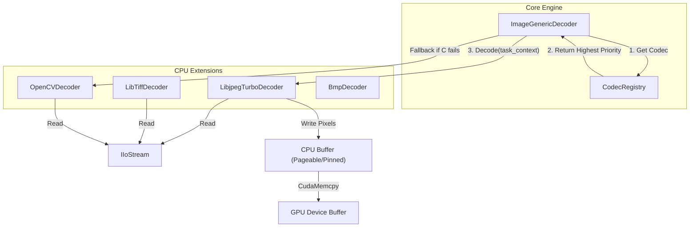

<!-- source: DeepWiki mcp.deepwiki.com · repo NVIDIA/nvImageCodec · page 3.2 CPU Fallback Extensions: libjpeg-turbo, libtiff, OpenCV, nvBMP, nvPNM · fetched 2026-10-26 -->

# CPU Fallback Extensions: libjpeg-turbo, libtiff, OpenCV, nvBMP, nvPNM

<details>
<summary>Relevant source files</summary>

The following files were used as context for generating this wiki page:

- [Acknowledgements.txt](Acknowledgements.txt)
- [CMakeLists.txt](CMakeLists.txt)

</details>


The nvImageCodec library employs a tiered codec strategy where high-performance GPU-accelerated extensions are prioritized, but CPU-based extensions are provided as essential fallbacks. These fallback extensions ensure broad format support and system reliability when GPU resources are unavailable, when specific bitstream features are unsupported by hardware decoders, or when processing on the CPU is more efficient for small workloads.

## Overview of Fallback Extensions

The CPU fallback extensions are implemented as standalone modules located in the `extensions/` directory. Each extension implements the `ICodec` and `IDecoder`/`IEncoder` interfaces, allowing the core engine to treat them interchangeably with GPU codecs.

| Extension | Library | Supported Formats | Role |
| :--- | :--- | :--- | :--- |
| `libjpeg_turbo_ext` | libjpeg-turbo | JPEG | High-speed CPU JPEG fallback. |
| `libtiff_ext` | libtiff | TIFF | Comprehensive CPU TIFF support. |
| `opencv_ext` | OpenCV | PNG, WebP, JPEG, TIFF, etc. | Multi-format "catch-all" fallback. |
| `nvbmp_ext` | Header-only | BMP | Native CPU implementation for BMP. |
| `nvpnm_ext` | Header-only | PNM (PPM, PGM, PBM) | Native CPU implementation for PNM. |

### Fallback Priority Mechanism

The `nvimgcodec` core engine uses a priority-based selection mechanism during the decode/encode pipeline orchestration [src/image_generic_decoder.cpp:24-45](). Extensions are typically registered with different priority levels. For example, `nvjpeg_ext` (GPU) is generally registered with a higher priority than `libjpeg_turbo_ext` (CPU).

Sources: [CMakeLists.txt:94-98](), [src/image_generic_decoder.cpp:24-45]()

---

## libjpeg-turbo Extension (`libjpeg_turbo_ext`)

This extension provides a CPU-based JPEG decoder and encoder using the `libjpeg-turbo` library. It is often used when the `nvjpeg` extension cannot handle a specific bitstream (e.g., unsupported subsampling or specific metadata configurations).

### Implementation Details
The extension wraps the `libjpeg-turbo` API to handle memory-to-memory transcoding. It supports standard YUV and RGB pixel formats and manages the `jpeg_decompress_struct` and `jpeg_compress_struct` lifecycles.

**Key Components:**
* `LibjpegTurboDecoder`: Implements the decoding logic, including header parsing and scanline reading.
* `LibjpegTurboEncoder`: Handles JPEG compression parameters like quality and subsampling.

Sources: [CMakeLists.txt:96](), [extensions/libjpeg_turbo/]()

---

## libtiff Extension (`libtiff_ext`)

The `libtiff_ext` serves as the CPU fallback for the `nvtiff` extension. While `nvtiff` handles high-performance GPU decoding of common TIFF compressions, `libtiff` provides exhaustive support for the complex TIFF specification, including various compression schemes (LZW, Deflate, PackBits) and tiling configurations.

### Data Flow
The extension utilizes `IIoStream` to read from the bitstream and passes the data to `libtiff`'s internal I/O abstraction layer.

**Key Components:**
* `LibTiffDecoder`: Manages TIFF directory structures and tile/strip decoding.
* `LibTiffEncoder`: Handles multi-page TIFF creation and compression selection.

Sources: [CMakeLists.txt:97](), [extensions/libtiff/]()

---

## OpenCV Extension (`opencv_ext`)

The OpenCV extension acts as a versatile multi-format fallback. Because OpenCV supports a wide array of formats (PNG, WebP, OpenEXR, etc.), it is often the "last resort" in the codec search path.

### Implementation Logic
The extension converts `nvimgcodec` bitstreams into `cv::Mat` objects using `cv::imdecode` and encodes them using `cv::imencode`. It is particularly important for formats like PNG and WebP where specialized GPU extensions might not be loaded.

**Supported Formats via OpenCV:**
* PNG
* WebP
* JPEG (Fallback)
* TIFF (Fallback)
* BMP (Fallback)

Sources: [CMakeLists.txt:98](), [extensions/opencv/]()

---

## Native CPU Extensions: nvBMP and nvPNM

Unlike the previous extensions that wrap third-party libraries, `nvbmp_ext` and `nvpnm_ext` are native, lightweight CPU implementations provided within nvImageCodec.

### nvBMP Extension
Supports the Windows Bitmap (BMP) format. It handles various bit-depths and uncompressed pixel arrays.
* **Class:** `BmpDecoder` / `BmpEncoder`
* **File:** `extensions/nvbmp/`

### nvPNM Extension
Supports the Portable AnyMap (PNM) family, including PBM (bits), PGM (grayscale), and PPM (color). It supports both ASCII (plain) and binary (raw) formats.
* **Class:** `PnmDecoder` / `PnmEncoder`
* **File:** `extensions/nvpnm/`

Sources: [CMakeLists.txt:94-95](), [extensions/nvbmp/](), [extensions/nvpnm/]()

---

## Architecture: CPU Extension Data Flow

The following diagram illustrates how the `nvimgcodec` core interacts with these CPU fallback extensions.

### CPU Codec Integration Diagram
Title: CPU Extension Interaction Flow

Sources: [src/image_generic_decoder.cpp:24-45](), [src/codec_registry.h:30-50]()

---

## Code Entity Mapping

This diagram maps the natural language concepts of "Fallbacks" to the specific C++ classes and registration logic used in the codebase.

### Code Entity Association
Title: Mapping Fallback Concepts to Code Entities
```mermaid
classDiagram
    class "ICodec" {
        <<interface>>
        +get_id()
        +create_decoder()
        +create_encoder()
    }

    class "LibjpegTurboExtension" {
        +nvimgcodecExtensionDesc_t desc
        +register_codecs()
    }

    class "OpenCVExtension" {
        +nvimgcodecExtensionDesc_t desc
        +register_codecs()
    }

    class "CodecRegistry" {
        -std::vector<ICodec*> codecs_
        +register_codec(ICodec* codec, float priority)
    }

    ICodec <|-- "LibjpegTurboDecoder"
    ICodec <|-- "OpenCVDecoder"
    "LibjpegTurboExtension" ..> "LibjpegTurboDecoder" : "creates"
    "OpenCVExtension" ..> "OpenCVDecoder" : "creates"
    "CodecRegistry" o-- ICodec : "manages"
```
Sources: [include/nvimgcodec.h:400-500](), [src/codec_registry.h:20-60](), [extensions/libjpeg_turbo/libjpeg_turbo_ext.cpp:10-50]()

## Build Configuration

The inclusion of these extensions is controlled via CMake options. By default, most are enabled to provide maximum compatibility.

| CMake Option | Default | Description |
| :--- | :--- | :--- |
| `BUILD_LIBJPEG_TURBO_EXT` | `ON` | Enables libjpeg-turbo CPU fallback. |
| `BUILD_LIBTIFF_EXT` | `ON` | Enables libtiff CPU fallback. |
| `BUILD_OPENCV_EXT` | `ON` | Enables OpenCV multi-format fallback. |
| `BUILD_NVBMP_EXT` | `ON` | Enables native BMP support. |
| `BUILD_NVPNM_EXT` | `ON` | Enables native PNM support. |

Sources: [CMakeLists.txt:94-98](), [CMakeLists.txt:100-109]()

---

