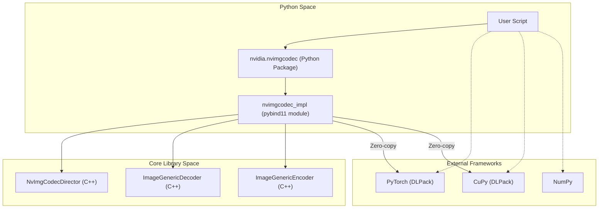
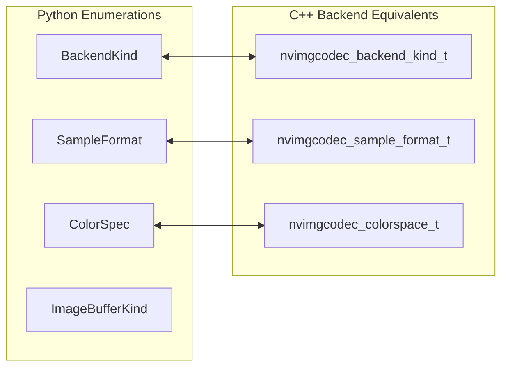

<!-- source: DeepWiki mcp.deepwiki.com · repo NVIDIA/nvImageCodec · page 4 Python API · fetched 2026-10-26 -->

# Python API

Relevant source files

The following files were used as context for generating this wiki page:

- [.gitmodules](.gitmodules)
- [CMakeLists.txt](CMakeLists.txt)

The nvImageCodec Python API provides a high-level, idiomatic interface to the underlying C++ acceleration engine. It allows developers to perform high-performance image decoding and encoding directly within Python environments, with native support for popular data science frameworks like PyTorch, CuPy, and TensorFlow.

The Python bindings are implemented using `pybind11` [python/CMakeLists.txt:20-25](), bridging the core C++ logic to the `nvidia.nvimgcodec` package.

## Package Structure

The Python API is organized into a primary user-facing package that wraps the low-level implementation module.

*   **`nvidia.nvimgcodec`**: The main Python package.
*   **`nvimgcodec_impl`**: The pybind11-generated binary module containing the raw C++ bindings [python/CMakeLists.txt:51-55]().

### Component Architecture
The following diagram illustrates how the Python layers interact with the core library and external frameworks.

**Python API Interaction Map**

Sources: [python/CMakeLists.txt:51-60](), [python/src/nvimgcodec_python.cpp:15-30]()

## Key Python Classes

The API is centered around several core classes that manage the lifecycle of image data and the codec engine.

| Class | Description |
| :--- | :--- |
| `Decoder` | Primary interface for decoding bitstreams into images. Supports batching and backend selection. |
| `Encoder` | Primary interface for encoding images into bitstreams. |
| `Image` | Represents a decoded image or an image to be encoded. Supports DLPack for zero-copy transfers. |
| `CodeStream` | Represents an encoded image bitstream (file or memory buffer). |

For a deep dive into using these classes, see **[Python Decoder and Encoder](#4.1)**.

Sources: [python/src/decoder.cpp:20-50](), [python/src/encoder.cpp:20-50](), [python/src/image.cpp:15-40]()

## Data Types and Parameters

The Python API exposes a wide range of enumerations and structures to control the behavior of the engine. These allow for fine-grained control over color spaces, sample formats, and codec-specific settings (e.g., JPEG quality or JPEG2000 progression orders).

**Code Entity Mapping**

For a complete reference of these types, see **[Python Data Types and Parameters](#4.2)**.

Sources: [python/src/enum.cpp:10-100](), [python/src/struct.cpp:10-80]()

## Framework Integrations

A key feature of the nvImageCodec Python API is its ability to interoperate with the Python data science ecosystem without unnecessary memory copies. By implementing the `__dlpack__` and `__dlpack_device__` protocols, `nvimgcodec.Image` objects can be converted directly to tensors in PyTorch, CuPy, and TensorFlow.

*   **DLPack**: Enables zero-copy sharing of GPU and CPU memory buffers.
*   **NumPy**: Seamless conversion for CPU-based processing.

For details and example notebooks, see **[Framework Integrations and Sample Notebooks](#4.3)**.

Sources: [python/src/image.cpp:120-150](), [.gitmodules:12-14]()

## Child Pages
*   **[Python Decoder and Encoder](#4.1)**: Reference for construction, batching, and metadata retrieval.
*   **[Python Data Types and Parameters](#4.2)**: Documentation for enums like `BackendKind` and `SampleFormat`.
*   **[Framework Integrations and Sample Notebooks](#4.3)**: Zero-copy integration with PyTorch/CuPy and Jupyter samples.

---

