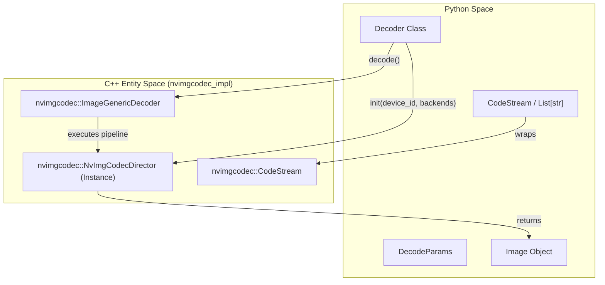
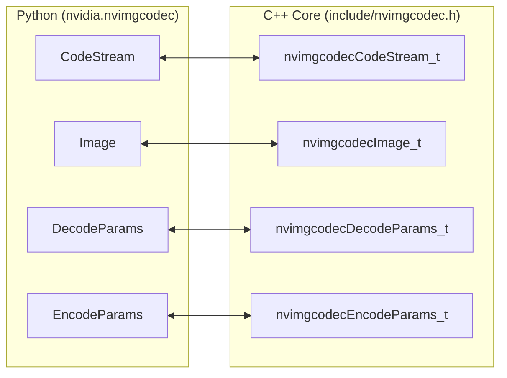

<!-- source: DeepWiki mcp.deepwiki.com · repo NVIDIA/nvImageCodec · page 4.1 Python Decoder and Encoder · fetched 2026-10-26 -->

# Python Decoder and Encoder

Relevant source files

The following files were used as context for generating this wiki page:

- [.gitmodules](.gitmodules)
- [CMakeLists.txt](CMakeLists.txt)

The Python API of `nvImageCodec` provides high-level `Decoder` and `Encoder` classes that wrap the underlying C++ core engine. These classes facilitate batch processing of images, automatic codec selection based on backends, and seamless interoperability with Python scientific computing frameworks like NumPy and PyTorch through DLPack.

## Decoder Class

The `Decoder` class is the primary entry point for transforming compressed bitstreams into raw image data. It manages an internal `nvimgcodecInstance_t` and orchestrates the decoding pipeline.

### Construction and Parameters
When initializing a `Decoder`, several parameters control its behavior:
*   **`device_id`**: Specifies the CUDA device index to be used for GPU-accelerated decoding.
*   **`backends`**: A list of `BackendKind` (e.g., `HYBRID`, `GPU`, `CPU`) defining the priority of execution engines.
*   **`options`**: A string-based configuration for fine-tuning internal engine behavior.

### Decoding Methods
The `Decoder` supports both single-image and batch decoding operations:
*   **`decode(code_streams, params)`**: Decodes a list of `CodeStream` objects or file paths. It returns a list of `Image` objects.
*   **`read(paths, params)`**: A convenience wrapper that creates `CodeStream` objects from file system paths and decodes them.

### Data Flow: Decoding
The following diagram illustrates the transition from Python entities to the underlying C++ implementation during a decode call.

"Python Decoder Data Flow"

Sources: [python/src/decoder.cpp:24-150](), [src/image_generic_decoder.cpp:28-45]()

## Encoder Class

The `Encoder` class handles the compression of raw image buffers into various bitstream formats (JPEG, JPEG2000, TIFF, etc.).

### Construction and Parameters
Similar to the decoder, the `Encoder` is configured with:
*   **`device_id`**: The target CUDA device for encoding.
*   **`backends`**: Preference for `GPU` or `CPU` implementations.
*   **`options`**: Encoder-specific settings (e.g., backend-specific tuning).

### Encoding Methods
*   **`encode(images, params)`**: Compresses a list of `Image` objects.
*   **`write(path, image, params)`**: Encodes an image and writes the resulting bitstream directly to a file.

### Encode Parameters
The `EncodeParams` object allows specifying global encoding settings, while format-specific parameters (like `JpegEncodeParams` or `Jpeg2kEncodeParams`) provide granular control over quality, subsampling, and bitstream-specific features.

Sources: [python/src/encoder.cpp:22-130](), [src/image_generic_encoder.cpp:25-40]()

## Key Python Entities

The Python API abstracts complex C++ memory management into several key objects:

| Class | Role | Interop / Metadata |
| :--- | :--- | :--- |
| `CodeStream` | Represents a bitstream (file or memory). | Provides `target_psnr`, `bitstream_type`, and parser-extracted metadata. |
| `Image` | Represents a raw pixel buffer. | Supports `__cuda_array_interface__` and `__array_interface__`. |
| `DecodeParams` | Instructions for the decoder. | Includes `color_spec`, `sample_format`, and `roi` (Region of Interest). |
| `EncodeParams` | Instructions for the encoder. | Includes quality, format, and backend selection. |

### DLPack and NumPy Interop
`nvImageCodec` provides zero-copy interoperability with the Python ecosystem:
1.  **DLPack**: Images can be exported to or imported from frameworks like PyTorch and CuPy using `Image.to_dlpack()` and `Image.from_dlpack()`.
2.  **NumPy**: For CPU-based buffers, the `Image` object implements the array interface, allowing direct conversion to `numpy.ndarray`.

"Code Entity Mapping: Python to C++ Core"

Sources: [python/src/image.cpp:30-200](), [python/src/codestream.cpp:20-100](), [external/dlpack/include/dlpack/dlpack.h:40-80]()

## Metadata Retrieval

One of the strengths of the Python API is the ability to inspect bitstreams before decoding.
*   **Parsers**: When a `CodeStream` is created, the library automatically invokes the relevant `IImageParser` [src/parsers/jpeg.cpp:10-50]().
*   **Properties**: Users can access `image_info` on a `CodeStream` to retrieve width, height, number of channels, chroma subsampling, and orientation (EXIF).

Example flow for metadata:
1.  `cs = nvimgcodec.CodeStream(path)`
2.  `print(cs.image_info.width, cs.image_info.height)`
3.  `decoder.decode([cs])`

Sources: [src/parsers/parser_framework.cpp:15-60](), [python/src/codestream.cpp:110-140]()

---

