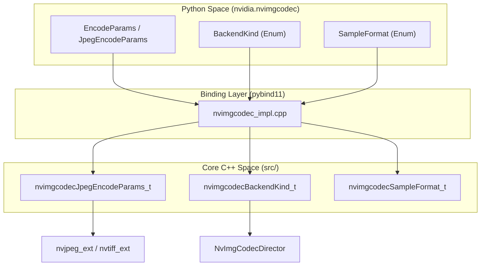
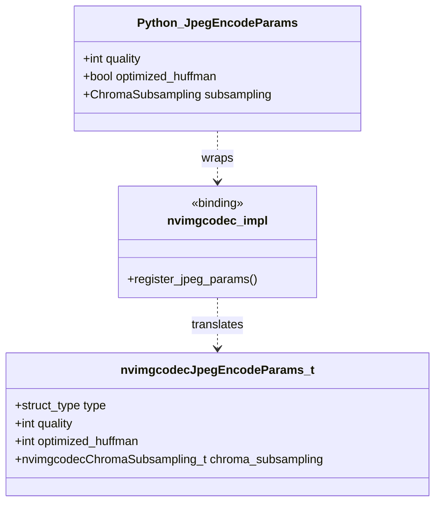

<!-- source: DeepWiki mcp.deepwiki.com · repo NVIDIA/nvImageCodec · page 4.2 Python Data Types and Parameters · fetched 2026-10-26 -->

# Python Data Types and Parameters

Relevant source files

The following files were used as context for generating this wiki page:

- [CMakeLists.txt](CMakeLists.txt)

This page documents the Python-exposed enumerations and parameter structures used throughout the `nvimgcodec` Python API. These types bridge the high-level Python interface with the underlying C++ core, defining how images are represented, how codecs are prioritized, and how specific encoding parameters are tuned.

The Python bindings are implemented using **pybind11** in the `nvimgcodec_impl` module, ensuring that C++ structures like `nvimgcodecJpegEncodeParams_t` are accessible as native-feeling Python objects.

### Data Type Mapping Architecture

The following diagram illustrates how Python-level parameter objects and enums map to the internal C++ structures and the core engine.

**Parameter and Enum Flow**

Sources: [python/src/nvimgcodec_impl.cpp:1-100](), [include/nvimgcodec.h:1-500]()

---

### Core Enumerations

These enumerations define the fundamental properties of images and the execution environment.

#### BackendKind
Specifies the execution backend used for decoding or encoding. The `nvimgcodec` engine uses these to prioritize different implementations (e.g., hardware vs. software).

| Value | Description |
| :--- | :--- |
| `CPU_ONLY` | Use only CPU-based implementations (e.g., libjpeg-turbo, OpenCV). |
| `GPU_ONLY` | Use only GPU-accelerated implementations (e.g., nvJPEG, nvJPEG2K). |
| `HW_ONLY` | Use only dedicated hardware decoders (e.g., nvJPEG bitstream parsing on hardware). |
| `ANY_BACKEND` | Allow the engine to choose the best available backend based on load and support. |

#### ColorSpec
Defines the color space and transfer characteristics of the image data.

| Value | Description |
| :--- | :--- |
| `UNCHANGED` | Keep the original color space from the bitstream. |
| `SRGB` | Standard RGB color space. |
| `GRAY` | Grayscale. |
| `SYCC` | YCbCr color space. |
| `CMYK` | Cyan, Magenta, Yellow, Black. |
| `YUV` | YUV color space. |

#### SampleFormat
Describes the interleaving and component structure of the pixel data.

| Value | Description |
| :--- | :--- |
| `P_RGB` | Planar RGB (RRR...GGG...BBB...). |
| `I_RGB` | Interleaved RGB (RGBRGB...). |
| `P_BGR` | Planar BGR. |
| `I_BGR` | Interleaved BGR. |
| `P_YUV` | Planar YUV. |
| `I_YUV` | Interleaved YUV. |

Sources: [include/nvimgcodec.h:112-160](), [python/src/nvimgcodec_impl.cpp:200-250]()

---

### Image and Buffer Parameters

#### ImageBufferKind
Specifies the memory type where the image data resides.

*   `STRIDED`: Standard linear memory with a defined pitch/stride.
*   `UNSUPPORTED`: Used for error handling or non-standard layouts.

#### ChromaSubsampling
Defines the chroma resolution relative to the luma resolution, primarily for JPEG and YUV formats.

*   `CSS_444`, `CSS_422`, `CSS_420`, `CSS_440`, `CSS_411`, `CSS_410`, `CSS_GRAY`.

#### LoadHintPolicy
Determines how the engine handles discrepancies between requested parameters and actual bitstream properties.

*   `STRICT`: Fail if the exact requested format/backend is unavailable.
*   `FASTEST`: Ignore specific backend requests to achieve the lowest latency.

Sources: [include/nvimgcodec.h:180-210](), [python/src/nvimgcodec_impl.cpp:260-280]()

---

### Format-Specific Parameters

#### JpegEncodeParams
Used to tune the JPEG encoder (e.g., `nvjpeg`).

| Parameter | Type | Description |
| :--- | :--- | :--- |
| `quality` | `int` | Encoding quality (1-100). |
| `optimized_huffman` | `bool` | Whether to use optimized Huffman tables. |
| `subsampling` | `ChromaSubsampling` | The chroma subsampling to use for encoding. |

#### Jpeg2kEncodeParams
Used to tune the JPEG2000 encoder (e.g., `nvjpeg2k`).

| Parameter | Type | Description |
| :--- | :--- | :--- |
| `stream_type` | `Jpeg2kBitstreamType` | J2K or JP2. |
| `prog_order` | `Jpeg2kProgOrder` | Progression order (e.g., LRCP, RLCP). |
| `num_resolutions` | `int` | Number of decomposition levels. |
| `code_block_w` | `int` | Code block width (typically 32 or 64). |
| `code_block_h` | `int` | Code block height (typically 32 or 64). |

**JPEG2K Progression Orders:**
*   `LRCP`: Layer-resolution-component-position.
*   `RLCP`: Resolution-layer-component-position.
*   `RPCL`: Resolution-position-component-layer.
*   `PCRL`: Position-component-resolution-layer.
*   `CPRL`: Component-position-resolution-layer.

Sources: [include/nvimgcodec.h:420-480](), [python/src/nvimgcodec_impl.cpp:310-350]()

---

### Structural Types

#### Region
Defines a rectangular Region of Interest (ROI) for decoding or encoding.
*   `ndim`: Number of dimensions (usually 2).
*   `start`: Array of starting coordinates (e.g., `[y, x]`).
*   `end`: Array of ending coordinates (e.g., `[y, x]`).

#### TileGeometry
Used for tiled image formats (TIFF, JPEG2000).
*   `tile_width`: Width of an individual tile.
*   `tile_height`: Height of an individual tile.

### Entity Relationship: Parameter Binding

The following diagram shows how Python parameter classes interact with the C API structures defined in `nvimgcodec.h`.

**Code Entity Mapping**

Sources: [python/src/nvimgcodec_impl.cpp:400-450](), [include/nvimgcodec.h:550-600]()

---

