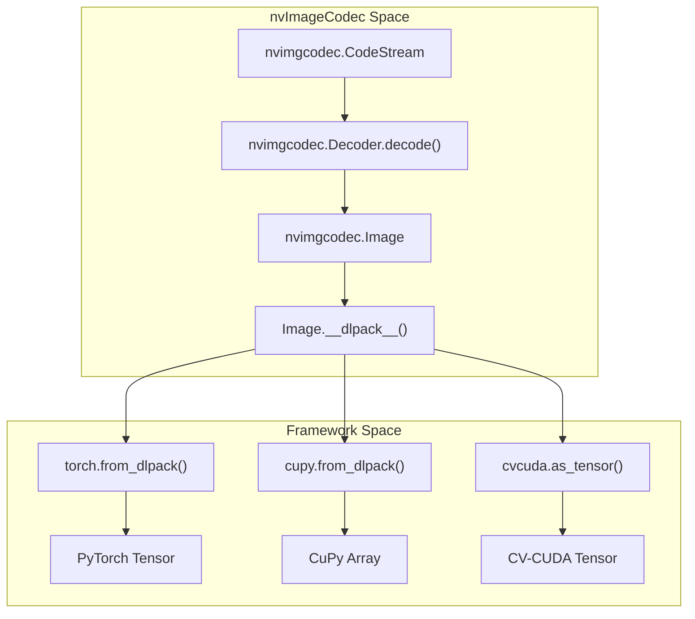
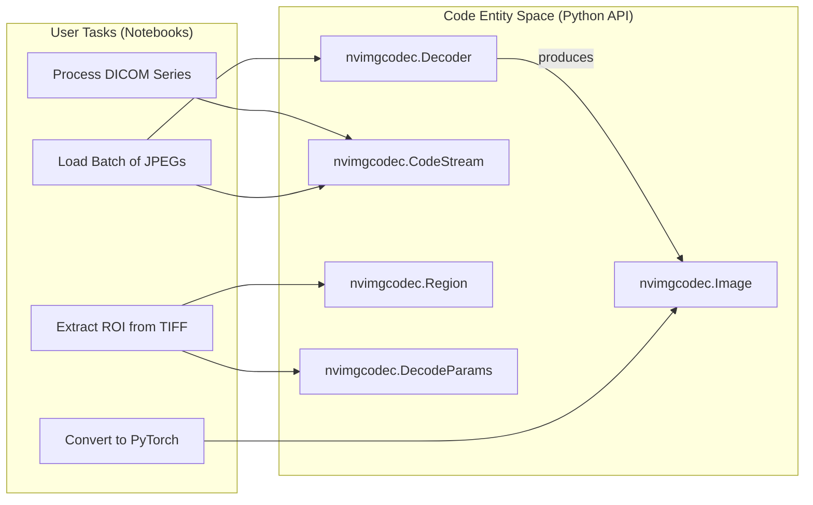

<!-- source: DeepWiki mcp.deepwiki.com · repo NVIDIA/nvImageCodec · page 4.3 Framework Integrations and Sample Notebooks · fetched 2026-10-26 -->

# Framework Integrations and Sample Notebooks

Relevant source files

The following files were used as context for generating this wiki page:

- [.gitmodules](.gitmodules)
- [CMakeLists.txt](CMakeLists.txt)
- [example/README.md](example/README.md)
- [example/assets/imagenet-classes.txt](example/assets/imagenet-classes.txt)

The `nvImageCodec` library is designed to facilitate high-performance image I/O within the Python deep learning and computer vision ecosystem. It achieves this through zero-copy data exchange using the **DLPack** standard, allowing seamless transitions between `nvImageCodec` and frameworks like **PyTorch**, **CuPy**, **CV-CUDA**, and **TensorFlow**.

This page details the implementation of these integrations and provides an overview of the technical samples provided in the repository to demonstrate advanced features like batch decoding, DICOM processing, and sliding window tile caches.

## Framework Integration via DLPack

Integration with third-party frameworks is primarily handled through the `__cuda_array_interface__` and DLPack protocols. This allows `nvImageCodec.Image` objects to be converted into framework-specific tensor types without copying data between GPU memory buffers.

### Implementation Flow

When an image is decoded into a GPU buffer by `nvImageCodec`, the underlying memory can be wrapped into a DLPack tensor. Frameworks then consume this tensor to create their own native objects (e.g., `torch.Tensor`).

Title: DLPack Zero-Copy Data Flow

**Sources:** `[CMakeLists.txt:12-14]()`, `[example/README.md:20-25]()`

### Key Integration Points
*   **PyTorch**: Uses `torch.from_dlpack()` to ingest `nvImageCodec` buffers for training pipelines.
*   **CuPy**: Leverages `cupy.from_dlpack()` for custom GPU kernel processing on decoded images.
*   **CV-CUDA**: Integrates for high-performance pre-processing (resizing, normalization) after hardware-accelerated decoding.
*   **TensorFlow**: Supported via standard DLPack conversion utilities.

**Sources:** `[example/README.md:16-27]()`

---

## Sample Notebooks Overview

The repository includes a suite of Jupyter notebooks located in `example/python/` that demonstrate the practical application of the library in complex workflows.

### 1. Batch Decoding and Performance
These samples demonstrate the `nvimgcodec.Decoder` ability to process multiple `CodeStream` objects in a single call, maximizing GPU utilization.
*   **Implementation**: Utilizes `decoder.decode(code_streams)` where `code_streams` is a list of bitstreams.
*   **Concepts**: Batching, asynchronous execution, and GPU backend selection (`BackendKind.GPU_ONLY`).

### 2. DICOM and Medical Imaging
Demonstrates the library's ability to handle medical imaging formats and multi-frame data.
*   **Features**: Metadata extraction, handling high-bit depth data, and frame-level access.
*   **Entities**: `nvimgcodec.CodeStream`, `nvimgcodec.Image`.

### 3. Sliding Window Tile Cache
A sophisticated sample showing how to use `nvImageCodec` for Large Image (WSI) processing.
*   **Logic**: Uses the library to decode specific Regions of Interest (ROI) from large TIFF or JPEG2000 files without loading the entire image into memory.
*   **Key Class**: `nvimgcodec.Region` and `nvimgcodec.DecodeParams`.

### 4. Framework-Specific Samples
*   **Torch DataLoader**: Shows a custom `torch.utils.data.Dataset` implementation that uses `nvImageCodec` for on-the-fly GPU decoding during training.
*   **CV-CUDA Integration**: Demonstrates a pipeline: `nvImageCodec (Decode) -> DLPack -> CV-CUDA (Resize/Crop)`.
*   **cuCIM Interop**: Integration with the NVIDIA cuCIM library for accelerated computer aided microscopy.

**Sources:** `[example/README.md:44-67]()`, `[example/python/]()`

---

## Technical Mapping: Notebooks to Code Entities

The following diagram maps common tasks performed in the sample notebooks to the specific `nvImageCodec` Python classes and methods used to implement them.

Title: Notebook Task to Code Entity Mapping

**Sources:** `[example/README.md:5-27]()`, `[example/python/]()`

---

## Environment Setup for Samples

To run the provided notebooks, the environment must satisfy specific framework dependencies.

| Framework | Minimum Version | Purpose in Samples |
| :--- | :--- | :--- |
| **PyTorch** | 1.13.0 | Deep learning tensor integration |
| **CuPy** | 11.2.0 | General GPU array manipulation |
| **CV-CUDA** | 0.3.0 Beta | Accelerated image pre-processing |
| **cuCIM** | 22.6.0 | Microscopy and large image handling |
| **Jupyter** | 1.0.0 | Interactive execution environment |

**Sources:** `[example/README.md:16-27]()`

### Running the Notebooks
1.  Navigate to the python samples directory: `cd samples/python` `[example/README.md:49-49]()`.
2.  Launch the server: `jupyter notebook` `[example/README.md:50-50]()`.
3.  Access the dashboard via the provided tokenized URL `[example/README.md:53-67]()`.

## Asset Management
The samples rely on a collection of standardized assets including:
*   **ImageNet Classes**: Used for classification examples `[example/assets/imagenet-classes.txt:1-260]()`.
*   **Medical Images**: DICOM and high-bit depth samples.
*   **Large Format**: Multi-tile TIFFs for sliding window demonstrations.

**Sources:** `[example/assets/imagenet-classes.txt:1-260]()`

---

