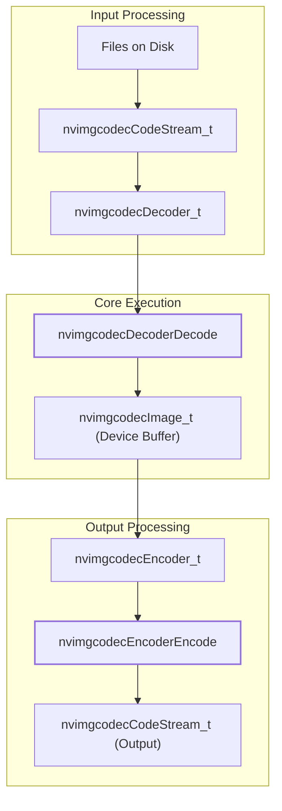
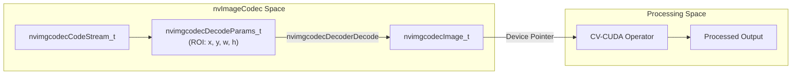

<!-- source: DeepWiki mcp.deepwiki.com · repo NVIDIA/nvImageCodec · page 5.1 nvimproc and nvimtrans Applications · fetched 2026-10-26 -->

# nvimproc and nvimtrans Applications

<details>
<summary>Relevant source files</summary>

The following files were used as context for generating this wiki page:

- [example/CMakeLists.txt](example/CMakeLists.txt)
- [example/README.md](example/README.md)

</details>


The `nvImageCodec` library provides two primary C++ sample applications that demonstrate the practical integration of the C API for high-performance image processing and transcoding. `nvimtrans` focuses on batch conversion between various image formats using GPU acceleration, while `nvimproc` showcases a more complex pipeline involving Region of Interest (ROI) decoding and color space conversion integrated with CV-CUDA.

## nvimtrans: Batch Transcoding Application

`nvimtrans` is a command-line utility designed to demonstrate the batch processing capabilities of the `nvImageCodec` library. It allows users to decode a set of input images (of potentially mixed formats) and encode them into a target format.

### Key Implementation Details

The application follows a standard lifecycle using the `nvimgcodecInstance_t` handle to manage the library state. It utilizes the `nvimgcodecCodeStream_t` abstraction to represent both input bitstreams and output files.

**Data Flow in nvimtrans:**
1.  **Initialization**: Create a library instance using `nvimgcodecInstanceCreate` [[include/nvimgcodec.h:558-561]]().
2.  **Input Discovery**: Scan input paths and create code streams via `nvimgcodecCodeStreamCreateFromFile` [[include/nvimgcodec.h:803-807]]().
3.  **Decoder Creation**: Initialize an `nvimgcodecDecoder_t` to handle the batch [[include/nvimgcodec.h:1120-1123]]().
4.  **Batch Decoding**: Submit the batch for decoding into `nvimgcodecImage_t` objects.
5.  **Encoder Creation**: Initialize an `nvimgcodecEncoder_t` targeting the desired output format (e.g., JPEG, PNG) [[include/nvimgcodec.h:1263-1267]]().
6.  **Batch Encoding**: Write the decoded images back to disk in the new format.

### Code Entity Relationship: nvimtrans
The following diagram maps the high-level transcoding logic to the specific C API entities used within the application.

**Transcoding Pipeline Mapping**

Sources: [include/nvimgcodec.h:558-561](), [include/nvimgcodec.h:803-807](), [include/nvimgcodec.h:1120-1123](), [include/nvimgcodec.h:1263-1267]()

---

## nvimproc: ROI and Image Processing

`nvimproc` is a specialized sample that demonstrates how to perform partial image decoding (Region of Interest) and subsequent image processing. This application is particularly relevant for workflows involving large-scale images (like TIFF or JPEG2000) where only a portion of the image is required for processing.

### Integration with CV-CUDA
`nvimproc` optionally integrates with **CV-CUDA** to perform high-performance GPU-accelerated color conversions or resizing after the image has been decoded by `nvImageCodec`. This integration is toggled via the `BUILD_CVCUDA_SAMPLES` CMake option [[example/CMakeLists.txt:32-32]]().

### Key Features
*   **ROI Decoding**: Uses `nvimgcodecDecodeParams_t` to specify a sub-region of the image to decode, reducing memory bandwidth and GPU compute requirements.
*   **Color Conversion**: Demonstrates converting between formats (e.g., YUV to RGB) using the internal `imgproc` kernels or CV-CUDA.
*   **Resource Sharing**: Shows how to wrap CUDA device memory allocated by `nvImageCodec` into external framework tensors.

### Code Entity Relationship: nvimproc
This diagram illustrates how `nvimproc` bridges the gap between the `nvimgcodec` decoding layer and external processing libraries.

**ROI Decoding and Processing Flow**

Sources: [example/CMakeLists.txt:32-32](), [include/nvimgcodec.h:1120-1123]()

---

## Command-Line Options and Usage

Both applications share common configuration patterns for selecting GPU devices and specifying input/output paths.

| Option | Description |
| :--- | :--- |
| `-i`, `--input` | Path to input image file or directory. |
| `-o`, `--output` | Path to output directory or filename. |
| `-d`, `--device` | CUDA Device ID to use for processing (default: 0). |
| `-f`, `--format` | (nvimtrans) Target format for transcoding (e.g., "jpg", "png", "tif"). |
| `-r`, `--roi` | (nvimproc) Region of Interest specified as `x,y,width,height`. |

### Building the Samples
The samples are built using CMake. If building as part of the main project, they are included by default unless CV-CUDA dependencies are missing [[example/CMakeLists.txt:71-75]]().

```bash
mkdir build && cd build
export CUDACXX=nvcc
cmake .. -DCMAKE_BUILD_TYPE=Release -DBUILD_CVCUDA_SAMPLES=ON
make
```
Sources: [example/README.md:31-37](), [example/CMakeLists.txt:71-75]()

## Implementation Notes

### Error Handling
The samples demonstrate the use of the `nvimgcodecStatus_t` return codes. Every API call is typically wrapped in a check to ensure `NVIMGCODEC_STATUS_SUCCESS` was returned [[include/nvimgcodec.h:58-103]]().

### Memory Management
The samples showcase the library's ability to handle different memory types. By default, `nvImageCodec` decodes into CUDA device memory, but the samples can be configured to use pinned host memory for CPU-based fallbacks by adjusting the `nvimgcodecImage_t` descriptor.

Sources: [include/nvimgcodec.h:58-103](), [example/README.md:41-43]()

---

