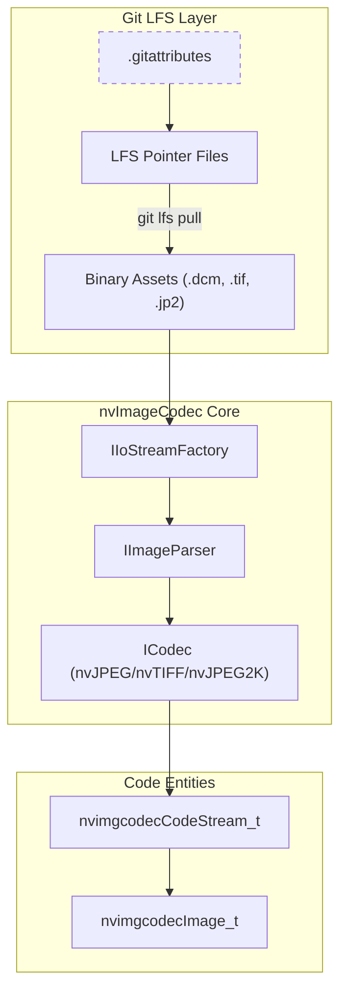
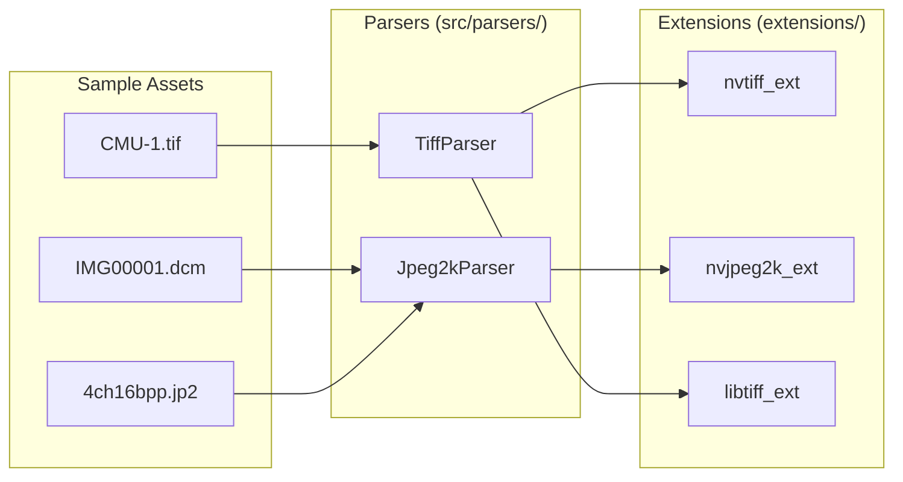

<!-- source: DeepWiki mcp.deepwiki.com · repo NVIDIA/nvImageCodec · page 5.2 Sample Assets and Test Images · fetched 2026-10-26 -->

# Sample Assets and Test Images

Relevant source files

The following files were used as context for generating this wiki page:

- [.gitattributes](.gitattributes)
- [example/assets/imagenet-classes.txt](example/assets/imagenet-classes.txt)
- [example/assets/images/4ch16bpp.jp2](example/assets/images/4ch16bpp.jp2)
- [example/assets/images/Alex_2016-01-14_1300Z_(Geotiff).tif](example/assets/images/Alex_2016-01-14_1300Z_(Geotiff).tif)
- [example/assets/images/CMU-1.tif](example/assets/images/CMU-1.tif)
- [example/assets/images/DICOM/MRI/Knee/DICOMS/STU00001/SER00001/IMG00001.dcm](example/assets/images/DICOM/MRI/Knee/DICOMS/STU00001/SER00001/IMG00001.dcm)

The `nvImageCodec` repository includes a curated set of sample assets and test images to demonstrate the library's capabilities across diverse domains, including medical imaging (DICOM), geospatial analysis (GeoTIFF), and digital pathology (Whole-Slide Imaging). These assets are primarily located in the `example/assets/` directory and are used by both C++ and Python examples to showcase high-bit-depth, multi-channel, and large-scale image processing.

## Git Large File Storage (LFS) Usage

Due to the high resolution and uncompressed nature of many professional imaging formats, several assets in the repository are large binary files. `nvImageCodec` uses **Git LFS** to manage these files efficiently without bloating the core repository size.

The `.gitattributes` file defines which extensions are tracked by LFS. When cloning the repository, these files appear as small text pointers unless Git LFS is installed and initialized.

| Extension | Filter Type | Purpose |
| :--- | :--- | :--- |
| `.jpg`, `.jpeg`, `.png` | LFS | Standard natural images |
| `.tif`, `.tiff`, `.svs` | LFS | GeoTIFF and Whole-Slide Images |
| `.jp2`, `.j2k` | LFS | JPEG 2000 (Medical/Satellite) |
| `.dcm` | LFS | DICOM Medical records |
| `.pfm` | LFS | Portable Float Map (HDR/Depth) |
| `.bmp` | LFS | Bitmaps |

Sources: [.gitattributes:1-19]()

## Asset Catalog

### Medical Imaging: DICOM MRI Knee Series
The repository provides a representative MRI scan series of a knee. These files are used to demonstrate the library's ability to handle the DICOM (Digital Imaging and Communications in Medicine) standard, often involving 16-bit grayscale data.

*   **Path:** `example/assets/images/DICOM/MRI/Knee/DICOMS/STU00001/SER00001/IMG00001.dcm`
*   **Format:** DICOM (`.dcm`)
*   **Characteristics:** High dynamic range (16-bit), metadata-rich.

Sources: [example/assets/images/DICOM/MRI/Knee/DICOMS/STU00001/SER00001/IMG00001.dcm:1-3]()

### Geospatial: GeoTIFF
For geospatial and remote sensing applications, a large GeoTIFF file is included. This asset demonstrates the library's capability to parse TIFF files containing geographic metadata and large-scale raster data.

*   **Path:** `example/assets/images/Alex_2016-01-14_1300Z_(Geotiff).tif`
*   **Format:** TIFF (`.tif`)
*   **Size:** ~99.8 MB
*   **Characteristics:** Contains georeferencing tags, used for satellite/aerial imagery testing.

Sources: [example/assets/images/Alex_2016-01-14_1300Z_(Geotiff).tif:1-3]()

### Digital Pathology: CMU Whole-Slide TIFF
Digital pathology slides (Whole-Slide Imaging - WSI) are often gigapixel images stored in tiled TIFF formats. The `CMU-1.tif` asset is a standard test slide used to verify high-performance decoding of tiled sub-regions.

*   **Path:** `example/assets/images/CMU-1.tif`
*   **Format:** TIFF (`.tif`)
*   **Size:** ~163.6 MB
*   **Characteristics:** Multi-resolution pyramid, tiled storage, extremely high pixel dimensions.

Sources: [example/assets/images/CMU-1.tif:1-3]()

### Multi-Channel: JPEG 2000
While most consumer images use 3 channels (RGB), many industrial and scientific applications require more. The `4ch16bpp.jp2` file provides a 4-channel, 16-bit per pixel JPEG 2000 bitstream.

*   **Path:** `example/assets/images/4ch16bpp.jp2`
*   **Format:** JPEG 2000 (`.jp2`)
*   **Characteristics:** 4 channels (e.g., RGBA or multispectral), 16-bit depth per channel.

Sources: [example/assets/images/4ch16bpp.jp2:1-3]()

### Metadata: ImageNet Class List
For computer vision tasks, specifically those involving classification, the repository includes the standard ImageNet class mapping. This is used by sample applications to map model output indices to human-readable labels.

*   **Path:** `example/assets/imagenet-classes.txt`
*   **Content:** 1,000 classes ranging from "tench" to "vulture".

Sources: [example/assets/imagenet-classes.txt:1-25]()

## Asset Integration Workflow

The following diagram illustrates how these binary assets are handled by the Git LFS system and subsequently consumed by the `nvImageCodec` core components during testing or example execution.

### Asset Loading Data Flow

Sources: [.gitattributes:1-19](), [example/assets/images/4ch16bpp.jp2:1-3]()

### Mapping Assets to Codec Extensions
This diagram maps specific sample assets to the internal `nvImageCodec` extensions and parsers responsible for processing them.

Sources: [example/assets/images/DICOM/MRI/Knee/DICOMS/STU00001/SER00001/IMG00001.dcm:1-3](), [example/assets/images/CMU-1.tif:1-3](), [example/assets/images/4ch16bpp.jp2:1-3]()

---

