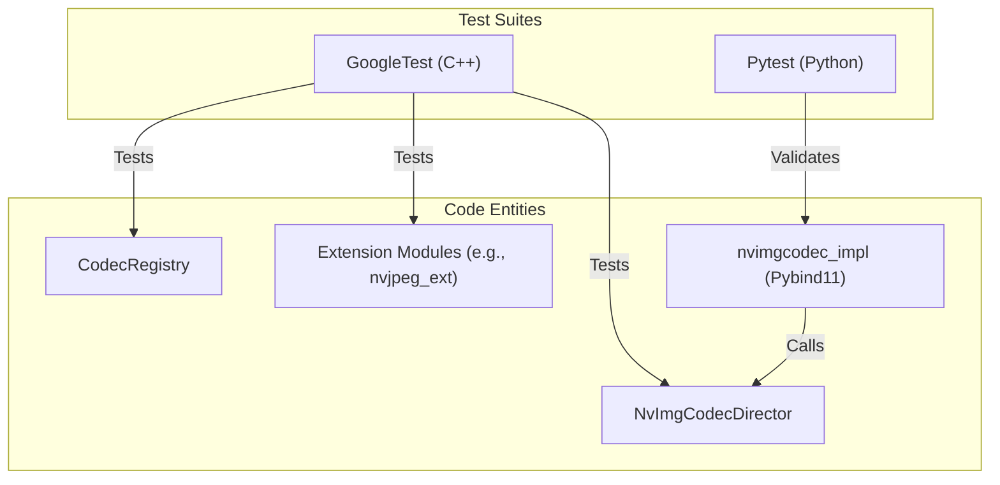
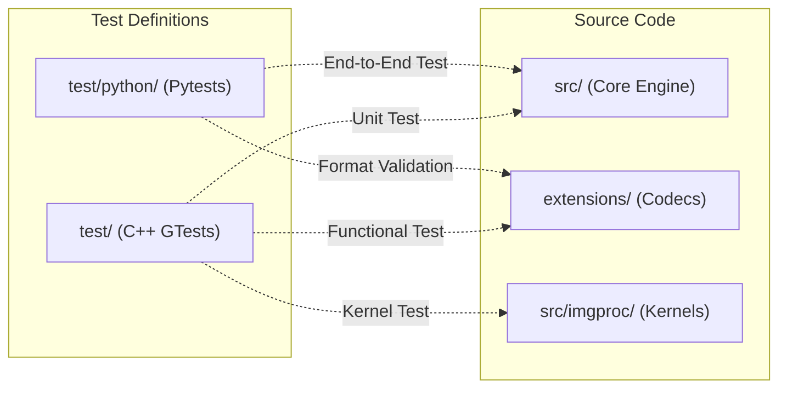

<!-- source: DeepWiki mcp.deepwiki.com · repo NVIDIA/nvImageCodec · page 6 Testing · fetched 2026-10-26 -->

# Testing

Relevant source files

The following files were used as context for generating this wiki page:

- [.gitmodules](.gitmodules)
- [CMakeLists.txt](CMakeLists.txt)

The nvImageCodec library employs a multi-layered testing strategy to ensure the reliability, performance, and correctness of its image decoding and encoding pipelines. The infrastructure is divided into a C++ test suite for core logic and low-level components, and a Python-based test suite for high-level API validation and framework integration.

The testing environment is managed via CMake, with the `BUILD_TEST` option [CMakeLists.txt:80-81]() controlling the compilation of the test infrastructure.

### Test Infrastructure Overview

The test infrastructure bridges the gap between the core C++ engine and the high-level Python bindings, ensuring that individual components (like parsers and codecs) function correctly both in isolation and when integrated into complex workflows.

#### Core Test Components
*   **C++ Unit Tests**: Built using **GoogleTest** [external/googletest](). These tests target the internal logic of the `NvImgCodecDirector`, `CodecRegistry`, and individual extension modules.
*   **Python Pytest Suite**: Located in `test/python/`, this suite validates the Pythonic API, memory interoperability (DLPack/NumPy), and handles end-to-end integration scenarios.
*   **Integration Tests**: These verify the interaction between the core library and various backend extensions (e.g., nvJPEG, OpenCV, libtiff).

### System-to-Code Mapping: Test Architecture

The following diagram illustrates how the testing infrastructure interacts with the codebase entities.

**Test Infrastructure Relationship**

**Sources:** [.gitmodules:8-11](), [CMakeLists.txt:80-81](), [CMakeLists.txt:126-127]()

### C++ Unit and Integration Tests

The C++ test suite is the primary mechanism for validating the library's core functionality. It covers everything from basic API handle management to complex concurrency and fallback scenarios.

Key areas of focus include:
*   **API Validation**: Testing `nvimgcodecInstance_t`, `nvimgcodecDecoder_t`, and `nvimgcodecEncoder_t` lifecycles.
*   **Codec Prioritization**: Verifying that the `CodecRegistry` correctly selects backends based on load hints and availability.
*   **Extension Testing**: Dedicated tests for GPU-accelerated modules like `nvjpeg_ext` and `nvtiff_ext`, as well as CPU fallbacks.
*   **Image Processing**: Validating `imgproc` kernels for color space conversion and ROI handling.

For details, see [C++ Unit and Integration Tests](#6.1).

### Python Test Suite

The Python test suite provides a flexible environment for testing the library against a wide variety of image formats and configurations. It leverages `pytest` and common data science libraries to ensure seamless integration.

Key features include:
*   **Format Coverage**: Comprehensive tests for JPEG, JPEG2000, TIFF, PNG, and WebP.
*   **Interoperability**: Validating zero-copy data exchange with PyTorch, CuPy, and TensorFlow using DLPack.
*   **Advanced Features**: Testing Region of Interest (ROI) decoding, EXIF orientation handling, and multi-GPU setups.
*   **Fixtures**: Using `conftest.py` to manage global resources like CUDA contexts and test data paths.

For details, see [Python Test Suite](#6.2).

### Test Configuration and Execution

Testing behavior can be modified during the CMake configuration phase using specific flags:

| CMake Option | Description | Default |
| :--- | :--- | :--- |
| `BUILD_TEST` | Enables building the C++ test suite. | `ON` |
| `SKIP_NVTIFF_WITH_NVCOMP_TESTS` | Skips nvtiff tests that require the nvCOMP library. | `OFF` |
| `BUILD_PYTHON` | Required to run the Python pytest suite. | `ON` |

**Sources:** [CMakeLists.txt:80-81](), [CMakeLists.txt:119-124](), [CMakeLists.txt:126-127]()

### Code Entity Association

This diagram maps specific test categories to the files and directories they target within the repository.

**Code-to-Test Mapping**

**Sources:** [CMakeLists.txt:80-118]()

---

