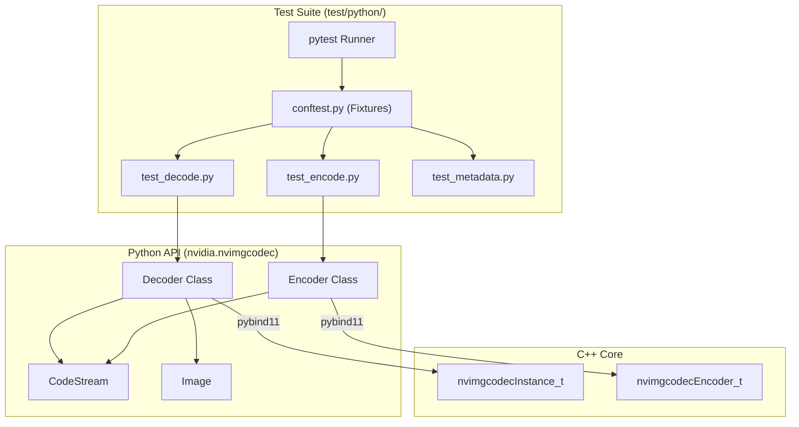
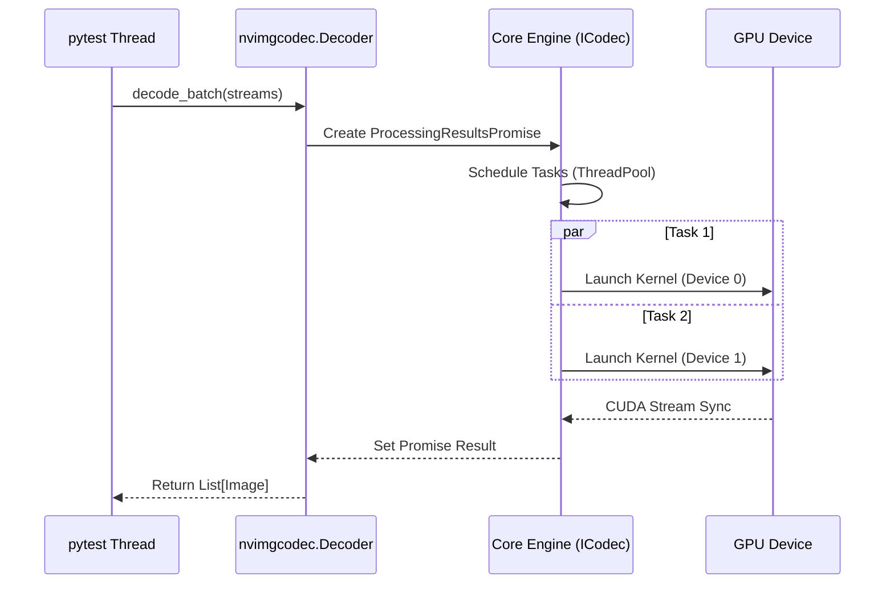

<!-- source: DeepWiki mcp.deepwiki.com · repo NVIDIA/nvImageCodec · page 6.2 Python Test Suite · fetched 2026-10-26 -->

# Python Test Suite

Relevant source files

The following files were used as context for generating this wiki page:

- [.gitmodules](.gitmodules)
- [CMakeLists.txt](CMakeLists.txt)

The Python test suite for `nvImageCodec` provides a comprehensive validation framework for the Python bindings, ensuring parity with the C++ core and verifying integration with the Python data science ecosystem (NumPy, CuPy, PyTorch). The suite is located in `test/python/` and utilizes the `pytest` framework to verify decoding and encoding across various formats, hardware configurations, and metadata scenarios.

### Test Infrastructure and Configuration

The test suite relies on `pytest` fixtures and configuration defined in `test/python/conftest.py` to manage the lifecycle of the `nvimgcodec` instance and provide reusable test assets.

#### Key Fixtures
- **`nvimgcodec_instance`**: Manages the creation and destruction of the `nvimgcodec.Instance` object used across tests.
- **`device_id`**: Parameterizes tests to run on specific GPU devices.
- **`image_suite`**: Provides access to a curated set of test images including different formats (JPEG, TIFF, WebP, etc.) and color spaces.

#### Dependencies
The Python tests require several external libraries to validate output correctness and framework interoperability:
- `numpy`: For CPU-side buffer validation.
- `cupy`: For GPU-side buffer validation and DLPack testing.
- `torch`: For PyTorch integration and tensor interoperability tests.
- `opencv-python`: Used as a reference for ground-truth comparisons in some decode tests.
- `pillow`: Used for verifying metadata and basic image properties.

Sources: [CMakeLists.txt:126-142](), [.gitmodules:1-17]()

### Implementation and Data Flow

The Python tests follow a structured flow: they initialize a decoder or encoder, process input data (files or memory buffers), and compare the results against expected values or reference implementations.

#### Test Execution Flow
1. **Setup**: The `pytest` environment loads fixtures and determines the available backends (e.g., `nvJPEG`, `OpenCV`, `libjpeg-turbo`).
2. **Input Preparation**: Images are loaded from `example/assets/images/` or generated dynamically (for dtype/ROI tests).
3. **Execution**: The `nvimgcodec.Decoder` or `nvimgcodec.Encoder` is invoked.
4. **Verification**:
    - **Data Integrity**: Pixel-wise comparison using `numpy.allclose` or `cupy.allclose`.
    - **Metadata**: Checking EXIF orientation, ICC profiles, and resolution.
    - **Performance/Concurrency**: Verifying multi-threaded or multi-GPU execution without deadlocks.

#### Natural Language to Code Entity Mapping: Test Orchestration

The following diagram illustrates how the Python test suite interacts with the `nvimgcodec` Python classes.

**Python Test Entity Relationship**

Sources: [CMakeLists.txt:126-128](), [python/pybind11 submodule]().

### Test Categories and Coverage

The suite is divided into functional modules targeting specific features of the library.

| Category | Description | Key Modules/Tests |
| :--- | :--- | :--- |
| **Format Support** | Validates decode/encode for JPEG, JPEG2K, TIFF, PNG, WebP, BMP, PNM. | `test_decode.py`, `test_encode.py` |
| **Data Types** | Tests support for `uint8`, `uint16`, and `float32` pixel representations. | `test_dtype.py` |
| **ROI & Layout** | Verifies Region of Interest (ROI) decoding and planar vs. interleaved formats. | `test_roi.py`, `test_sample_format.py` |
| **Metadata** | Validates EXIF orientation, ICC profile extraction/embedding, and resolution tags. | `test_metadata.py`, `test_orientation.py` |
| **Integrations** | Zero-copy transfers via DLPack with PyTorch and CuPy. | `test_dlpack.py`, `test_pytorch.py` |
| **Advanced Features** | Tests multi-GPU distribution, batching, and concurrency. | `test_multigpu.py`, `test_concurrency.py` |
| **Medical Imaging** | Validates DICOM integration using specialized test assets. | `test_dicom.py` |

### Multi-GPU and Concurrency Testing

The suite includes specific tests for high-concurrency environments to ensure the `nvimgcodec` Director and ThreadPool handle parallel requests correctly.

**Concurrency Data Flow**

Sources: [CMakeLists.txt:80-81](), [Architecture Overview (Section 2.3)]().

### Requirements for Running Tests

To execute the Python test suite, the environment must be configured with the following:
1. **Built Library**: The `nvimgcodec` Python wheel must be installed or the `PYTHONPATH` must point to the build directory.
2. **Test Assets**: Git LFS must be used to pull the images in `example/assets/images/`.
3. **Environment Variables**:
   - `CUDA_VISIBLE_DEVICES`: To restrict or enable specific GPUs for `test_multigpu.py`.
   - `LD_LIBRARY_PATH`: Must include paths to CUDA and codec libraries (nvJPEG, etc.) if not using static linking.

Sources: [CMakeLists.txt:144-150](), [example/assets/images/ (Section 5.2)]().

---

