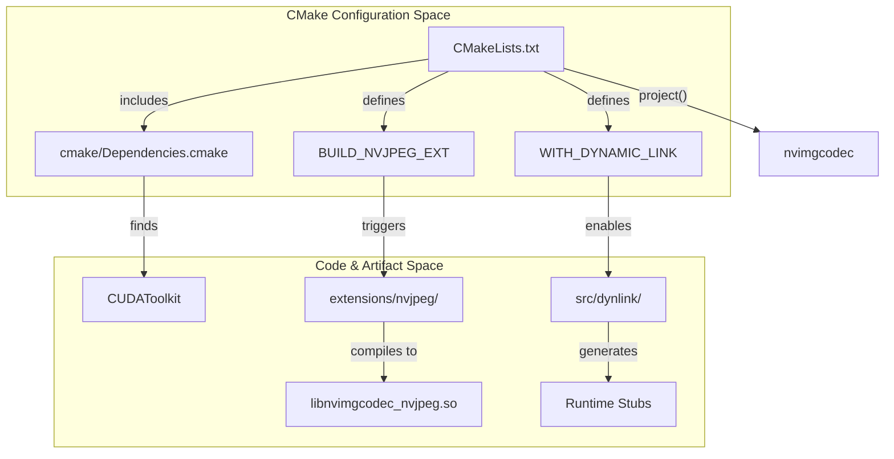
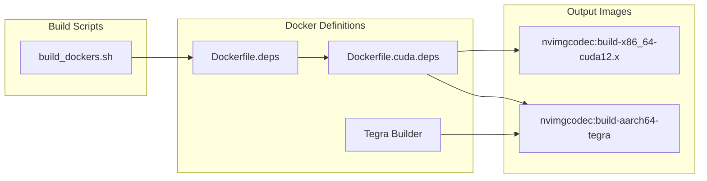

<!-- source: DeepWiki mcp.deepwiki.com · repo NVIDIA/nvImageCodec · page 7 Build System and Packaging · fetched 2026-10-26 -->

# Build System and Packaging

Relevant source files

The following files were used as context for generating this wiki page:

- [CMakeLists.txt](CMakeLists.txt)
- [cmake/Dependencies.cmake](cmake/Dependencies.cmake)
- [cmake/Package.cmake](cmake/Package.cmake)

The `nvImageCodec` library utilizes a robust CMake-based build system designed to handle complex dependencies, GPU-accelerated extensions, and multiple distribution formats. The system supports high-performance builds for both x86_64 and aarch64 (Tegra) architectures, with specialized logic for dynamic loading of NVIDIA libraries to minimize deployment-time dependencies.

### Build System Overview

The build system is centered around `CMakeLists.txt` and a collection of modular scripts in the `cmake/` directory. It manages the compilation of the core C++ library, various codec extensions, Python bindings via `pybind11`, and a suite of tests and samples.

#### Key Build Components
- **Feature Toggles**: Options like `BUILD_EXTENSIONS`, `BUILD_PYTHON`, and `BUILD_TEST` allow for granular control over the build scope [CMakeLists.txt:78-128]().
- **Dependency Management**: The system resolves mandatory and optional dependencies, including CUDA Toolkit, nvJPEG, nvJPEG2K, nvTIFF, and CPU fallbacks like `libjpeg-turbo` and `OpenCV` [cmake/Dependencies.cmake:34-170]().
- **Dynamic Linking Strategy**: A key feature is the ability to use `WITH_DYNAMIC_LINK` to `dlopen` CUDA libraries at runtime, removing the need for these libraries to be present at link-time [CMakeLists.txt:144-148]().

#### Code Entity Mapping: Build Configuration
The following diagram illustrates how CMake variables and scripts map to the resulting build artifacts.

"Build System Entity Mapping"

Sources: [CMakeLists.txt:20-148](), [cmake/Dependencies.cmake:34-53]()

For a deep dive into available flags and cross-compilation, see **[CMake Build Configuration](#7.1)**.

---

### Packaging and Distribution

`nvImageCodec` supports three primary distribution channels, each tailored for different user environments.

| Packaging Type | Target Audience | Primary Tools |
| :--- | :--- | :--- |
| **Python Wheels** | Data Scientists / ML Engineers | `setup.py.in`, `bundle-wheel.sh` |
| **Conda Packages** | HPC / Environment Isolation | `conda-build`, `meta.yaml` |
| **System Packages** | System Administrators (Debian/RPM) | `CPack`, `cmake/Package.cmake` |

#### Packaging Logic
The project uses `CPack` for generating system-level installers [cmake/Package.cmake:1-5](). For Python users, it generates wheels that can be installed via `pip`, often bundling necessary libraries to ensure a "ready-to-use" experience [CMakeLists.txt:130-140]().

For detailed instructions on recipe structures and bundling scripts, see **[Packaging: Conda, Wheel, and Debian/RPM](#7.2)**.

---

### Docker Build Environments

To ensure reproducible builds across different CUDA versions and architectures, the project provides an extensive Docker infrastructure.

#### Environment Matrix
The system manages Dockerfiles for various scenarios:
- **Base Dependencies**: `Dockerfile.deps` and `Dockerfile.cuda.deps` establish the foundation with required system libraries.
- **Architecture Variants**: Support for `x86_64` and `aarch64` (Tegra/Jetson).
- **Compiler Variants**: Specific images for `GCC14` and Windows `VS17` environments.

"Docker Infrastructure Flow"

Sources: [CMakeLists.txt:32-42](), [cmake/Dependencies.cmake:58-97]()

For documentation on the orchestration scripts and the full image matrix, see **[Docker Build Environments](#7.3)**.

---
**Child Pages:**
* [CMake Build Configuration](#7.1)
* [Packaging: Conda, Wheel, and Debian/RPM](#7.2)
* [Docker Build Environments](#7.3)

---

