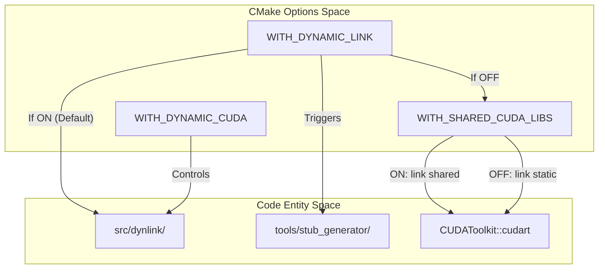
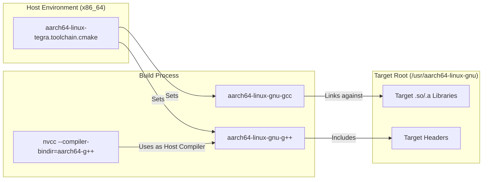

<!-- source: DeepWiki mcp.deepwiki.com · repo NVIDIA/nvImageCodec · page 7.1 CMake Build Configuration · fetched 2026-10-26 -->

# CMake Build Configuration

Relevant source files

The following files were used as context for generating this wiki page:

- [CMakeLists.txt](CMakeLists.txt)
- [cmake/CUDA_utils.cmake](cmake/CUDA_utils.cmake)
- [cmake/ConfigureVersion.cmake](cmake/ConfigureVersion.cmake)
- [cmake/Dependencies.cmake](cmake/Dependencies.cmake)
- [cmake/FindSphinx.cmake](cmake/FindSphinx.cmake)
- [cmake/FindZSTD.cmake](cmake/FindZSTD.cmake)
- [cmake/SetCUDAArchitectures.cmake](cmake/SetCUDAArchitectures.cmake)
- [cmake/Utils.cmake](cmake/Utils.cmake)
- [cmake/aarch64-linux-tegra.toolchain.cmake](cmake/aarch64-linux-tegra.toolchain.cmake)
- [cmake/template/Config.cmake.in](cmake/template/Config.cmake.in)

The nvImageCodec build system is based on CMake (minimum version 3.18) and is designed to handle complex dependencies, multiple CUDA architectures, and cross-compilation for Tegra platforms [CMakeLists.txt:16-16](). It manages the compilation of the core library, Python bindings, and a variety of codec extensions that can be either statically linked or dynamically loaded at runtime.

## Core Build Options

The build behavior is controlled through several key CMake options. These allow developers to toggle specific features, such as Python support, documentation, or individual codec extensions.

### Feature Toggles
| Option | Default | Description |
| :--- | :--- | :--- |
| `BUILD_LIBRARY` | `ON` | Builds the core C++ library. [CMakeLists.txt:78-78]() |
| `BUILD_TEST` | `ON` | Builds the GoogleTest-based C++ unit tests. [CMakeLists.txt:80-80]() |
| `BUILD_SAMPLES` | `ON` | Builds C++ sample applications like `nvimtrans`. [CMakeLists.txt:82-82]() |
| `BUILD_PYTHON` | `ON` | Builds pybind11-based Python bindings. [CMakeLists.txt:126-126]() |
| `BUILD_EXTENSIONS` | `ON` | Global toggle for all extension modules. [CMakeLists.txt:88-88]() |

### Extension Flags
Individual extensions can be enabled or disabled. If `BUILD_EXTENSIONS` is `OFF`, all individual extension flags are forced to `OFF` [CMakeLists.txt:100-109]().
* `BUILD_NVJPEG_EXT`: nvJPEG (GPU) [CMakeLists.txt:91-91]()
* `BUILD_NVJPEG2K_EXT`: nvJPEG2000 (GPU) [CMakeLists.txt:92-92]()
* `BUILD_NVTIFF_EXT`: nvTIFF (GPU) [CMakeLists.txt:93-93]()
* `BUILD_LIBJPEG_TURBO_EXT`: libjpeg-turbo (CPU) [CMakeLists.txt:96-96]()
* `BUILD_OPENCV_EXT`: OpenCV (CPU) [CMakeLists.txt:98-98]()

## Dynamic Linking Configuration

A critical feature of nvImageCodec is its ability to avoid hard dependencies on specific CUDA library versions at link-time by using a dynamic loading layer.

### Dynamic Loading vs. Static Linking
* **`WITH_DYNAMIC_LINK`**: When `ON` (default), the library uses `dlopen` (or `LoadLibrary` on Windows) to load CUDA, nvJPEG, nvJPEG2K, and nvTIFF at runtime [CMakeLists.txt:144-144]().
* **`WITH_SHARED_CUDA_LIBS`**: Controls whether to link against shared (`ON`) or static (`OFF`) CUDA libraries when dynamic loading is disabled [CMakeLists.txt:152-152]().

Specific libraries can be fine-tuned:
* `WITH_DYNAMIC_CUDA`, `WITH_DYNAMIC_NVJPEG`, `WITH_DYNAMIC_NVJPEG2K`, `WITH_DYNAMIC_NVTIFF` [CMakeLists.txt:145-148]().

### Implementation Mapping: Linking Strategy
The following diagram illustrates how CMake options translate to the internal linking strategy and the use of the dynamic linking layer (`src/dynlink`).

**Linking Strategy Logic**

Sources: [CMakeLists.txt:144-155](), [cmake/Dependencies.cmake:54-61]()

## CUDA Architecture Targeting

nvImageCodec uses specialized logic to target multiple GPU architectures in a single build. This is managed primarily via `cmake/CUDA_utils.cmake` and `cmake/SetCUDAArchitectures.cmake`.

### Architecture Selection logic
The system detects the host architecture (`ARCH`) and selects a "known" set of CUDA architectures (`sm_XX`) to target.
* **x86_64**: Targets major architectures from `35` to `120` [cmake/CUDA_utils.cmake:52-56]().
* **aarch64 (SBSA)**: Targets major architectures from `70` to `120` [cmake/CUDA_utils.cmake:46-51]().
* **aarch64-linux (Tegra)**: Targets specific Tegra architectures: `53`, `62`, `72`, `87`, `90a`, `110` [cmake/CUDA_utils.cmake:42-45]().

### Key Functions
* **`CUDA_find_supported_arch_values`**: Checks the compiler (NVCC or Clang) to see which `sm_` values are actually supported by the installed toolkit [cmake/CUDA_utils.cmake:111-125]().
* **`CUDA_get_gencode_args`**: Generates the `-gencode` flags for NVCC. It ensures the last architecture in the list is also generated as PTX (`compute_XX`) for forward compatibility [cmake/CUDA_utils.cmake:139-159]().
* **`add_sources_cuda_archs`**: A helper to apply specific CUDA architecture flags to a list of source files using the `COMPILE_FLAGS` property [cmake/SetCUDAArchitectures.cmake:64-87]().

## Versioning and RPATH

### Version Generation
The project version is read from `VERSION.txt` [CMakeLists.txt:21-22](). The `cmake/ConfigureVersion.cmake` script contains the `configure_library_version` function, which:
1. Calculates a numeric version: `MAJOR * 1000 + MINOR * 100 + PATCH` [cmake/ConfigureVersion.cmake:3-4]().
2. Injects these values into header templates (e.g., `nvimgcodec_version.h.in`) using `configure_file` [cmake/ConfigureVersion.cmake:7-11]().

### RPATH Configuration
To ensure that the library and its extensions can find each other at runtime without requiring `LD_LIBRARY_PATH` tweaks, nvImageCodec configures RPATH:
* On Linux, it sets `$ORIGIN` and `$ORIGIN/extensions` so that the core library can locate plugin modules in the `extensions/` subdirectory relative to its own location [CMakeLists.txt:167-172]().

## Cross-Compilation for aarch64/Tegra

The repository provides a toolchain file for cross-compiling from x86_64 to aarch64 Linux (specifically for NVIDIA Jetson/Tegra).

### Toolchain: `cmake/aarch64-linux-tegra.toolchain.cmake`
This file overrides standard CMake variables to point to the cross-compiler suite:
* **Compilers**: Sets `CMAKE_C_COMPILER` and `CMAKE_CXX_COMPILER` to `aarch64-linux-gnu-gcc` and `g++` [cmake/aarch64-linux-tegra.toolchain.cmake:6-7]().
* **CUDA Host**: Sets `CMAKE_CUDA_HOST_COMPILER` to the cross-compiler [cmake/aarch64-linux-tegra.toolchain.cmake:8-8]().
* **System Root**: Sets `CMAKE_SYSTEM_PREFIX_PATH` to `/usr/aarch64-linux-gnu` to find target-specific libraries [cmake/aarch64-linux-tegra.toolchain.cmake:28-28]().
* **Search Modes**: Sets `CMAKE_FIND_ROOT_PATH_MODE_LIBRARY` and `INCLUDE` to `ONLY` to prevent the build system from accidentally picking up host (x86_64) libraries [cmake/aarch64-linux-tegra.toolchain.cmake:35-36]().

**Cross-Compilation Data Flow**

Sources: [cmake/aarch64-linux-tegra.toolchain.cmake:1-37](), [CMakeLists.txt:62-69]()

## Python Build Infrastructure

The Python bindings require a specialized build process because they often need to be built for multiple Python versions (e.g., 3.8, 3.9, 3.10) in a single invocation.

* **`FindPython`**: A custom wrapper in `cmake/Utils.cmake` that unsets previous Python cached variables to allow finding a different version in the same CMake run [cmake/Utils.cmake:31-122]().
* **`build_per_python_lib`**: This function iterates over the requested Python versions and creates unique targets for each, ensuring that the resulting `.so` or `.pyd` files are tagged with the correct Python ABI [cmake/Utils.cmake:141-163]().

Sources:
* `CMakeLists.txt`
* `cmake/CUDA_utils.cmake`
* `cmake/SetCUDAArchitectures.cmake`
* `cmake/ConfigureVersion.cmake`
* `cmake/Utils.cmake`
* `cmake/Dependencies.cmake`
* `cmake/aarch64-linux-tegra.toolchain.cmake`

---

