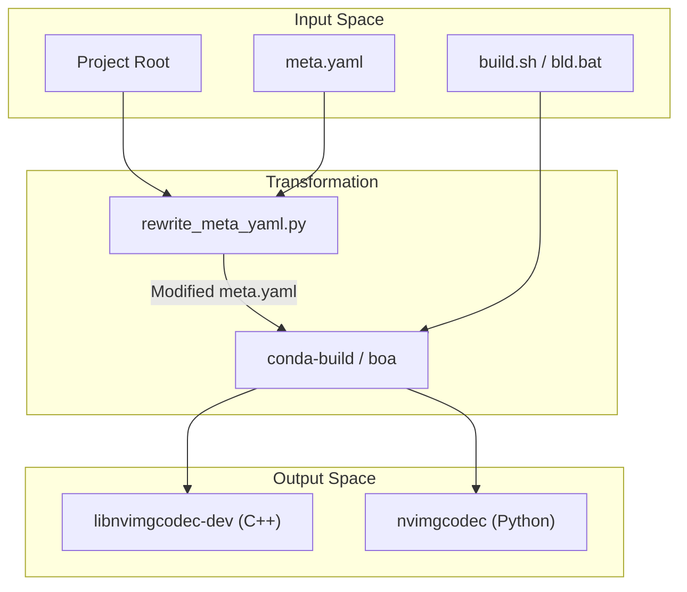
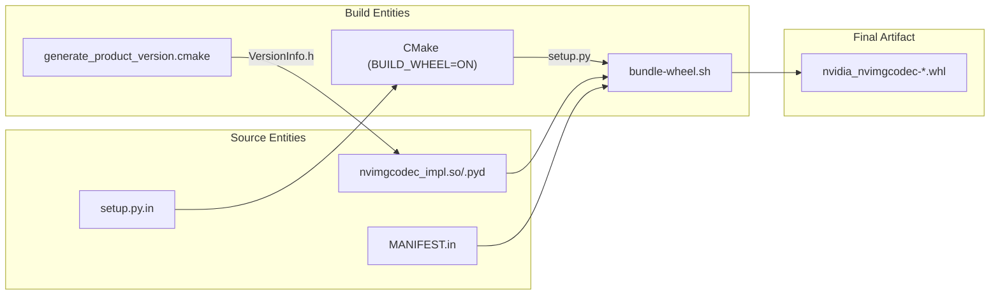

<!-- source: DeepWiki mcp.deepwiki.com · repo NVIDIA/nvImageCodec · page 7.2 Packaging: Conda, Wheel, and Debian/RPM · fetched 2026-10-26 -->

# Packaging: Conda, Wheel, and Debian/RPM

Relevant source files

The following files were used as context for generating this wiki page:

- [cmake/Package.cmake](cmake/Package.cmake)
- [cmake/third_party/VersionInfo.in](cmake/third_party/VersionInfo.in)
- [cmake/third_party/VersionResource.rc](cmake/third_party/VersionResource.rc)
- [cmake/third_party/generate_product_version.cmake](cmake/third_party/generate_product_version.cmake)
- [conda/build.sh](conda/build.sh)
- [conda/recipes/libnvimgcodec/bld.bat](conda/recipes/libnvimgcodec/bld.bat)
- [conda/recipes/libnvimgcodec/build.sh](conda/recipes/libnvimgcodec/build.sh)
- [conda/recipes/libnvimgcodec/meta.yaml](conda/recipes/libnvimgcodec/meta.yaml)
- [conda/recipes/nvimgcodec/bld.bat](conda/recipes/nvimgcodec/bld.bat)
- [conda/recipes/nvimgcodec/build.sh](conda/recipes/nvimgcodec/build.sh)
- [conda/recipes/nvimgcodec/meta.yaml](conda/recipes/nvimgcodec/meta.yaml)
- [conda/scripts/rewrite_meta_yaml.py](conda/scripts/rewrite_meta_yaml.py)
- [cpack/debian_lib_postinst.in](cpack/debian_lib_postinst.in)
- [cpack/debian_lib_postrm.in](cpack/debian_lib_postrm.in)
- [cpack/ld.so.conf.in](cpack/ld.so.conf.in)

This page documents the packaging pipelines for nvImageCodec, covering Conda recipes, Python wheels, and system-level Debian/RPM packages. The project utilizes a multi-tiered packaging strategy to support high-performance C++ library distribution, Python ecosystem integration, and standard Linux package management.

## 1. Conda Packaging

The Conda pipeline is divided into two primary feedstock recipes: `libnvimgcodec` (the C++ core and extensions) and `nvimgcodec` (the Python bindings). This separation allows for cleaner dependency management and independent versioning of the runtime library versus the Python API.

### 1.1 libnvimgcodec Recipe
This recipe builds the core shared libraries and extension modules. It is structured as a "split" package in `conda/recipes/libnvimgcodec/meta.yaml` [conda/recipes/libnvimgcodec/meta.yaml:26-28](), producing several outputs:
*   **libnvimgcodec-dev**: Headers, CMake configurations, and development symlinks [conda/recipes/libnvimgcodec/meta.yaml:73-95]().
*   **libnvimgcodec**: A generic meta-package for the runtime [conda/recipes/libnvimgcodec/meta.yaml:134-143]().
*   **libnvimgcodec[major]**: The versioned shared library [conda/recipes/libnvimgcodec/meta.yaml:156-160]().

The build process is handled by `conda/recipes/libnvimgcodec/build.sh` (Linux) and `bld.bat` (Windows). Key CMake flags used during the Conda build include:
*   `-DWITH_DYNAMIC_LINK:BOOL=OFF`: Disables internal `dlopen` logic in favor of Conda's shared library linking [conda/recipes/libnvimgcodec/build.sh:33]().
*   `-DNVIMGCODEC_INSTALL_LD_SO_CONF:BOOL=OFF`: Prevents writing to system directories, as Conda uses `RPATH` [conda/recipes/libnvimgcodec/build.sh:42]().

### 1.2 nvimgcodec (Python) Recipe
This recipe depends on `libnvimgcodec-dev` [conda/recipes/nvimgcodec/meta.yaml:67]() and builds the Python bindings. It uses `pybind11` and `setuptools` to create the `nvidia.nvimgcodec` package [conda/recipes/nvimgcodec/meta.yaml:70-72]().

### 1.3 Conda Build Utility: rewrite_meta_yaml.py
For local development and CI, the `conda/scripts/rewrite_meta_yaml.py` utility modifies `meta.yaml` files on the fly. It performs two main tasks:
1.  **Version Injection**: Updates the `` Jinja2 variable with the detected project version [conda/scripts/rewrite_meta_yaml.py:41-43]().
2.  **Source Redirection**: For local builds (`CONDA_BUILD_LOCAL=1`), it changes the `source` block from a URL/SHA256 to a local `path` pointing to the project root [conda/scripts/rewrite_meta_yaml.py:28-33]().

**Conda Packaging Data Flow**
The following diagram illustrates how source code and metadata flow through the Conda build system.

| Title: Conda Build Pipeline |
| :--- |

Sources: [conda/build.sh:140-165](), [conda/scripts/rewrite_meta_yaml.py:15-69](), [conda/recipes/libnvimgcodec/meta.yaml:71-134]().

## 2. Python Wheel Packaging

Python wheels are built using a combination of CMake and a specialized shell script, `bundle-wheel.sh`. Unlike standard Python packages, nvImageCodec wheels often bundle specific CUDA dependencies or use custom platform tags.

### 2.1 Wheel Generation Logic
*   **setup.py.in**: A template processed by CMake to include the correct versioning and package metadata.
*   **bundle-wheel.sh**: Orchestrates the assembly of the wheel, including copying shared libraries into the package directory and invoking `pip wheel`.
*   **Platform Tagging**: For cross-compilation (e.g., building aarch64 wheels on x86_64), the build script manually sets `WHL_PLATFORM_NAME` [conda/recipes/nvimgcodec/build.sh:24-33]().

### 2.2 CMake Integration
The build system uses `generate_product_version` to create Windows resource files (`.rc`) and headers (`VersionInfo.h`) to ensure the DLLs and Python modules have embedded version metadata [cmake/third_party/generate_product_version.cmake:39-107]().

**Wheel Assembly Logic**
This diagram maps the code entities involved in creating a Python wheel.

| Title: Wheel Packaging Entity Map |
| :--- |

Sources: [cmake/third_party/generate_product_version.cmake:39-56](), [conda/recipes/nvimgcodec/build.sh:73-87](), [cmake/third_party/VersionInfo.in:1-42]().

## 3. Debian and RPM Packaging (CPack)

nvImageCodec uses **CPack** to generate system packages (`.deb` and `.rpm`). This is primarily configured in `cmake/Package.cmake`.

### 3.1 Installation Prefixes
CPack logic differentiates between package types to follow platform conventions:
*   **DEB**: Uses the standard `CPACK_INSTALL_PREFIX` [cmake/Package.cmake:1-2]().
*   **TGZ**: Sets a custom prefix based on the package name [cmake/Package.cmake:3-4]().

### 3.2 Post-Installation Scripts
For Linux system packages, the project provides templates for `ldconfig` management:
*   **postinst/postrm**: Scripts (e.g., `cpack/debian_lib_postinst.in`) that run `ldconfig` after installation or removal to update the dynamic linker cache.
*   **ld.so.conf.in**: A configuration file template used to add the nvImageCodec library path to the system's library search path. This can be toggled via the `NVIMGCODEC_INSTALL_LD_SO_CONF` CMake variable [conda/recipes/libnvimgcodec/build.sh:42]().

## 4. Versioning System

The versioning is centralized and injected into both C++ and Python components.

| Constant | Description | Source |
| :--- | :--- | :--- |
| `PRODUCT_VERSION_MAJOR` | Major version number | [cmake/third_party/VersionInfo.in:4]() |
| `PRODUCT_VERSION_FULL_STR` | Complete version string (Major.Minor.Patch.Build) | [cmake/third_party/VersionInfo.in:42]() |
| `FILE_VERSION_RESOURCE` | Comma-separated version for Windows RC files | [cmake/third_party/VersionInfo.in:49]() |

The function `generate_product_version` in `cmake/third_party/generate_product_version.cmake` automates the creation of these versioning headers and resource files by parsing arguments like `NAME`, `VERSION_MAJOR`, and `COMPANY_NAME` [cmake/third_party/generate_product_version.cmake:41-54]().

Sources: [cmake/third_party/VersionInfo.in:1-50](), [cmake/third_party/generate_product_version.cmake:39-107](), [cmake/Package.cmake:1-5]().

---

