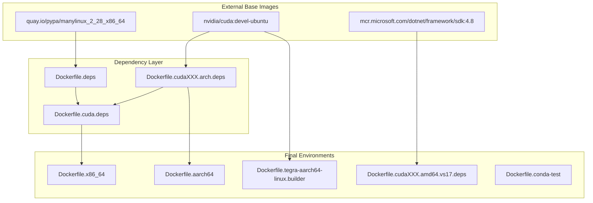

<!-- source: DeepWiki mcp.deepwiki.com · repo NVIDIA/nvImageCodec · page 7.3 Docker Build Environments · fetched 2026-10-26 -->

# Docker Build Environments

Relevant source files

The following files were used as context for generating this wiki page:

- [docker/Dockerfile.aarch64](docker/Dockerfile.aarch64)
- [docker/Dockerfile.conda-test](docker/Dockerfile.conda-test)
- [docker/Dockerfile.cuda.deps](docker/Dockerfile.cuda.deps)
- [docker/Dockerfile.cuda129.aarch64.deps](docker/Dockerfile.cuda129.aarch64.deps)
- [docker/Dockerfile.cuda129.amd64.vs17.deps](docker/Dockerfile.cuda129.amd64.vs17.deps)
- [docker/Dockerfile.cuda129.x86_64.deps](docker/Dockerfile.cuda129.x86_64.deps)
- [docker/Dockerfile.cuda133.aarch64.deps](docker/Dockerfile.cuda133.aarch64.deps)
- [docker/Dockerfile.cuda133.amd64.vs17.deps](docker/Dockerfile.cuda133.amd64.vs17.deps)
- [docker/Dockerfile.cuda133.x86_64.deps](docker/Dockerfile.cuda133.x86_64.deps)
- [docker/Dockerfile.deps](docker/Dockerfile.deps)
- [docker/Dockerfile.gcc14](docker/Dockerfile.gcc14)
- [docker/Dockerfile.tegra-aarch64-linux.builder](docker/Dockerfile.tegra-aarch64-linux.builder)
- [docker/Dockerfile.x86_64](docker/Dockerfile.x86_64)
- [docker/build.sh](docker/build.sh)
- [docker/build_dockers.bat](docker/build_dockers.bat)
- [docker/build_dockers.sh](docker/build_dockers.sh)
- [docker/build_helper.bat](docker/build_helper.bat)
- [docker/build_helper.sh](docker/build_helper.sh)
- [docker/default-config-docker.bat](docker/default-config-docker.bat)
- [docker/default-config-docker.sh](docker/default-config-docker.sh)

The `nvImageCodec` project utilizes a comprehensive Docker infrastructure to ensure reproducible builds, consistent testing environments, and streamlined packaging across multiple hardware architectures and software stacks. This infrastructure supports Linux (x86_64 and aarch64/SBSA), Windows (VS17), and specialized Tegra/Jetson cross-compilation environments.

## Docker Infrastructure Overview

The Docker environment is organized into a hierarchy of images: base dependency images containing the toolchain, CUDA-specific dependency layers, and final build/test images.

### Image Hierarchy and Data Flow

The following diagram illustrates how the different Dockerfiles interact to produce the final build environments.

**Diagram: Docker Image Lineage and Dependencies**

**Sources:** [docker/Dockerfile.deps:1-8](), [docker/Dockerfile.cuda.deps:1-11](), [docker/Dockerfile.x86_64:1-5](), [docker/Dockerfile.aarch64:1-14]()

## Linux Build Environments

### Manylinux Dependency Base
The project targets `manylinux_2_28` to ensure binary compatibility for Python wheels. 
*   **`Dockerfile.deps`**: Installs core build tools including `patchelf` (v0.17.2) for RPATH manipulation [docker/Dockerfile.deps:15-19]() and CMake (v3.24.3) [docker/Dockerfile.deps:21-31](). It triggers the `external/build_deps.sh` script to compile static dependencies like `libjpeg-turbo`, `libtiff`, and `OpenCV` [docker/Dockerfile.deps:34-38]().
*   **`Dockerfile.cuda.deps`**: Merges the `manylinux` base with specific CUDA toolkit versions. It sets `NVIDIA_DRIVER_CAPABILITIES` to `video,compute,utility` to allow hardware acceleration within the container [docker/Dockerfile.cuda.deps:15-18]().

### Architecture Specifics (x86_64 vs aarch64)
*   **x86_64**: Uses standard `manylinux` base.
*   **aarch64 (SBSA)**: Based on `ubuntu:24.04`. It includes a complex multi-stage build to clone and sparse-checkout `NVIDIA/DALI` and `DALI_extra` repositories for testing purposes [docker/Dockerfile.aarch64:4-12](). It also manually installs redistributable versions of `libnvjpeg_2k`, `libnvtiff`, and `nvcomp` for the `sbsa` architecture [docker/Dockerfile.aarch64:66-87]().

### GCC 14 Environment
For cutting-edge compiler support, `Dockerfile.gcc14` provides a `manylinux_2_28` environment with `gcc-toolset-14`, including AddressSanitizer (ASAN), LeakSanitizer (LSAN), and ThreadSanitizer (TSAN) libraries for memory safety testing [docker/Dockerfile.gcc14:1-15]().

**Sources:** [docker/Dockerfile.deps:1-53](), [docker/Dockerfile.aarch64:1-114](), [docker/Dockerfile.gcc14:1-21]()

## Windows Build Environments

The Windows environment is defined in `Dockerfile.cuda129.amd64.vs17.deps` and `Dockerfile.cuda133.amd64.vs17.deps`. It uses Windows Server Core 2019 and installs Visual Studio 2022 Build Tools (v17).

### Key Windows Components:
*   **Workloads**: Specifically installs `Microsoft.VisualStudio.Workload.VCTools` and `Microsoft.VisualStudio.Component.VC.CMake.Project` [docker/Dockerfile.cuda129.amd64.vs17.deps:17-28]().
*   **CUDA Integration**: Downloads and installs the CUDA local installer silently, then copies `MSBuildExtensions` into the BuildTools directory so CMake's `find_package(CUDA)` or `enable_language(CUDA)` works correctly [docker/Dockerfile.cuda129.amd64.vs17.deps:42-47]().
*   **Python Stack**: Installs multiple Python versions (3.9 through 3.14) and upgrades `pip`, `setuptools`, and `wheel` for each interpreter [docker/Dockerfile.cuda129.amd64.vs17.deps:57-87]().
*   **Entrypoint**: Configured to launch `VsDevCmd.bat` to initialize the developer environment before starting a PowerShell session [docker/Dockerfile.cuda129.amd64.vs17.deps:99]().

**Sources:** [docker/Dockerfile.cuda129.amd64.vs17.deps:1-100](), [docker/Dockerfile.cuda133.amd64.vs17.deps:1-100]()

## Tegra/Jetson Builder

The `Dockerfile.tegra-aarch64-linux.builder` is a specialized cross-compilation environment running on x86_64 but targeting Tegra (Jetson) platforms.

*   **Target Architectures**: Configured for Compute Capability 7.2 (Volta/Xavier) and 8.7 (Ampere/Orin) [docker/Dockerfile.tegra-aarch64-linux.builder:8-11]().
*   **Cross Toolchain**: Installs `gcc-aarch64-linux-gnu` and `g++-aarch64-linux-gnu` [docker/Dockerfile.tegra-aarch64-linux.builder:33-34]().
*   **CUDA Cross-Packages**: Uses `cuda-nvcc-cross-aarch64`, `cuda-cudart-cross-aarch64`, and `cuda-driver-cross-aarch64` [docker/Dockerfile.tegra-aarch64-linux.builder:53-59]().
*   **Python Header Hack**: To build Python wheels for the target, it downloads Python source code and runs `./configure` with the cross-compiler to install target-specific headers into the host's `/usr/include` paths [docker/Dockerfile.tegra-aarch64-linux.builder:107-123]().

**Sources:** [docker/Dockerfile.tegra-aarch64-linux.builder:1-145]()

## Conda Test Environment

`Dockerfile.conda-test` provides a clean runtime environment for verifying Conda packages.
*   **Miniconda**: Installs a pinned version of Miniconda3 (py312) with SHA256 verification [docker/Dockerfile.conda-test:18-23]().
*   **Channel Config**: Forces the use of `conda-forge` and initializes `conda-index` for local channel testing [docker/Dockerfile.conda-test:28-31]().

**Sources:** [docker/Dockerfile.conda-test:1-34]()

## Orchestration Scripts

The build process is orchestrated by shell and batch scripts that handle argument parsing and `docker build` command generation.

### Orchestration Logic Flow

**Diagram: Build Orchestration Data Flow**

### Script Roles:
1.  **`build_dockers.sh` / `build_dockers.bat`**: High-level entry points. They parse command-line arguments (like CUDA version, Python version) and call the helper scripts.
2.  **`default-config-docker.sh` / `default-config-docker.bat`**: Sets default environment variables for the build if not provided by the user.
3.  **`build_helper.sh` / `build_helper.bat`**: Contains the actual logic to construct the `docker build` commands, including `--build-arg` flags for CUDA versions and image names.
4.  **`build.sh`**: A lower-level script often used to trigger the compilation of the project *inside* the container once the environment is ready.

**Sources:** [docker/build_dockers.sh:1-20](), [docker/build_helper.sh:1-20](), [docker/default-config-docker.sh:1-15](), [docker/build_dockers.bat:1-20]()

---

