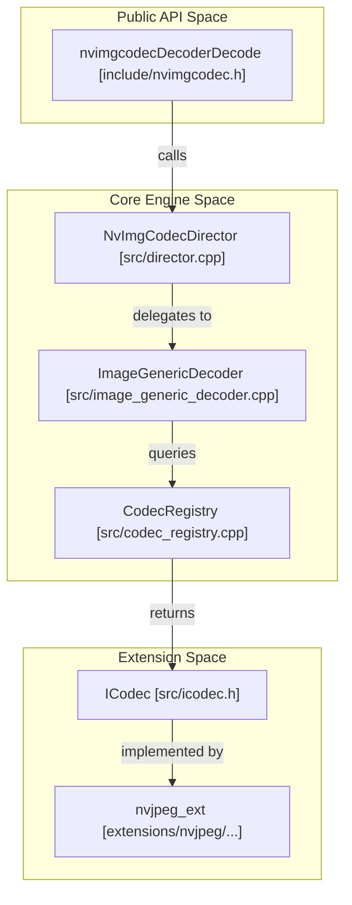
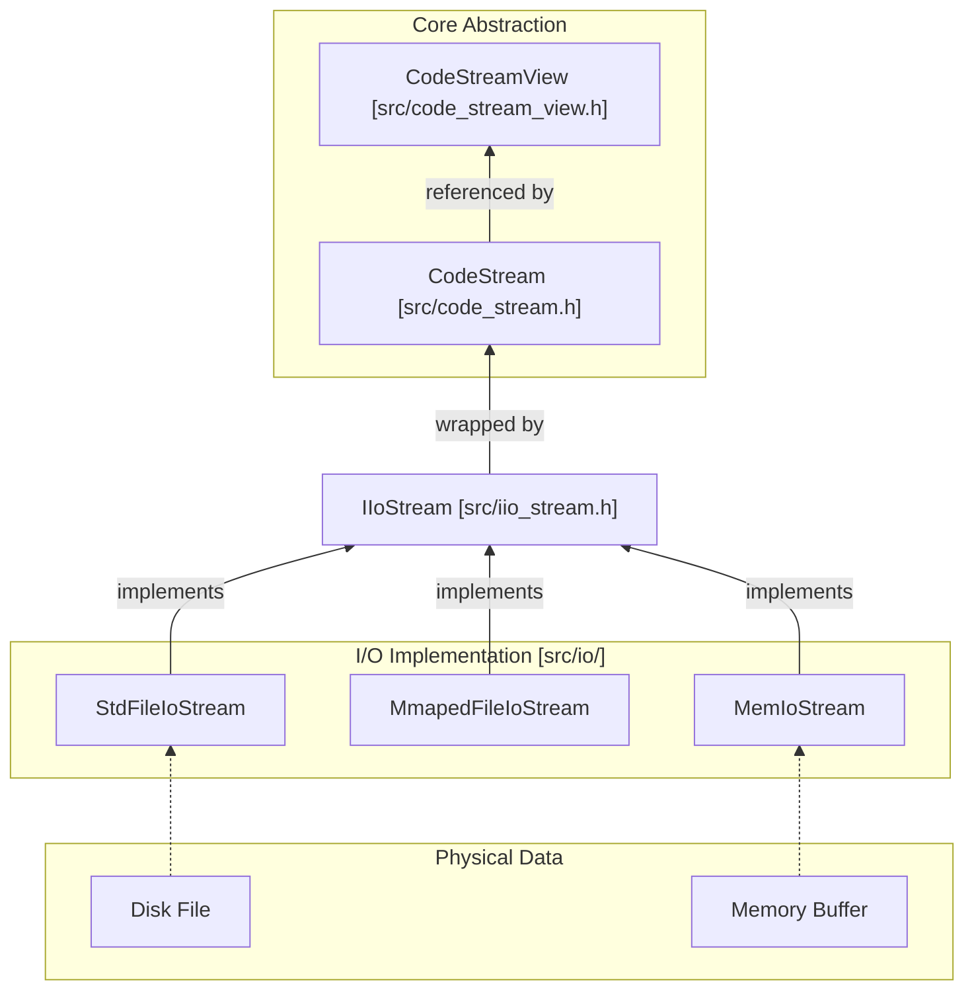

<!-- source: DeepWiki mcp.deepwiki.com · repo NVIDIA/nvImageCodec · page 8 Glossary · fetched 2026-10-26 -->

# Glossary

Relevant source files

The following files were used as context for generating this wiki page:

- [.clang-format](.clang-format)
- [.gitattributes](.gitattributes)
- [.gitmodules](.gitmodules)
- [Acknowledgements.txt](Acknowledgements.txt)
- [CMakeLists.txt](CMakeLists.txt)
- [README.md](README.md)

This page provides definitions for codebase-specific terminology, architectural patterns, and domain concepts used throughout the `nvImageCodec` project. It serves as a technical reference for engineers to understand the relationships between high-level concepts and their underlying C++ implementations.

## Core Architectural Terms

### Director
The central orchestration component of the library. The `NvImgCodecDirector` manages the lifecycle of the library instance, including the loading of extensions, registration of codecs, and the creation of decoders and encoders.

*   **Implementation**: `NvImgCodecDirector` class in `src/director.h` and `src/director.cpp`.
*   **Role**: Acts as the entry point for most C API calls, delegating work to the `CodecRegistry` or `PluginFramework`.

### Extension
A modular plugin that provides specific codec implementations (e.g., nvJPEG, libtiff). Extensions are shared libraries loaded at runtime that register their capabilities with the core engine.

*   **Implementation**: Defined by `nvimgcodecExtensionDesc_t` in `include/nvimgcodec.h`.
*   **Discovery**: Managed by the `PluginFramework` in `src/plugin_framework.cpp`.

### Codec Registry
A singleton-like component within the `Director` that maintains a list of all available image parsers, decoders, and encoders. It is used to match a specific bitstream to the best available codec.

*   **Implementation**: `CodecRegistry` class in `src/codec_registry.h`.

### Code Stream
An abstraction representing an image bitstream. It can wrap a file on disk, a memory buffer, or a custom I/O stream. It provides a unified way for parsers and decoders to access raw data.

*   **Implementation**: `nvimgcodecCodeStream_t` (C API handle) and `CodeStream` class in `src/code_stream.h`.

## Domain Concepts

### Backend Kind
Specifies the processing hardware or library type used for a codec operation.
*   **CPU**: Processing happens on the host processor (e.g., `libjpeg-turbo`).
*   **GPU_CUDA**: Processing happens on NVIDIA GPUs using CUDA kernels (e.g., `nvjpeg_ext`).
*   **GPU_HYBRID**: A mix of CPU and GPU processing.
*   **HARDWARE**: Dedicated hardware accelerators (e.g., JPEG hardware decoder on Jetson).

### Sample Format
Describes the pixel layout and bit depth of an image (e.g., RGB8, BGR8, YUV420, Gray8).

*   **Source**: Defined in `nvimgcodecSampleFormat_t` within `include/nvimgcodec.h`.

### Fallback Mechanism
The logic used when a preferred codec (usually GPU-accelerated) fails or is unavailable. The `ImageGenericDecoder` will automatically attempt to use the next available codec in the priority list (often a CPU-based extension like `opencv_ext`).

*   **Logic Site**: `ImageGenericDecoder::decode` in `src/image_generic_decoder.cpp`.

---

## Code Entity Mapping

### System Flow: From API to Extension
The following diagram illustrates how a user request for decoding flows from the Public C API through the Director and into a specific Codec Extension.

**Figure 1: Request Dispatch Flow**

**Sources**: [include/nvimgcodec.h:1-100](), [src/director.cpp:1-50](), [src/image_generic_decoder.cpp:1-100]().

### Data Abstraction: CodeStream and I/O
This diagram maps the natural language concept of "Image Data" to the specific classes handling I/O and bitstream access.

**Figure 2: I/O Abstraction Hierarchy**

**Sources**: [src/code_stream.h:1-50](), [src/iio_stream.h:1-40](), [src/io/std_file_io_stream.h:1-30]().

---

## Technical Terms Table

| Term | Definition | Code Pointer |
| :--- | :--- | :--- |
| **DLPack** | A standard for sharing tensors between frameworks (PyTorch, CuPy) without copying. | `external/dlpack` |
| **ROI** | Region of Interest. Specifies a sub-rectangle of an image to be decoded or encoded. | `nvimgcodecRegion_t` [include/nvimgcodec.h]() |
| **Exif Orientation** | Metadata indicating how the image should be rotated/flipped for display. | `src/parsers/exif_orientation.h` |
| **Dynamic Link Layer** | A subsystem that loads CUDA and codec libraries (nvJPEG, etc.) via `dlopen` at runtime. | `src/dynlink/` |
| **Processing Results** | A promise/future mechanism used for asynchronous batch processing. | `src/processing_results.h` |
| **Image Buffer Kind** | Specifies if the pixel data resides in `STRIDED`, `PLANAR`, or `PITCHED` memory. | `nvimgcodecImageBufferKind_t` [include/nvimgcodec.h]() |

**Sources**: [include/nvimgcodec.h:1-500](), [src/parsers/exif_orientation.h:1-20](), [README.md:17-28]().