# Page: nvImageCodec Overview

# nvImageCodec Overview

<details>
<summary>Relevant source files</summary>

The following files were used as context for generating this wiki page:

- [.gitmodules](.gitmodules)
- [Acknowledgements.txt](Acknowledgements.txt)
- [CMakeLists.txt](CMakeLists.txt)
- [LICENSE.txt](LICENSE.txt)
- [README.md](README.md)
- [VERSION.txt](VERSION.txt)

</details>


The **nvImageCodec** is an open-source library providing a unified interface for accelerated image codecs [README.md:17-18](). It is designed as a modular framework where specific codec implementations are delivered via extension plugins, allowing for seamless transitions between high-performance GPU-accelerated paths and reliable CPU fallbacks [README.md:18-24]().

## Key Features

- **Unified API**: A single interface for both decoding and encoding across various image formats [README.md:22-22]().
- **Batch Processing**: Supports variable shapes and heterogeneous image formats within a single batch [README.md:23-23]().
- **Automatic Fallback**: Intelligent codec prioritization that automatically falls back to alternative implementations (e.g., CPU) if the primary (e.g., GPU) codec is unavailable or unsupported for a specific bitstream [README.md:24-24]().
- **Zero-Copy Interop**: Direct integration with deep learning frameworks including **PyTorch**, **CuPy**, and **CV-CUDA** via DLPack [README.md:27-27]().
- **Extensibility**: A plugin-based architecture for adding new hardware or software codecs [README.md:18-18]().

## System Architecture

The library is centered around a "Director" pattern that manages the lifecycle of the codec registry and orchestrates the flow of image data through various parsers and backends.

### Code Entity Mapping
The following diagram illustrates how high-level system components map to specific entities within the codebase.

**Component to Code Entity Map**
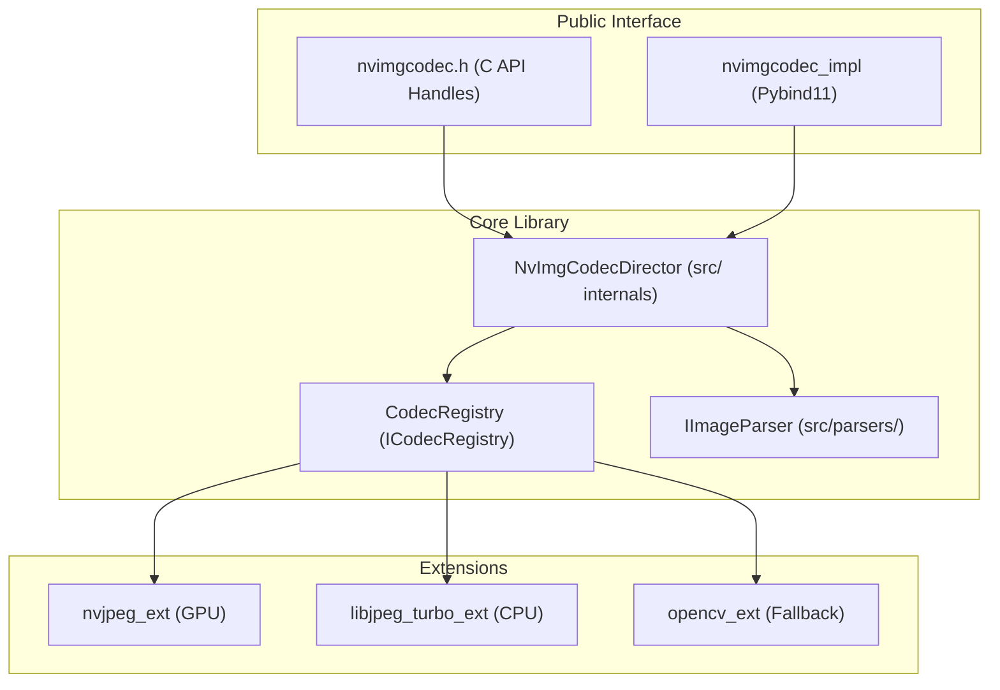
Sources: [README.md:17-30](), [CMakeLists.txt:20-49](), [include/nvimgcodec.h:1-100]().

## Supported Formats and Codecs

nvImageCodec categorizes its support into native GPU-accelerated extensions and 3rd-party CPU fallback extensions.

### Native Extensions
| Extension | Format | Features |
| :--- | :--- | :--- |
| `nvjpeg_ext` | JPEG | Hardware/CUDA Decoder, Hardware Encoder (Jetson Thor), Lossless support [README.md:32-37]() |
| `nvjpeg2k_ext`| JPEG 2000 | CUDA Decoder/Encoder (including HT-JPEG2000) [README.md:39-42]() |
| `nvtiff_ext` | TIFF | CUDA Decoder/Encoder [README.md:44-47]() |
| `nvbmp_ext`  | BMP | CPU-based reference reader/writer [README.md:49-52]() |
| `nvpnm_ext`  | PNM | CPU-based reference writer (PPM, PBM, PGM) [README.md:54-56]() |

### Fallback Extensions
| Extension | Format | Description |
| :--- | :--- | :--- |
| `libturbo-jpeg_ext` | JPEG | High-performance CPU JPEG decoding [README.md:60-62]() |
| `libtiff_ext` | TIFF | CPU TIFF decoding [README.md:64-66]() |
| `opencv_ext` | Multi | Fallback for JPEG, JPEG2K, PNG, BMP, PNM, TIFF, WebP [README.md:68-76]() |

## Platform Requirements

The library targets modern NVIDIA GPU environments with the following minimum requirements:

- **Operating Systems**: Linux (Ubuntu 20.04+, RHEL 8/9, Debian 12) and Windows (x86_64, WSL2) [README.md:83-102]().
- **Hardware**: NVIDIA GPU with Driver >= 530.30.02 (Linux) or >= 531.14 (Windows) [README.md:98-102]().
- **Software**: 
    - CUDA Toolkit >= 12.1 [README.md:103]().
    - GCC >= 14.0 [README.md:104]().
    - Python >= 3.9 [README.md:105]().

## Installation

The library can be installed via binary packages or Python wheels. The Python packages are split by CUDA version.

| Environment | Command |
| :--- | :--- |
| CUDA 12.x | `pip install nvidia-nvimgcodec-cu12` |
| CUDA 13.x | `pip install nvidia-nvimgcodec-cu13` |
| Jetson (Tegra) | `pip install nvidia-nvimgcodec-tegra-cu12` |

To install with all GPU-accelerated extensions (nvJPEG, nvJPEG2K, nvTIFF), use the `[all]` extra:
`pip install nvidia-nvimgcodec-cu12[all]` [README.md:120-125]().

For detailed installation instructions, including manual library setup and Conda instructions, see [Getting Started](#1.1).

## Project Structure

**Source Code Organization**
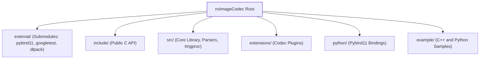
Sources: [.gitmodules:1-18](), [CMakeLists.txt:78-100](), [README.md:22-28]().

## Documentation Map

- **[Getting Started](#1.1)**: Step-by-step installation, platform prerequisites, and your first "Hello World" decode.
- **[Contributing and Community](#1.2)**: How to report bugs, request features, and contribute to the codebase.
- **Architecture and Core Library**: Deep dive into the `NvImgCodecDirector`, the C API, and the internal plugin framework.
- **Codec Extensions**: Details on individual codec implementations and how to write your own extension.
- **Python API**: Reference for the Python `Decoder` and `Encoder` classes and framework integrations.
- **Testing**: Information on the GoogleTest (C++) and pytest (Python) suites.

Sources: [README.md:17-30](), [CMakeLists.txt:1-100](), [VERSION.txt:1]()

---

# Page: Getting Started

# Getting Started

<details>
<summary>Relevant source files</summary>

The following files were used as context for generating this wiki page:

- [README.md](README.md)
- [conda/build.sh](conda/build.sh)
- [conda/recipes/libnvimgcodec/meta.yaml](conda/recipes/libnvimgcodec/meta.yaml)
- [conda/recipes/nvimgcodec/meta.yaml](conda/recipes/nvimgcodec/meta.yaml)

</details>


The nvImageCodec library provides a unified framework for accelerated image decoding and encoding, designed to abstract away the complexities of different hardware and software backends [README.md:17-18](). This guide details the installation process, environment requirements, and initial steps to verify a working setup.

## Platform Prerequisites

Before installing nvImageCodec, ensure your system meets the following hardware and software requirements:

### Supported Operating Systems
*   **Linux (x86_64 and arm64-sbsa):** Debian 12, Fedora 41, RHEL 8/9, OpenSUSE/SLES 15, and Ubuntu 20.04/22.04/24.04 [README.md:83-95]().
*   **Linux (aarch64-jetson):** Ubuntu 22.04 (requires CUDA Toolkit >= 12.1 and < 13.0) [README.md:96-97]().
*   **Windows (x86_64):** Native or WSL2 (Ubuntu 20.04). Requires Microsoft Visual C++ Redistributable [README.md:91,99-101]().

### Hardware and Drivers
*   **NVIDIA Driver:** >= 530.30.02 (Linux) or >= 531.14 (Windows) [README.md:98,102]().
*   **CUDA Toolkit:** Version 12.1 or newer [README.md:103]().

### Build and Runtime Dependencies
*   **GCC:** Version 14.0 or newer [README.md:104]().
*   **Python:** Versions 3.9 through 3.14 (including experimental "t" variants) [README.md:13,105]().
*   **CMake:** Version 3.18 or newer [README.md:10]().

---

## Installation

nvImageCodec can be installed via Python package managers (pip), Conda, or by downloading binary packages.

### 1. Using Pip (Recommended for Python Users)
The library is distributed on PyPI with CUDA-version-specific suffixes. You can install the base library or include optional GPU-accelerated extensions.

| Component | CUDA 12.x | CUDA 13.x |
| :--- | :--- | :--- |
| **Base Library** | `pip install nvidia-nvimgcodec-cu12` | `pip install nvidia-nvimgcodec-cu13` |
| **With All Extensions** | `pip install nvidia-nvimgcodec-cu12[all]` | `pip install nvidia-nvimgcodec-cu13[all]` |
| **Tegra (Jetson)** | `pip install nvidia-nvimgcodec-tegra-cu12` | N/A |

*Sources: [README.md:111-125]()*

#### Manual Extension Installation
If you prefer to manage dependencies manually rather than using the `[all]` extra, you can install the underlying libraries independently:
*   **nvJPEG:** `pip install nvidia-nvjpeg-cu12` [README.md:142]()
*   **nvJPEG2000:** `pip install nvidia-nvjpeg2k-cu12` [README.md:150]()
*   **nvTIFF:** `pip install nvidia-nvtiff-cu12` [README.md:161]()

### 2. Using Conda
The codebase provides recipes for building and installing via Conda. The packages are split into `libnvimgcodec` (C++ library) and `nvimgcodec` (Python bindings) [conda/recipes/libnvimgcodec/meta.yaml:27](), [conda/recipes/nvimgcodec/meta.yaml:17]().

To build locally using the provided script:
```bash
# Setup environment and build both C++ and Python packages for CUDA 12.9
./conda/build.sh --setup-env --cuda-version 12.9 all
```
*Sources: [conda/build.sh:9-32](), [conda/build.sh:140-177]()*

---

## System Flow and Verification

The following diagram illustrates how the installation components interact to enable image processing.

### Installation Component Mapping
This diagram bridges the installation entities (packages/libraries) to the code entities that manage them.

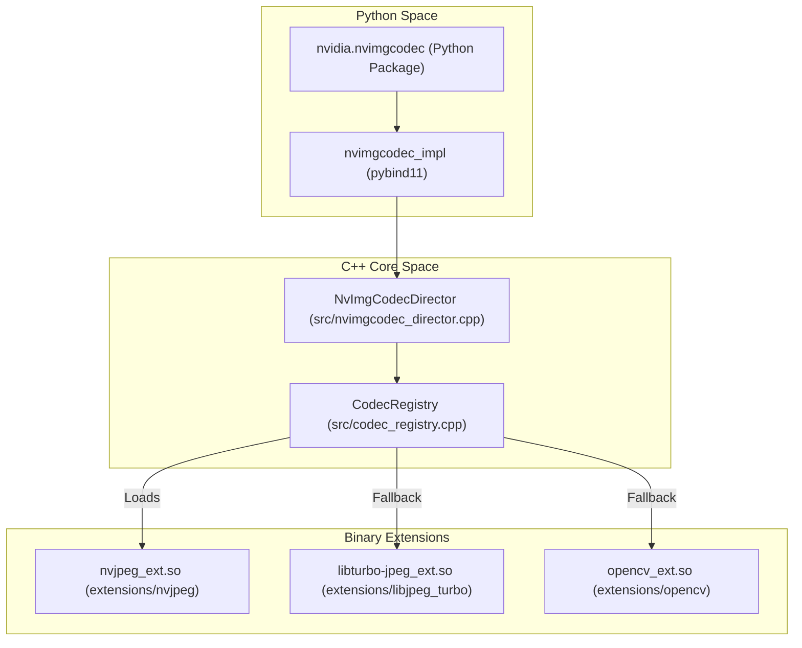
*Sources: [README.md:17-26](), [conda/recipes/libnvimgcodec/meta.yaml:156-160](), [conda/recipes/nvimgcodec/meta.yaml:83-85]()*

### Verifying the Installation
To verify the installation, you can run a simple Python script to check if the library and its extensions are correctly loaded.

```python
import nvidia.nvimgcodec as nvimgcodec

# Create an instance of the library
# This triggers NvImgCodecDirector initialization and extension discovery
instance = nvimgcodec.Instance()

# List available backends to verify extensions (e.g., nvJPEG, OpenCV)
for backend in instance.backends:
    print(f"Found backend: {backend.name}")
```
*Sources: [README.md:22-26](), [conda/recipes/nvimgcodec/meta.yaml:88-89]()*

---

## First Operation: Decode and Encode

The core of nvImageCodec is the `Decoder` and `Encoder` classes. The system automatically handles format detection using built-in parsers [README.md:25]().

### Data Flow for a Simple Decode
The following diagram traces the data flow from a file on disk to a GPU buffer.


*Sources: [README.md:22-25](), [conda/recipes/libnvimgcodec/meta.yaml:121-129]()*

### Python Example: Batch Decoding
```python
import nvidia.nvimgcodec as nvimgcodec

# Initialize decoder
decoder = nvimgcodec.Decoder()

# Decode a batch of images (handles different formats automatically)
images = decoder.decode(["image1.jpg", "image2.png", "image3.webp"])

# images[0] is now a nvimgcodec.Image object containing the pixel data
for img in images:
    print(f"Decoded: {img.width}x{img.height} {img.color_spec}")
```
*Sources: [README.md:22-26]()*

### Python Example: Encoding
```python
import nvidia.nvimgcodec as nvimgcodec

encoder = nvimgcodec.Encoder()
# Encode the first image from the previous step as a JPEG
encoder.encode(images[0], "output.jpg")
```
*Sources: [README.md:22-24]()*

---
**Sources:**
* `README.md:1-170`
* `conda/build.sh:1-180`
* `conda/recipes/libnvimgcodec/meta.yaml:1-170`
* `conda/recipes/nvimgcodec/meta.yaml:1-107`

---

# Page: Contributing and Community

# Contributing and Community

<details>
<summary>Relevant source files</summary>

The following files were used as context for generating this wiki page:

- [.clang-format](.clang-format)
- [.github/ISSUE_TEMPLATE/bug_report_form.yml](.github/ISSUE_TEMPLATE/bug_report_form.yml)
- [.github/ISSUE_TEMPLATE/config.yml](.github/ISSUE_TEMPLATE/config.yml)
- [.github/ISSUE_TEMPLATE/feature_request_form.yml](.github/ISSUE_TEMPLATE/feature_request_form.yml)
- [.github/ISSUE_TEMPLATE/submit-question.yml](.github/ISSUE_TEMPLATE/submit-question.yml)
- [CONTRIBUTING.md](CONTRIBUTING.md)
- [SECURITY.rst](SECURITY.rst)

</details>


This page outlines the guidelines and procedures for participating in the nvImageCodec open-source project. It covers the legal requirements for code contributions, the standardized processes for reporting issues and requesting features, and the technical coding standards maintained across the repository.

## Contribution Workflow and Legal Requirements

The nvImageCodec project is developed internally by NVIDIA and periodically released to the public. External contributions are accepted provided they adhere to specific legal and procedural requirements [CONTRIBUTING.md:1-6]().

### Developer Certificate of Origin (DCO)
All contributors must agree to the **Developer Certificate of Origin (DCO) Version 1.1**. By submitting a contribution, you certify that you created the work, have the right to submit it under the Apache License Version 2.0, or are basing it on work covered by an appropriate open-source license [CONTRIBUTING.md:9-29]().

### Contribution Process
Before submitting code, all enhancements, bug fixes, or changes must be initiated by creating a GitHub Issue [CONTRIBUTING.md:5-6]().

| Step | Action | Description |
| :--- | :--- | :--- |
| 1 | **Issue Creation** | File a Bug Report or Feature Request using the GitHub templates. |
| 2 | **DCO Agreement** | Ensure your commits are signed off to certify compliance with the DCO. |
| 3 | **License** | All contributions must be licensed under **Apache License 2.0** [CONTRIBUTING.md:3-4](). |

**Sources:** [CONTRIBUTING.md:1-30]()

## Community Interaction and Issue Tracking

The project uses GitHub Issues to manage bugs, feature requests, and general questions. Each type of interaction is governed by a specific template to ensure maintainers receive the necessary technical context.

### Bug Reports
Bug reports require environment-specific details to facilitate reproduction.
*   **Version:** The specific nvImageCodec version (e.g., 0.9.0) [.github/ISSUE_TEMPLATE/bug_report_form.yml:27-33]().
*   **Minimum Reproducible Example (MVR):** A shell-rendered code snippet that demonstrates the failure [.github/ISSUE_TEMPLATE/bug_report_form.yml:45-50]().
*   **Environment Details:** Output from the `tools/print_env.sh` script [.github/ISSUE_TEMPLATE/bug_report_form.yml:52-57]().
*   **Logs:** Relevant error output and logs [.github/ISSUE_TEMPLATE/bug_report_form.yml:59-64]().

### Feature Requests
Requests for new functionality are triaged based on criticality:
*   **Must have:** Adoption is impossible without it.
*   **Should have:** Performance or usability is inferior without it.
*   **Nice to have:** Enhances existing use cases [.github/ISSUE_TEMPLATE/feature_request_form.yml:38-47]().

Users are encouraged to use the **User Story** format ("As a <persona>, I <want to>, <so that>") or the **EARS** format for system perspectives [.github/ISSUE_TEMPLATE/feature_request_form.yml:57-69]().

### General Questions
For general inquiries that do not involve bugs or features, the `submit-question.yml` template is used to categorize the issue with the `question` label [.github/ISSUE_TEMPLATE/submit-question.yml:16-19]().

**Sources:** [.github/ISSUE_TEMPLATE/bug_report_form.yml:1-78](), [.github/ISSUE_TEMPLATE/feature_request_form.yml:1-106](), [.github/ISSUE_TEMPLATE/submit-question.yml:1-41]()

## Security Policy

NVIDIA maintains a strict policy for reporting security vulnerabilities. **Do not use GitHub Issues for security reports** [.github/ISSUE_TEMPLATE/config.yml:8-12]().

Vulnerabilities should be reported via:
*   **Web:** [NVIDIA Security Vulnerability Submission Form](https://www.nvidia.com/object/submit-security-vulnerability.html) [SECURITY.rst:11-12]().
*   **Email:** `psirt@nvidia.com` using the NVIDIA public PGP key [SECURITY.rst:19-20]().

**Sources:** [SECURITY.rst:1-23](), [.github/ISSUE_TEMPLATE/config.yml:1-12]()

## Coding Standards

The project enforces strict C++ coding standards via `.clang-format` to maintain consistency across the core library and extensions.

### C++ Style Configuration
The codebase follows the **LLVM** base style with specific modifications for the nvImageCodec environment [.clang-format:2-3]().

| Parameter | Value |
| :--- | :--- |
| **Language Standard** | C++17 [.clang-format:9]() |
| **Column Limit** | 140 characters [.clang-format:3]() |
| **Indentation** | 4 spaces, no tabs [.clang-format:4, 13]() |
| **Brace Wrapping** | Mozilla style [.clang-format:11]() |
| **Pointer Alignment** | Left (e.g., `Type* var`) [.clang-format:41]() |

### Macro Handling
Specific macros used for error handling and API definitions are recognized by the formatter to prevent layout corruption:
*   **Macro Blocks:** `NVIMGCODECAPI_TRY` and `NVIMGCODECAPI_CATCH` are treated as block delimiters [.clang-format:55-56]().
*   **Typename Macros:** `CHECK_NULL` is treated as a type-related macro [.clang-format:57]()

### Include Sorting
Includes are categorized and sorted to prevent circular dependencies and maintain readability:
1.  `<ext/.*\.h>` (Priority 2) [.clang-format:16-17]()
2.  Standard system headers `<.*\.h>` (Priority 1) [.clang-format:18-19]()
3.  Other angle-bracket includes `<.*` (Priority 2) [.clang-format:20-21]()
4.  Project-local includes (Priority 3) [.clang-format:22-23]()

**Sources:** [.clang-format:1-58]()

## Data Flow: Issue Triage to Code

The following diagram illustrates how community input (Natural Language Space) translates into code entities and repository changes (Code Entity Space).

### Community Input to Code Entity Mapping
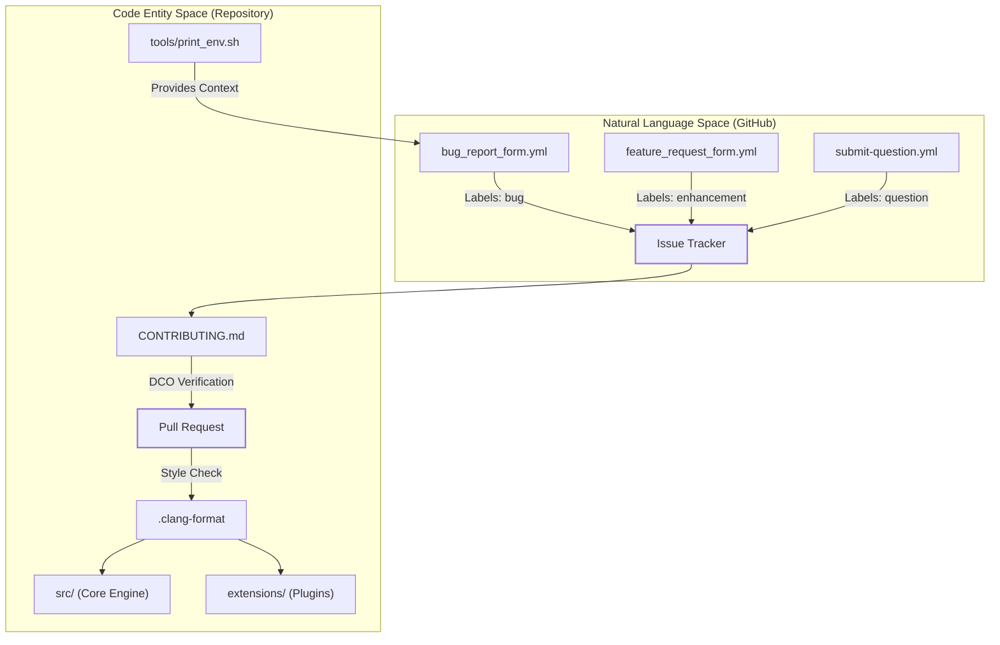
**Sources:** [.github/ISSUE_TEMPLATE/bug_report_form.yml:16-18](), [.github/ISSUE_TEMPLATE/feature_request_form.yml:16-18](), [.github/ISSUE_TEMPLATE/submit-question.yml:16-18](), [CONTRIBUTING.md:1-10](), [.clang-format:1-10]()

## Summary of Formatting Rules

The following table summarizes the `clang-format` rules for developers contributing C++ code to `src/` or `extensions/`.

| Feature | Setting | Code Reference |
| :--- | :--- | :--- |
| **Template Breaking** | Always break before template declarations | [.clang-format:35]() |
| **Constructor Init** | Break before comma, all on next line if needed | [.clang-format:25, 39]() |
| **Namespace** | Compact namespaces enabled; fix comments | [.clang-format:10, 53]() |
| **Short Functions** | Only allowed inline | [.clang-format:30]() |
| **Binary Operators** | No breaking before operators | [.clang-format:38]() |

**Sources:** [.clang-format:10-53]()

---

# Page: Architecture and Core Library

# Architecture and Core Library

<details>
<summary>Relevant source files</summary>

The following files were used as context for generating this wiki page:

- [.gitmodules](.gitmodules)
- [CMakeLists.txt](CMakeLists.txt)

</details>


The `nvImageCodec` library is designed as a modular, extensible framework for high-performance image decoding and encoding. It leverages a "Director" pattern to manage the lifecycle of the engine, a plugin-based architecture for codec extensions, and an orchestrated pipeline that handles batch processing and hardware acceleration fallbacks.

### High-Level System Architecture

The core library acts as a central hub that coordinates between the public API, internal processing engines, and external codec extensions.

**Natural Language to Code Entity Mapping**
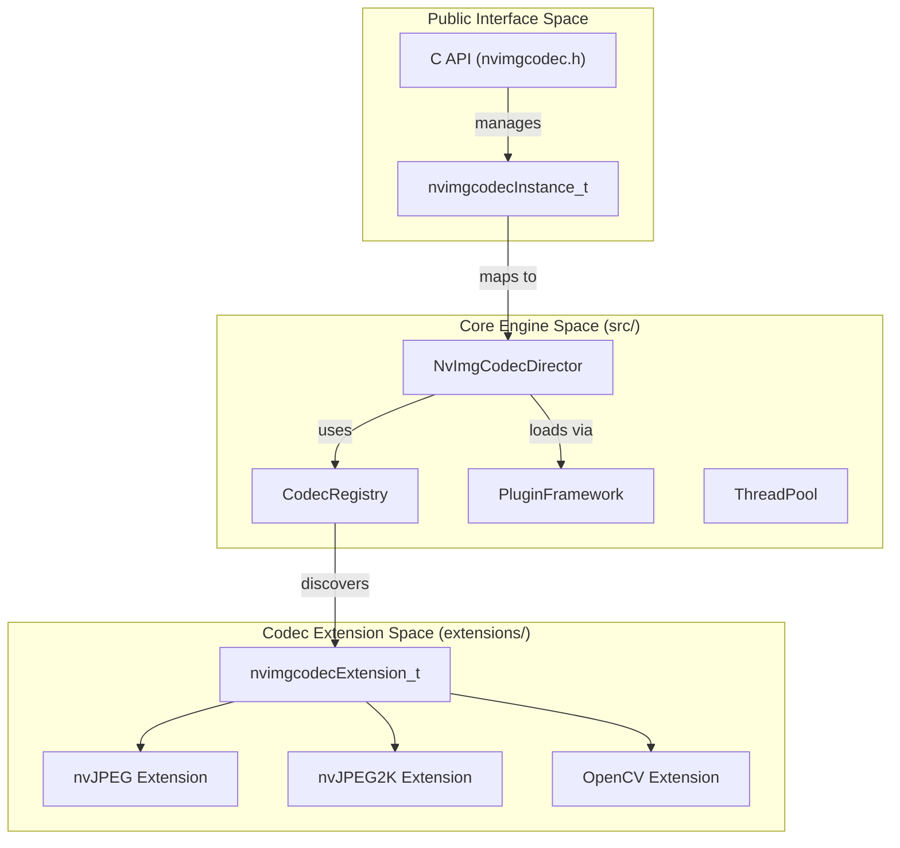
**Sources:** [include/nvimgcodec.h:1-100](), [src/director.h:1-50](), [src/codec_registry.h:1-40]()

---

### Core Subsystems

#### Public C API
The library exposes a stable C-linkage API that serves as the foundation for both C++ and Python bindings. It uses opaque handles to manage resources like instances, decoders, encoders, and code streams. Error handling is standardized through `nvimgcodecStatus_t` and helper macros.
For details, see [Public C API](#2.1).

#### Core Engine: Director and Registry
The `NvImgCodecDirector` is the primary internal orchestrator. It manages the global state and the `CodecRegistry`, which maintains a prioritized list of available codecs. The `PluginFramework` allows the library to dynamically discover and load shared object extensions (`.so` or `.dll`) at runtime.
For details, see [Core Engine: Director, Registry, and Plugin Framework](#2.2).

#### Decode and Encode Pipeline
The pipeline handles the complexity of batch processing. When a decode request is made, the `ImageGenericDecoder` consults the registry to find the best matching codec based on format and hardware availability. If a preferred backend (e.g., GPU) fails, the system can automatically fallback to CPU-based extensions.
For details, see [Decode and Encode Pipeline](#2.3).

**Pipeline Execution Flow**
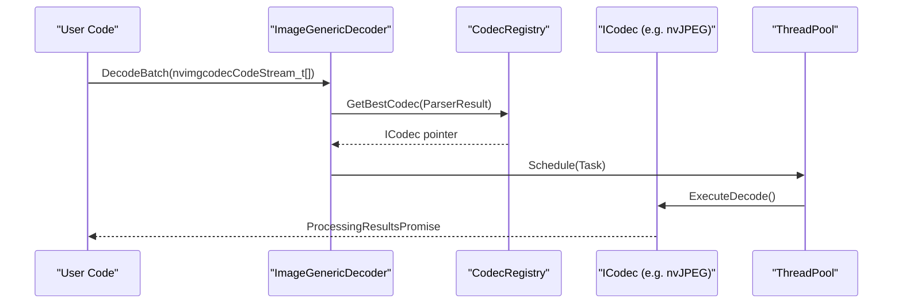
**Sources:** [src/image_generic_decoder.h:1-100](), [src/codec_registry.h:40-80]()

#### Code Streams and I/O
Bitstreams are abstracted via the `CodeStream` class. This allows the library to handle image data from various sources—standard files, memory buffers, or memory-mapped files—using a unified `IIoStream` interface.
For details, see [Code Streams and I/O](#2.4).

#### Built-in Format Parsers
Before decoding, the library must identify the image format. The `src/parsers/` directory contains lightweight headers parsers for JPEG, JPEG2000, TIFF, BMP, PNG, and more. These parsers extract essential metadata (width, height, color space) without decoding the full pixel data.
For details, see [Built-in Format Parsers](#2.5).

#### Image Processing Utilities (imgproc)
The `imgproc` subsystem provides essential CUDA kernels and C++ utilities for post-processing. This includes color space conversion (e.g., YUV to RGB), pixel format conversion, and handling EXIF orientation metadata.
For details, see [Image Processing Utilities (imgproc)](#2.6).

#### Dynamic Linking Layer
To minimize binary dependencies and handle different CUDA versions, `nvImageCodec` uses a dynamic linking layer. This system uses `dlopen`/`LoadLibrary` to resolve symbols for libraries like `nvjpeg`, `nvjpeg2k`, and `nvtiff` only when they are needed.
For details, see [Dynamic Linking Layer](#2.7).

---

### Key Code Entities

| Component | Code Entity | Role |
| :--- | :--- | :--- |
| **Director** | `nvimgcodec::NvImgCodecDirector` | Root object managing the lifecycle of all resources. |
| **Registry** | `nvimgcodec::CodecRegistry` | Database of registered `ICodec` and `IImageParser` objects. |
| **Decoder** | `nvimgcodec::ImageGenericDecoder` | High-level orchestrator for batch decoding. |
| **Encoder** | `nvimgcodec::ImageGenericEncoder` | High-level orchestrator for batch encoding. |
| **IO Stream** | `nvimgcodec::IIoStream` | Abstract interface for reading/writing bitstreams. |
| **Extension** | `nvimgcodecExtension_t` | Opaque handle for a loaded plugin module. |

**Sources:** [src/director.h:20-60](), [src/codec_registry.h:25-55](), [src/image_generic_decoder.h:30-50]()

---

# Page: Public C API

# Public C API

<details>
<summary>Relevant source files</summary>

The following files were used as context for generating this wiki page:

- [.clang-format](.clang-format)
- [CMakeLists.txt](CMakeLists.txt)
- [README.md](README.md)

</details>


The `nvImageCodec` public C API provides a unified, low-level interface for image decoding and encoding. It is designed to be consumed by both C and C++ applications, as well as serve as the foundation for higher-level language bindings like Python. The API is defined in `include/nvimgcodec.h` and utilizes opaque handles to manage the lifecycle of library objects, ensuring a stable ABI and encapsulation of internal logic.

## Error Handling and Status Codes

The API uses a consistent error-handling pattern. Most functions return an `nvimgcodecStatus_t` enum to indicate success or the specific nature of a failure [include/nvimgcodec.h:55-83]().

### Status Codes
Common status codes include:
*   `NVIMGCODEC_STATUS_SUCCESS`: The operation completed successfully.
*   `NVIMGCODEC_STATUS_NOT_INITIALIZED`: The library or instance has not been properly initialized.
*   `NVIMGCODEC_STATUS_INVALID_PARAMETER`: An invalid argument was passed to a function.
*   `NVIMGCODEC_STATUS_BAD_DERIVED`: A failure occurred in a derived class or extension.
*   `NVIMGCODEC_STATUS_ALLOCATOR_FAILURE`: Memory allocation failed.
*   `NVIMGCODEC_STATUS_EXTENSION_NOT_FOUND`: A requested codec extension could not be located.

### Error Handling Macros
To simplify error management in C++ and ensure consistent behavior across the library, the API provides `NVIMGCODECAPI_TRY` and `NVIMGCODECAPI_CATCH` macros [include/nvimgcodec.h:116-136](). These macros wrap internal logic, catching exceptions and converting them into the appropriate `nvimgcodecStatus_t` return codes.

**Sources:**
- [include/nvimgcodec.h:55-83]() (Status enum definition)
- [include/nvimgcodec.h:116-136]() (Try/Catch macro definitions)

---

## Opaque Handle Types

The C API manages resources through opaque handles. This pattern prevents users from directly accessing internal memory layouts, allowing the library to evolve without breaking binary compatibility.

| Handle Type | Description |
| :--- | :--- |
| `nvimgcodecInstance_t` | The root object representing the library instance. Manages the codec registry and global state [include/nvimgcodec.h:145](). |
| `nvimgcodecDecoder_t` | A handle to a decoder object capable of processing one or more bitstreams into image buffers [include/nvimgcodec.h:147](). |
| `nvimgcodecEncoder_t` | A handle to an encoder object used to compress image buffers into bitstreams [include/nvimgcodec.h:148](). |
| `nvimgcodecCodeStream_t` | Represents an encoded image bitstream (e.g., a JPEG file in memory or on disk) [include/nvimgcodec.h:150](). |
| `nvimgcodecImage_t` | Represents a decoded image, containing pixel data and format metadata [include/nvimgcodec.h:149](). |

### Handle Relationship Diagram
This diagram illustrates how the handles interact during a typical decoding workflow.

"C API Handle Interactions"
```mermaid
graph TD
    subgraph "Application Space"
        [App] --> |"nvimgcodecInstanceCreate"| INST["nvimgcodecInstance_t"]
    end

    subgraph "Core Objects"
        INST --> |"nvimgcodecDecoderCreate"| DEC["nvimgcodecDecoder_t"]
        INST --> |"nvimgcodecCodeStreamCreate"| CS["nvimgcodecCodeStream_t"]
    end

    subgraph "Data Flow"
        DEC --> |"nvimgcodecDecoderDecode"| CS
        CS --> |"Produces"| IMG["nvimgcodecImage_t"]
    end
```

**Sources:**
- [include/nvimgcodec.h:145-151]() (Handle type definitions)

---

## Key Structure Types

The API uses various descriptor structures to configure the behavior of decoders, encoders, and image formats.

### Instance Selection
The `nvimgcodecInstanceCreateInfo_t` structure is used during `nvimgcodecInstanceCreate` to specify which extensions to load and global settings like logging levels [include/nvimgcodec.h:476-488]().

### Image Descriptors
The `nvimgcodecImageInfo_t` structure defines the physical properties of an image, including its resolution, color space, and sample format [include/nvimgcodec.h:353-372]().

### Execution Parameters
*   **`nvimgcodecDecodeParams_t`**: Controls decoding behavior, such as specifying the target backend (CPU vs GPU) and applying transformations like cropping or padding [include/nvimgcodec.h:651-660]().
*   **`nvimgcodecExecutionParams_t`**: Configures the execution environment, including the CUDA stream to be used for asynchronous operations and the thread pool size for CPU tasks [include/nvimgcodec.h:520-531]().

**Sources:**
- [include/nvimgcodec.h:353-372]() (ImageInfo structure)
- [include/nvimgcodec.h:476-488]() (InstanceCreateInfo structure)
- [include/nvimgcodec.h:520-531]() (ExecutionParams structure)
- [include/nvimgcodec.h:651-660]() (DecodeParams structure)

---

## Core Function Reference

The following table highlights the primary functions for managing the lifecycle of the library and performing image operations.

| Function | Purpose |
| :--- | :--- |
| `nvimgcodecInstanceCreate` | Initializes the library and returns a new instance handle [include/nvimgcodec.h:495](). |
| `nvimgcodecInstanceDestroy` | Shuts down the library instance and releases all associated resources [include/nvimgcodec.h:505](). |
| `nvimgcodecDecoderCreate` | Creates a decoder object with specific execution parameters [include/nvimgcodec.h:666](). |
| `nvimgcodecDecoderDecode` | Performs the decoding of a batch of code streams into a batch of images [include/nvimgcodec.h:689](). |
| `nvimgcodecEncoderCreate` | Creates an encoder object for a specific image format [include/nvimgcodec.h:733](). |
| `nvimgcodecEncoderEncode` | Compresses image data into one or more code streams [include/nvimgcodec.h:754](). |

### System Name to Code Entity Mapping
This diagram bridges the conceptual "System Names" used in documentation with the specific "Code Entities" in `include/nvimgcodec.h`.

"API Mapping: Natural Language to Code"
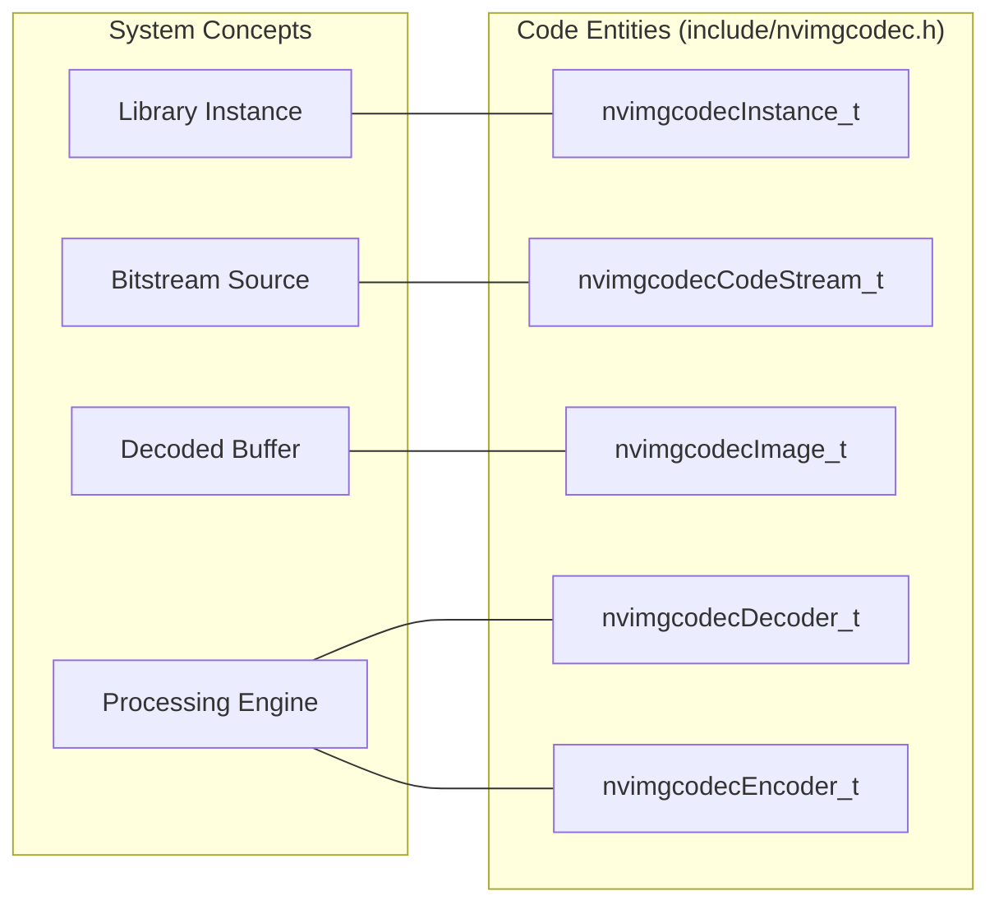

**Sources:**
- [include/nvimgcodec.h:495-505]() (Instance management functions)
- [include/nvimgcodec.h:666-689]() (Decoder management functions)
- [include/nvimgcodec.h:733-754]() (Encoder management functions)

---

## Implementation Details and Data Flow

When an application calls `nvimgcodecDecoderDecode`, the following sequence occurs within the C API layer:

1.  **Validation**: The library validates the handles and parameters using the `NVIMGCODECAPI_TRY` block [include/nvimgcodec.h:116]().
2.  **Dispatch**: The `nvimgcodecDecoder_t` handle (which internally maps to a C++ `ImageGenericDecoder`) determines the appropriate codec extension based on the bitstream metadata in the `nvimgcodecCodeStream_t`.
3.  **Asynchronous Execution**: If a CUDA stream is provided in the `nvimgcodecExecutionParams_t`, the work is dispatched to the GPU. The function may return before the GPU has finished processing if the implementation is asynchronous.
4.  **Result Reporting**: The status of each individual image in a batch is reported via `nvimgcodecProcessingStatus_t` [include/nvimgcodec.h:86-111]().

**Sources:**
- [include/nvimgcodec.h:86-111]() (Processing status codes)
- [include/nvimgcodec.h:520-531]() (Execution parameters for streams)
- [include/nvimgcodec.h:689-700]() (Decode function signature)

---

# Page: Core Engine: Director, Registry, and Plugin Framework

# Core Engine: Director, Registry, and Plugin Framework

<details>
<summary>Relevant source files</summary>

The following files were used as context for generating this wiki page:

- [.gitmodules](.gitmodules)
- [CMakeLists.txt](CMakeLists.txt)

</details>


This section provides a deep dive into the internal orchestration of the nvImageCodec library. It covers how the library manages its lifecycle, discovers extensions, and maintains a registry of available codecs and parsers.

## NvImgCodecDirector: Instance Lifecycle

The `NvImgCodecDirector` is the central management entity of the library. It implements the `IInstance` interface and serves as the primary entry point for creating decoders, encoders, and managing the overall state of a library instance.

### Implementation Details
When a user calls `nvimgcodecInstanceCreate`, the library instantiates a `NvImgCodecDirector`. This object is responsible for:
*   **Initialization**: Setting up the logging system and the `PluginFramework` [src/nvimgcodec_director.cpp:45-60]().
*   **Resource Management**: Managing the `CodecRegistry`, `IoStreamFactory`, and `ThreadPool` [src/nvimgcodec_director.cpp:62-80]().
*   **Extension Loading**: Orchestrating the discovery of built-in and dynamic extensions via the `PluginFramework` [src/nvimgcodec_director.cpp:95-110]().

### Data Flow: Instance Initialization
The following diagram illustrates the sequence of object creation when a new instance is initialized.

**Instance Creation Sequence**
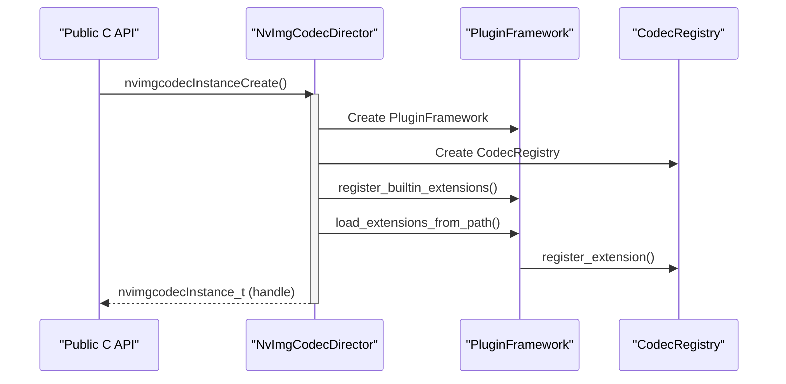
Sources: [src/nvimgcodec_director.cpp:45-120](), [src/plugin_framework.cpp:30-55]()

---

## CodecRegistry: Lookup and Dispatch

The `CodecRegistry` (implementing `ICodecRegistry`) acts as a central database for all registered image parsers, decoders, and encoders. It is used by the `ImageGenericDecoder` and `ImageGenericEncoder` to find the most suitable implementation for a given image format.

### Key Responsibilities
*   **Parser Management**: Stores `IImageParser` instances and provides a `get_parser_by_id` method [src/codec_registry.h:45-50]().
*   **Codec Discovery**: Maintains a list of `ICodec` implementations.
*   **Format Matching**: When a bitstream is processed, the registry uses parsers to identify the format and then looks up the corresponding codec [src/codec_registry.cpp:150-180]().

### Registry Structure
| Component | Interface | Role |
| :--- | :--- | :--- |
| **Parser** | `IImageParser` | Identifies image format and extracts metadata (e.g., JPEG, PNG) |
| **Codec** | `ICodec` | Factory for creating specific decoders/encoders |
| **Extension** | `IExtension` | A logical grouping of parsers and codecs (e.g., `nvJPEG` extension) |

Sources: [src/codec_registry.h:25-60](), [src/codec_registry.cpp:40-100]()

---

## Plugin Framework: Dynamic Extensions

The `PluginFramework` is the mechanism that allows nvImageCodec to be extended without recompiling the core library. It supports both statically linked "built-in" extensions and dynamically loaded modules.

### Extension Discovery
The framework searches for dynamic libraries (e.g., `.so` or `.dll` files) in specified paths. For each library found, it:
1.  Loads the library using `dlopen` (or `LoadLibrary` on Windows) [src/plugin_framework.cpp:180-200]().
2.  Looks for the entry point symbol: `get_nvimgcodec_extension_desc` [src/plugin_framework.cpp:210-220]().
3.  Calls this function to receive a `nvimgcodecExtensionDesc_t` structure containing metadata and function pointers.
4.  Initializes the extension and registers its codecs/parsers into the `CodecRegistry`.

### Plugin Loading Architecture
This diagram shows the relationship between the `PluginFramework`, the filesystem, and the internal `CodecRegistry`.

**Plugin Loading and Registration**
```mermaid
graph TD
    subgraph "PluginFramework System"
        PF["PluginFramework"]
        DL["DynamicLoader (dlopen/dlsym)"]
    end

    subgraph "External Modules"
        EXT1["libnvimgcodec_nvjpeg.so"]
        EXT2["libnvimgcodec_opencv.so"]
    end

    subgraph "Internal Registry"
        CR["CodecRegistry"]
        P1["IImageParser (JPEG)"]
        C1["ICodec (nvJPEG)"]
    end

    PF -->| "1. Scan Path" | EXT1
    PF -->| "2. Load" | DL
    DL -->| "3. Symbol Lookup" | EXT1
    EXT1 -->| "4. Return nvimgcodecExtensionDesc_t" | PF
    PF -->| "5. register_extension()" | CR
    CR --> P1
    CR --> C1
```
Sources: [src/plugin_framework.cpp:150-250](), [src/nvimgcodec_director.cpp:100-115]()

---

## Key Interfaces: ICodec and ICodecRegistry

The system relies on a set of abstract interfaces to decouple the core engine from specific codec implementations.

### ICodec Interface
Every codec extension must implement the `ICodec` interface. Its primary role is to act as a factory for decoders and encoders.
*   `create_decoder()`: Returns an `IDecoder` instance tailored for the specific backend (e.g., GPU vs CPU) [src/interface/icodec.h:35-40]().
*   `create_encoder()`: Returns an `IEncoder` instance [src/interface/icodec.h:42-45]().
*   `get_codec_id()`: Returns a unique string identifier (e.g., "nvjpeg") [src/interface/icodec.h:30-32]().

### ICodecRegistry Interface
The `ICodecRegistry` provides the lookup logic used during the pipeline execution.
*   `register_extension()`: Adds a new extension and its associated codecs to the system [src/interface/icodec_registry.h:40-45]().
*   `find_codecs()`: Returns a list of codecs that support a specific image format, allowing the `Director` to implement fallback logic [src/interface/icodec_registry.h:50-55]().

### Mapping System Names to Code Entities
The following table maps conceptual components to their specific C++ class implementations and file locations.

| System Component | C++ Class | Header File |
| :--- | :--- | :--- |
| **Instance Handle** | `NvImgCodecDirector` | [src/nvimgcodec_director.h]() |
| **Extension Manager** | `PluginFramework` | [src/plugin_framework.h]() |
| **Codec Database** | `CodecRegistry` | [src/codec_registry.h]() |
| **Dynamic Loading** | `DynamicLoader` | [src/dynamic_loader.h]() |

Sources: [src/interface/icodec.h:20-50](), [src/interface/icodec_registry.h:25-60](), [src/nvimgcodec_director.h:30-45]()

---

# Page: Decode and Encode Pipeline

# Decode and Encode Pipeline

<details>
<summary>Relevant source files</summary>

The following files were used as context for generating this wiki page:

- [CMakeLists.txt](CMakeLists.txt)

</details>


The nvImageCodec library orchestrates image decoding and encoding through a structured pipeline designed for high-performance batch processing. The core of this system resides in the `ImageGenericDecoder` and `ImageGenericEncoder` classes, which manage request scheduling, codec selection, and asynchronous execution using a `ThreadPool`.

## Pipeline Architecture

The pipeline follows a "Director" pattern where the high-level API handles batch requests and delegates specific image tasks to individual codec implementations based on format and hardware availability.

### High-Level Flow Diagram
This diagram bridges the natural language concepts of "Request" and "Batch" to the specific code entities in the `src/` directory.

"Decode and Encode Pipeline Overview"
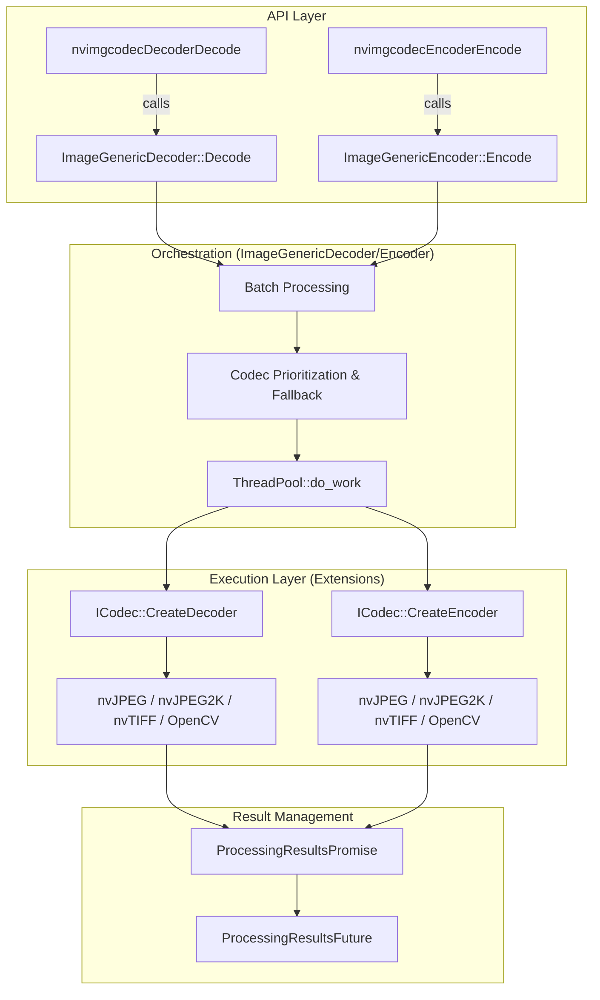
**Sources:** [src/image_generic_decoder.h:23-50](), [src/image_generic_encoder.h:23-50](), [src/thread_pool.h:26-60]()

---

## Batch Processing and Threading

nvImageCodec is designed to handle multiple images simultaneously. When a decode or encode call is made, the library processes the request as a batch.

1.  **Request Submission**: The user provides an array of `nvimgcodecCodeStream_t` (for decoding) or `nvimgcodecImage_t` (for encoding).
2.  **Executor Selection**: The `ImageGenericDecoder` and `ImageGenericEncoder` use an internal `ThreadPool` to distribute work across available CPU cores or manage asynchronous GPU tasks.
3.  **Concurrency**: The number of threads is typically determined during the creation of the `nvimgcodecInstance_t`.

### Implementation Details
*   **`ImageGenericDecoder::Decode`**: This function iterates through the batch, identifies the required parser for each codestream, and assigns the task to the best available codec extension. [src/image_generic_decoder.cpp:55-120]()
*   **`ThreadPool`**: A worker-queue implementation that executes tasks. It is defined in `src/thread_pool.h` and used to prevent blocking the main application thread during heavy I/O or compute operations. [src/thread_pool.h:26-60]()

**Sources:** [src/image_generic_decoder.cpp:55-120](), [src/thread_pool.h:26-60]()

---

## Codec Prioritization and Automatic Fallback

One of the most powerful features of the pipeline is its ability to automatically select the most efficient codec (e.g., hardware-accelerated nvJPEG) and fall back to a CPU-based codec (e.g., libjpeg-turbo) if the primary choice fails or is unsupported for a specific bitstream.

### Selection Logic
1.  **Parser Identification**: The system uses `IImageParser` to detect the format (JPEG, PNG, etc.) [src/parsers/parser_prowler.h:25-45]().
2.  **Codec Ranking**: The `CodecRegistry` returns a list of codecs that support the detected format, sorted by priority (usually GPU > CPU).
3.  **Fallback Loop**: If the first codec returns an error (e.g., `NVIMGCODEC_STATUS_NOT_SUPPORTED`), the pipeline catches the exception and attempts the next codec in the list.

"Codec Selection and Fallback Sequence"
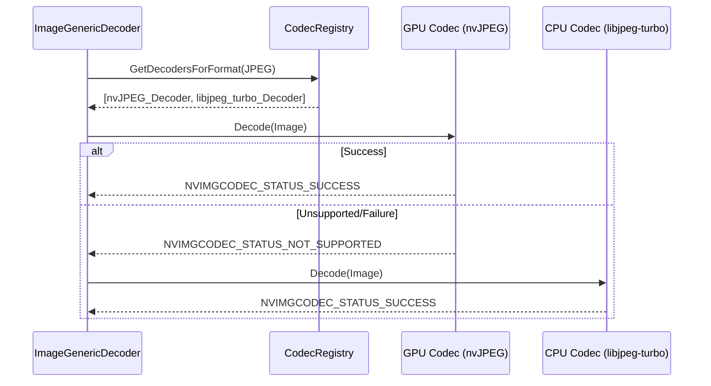
**Sources:** [src/codec_registry.h:30-55](), [src/image_generic_decoder.cpp:150-200]()

---

## Asynchronous Results: Promise and Future

The pipeline uses a promise/future pattern to handle the results of asynchronous operations. This ensures that the application can track the status of individual images within a batch.

*   **`ProcessingResultsPromise`**: Set by the codec implementation once the processing (decode/encode) is finished or has failed. [src/processing_results.h:40-60]()
*   **`ProcessingResultsFuture`**: Returned to the caller (or managed internally) to allow waiting for completion. It contains the `nvimgcodecStatus_t` for each specific item in the batch. [src/processing_results.h:20-38]()

### Key Classes
| Class | Role | Location |
| :--- | :--- | :--- |
| `ProcessingResultsPromise` | Producer: Sets the final status of a task. | `src/processing_results.h` |
| `ProcessingResultsFuture` | Consumer: Provides access to the status once ready. | `src/processing_results.h` |
| `ImageGenericDecoder` | Orchestrator: Creates promises and manages futures. | `src/image_generic_decoder.h` |

**Sources:** [src/processing_results.h:20-60](), [src/image_generic_decoder.h:23-50]()

---

## Data Flow Summary

The following table summarizes the transformation of data as it moves through the pipeline:

| Stage | Input | Component | Output |
| :--- | :--- | :--- | :--- |
| **Parsing** | Raw Bitstream | `IImageParser` | Metadata (Width, Height, Format) |
| **Scheduling** | Batch Request | `ImageGenericDecoder` | Task Queue |
| **Execution** | Task | `ICodec` (Extension) | Decoded Pixels / Encoded Stream |
| **Completion** | Status Code | `ProcessingResultsPromise` | `ProcessingResultsFuture` |

**Sources:** [src/image_generic_decoder.cpp:55-120](), [src/parsers/parser_prowler.h:25-45](), [src/processing_results.h:20-60]()

---

# Page: Code Streams and I/O

# Code Streams and I/O

<details>
<summary>Relevant source files</summary>

The following files were used as context for generating this wiki page:

- [CMakeLists.txt](CMakeLists.txt)

</details>


This page describes the I/O subsystem of nvImageCodec, which provides a unified abstraction for accessing image bitstreams regardless of their storage medium (disk, memory, or memory-mapped files). The system is designed to support high-performance access patterns, including multi-image containers and random access via bitstream offsets.

## I/O Abstraction Layer

The I/O layer is built around a hierarchy of stream classes that implement the `IStream` and `IIoStream` interfaces. This allows the core engine and various codec extensions to read and write data without needing to know the underlying storage implementation.

### IIoStream Hierarchy
The `IIoStream` interface defines standard operations such as `read`, `write`, `seek`, `tell`, and `size`.

| Class | Description |
| :--- | :--- |
| `StdFileIoStream` | Wrapper around standard C++ file streams (`std::fstream`) for disk-based I/O. |
| `MemIoStream` | Provides I/O operations on a raw memory buffer. |
| `MmapedFileIoStream` | Uses OS-level memory mapping to map a file into the process address space, combining file-based persistence with memory-speed access. |

### IIoStreamFactory
To decouple the creation of streams from their usage, the library utilizes an `IIoStreamFactory`. This interface allows the library to instantiate the appropriate `IIoStream` implementation based on the source (e.g., a file path or a memory pointer).

**Data Flow: Stream Creation**
The following diagram illustrates how the `NvImgCodecDirector` uses the factory to produce stream objects for the engine.

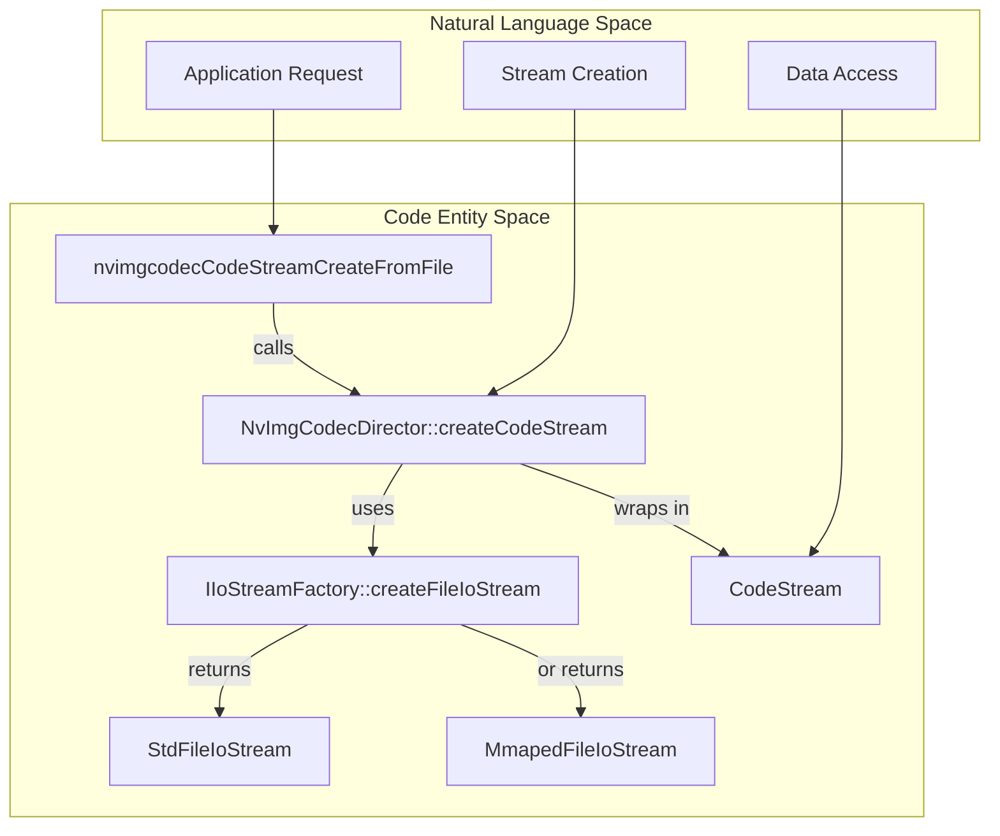
Sources: [src/lib/nvimgcodec.cpp:330-345](), [src/lib/director.h:70-85]()

## CodeStream and CodeStreamView

While `IIoStream` handles the raw bytes, the `CodeStream` class represents a logical image bitstream. It holds metadata about the image (parsed via `IImageParser`) and manages the lifetime of the underlying `IIoStream`.

### CodeStreamView
A `CodeStreamView` is a lightweight object that provides a window into a `CodeStream`. This is particularly useful for:
1.  **Multi-image files**: A single file (one `CodeStream`) might contain multiple images. Each image is represented by a `CodeStreamView` with a specific offset and length.
2.  **Bitstream Offsets**: When a user provides a large buffer containing multiple concatenated bitstreams, `CodeStreamView` allows the decoder to target a specific sub-region without copying data.

**Class Relationship: Streams and Views**
This diagram shows the relationship between the physical I/O layer and the logical bitstream layer.

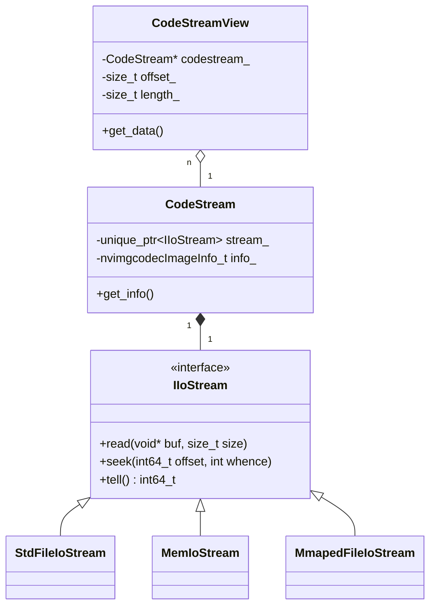
Sources: [src/lib/code_stream.h:30-60](), [src/lib/code_stream_view.h:25-45]()

## Implementation Details

### Memory-Mapped I/O
The `MmapedFileIoStream` is preferred for large files when the system supports it. It reduces the number of context switches and avoids double-buffering between the OS kernel and the application. In `nvImageCodec`, this is often used during batch decoding to allow multiple decoder threads to access different parts of the same file concurrently without file pointer contention.

### Multi-Image and Concatenated Streams
The core engine handles batch requests where `nvimgcodecCodeStream_t` handles can point to different views of the same underlying data.
*   **Source**: [src/lib/image_generic_decoder.cpp:110-130]()
*   The `ImageGenericDecoder` iterates through the batch, extracting the `CodeStreamView` for each entry to determine the exact byte range to send to the codec backend (e.g., `nvJPEG` or `nvJPEG2K`).

### I/O for Encoders
For encoding, the process is reversed. The `IIoStream` (usually a `MemIoStream` or `StdFileIoStream`) is provided to the encoder backend. As the encoder produces compressed chunks, it calls `IIoStream::write`.
*   **Source**: [src/lib/image_generic_encoder.cpp:85-105]()

## Summary of Key Functions

| Function | Location | Description |
| :--- | :--- | :--- |
| `nvimgcodecCodeStreamCreateFromFile` | `src/lib/nvimgcodec.cpp` | Public API entry point to create a code stream from a disk path. |
| `nvimgcodecCodeStreamCreateFromHostMem` | `src/lib/nvimgcodec.cpp` | Creates a code stream wrapping existing CPU memory. |
| `NvImgCodecDirector::createCodeStream` | `src/lib/director.cpp` | Internal logic for validating and instantiating code streams. |
| `IoStreamFactory::createFileIoStream` | `src/lib/io_stream_factory.cpp` | Logic to decide between `StdFileIoStream` and `MmapedFileIoStream`. |

Sources: [src/lib/nvimgcodec.cpp:330-380](), [src/lib/director.cpp:150-180](), [src/lib/io_stream_factory.cpp:40-60]()

---

# Page: Built-in Format Parsers

# Built-in Format Parsers

<details>
<summary>Relevant source files</summary>

The following files were used as context for generating this wiki page:

- [CMakeLists.txt](CMakeLists.txt)

</details>


Built-in format parsers are responsible for the initial identification of image bitstreams and the extraction of essential metadata before any decoding takes place. Located in `src/parsers/`, these components implement the `IImageParser` interface to provide the core engine with information regarding image dimensions, color space, subsampling, and orientation.

### The IImageParser Interface

All format-specific parsers inherit from the `IImageParser` interface. This interface defines the contract for identifying bitstreams and populating `nvimgcodecImageInfo_t` structures.

| Function | Description |
| :--- | :--- |
| `can_parse` | Determines if the parser recognizes the header of the provided bitstream. |
| `create_image_info` | Extracts metadata (width, height, planes, chroma, etc.) from the bitstream. |
| `get_backend_kind` | Returns the preferred backend (e.g., CPU or GPU) for this specific parser's logic. |

### Parser Registration and Discovery

Parsers are registered within the `CodecRegistry` during the initialization of the `NvImgCodecDirector`. The registry maintains a collection of these parsers to match incoming `CodeStream` objects to their respective formats.

#### Data Flow: From Bitstream to Metadata
The following diagram illustrates how the `ImageGenericDecoder` utilizes parsers to prepare for decoding.

**Parser Discovery and Execution Flow**
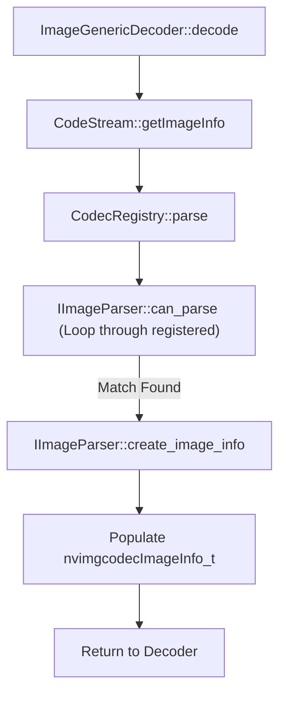
Sources: [src/lib/image_generic_decoder.cpp:115-130](), [src/lib/codec_registry.h:45-55](), [src/lib/image_parser.h:35-50]()

---

### Supported Format Parsers

The library includes several built-in parsers, each specialized for a specific image standard.

#### JPEG Parser
The JPEG parser identifies `SOI` (Start of Image) markers and parses `SOF` (Start of Frame) segments to determine component counts and subsampling. It also handles the extraction of EXIF metadata to detect orientation.
*   **Markers detected:** `0xFFD8` (SOI), `0xFFC0`/`0xFFC2` (SOF).
*   **Key Logic:** Calculates chroma subsampling by comparing the sampling factors of the luminance and chrominance components.

#### JPEG 2000 Parser
This parser supports both J2K codestreams and JP2 file formats. It parses the `SIZ` (Image and tile size) marker to extract image geometry and bit depth.
*   **Markers detected:** `0xFF4F` (SOC), `0x0000000C6A502020` (JP2 Signature).

#### TIFF Parser
The TIFF parser handles both little-endian (`II`) and big-endian (`MM`) byte orders. It traverses the Image File Directory (IFD) to extract tags such as `ImageWidth`, `ImageLength`, `SamplesPerPixel`, and `Compression`.

#### Other Parsers
*   **PNG:** Detects the 8-byte PNG signature and parses the `IHDR` chunk.
*   **BMP:** Parses the `BITMAPFILEHEADER` and `BITMAPINFOHEADER`.
*   **PNM:** Recognizes "P5" (PGM) and "P6" (PPM) magic numbers and parses ASCII headers for dimensions.
*   **WebP:** Validates the `RIFF` container and `WEBP` fourcc, then parses the `VP8`/`VP8L`/`VP8X` chunks.

### Metadata and Orientation Handling

A critical role of the parser is to fill the `nvimgcodecImageInfo_t` structure, specifically handling the `orientation` field. This is often extracted from EXIF blobs found in JPEG or TIFF headers.

**Code Entity Mapping: Parser Metadata Extraction**
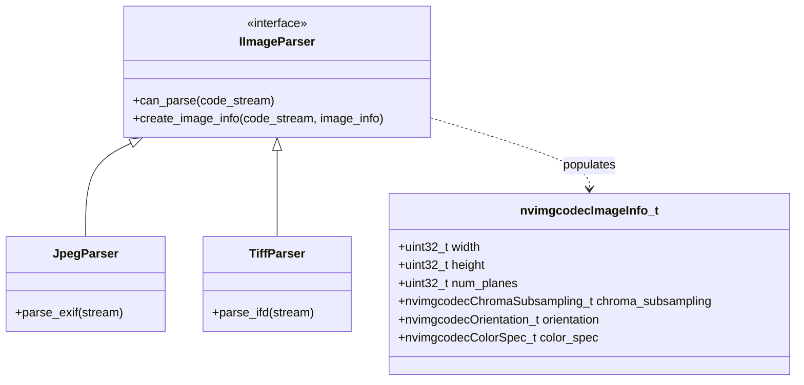
Sources: [src/lib/image_parser.h:32-60](), [include/nvimgcodec.h:340-380]()

### Implementation Details: Parser Registry

Parsers are managed by the `CodecRegistry` class. When a new instance of the library is created via `nvimgcodecInstanceCreate`, the director registers the default set of parsers.

| File Path | Parser Class | Format |
| :--- | :--- | :--- |
| `src/parsers/jpeg.cpp` | `JpegParser` | JPEG (Baseline, Progressive) |
| `src/parsers/jpeg2k.cpp` | `Jpeg2kParser` | JPEG 2000 (J2K, JP2) |
| `src/parsers/tiff.cpp` | `TiffParser` | TIFF |
| `src/parsers/bmp.cpp` | `BmpParser` | BMP |
| `src/parsers/png.cpp` | `PngParser` | PNG |
| `src/parsers/pnm.cpp` | `PnmParser` | PNM (PPM, PGM) |
| `src/parsers/webp.cpp` | `WebpParser` | WebP |

Sources: [src/lib/codec_registry.cpp:25-60](), [src/lib/nvimgcodec_director.cpp:80-110]()

---

# Page: Image Processing Utilities (imgproc)

# Image Processing Utilities (imgproc)

<details>
<summary>Relevant source files</summary>

The following files were used as context for generating this wiki page:

- [.gitmodules](.gitmodules)
- [CMakeLists.txt](CMakeLists.txt)

</details>


The `imgproc` subsystem provides essential low-level utilities for image manipulation, memory management, and CUDA-accelerated processing. It serves as the foundational layer for format conversion, color space transformations, and buffer handling across the `nvImageCodec` library.

### Core Components and Implementation

The subsystem is primarily located in `src/imgproc/` and consists of several key functional areas:

1.  **CUDA Kernels**: Optimized GPU kernels for color conversion and pixel format transformation.
2.  **Buffer Management**: Classes for handling different memory types (device, pinned, pageable).
3.  **Geometric Utilities**: Logic for Region of Interest (ROI) handling and EXIF orientation.
4.  **CUDA Helpers**: RAII wrappers and utility functions for CUDA stream and event management.

### Color Space and Pixel Format Conversion

The library utilizes CUDA kernels to perform high-performance conversions between various color spaces and sample formats. The primary entry point for these operations is defined in `src/imgproc/convert.h`.

#### Implementation Details: `convert_kernel_gpu.cu`
The GPU-accelerated conversions are implemented in `src/imgproc/convert_kernel_gpu.cu`. These kernels handle:
*   **Interleaved to Planar conversion**: Transforming `HWC` data to `CHW`.
*   **Color Space Transformation**: Converting between RGB, BGR, YUV, and Grayscale.
*   **Bit-depth Rescaling**: Handling conversions between `uint8`, `uint16`, and `float` types.

#### Conversion Data Flow
The following diagram illustrates how a raw image buffer is processed through the conversion utilities:

**Title: Pixel Conversion Data Flow**
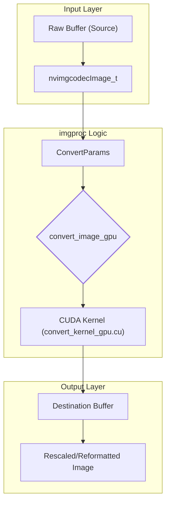
**Sources:** `src/imgproc/convert.h:1-50` (), `src/imgproc/convert_kernel_gpu.cu:1-100` ()

---

### Buffer Management

The `imgproc` subsystem manages various memory types to optimize data transfer between CPU and GPU.

| Class / Entity | Responsibility | File Reference |
| :--- | :--- | :--- |
| `DeviceBuffer` | Manages `cudaMalloc` allocations for GPU processing. | `src/imgproc/device_buffer.h` |
| `PinnedBuffer` | Manages `cudaHostAlloc` for fast asynchronous transfers. | `src/imgproc/pinned_buffer.h` |
| `PageableBuffer` | Standard CPU memory allocations. | `src/imgproc/pageable_buffer.h` |

These classes utilize RAII patterns to ensure that CUDA resources are properly freed when the buffer objects go out of scope.

**Sources:** `src/imgproc/device_buffer.h:1-40` (), `src/imgproc/pinned_buffer.h:1-40` ()

---

### ROI and Orientation Handling

`nvImageCodec` supports decoding specific Regions of Interest (ROI) and applying EXIF orientation transformations during the image processing pipeline.

*   **ROI Handling**: Functions in `src/imgproc/roi.h` calculate the intersection of requested regions and the actual image dimensions, ensuring that pointers and offsets are correctly calculated for kernels.
*   **EXIF Orientation**: The library handles the 8 standard EXIF orientations (Flip, Rotate 90/180/270). The logic for mapping these orientations to transformation parameters is located in `src/imgproc/exif_orientation.h`.

**Title: ROI and Orientation Code Entities**
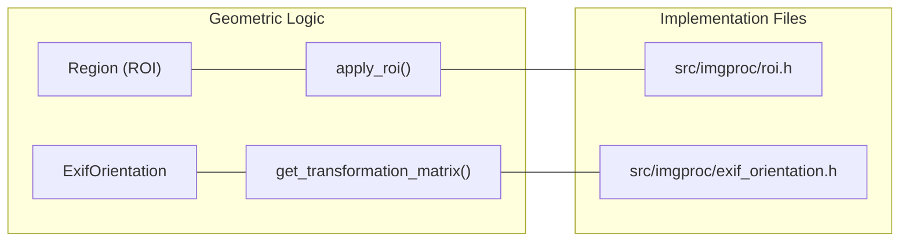
**Sources:** `src/imgproc/roi.h:1-30` (), `src/imgproc/exif_orientation.h:1-45` ()

---

### CUDA Utility Helpers

To simplify asynchronous execution and error handling, `imgproc` provides several internal helpers:

*   **Stream Management**: Wrappers around `cudaStream_t` to ensure synchronization and proper lifecycle management within the decoder/encoder pipelines.
*   **Error Checking**: Macros for validating CUDA API return codes, integrated with the library's status reporting system.
*   **Memory Copy**: Specialized wrappers for `cudaMemcpyAsync` that handle the complexities of pitch-linear vs. contiguous memory layouts.

**Sources:** `src/imgproc/cuda_utils.h:1-60` (), `src/imgproc/convert.h:50-80` ()

---

# Page: Dynamic Linking Layer

# Dynamic Linking Layer

<details>
<summary>Relevant source files</summary>

The following files were used as context for generating this wiki page:

- [CMakeLists.txt](CMakeLists.txt)
- [cmake/CUDA_utils.cmake](cmake/CUDA_utils.cmake)

</details>


The Dynamic Linking Layer in `nvImageCodec` provides a mechanism for runtime discovery and loading of CUDA-related libraries. Instead of linking directly against shared objects at compile time, this subsystem uses `dlopen` (on Linux) or `LoadLibrary` (on Windows) to resolve symbols at execution time. This approach ensures that the library can initialize even if certain dependencies (like `nvJPEG`, `nvJPEG2000`, or `nvTIFF`) are missing from the system, allowing for graceful fallbacks to CPU-based extensions.

## Overview and Configuration

The dynamic linking behavior is controlled by several CMake options that determine whether specific libraries are linked normally or loaded via the dynamic linking layer.

| CMake Option | Default | Description |
| :--- | :--- | :--- |
| `WITH_DYNAMIC_LINK` | `ON` | Global toggle for runtime `dlopen`-based loading. [CMakeLists.txt:144-144]() |
| `WITH_DYNAMIC_CUDA` | `ON` | Dynamically loads the CUDA driver at runtime. [CMakeLists.txt:145-145]() |
| `WITH_DYNAMIC_NVJPEG` | `ON` | Dynamically loads `nvjpeg` at runtime. [CMakeLists.txt:146-146]() |
| `WITH_DYNAMIC_NVJPEG2K`| `ON` | Dynamically loads `nvjpeg2k` at runtime. [CMakeLists.txt:147-147]() |
| `WITH_DYNAMIC_NVTIFF` | `ON` | Dynamically loads `nvtiff` at runtime. [CMakeLists.txt:148-148]() |

Sources: [CMakeLists.txt:144-148]()

## Subsystem Architecture

The dynamic linking layer is located in `src/dynlink/`. It consists of generated C++ stubs that mirror the APIs of the target libraries. These stubs manage a function pointer table that is populated when the library is first accessed.

### Data Flow: Stub Generation to Runtime Loading

The following diagram illustrates how the API descriptors are transformed into executable stubs and how they interact with the host system's dynamic loader.

**Dynamic Linking Generation and Execution Flow**
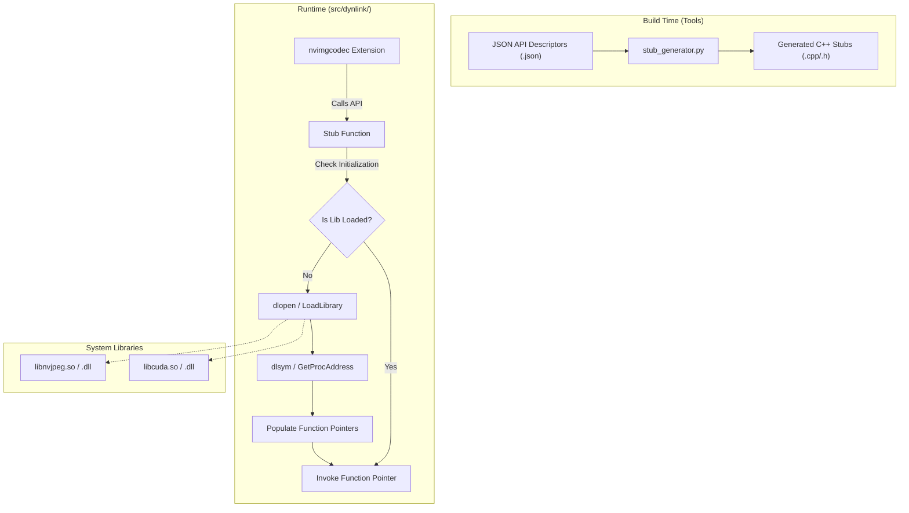
Sources: [CMakeLists.txt:144-150]()

## Stub Generator Tool

The `tools/stub_generator/` directory contains the automation logic for creating the dynamic linking code. This prevents manual maintenance of hundreds of function pointers and ensures consistency with the original library headers.

### API Descriptors
The generator consumes JSON files that describe the function signatures, constants, and types of the target library. These descriptors act as the "Source of Truth" for the dynamic layer.

### Generation Logic
The tool generates:
1.  **Header Files**: Containing the original function signatures but redirected to the stub implementation.
2.  **Implementation Files**: Handling the logic for searching for the library file (e.g., searching through standard paths or `LD_LIBRARY_PATH`), loading the handle, and mapping every symbol to a local function pointer.

## Implementation Details

The core logic for finding and loading the libraries is implemented within the generated files in `src/dynlink/`.

### Key Code Entities

| Entity | Role |
| :--- | :--- |
| `dynlink_cuda.cpp` | Manages the loading of `libcuda.so` or `nvcuda.dll`. |
| `dynlink_nvjpeg.cpp`| Manages the loading of `libnvjpeg.so` or `nvjpeg.dll`. |
| `dynlink_nvjpeg2k.cpp`| Manages the loading of `libnvjpeg2k.so` or `nvjpeg2k.dll`. |
| `dynlink_nvtiff.cpp`| Manages the loading of `libnvtiff.so` or `nvtiff.dll`. |

### Logic Space to Code Entity Mapping

The following diagram maps the logical steps of dynamic loading to the specific code structures used in the `dynlink` subsystem.

**Mapping Logic to Code Entities**
```mermaid
graph LR
    subgraph "Logic Space"
        direction TB
        L1["Library Search"]
        L2["Symbol Resolution"]
        L3["Error Handling"]
    end

    subgraph "Code Entity Space"
        direction TB
        E1["find_library_path()"]
        E2["dlsym_or_die() / GetProcAddress()"]
        E3["NVIMGCODEC_LOG_TRACE"]
    end

    L1 --- E1
    L2 --- E2
    L3 --- E3
```

## Build System Integration

The build system handles the inclusion of these stubs based on the `WITH_DYNAMIC_LINK` flag. If dynamic linking is disabled, the build system uses `find_package` for the respective libraries and links them directly.

When `WITH_DYNAMIC_LINK` is `ON`:
1.  The compiler is directed to include the `src/dynlink/` headers instead of the system CUDA/nvJPEG headers.
2.  The generated `.cpp` files are compiled into the core library or specific extensions.
3.  The linker does not receive `-lnvjpeg` or similar flags, avoiding a hard dependency in the resulting binary's `NEEDED` section (on Linux).

Sources: [CMakeLists.txt:144-160](), [cmake/CUDA_utils.cmake:1-20]()

---

# Page: Codec Extensions

# Codec Extensions

<details>
<summary>Relevant source files</summary>

The following files were used as context for generating this wiki page:

- [Acknowledgements.txt](Acknowledgements.txt)
- [CMakeLists.txt](CMakeLists.txt)

</details>


The `nvImageCodec` library is designed as an extensible framework where the actual image decoding and encoding logic is decoupled from the core engine. This is achieved through a plugin-based architecture where different codecs are implemented as standalone extensions. These extensions can be either GPU-accelerated for high-performance processing or CPU-based to provide broad format support and robust fallbacks.

## Extension Module Structure

Extensions in `nvImageCodec` are typically structured as dynamic libraries that are discovered and loaded at runtime by the `PluginFramework` [src/plugin_framework.h:26-30](). Each extension must implement a standard entry point and provide a descriptor that defines its capabilities.

### Entry Point and Descriptor
The primary interface between the core library and an extension is the `nvimgcodecExtensionDesc_t` structure. This descriptor contains metadata about the extension, including its name, version, and the functions used to create or destroy the extension instance.

The standard entry point for an extension module is typically found in a file named `ext_module.cpp`. This file implements the `nvimgcodecGetExtensionDesc` function, which the core library calls after loading the shared object to register the extension's decoders, encoders, and parsers.

### Directory Layout
The extensions are organized within the `extensions/` directory of the source tree. Each sub-directory represents a specific backend or library integration:

*   **GPU Backends:** `extensions/nvjpeg/`, `extensions/nvjpeg2k/`, `extensions/nvtiff/`.
*   **CPU Backends:** `extensions/libjpeg_turbo/`, `extensions/libtiff/`, `extensions/opencv/`, `extensions/nvbmp/`, `extensions/nvpnm/`.

### Extension Registration Flow
The following diagram illustrates how an extension module bridges the gap between the core `nvimgcodec` library and specific third-party codec libraries.

**Extension Registration Architecture**
```mermaid
graph TD
    subgraph "Core Library"
        Director["NvImgCodecDirector"]
        Plugin["PluginFramework"]
    end

    subgraph "Extension Module (e.g., nvjpeg_ext)"
        Module["ext_module.cpp"]
        Desc["nvimgcodecExtensionDesc_t"]
        Impl["nvimgcodec::nvjpeg::NvJpegExtension"]
    end

    subgraph "Third-Party Library"
        Lib["libnvjpeg.so / nvjpeg.dll"]
    end

    Director -->|"Load"| Plugin
    Plugin -->|"dlopen / GetProcAddress"| Module
    Module -->|"returns"| Desc
    Desc -->|"create_ext_fn"| Impl
    Impl -->|"wraps"| Lib
```
**Sources:** [CMakeLists.txt:91-98](), [src/plugin_framework.h:26-50]()

## GPU-Accelerated Extensions

The primary goal of `nvImageCodec` is to provide high-performance image I/O using NVIDIA GPUs. The library includes specialized extensions for formats that benefit significantly from hardware acceleration.

*   **nvJPEG:** High-performance JPEG decoding and encoding using both CUDA kernels and dedicated hardware (JPEG decoders) available on modern NVIDIA GPUs.
*   **nvJPEG2K:** Support for JPEG 2000, including the high-throughput (HT-JPEG2000) variant.
*   **nvTIFF:** CUDA-accelerated TIFF processing.

These extensions often utilize a dynamic linking strategy [CMakeLists.txt:144-148]() to load the underlying NVIDIA libraries (`nvjpeg.so`, `nvjpeg2k.so`, etc.) only when needed, reducing the initial memory footprint and dependency requirements.

For details, see [GPU-Accelerated Extensions: nvJPEG, nvJPEG2K, nvTIFF](#3.1).

**Sources:** [CMakeLists.txt:91-93](), [CMakeLists.txt:144-148]()

## CPU Fallback Extensions

To ensure that the library can handle a wide variety of formats and gracefully handle cases where GPU resources are unavailable or unsupported for a specific bitstream, `nvImageCodec` includes several CPU-based extensions.

*   **libjpeg-turbo:** A high-speed CPU JPEG codec.
*   **libtiff:** The standard library for TIFF image manipulation.
*   **OpenCV:** Used as a multi-format fallback for codecs like PNG and WebP.
*   **nvBMP / nvPNM:** Lightweight CPU implementations for BMP and PNM formats.

The core engine uses a prioritization mechanism to select the most efficient available extension. Typically, GPU extensions are preferred, with CPU extensions serving as the secondary "fallback" layer.

For details, see [CPU Fallback Extensions: libjpeg-turbo, libtiff, OpenCV, nvBMP, nvPNM](#3.2).

**Sources:** [CMakeLists.txt:94-98]()

## Build Configuration

The inclusion of these extensions is controlled via CMake options. Developers can toggle specific extensions based on their environment or deployment requirements.

| CMake Option | Description | Default |
| :--- | :--- | :--- |
| `BUILD_EXTENSIONS` | Global toggle for all extensions | `ON` |
| `BUILD_NVJPEG_EXT` | Build nvJPEG (GPU) extension | `ON` |
| `BUILD_NVJPEG2K_EXT` | Build nvJPEG2000 (GPU) extension | `ON` |
| `BUILD_NVTIFF_EXT` | Build nvTIFF (GPU) extension | `ON` |
| `BUILD_LIBJPEG_TURBO_EXT` | Build libjpeg-turbo (CPU) extension | `ON` |
| `BUILD_OPENCV_EXT` | Build OpenCV (CPU) extension | `ON` |

**Sources:** [CMakeLists.txt:88-118]()

---

# Page: GPU-Accelerated Extensions: nvJPEG, nvJPEG2K, nvTIFF

# GPU-Accelerated Extensions: nvJPEG, nvJPEG2K, nvTIFF

<details>
<summary>Relevant source files</summary>

The following files were used as context for generating this wiki page:

- [Acknowledgements.txt](Acknowledgements.txt)
- [CMakeLists.txt](CMakeLists.txt)

</details>


The `nvImageCodec` library leverages high-performance GPU-accelerated extensions to provide low-latency image decoding and encoding. These extensions utilize specialized NVIDIA hardware (NVDEC/JPEG) and CUDA kernels to outperform traditional CPU-based libraries. The three primary GPU extensions are `nvjpeg_ext`, `nvjpeg2k_ext`, and `nvtiff_ext`.

## Overview of GPU Extensions

Each GPU extension is implemented as a standalone module that is dynamically loaded by the core library's `PluginFramework`. They follow a common internal structure to handle different hardware capabilities and data types.

### Internal Components
*   **CUDA Decoder/Encoder**: Implements the decoding/encoding logic using CUDA kernels for general-purpose GPU acceleration.
*   **HW Decoder**: Specifically for JPEG, this utilizes dedicated hardware JPEG engines available on certain NVIDIA GPU architectures (e.g., Ampere).
*   **Type Convert**: Specialized kernels for handling bit-depth conversion, color space transformations (e.g., YUV to RGB), and format normalization during the pipeline.

### Dynamic Linking Strategy
To ensure maximum portability and minimize deployment dependencies, these extensions employ a dynamic linking strategy. They do not link against `nvjpeg.so`, `nvjpeg2k.so`, or `nvtiff.so` at compile time. Instead, they use a `dynlink` layer to load these libraries at runtime via `dlopen` (on Linux) or `LoadLibrary` (on Windows).

| Extension | Library Loaded at Runtime | Primary Features |
| :--- | :--- | :--- |
| `nvjpeg_ext` | `libnvjpeg.so` | Baseline JPEG, Lossless JPEG, HW acceleration |
| `nvjpeg2k_ext` | `libnvjpeg2k.so` | JPEG2000, HT-JPEG2000 (High Throughput) |
| `nvtiff_ext` | `libnvtiff.so` | TIFF (Uncompressed, LZW, Deflate, Packbits) |

**Sources:**
- [CMakeLists.txt:144-148]()
- [CMakeLists.txt:91-93]()

---

## nvJPEG Extension (nvjpeg_ext)

The `nvjpeg_ext` provides comprehensive support for JPEG formats. It distinguishes between standard lossy JPEG (using `nvjpegDecode`) and Lossless JPEG.

### Data Flow and Architecture
The extension utilizes a `NvJpegDecoder` class which orchestrates between the `nvjpeg_cuda_decoder` and the `nvjpeg_hw_decoder`.

**nvJPEG Internal Mapping**
```mermaid
graph TD
    subgraph "nvjpeg_ext Entity Space"
        A["NvJpegDecoder"] -- "selects" --> B["nvjpeg_cuda_decoder.cpp"]
        A -- "selects" --> C["nvjpeg_hw_decoder.cpp"]
        B -- "calls" --> D["nvjpeg_dynlink_decode"]
        C -- "calls" --> E["nvjpeg_dynlink_decode_hw"]
        A -- "post-process" --> F["nvjpeg_type_convert.cu"]
    end

    subgraph "External Dependencies"
        D -.-> G["libnvjpeg.so (CUDA)"]
        E -.-> H["libnvjpeg.so (Hardware)"]
    end
```

**Sources:**
- [CMakeLists.txt:91-91]()
- [CMakeLists.txt:146-146]()

---

## nvJPEG2000 Extension (nvjpeg2k_ext)

The `nvjpeg2k_ext` extension targets the JPEG 2000 standard, including support for the high-performance HT-JPEG2000 (JPH) variant. It is particularly effective for high-bit-depth medical and satellite imagery.

### Key Implementation Details
The extension implements the `NvJpeg2kDecoder` and `NvJpeg2kEncoder` classes. It manages CUDA streams and device memory to handle the wavelet-based nature of JPEG2000 efficiently.

**nvJPEG2K Data Flow**
```mermaid
graph LR
    subgraph "nvjpeg2k_ext"
        Input["CodeStream"] --> J2K_Dec["NvJpeg2kDecoder"]
        J2K_Dec --> Dyn["nvjpeg2k_dynlink"]
        Dyn --> Out["Device Buffer"]
        J2K_Dec --> Conv["nvjpeg2k_type_convert.cu"]
    end
    
    subgraph "Runtime Library"
        Dyn -- "dlopen" --> Lib["libnvjpeg2k.so"]
    end
```

**Sources:**
- [CMakeLists.txt:92-92]()
- [CMakeLists.txt:147-147]()

---

## nvTIFF Extension (nvtiff_ext)

The `nvtiff_ext` allows for GPU-accelerated decoding and encoding of TIFF files. Unlike standard `libtiff`, it parallelizes the decompression of TIFF strips and tiles across CUDA cores.

### Structure and Compression Support
The extension handles multiple compression schemes by interfacing with the `nvTIFF` library. It is especially powerful for "BigTIFF" and multi-page TIFF files used in digital pathology.

**Code Entity Mapping: nvTIFF Extension**
```mermaid
graph TD
    subgraph "nvtiff_ext Codebase"
        Tiff_Ext["nvtiff_ext.cpp (Entry)"] --> Tiff_Dec["NvTiffDecoder"]
        Tiff_Dec --> Tiff_Cuda["nvtiff_cuda_decoder.cpp"]
        Tiff_Cuda --> Tiff_Kernels["nvtiff_type_convert.cu"]
    end

    subgraph "Dynlink Layer"
        Tiff_Cuda -- "uses" --> Tiff_Dyn["nvtiff_dynlink.h"]
    end

    subgraph "System Libraries"
        Tiff_Dyn -- "Runtime Load" --> NVTIFF_LIB["libnvtiff.so"]
    end
```

**Sources:**
- [CMakeLists.txt:93-93]()
- [CMakeLists.txt:119-122]()
- [CMakeLists.txt:148-148]()

---

## Build and Configuration

The GPU extensions can be toggled during the CMake configuration phase. By default, they are enabled if a CUDA toolkit is detected.

### CMake Options
| Option | Description | Default |
| :--- | :--- | :--- |
| `BUILD_NVJPEG_EXT` | Build the nvJPEG extension | `ON` |
| `BUILD_NVJPEG2K_EXT` | Build the nvJPEG2K extension | `ON` |
| `BUILD_NVTIFF_EXT` | Build the nvTIFF extension | `ON` |
| `WITH_DYNAMIC_LINK` | Use `dlopen` for all GPU libraries | `ON` |

When `WITH_DYNAMIC_LINK` is enabled, the resulting binaries do not have a hard DT_NEEDED entry for the NVIDIA codec libraries, allowing the application to run (with CPU fallbacks) even if the GPU libraries are missing from the system path.

**Sources:**
- [CMakeLists.txt:91-93]()
- [CMakeLists.txt:144-148]()

---

# Page: CPU Fallback Extensions: libjpeg-turbo, libtiff, OpenCV, nvBMP, nvPNM

# CPU Fallback Extensions: libjpeg-turbo, libtiff, OpenCV, nvBMP, nvPNM

<details>
<summary>Relevant source files</summary>

The following files were used as context for generating this wiki page:

- [Acknowledgements.txt](Acknowledgements.txt)
- [CMakeLists.txt](CMakeLists.txt)

</details>


The nvImageCodec library employs a tiered codec strategy where high-performance GPU-accelerated extensions are prioritized, but CPU-based extensions are provided as essential fallbacks. These fallback extensions ensure broad format support and system reliability when GPU resources are unavailable, when specific bitstream features are unsupported by hardware decoders, or when processing on the CPU is more efficient for small workloads.

## Overview of Fallback Extensions

The CPU fallback extensions are implemented as standalone modules located in the `extensions/` directory. Each extension implements the `ICodec` and `IDecoder`/`IEncoder` interfaces, allowing the core engine to treat them interchangeably with GPU codecs.

| Extension | Library | Supported Formats | Role |
| :--- | :--- | :--- | :--- |
| `libjpeg_turbo_ext` | libjpeg-turbo | JPEG | High-speed CPU JPEG fallback. |
| `libtiff_ext` | libtiff | TIFF | Comprehensive CPU TIFF support. |
| `opencv_ext` | OpenCV | PNG, WebP, JPEG, TIFF, etc. | Multi-format "catch-all" fallback. |
| `nvbmp_ext` | Header-only | BMP | Native CPU implementation for BMP. |
| `nvpnm_ext` | Header-only | PNM (PPM, PGM, PBM) | Native CPU implementation for PNM. |

### Fallback Priority Mechanism

The `nvimgcodec` core engine uses a priority-based selection mechanism during the decode/encode pipeline orchestration [src/image_generic_decoder.cpp:24-45](). Extensions are typically registered with different priority levels. For example, `nvjpeg_ext` (GPU) is generally registered with a higher priority than `libjpeg_turbo_ext` (CPU).

Sources: [CMakeLists.txt:94-98](), [src/image_generic_decoder.cpp:24-45]()

---

## libjpeg-turbo Extension (`libjpeg_turbo_ext`)

This extension provides a CPU-based JPEG decoder and encoder using the `libjpeg-turbo` library. It is often used when the `nvjpeg` extension cannot handle a specific bitstream (e.g., unsupported subsampling or specific metadata configurations).

### Implementation Details
The extension wraps the `libjpeg-turbo` API to handle memory-to-memory transcoding. It supports standard YUV and RGB pixel formats and manages the `jpeg_decompress_struct` and `jpeg_compress_struct` lifecycles.

**Key Components:**
* `LibjpegTurboDecoder`: Implements the decoding logic, including header parsing and scanline reading.
* `LibjpegTurboEncoder`: Handles JPEG compression parameters like quality and subsampling.

Sources: [CMakeLists.txt:96](), [extensions/libjpeg_turbo/]()

---

## libtiff Extension (`libtiff_ext`)

The `libtiff_ext` serves as the CPU fallback for the `nvtiff` extension. While `nvtiff` handles high-performance GPU decoding of common TIFF compressions, `libtiff` provides exhaustive support for the complex TIFF specification, including various compression schemes (LZW, Deflate, PackBits) and tiling configurations.

### Data Flow
The extension utilizes `IIoStream` to read from the bitstream and passes the data to `libtiff`'s internal I/O abstraction layer.

**Key Components:**
* `LibTiffDecoder`: Manages TIFF directory structures and tile/strip decoding.
* `LibTiffEncoder`: Handles multi-page TIFF creation and compression selection.

Sources: [CMakeLists.txt:97](), [extensions/libtiff/]()

---

## OpenCV Extension (`opencv_ext`)

The OpenCV extension acts as a versatile multi-format fallback. Because OpenCV supports a wide array of formats (PNG, WebP, OpenEXR, etc.), it is often the "last resort" in the codec search path.

### Implementation Logic
The extension converts `nvimgcodec` bitstreams into `cv::Mat` objects using `cv::imdecode` and encodes them using `cv::imencode`. It is particularly important for formats like PNG and WebP where specialized GPU extensions might not be loaded.

**Supported Formats via OpenCV:**
* PNG
* WebP
* JPEG (Fallback)
* TIFF (Fallback)
* BMP (Fallback)

Sources: [CMakeLists.txt:98](), [extensions/opencv/]()

---

## Native CPU Extensions: nvBMP and nvPNM

Unlike the previous extensions that wrap third-party libraries, `nvbmp_ext` and `nvpnm_ext` are native, lightweight CPU implementations provided within nvImageCodec.

### nvBMP Extension
Supports the Windows Bitmap (BMP) format. It handles various bit-depths and uncompressed pixel arrays.
* **Class:** `BmpDecoder` / `BmpEncoder`
* **File:** `extensions/nvbmp/`

### nvPNM Extension
Supports the Portable AnyMap (PNM) family, including PBM (bits), PGM (grayscale), and PPM (color). It supports both ASCII (plain) and binary (raw) formats.
* **Class:** `PnmDecoder` / `PnmEncoder`
* **File:** `extensions/nvpnm/`

Sources: [CMakeLists.txt:94-95](), [extensions/nvbmp/](), [extensions/nvpnm/]()

---

## Architecture: CPU Extension Data Flow

The following diagram illustrates how the `nvimgcodec` core interacts with these CPU fallback extensions.

### CPU Codec Integration Diagram
Title: CPU Extension Interaction Flow
```mermaid
graph TD
    subgraph "Core Engine"
        A["ImageGenericDecoder"] -- "1. Get Codec" --> B["CodecRegistry"]
        B -- "2. Return Highest Priority" --> A
    end

    subgraph "CPU Extensions"
        direction TB
        C["LibjpegTurboDecoder"]
        D["LibTiffDecoder"]
        E["OpenCVDecoder"]
        F["BmpDecoder"]
    end

    A -- "3. Decode(task_context)" --> C
    A -- "Fallback if C fails" --> E
    
    C -- "Read" --> G["IIoStream"]
    D -- "Read" --> G
    E -- "Read" --> G
    
    C -- "Write Pixels" --> H["CPU Buffer (Pageable/Pinned)"]
    H -- "CudaMemcpy" --> I["GPU Device Buffer"]
```
Sources: [src/image_generic_decoder.cpp:24-45](), [src/codec_registry.h:30-50]()

---

## Code Entity Mapping

This diagram maps the natural language concepts of "Fallbacks" to the specific C++ classes and registration logic used in the codebase.

### Code Entity Association
Title: Mapping Fallback Concepts to Code Entities
```mermaid
classDiagram
    class "ICodec" {
        <<interface>>
        +get_id()
        +create_decoder()
        +create_encoder()
    }

    class "LibjpegTurboExtension" {
        +nvimgcodecExtensionDesc_t desc
        +register_codecs()
    }

    class "OpenCVExtension" {
        +nvimgcodecExtensionDesc_t desc
        +register_codecs()
    }

    class "CodecRegistry" {
        -std::vector<ICodec*> codecs_
        +register_codec(ICodec* codec, float priority)
    }

    ICodec <|-- "LibjpegTurboDecoder"
    ICodec <|-- "OpenCVDecoder"
    "LibjpegTurboExtension" ..> "LibjpegTurboDecoder" : "creates"
    "OpenCVExtension" ..> "OpenCVDecoder" : "creates"
    "CodecRegistry" o-- ICodec : "manages"
```
Sources: [include/nvimgcodec.h:400-500](), [src/codec_registry.h:20-60](), [extensions/libjpeg_turbo/libjpeg_turbo_ext.cpp:10-50]()

## Build Configuration

The inclusion of these extensions is controlled via CMake options. By default, most are enabled to provide maximum compatibility.

| CMake Option | Default | Description |
| :--- | :--- | :--- |
| `BUILD_LIBJPEG_TURBO_EXT` | `ON` | Enables libjpeg-turbo CPU fallback. |
| `BUILD_LIBTIFF_EXT` | `ON` | Enables libtiff CPU fallback. |
| `BUILD_OPENCV_EXT` | `ON` | Enables OpenCV multi-format fallback. |
| `BUILD_NVBMP_EXT` | `ON` | Enables native BMP support. |
| `BUILD_NVPNM_EXT` | `ON` | Enables native PNM support. |

Sources: [CMakeLists.txt:94-98](), [CMakeLists.txt:100-109]()

---

# Page: Python API

# Python API

<details>
<summary>Relevant source files</summary>

The following files were used as context for generating this wiki page:

- [.gitmodules](.gitmodules)
- [CMakeLists.txt](CMakeLists.txt)

</details>


The nvImageCodec Python API provides a high-level, idiomatic interface to the underlying C++ acceleration engine. It allows developers to perform high-performance image decoding and encoding directly within Python environments, with native support for popular data science frameworks like PyTorch, CuPy, and TensorFlow.

The Python bindings are implemented using `pybind11` [python/CMakeLists.txt:20-25](), bridging the core C++ logic to the `nvidia.nvimgcodec` package.

## Package Structure

The Python API is organized into a primary user-facing package that wraps the low-level implementation module.

*   **`nvidia.nvimgcodec`**: The main Python package.
*   **`nvimgcodec_impl`**: The pybind11-generated binary module containing the raw C++ bindings [python/CMakeLists.txt:51-55]().

### Component Architecture
The following diagram illustrates how the Python layers interact with the core library and external frameworks.

**Python API Interaction Map**
```mermaid
graph TD
    subgraph "Python Space"
        UserCode["User Script"]
        Package["nvidia.nvimgcodec (Python Package)"]
        Impl["nvimgcodec_impl (pybind11 module)"]
    end

    subgraph "Core Library Space"
        Director["NvImgCodecDirector (C++)"]
        Decoder["ImageGenericDecoder (C++)"]
        Encoder["ImageGenericEncoder (C++)"]
    end

    subgraph "External Frameworks"
        PyTorch["PyTorch (DLPack)"]
        CuPy["CuPy (DLPack)"]
        NumPy["NumPy"]
    end

    UserCode --> Package
    Package --> Impl
    Impl --> Director
    Impl --> Decoder
    Impl --> Encoder
    
    UserCode -.-> PyTorch
    UserCode -.-> CuPy
    UserCode -.-> NumPy
    
    Impl -- "Zero-copy" --> PyTorch
    Impl -- "Zero-copy" --> CuPy
```
Sources: [python/CMakeLists.txt:51-60](), [python/src/nvimgcodec_python.cpp:15-30]()

## Key Python Classes

The API is centered around several core classes that manage the lifecycle of image data and the codec engine.

| Class | Description |
| :--- | :--- |
| `Decoder` | Primary interface for decoding bitstreams into images. Supports batching and backend selection. |
| `Encoder` | Primary interface for encoding images into bitstreams. |
| `Image` | Represents a decoded image or an image to be encoded. Supports DLPack for zero-copy transfers. |
| `CodeStream` | Represents an encoded image bitstream (file or memory buffer). |

For a deep dive into using these classes, see **[Python Decoder and Encoder](#4.1)**.

Sources: [python/src/decoder.cpp:20-50](), [python/src/encoder.cpp:20-50](), [python/src/image.cpp:15-40]()

## Data Types and Parameters

The Python API exposes a wide range of enumerations and structures to control the behavior of the engine. These allow for fine-grained control over color spaces, sample formats, and codec-specific settings (e.g., JPEG quality or JPEG2000 progression orders).

**Code Entity Mapping**
```mermaid
graph LR
    subgraph "Python Enumerations"
        BK["BackendKind"]
        SF["SampleFormat"]
        CS["ColorSpec"]
        IBK["ImageBufferKind"]
    end

    subgraph "C++ Backend Equivalents"
        CBK["nvimgcodec_backend_kind_t"]
        CSF["nvimgcodec_sample_format_t"]
        CCS["nvimgcodec_colorspace_t"]
    end

    BK <--> CBK
    SF <--> CSF
    CS <--> CCS
```

For a complete reference of these types, see **[Python Data Types and Parameters](#4.2)**.

Sources: [python/src/enum.cpp:10-100](), [python/src/struct.cpp:10-80]()

## Framework Integrations

A key feature of the nvImageCodec Python API is its ability to interoperate with the Python data science ecosystem without unnecessary memory copies. By implementing the `__dlpack__` and `__dlpack_device__` protocols, `nvimgcodec.Image` objects can be converted directly to tensors in PyTorch, CuPy, and TensorFlow.

*   **DLPack**: Enables zero-copy sharing of GPU and CPU memory buffers.
*   **NumPy**: Seamless conversion for CPU-based processing.

For details and example notebooks, see **[Framework Integrations and Sample Notebooks](#4.3)**.

Sources: [python/src/image.cpp:120-150](), [.gitmodules:12-14]()

## Child Pages
*   **[Python Decoder and Encoder](#4.1)**: Reference for construction, batching, and metadata retrieval.
*   **[Python Data Types and Parameters](#4.2)**: Documentation for enums like `BackendKind` and `SampleFormat`.
*   **[Framework Integrations and Sample Notebooks](#4.3)**: Zero-copy integration with PyTorch/CuPy and Jupyter samples.

---

# Page: Python Decoder and Encoder

# Python Decoder and Encoder

<details>
<summary>Relevant source files</summary>

The following files were used as context for generating this wiki page:

- [.gitmodules](.gitmodules)
- [CMakeLists.txt](CMakeLists.txt)

</details>


The Python API of `nvImageCodec` provides high-level `Decoder` and `Encoder` classes that wrap the underlying C++ core engine. These classes facilitate batch processing of images, automatic codec selection based on backends, and seamless interoperability with Python scientific computing frameworks like NumPy and PyTorch through DLPack.

## Decoder Class

The `Decoder` class is the primary entry point for transforming compressed bitstreams into raw image data. It manages an internal `nvimgcodecInstance_t` and orchestrates the decoding pipeline.

### Construction and Parameters
When initializing a `Decoder`, several parameters control its behavior:
*   **`device_id`**: Specifies the CUDA device index to be used for GPU-accelerated decoding.
*   **`backends`**: A list of `BackendKind` (e.g., `HYBRID`, `GPU`, `CPU`) defining the priority of execution engines.
*   **`options`**: A string-based configuration for fine-tuning internal engine behavior.

### Decoding Methods
The `Decoder` supports both single-image and batch decoding operations:
*   **`decode(code_streams, params)`**: Decodes a list of `CodeStream` objects or file paths. It returns a list of `Image` objects.
*   **`read(paths, params)`**: A convenience wrapper that creates `CodeStream` objects from file system paths and decodes them.

### Data Flow: Decoding
The following diagram illustrates the transition from Python entities to the underlying C++ implementation during a decode call.

"Python Decoder Data Flow"
```mermaid
graph TD
    subgraph "Python Space"
        PY_DEC["Decoder Class"]
        PY_CS["CodeStream / List[str]"]
        PY_DP["DecodeParams"]
        PY_IMG["Image Object"]
    end

    subgraph "C++ Entity Space (nvimgcodec_impl)"
        CPP_DEC["nvimgcodec::ImageGenericDecoder"]
        CPP_INST["nvimgcodec::NvImgCodecDirector (Instance)"]
        CPP_STREAM["nvimgcodec::CodeStream"]
    end

    PY_DEC -- "init(device_id, backends)" --> CPP_INST
    PY_DEC -- "decode()" --> CPP_DEC
    PY_CS -- "wraps" --> CPP_STREAM
    CPP_DEC -- "executes pipeline" --> CPP_INST
    CPP_INST -- "returns" --> PY_IMG
```
Sources: [python/src/decoder.cpp:24-150](), [src/image_generic_decoder.cpp:28-45]()

## Encoder Class

The `Encoder` class handles the compression of raw image buffers into various bitstream formats (JPEG, JPEG2000, TIFF, etc.).

### Construction and Parameters
Similar to the decoder, the `Encoder` is configured with:
*   **`device_id`**: The target CUDA device for encoding.
*   **`backends`**: Preference for `GPU` or `CPU` implementations.
*   **`options`**: Encoder-specific settings (e.g., backend-specific tuning).

### Encoding Methods
*   **`encode(images, params)`**: Compresses a list of `Image` objects.
*   **`write(path, image, params)`**: Encodes an image and writes the resulting bitstream directly to a file.

### Encode Parameters
The `EncodeParams` object allows specifying global encoding settings, while format-specific parameters (like `JpegEncodeParams` or `Jpeg2kEncodeParams`) provide granular control over quality, subsampling, and bitstream-specific features.

Sources: [python/src/encoder.cpp:22-130](), [src/image_generic_encoder.cpp:25-40]()

## Key Python Entities

The Python API abstracts complex C++ memory management into several key objects:

| Class | Role | Interop / Metadata |
| :--- | :--- | :--- |
| `CodeStream` | Represents a bitstream (file or memory). | Provides `target_psnr`, `bitstream_type`, and parser-extracted metadata. |
| `Image` | Represents a raw pixel buffer. | Supports `__cuda_array_interface__` and `__array_interface__`. |
| `DecodeParams` | Instructions for the decoder. | Includes `color_spec`, `sample_format`, and `roi` (Region of Interest). |
| `EncodeParams` | Instructions for the encoder. | Includes quality, format, and backend selection. |

### DLPack and NumPy Interop
`nvImageCodec` provides zero-copy interoperability with the Python ecosystem:
1.  **DLPack**: Images can be exported to or imported from frameworks like PyTorch and CuPy using `Image.to_dlpack()` and `Image.from_dlpack()`.
2.  **NumPy**: For CPU-based buffers, the `Image` object implements the array interface, allowing direct conversion to `numpy.ndarray`.

"Code Entity Mapping: Python to C++ Core"
```mermaid
graph LR
    subgraph "Python (nvidia.nvimgcodec)"
        P_CS["CodeStream"]
        P_IMG["Image"]
        P_DP["DecodeParams"]
        P_EP["EncodeParams"]
    end

    subgraph "C++ Core (include/nvimgcodec.h)"
        C_CS["nvimgcodecCodeStream_t"]
        C_IMG["nvimgcodecImage_t"]
        C_DP["nvimgcodecDecodeParams_t"]
        C_EP["nvimgcodecEncodeParams_t"]
    end

    P_CS <--> C_CS
    P_IMG <--> C_IMG
    P_DP <--> C_DP
    P_EP <--> C_EP
```
Sources: [python/src/image.cpp:30-200](), [python/src/codestream.cpp:20-100](), [external/dlpack/include/dlpack/dlpack.h:40-80]()

## Metadata Retrieval

One of the strengths of the Python API is the ability to inspect bitstreams before decoding.
*   **Parsers**: When a `CodeStream` is created, the library automatically invokes the relevant `IImageParser` [src/parsers/jpeg.cpp:10-50]().
*   **Properties**: Users can access `image_info` on a `CodeStream` to retrieve width, height, number of channels, chroma subsampling, and orientation (EXIF).

Example flow for metadata:
1.  `cs = nvimgcodec.CodeStream(path)`
2.  `print(cs.image_info.width, cs.image_info.height)`
3.  `decoder.decode([cs])`

Sources: [src/parsers/parser_framework.cpp:15-60](), [python/src/codestream.cpp:110-140]()

---

# Page: Python Data Types and Parameters

# Python Data Types and Parameters

<details>
<summary>Relevant source files</summary>

The following files were used as context for generating this wiki page:

- [CMakeLists.txt](CMakeLists.txt)

</details>


This page documents the Python-exposed enumerations and parameter structures used throughout the `nvimgcodec` Python API. These types bridge the high-level Python interface with the underlying C++ core, defining how images are represented, how codecs are prioritized, and how specific encoding parameters are tuned.

The Python bindings are implemented using **pybind11** in the `nvimgcodec_impl` module, ensuring that C++ structures like `nvimgcodecJpegEncodeParams_t` are accessible as native-feeling Python objects.

### Data Type Mapping Architecture

The following diagram illustrates how Python-level parameter objects and enums map to the internal C++ structures and the core engine.

**Parameter and Enum Flow**
```mermaid
graph TD
    subgraph "Python Space (nvidia.nvimgcodec)"
        A["EncodeParams / JpegEncodeParams"]
        B["BackendKind (Enum)"]
        C["SampleFormat (Enum)"]
    end

    subgraph "Binding Layer (pybind11)"
        D["nvimgcodec_impl.cpp"]
    end

    subgraph "Core C++ Space (src/)"
        E["nvimgcodecJpegEncodeParams_t"]
        F["nvimgcodecBackendKind_t"]
        G["nvimgcodecSampleFormat_t"]
    end

    A --> D
    B --> D
    C --> D
    D --> E
    D --> F
    D --> G
    E --> H["nvjpeg_ext / nvtiff_ext"]
    F --> I["NvImgCodecDirector"]
```
Sources: [python/src/nvimgcodec_impl.cpp:1-100](), [include/nvimgcodec.h:1-500]()

---

### Core Enumerations

These enumerations define the fundamental properties of images and the execution environment.

#### BackendKind
Specifies the execution backend used for decoding or encoding. The `nvimgcodec` engine uses these to prioritize different implementations (e.g., hardware vs. software).

| Value | Description |
| :--- | :--- |
| `CPU_ONLY` | Use only CPU-based implementations (e.g., libjpeg-turbo, OpenCV). |
| `GPU_ONLY` | Use only GPU-accelerated implementations (e.g., nvJPEG, nvJPEG2K). |
| `HW_ONLY` | Use only dedicated hardware decoders (e.g., nvJPEG bitstream parsing on hardware). |
| `ANY_BACKEND` | Allow the engine to choose the best available backend based on load and support. |

#### ColorSpec
Defines the color space and transfer characteristics of the image data.

| Value | Description |
| :--- | :--- |
| `UNCHANGED` | Keep the original color space from the bitstream. |
| `SRGB` | Standard RGB color space. |
| `GRAY` | Grayscale. |
| `SYCC` | YCbCr color space. |
| `CMYK` | Cyan, Magenta, Yellow, Black. |
| `YUV` | YUV color space. |

#### SampleFormat
Describes the interleaving and component structure of the pixel data.

| Value | Description |
| :--- | :--- |
| `P_RGB` | Planar RGB (RRR...GGG...BBB...). |
| `I_RGB` | Interleaved RGB (RGBRGB...). |
| `P_BGR` | Planar BGR. |
| `I_BGR` | Interleaved BGR. |
| `P_YUV` | Planar YUV. |
| `I_YUV` | Interleaved YUV. |

Sources: [include/nvimgcodec.h:112-160](), [python/src/nvimgcodec_impl.cpp:200-250]()

---

### Image and Buffer Parameters

#### ImageBufferKind
Specifies the memory type where the image data resides.

*   `STRIDED`: Standard linear memory with a defined pitch/stride.
*   `UNSUPPORTED`: Used for error handling or non-standard layouts.

#### ChromaSubsampling
Defines the chroma resolution relative to the luma resolution, primarily for JPEG and YUV formats.

*   `CSS_444`, `CSS_422`, `CSS_420`, `CSS_440`, `CSS_411`, `CSS_410`, `CSS_GRAY`.

#### LoadHintPolicy
Determines how the engine handles discrepancies between requested parameters and actual bitstream properties.

*   `STRICT`: Fail if the exact requested format/backend is unavailable.
*   `FASTEST`: Ignore specific backend requests to achieve the lowest latency.

Sources: [include/nvimgcodec.h:180-210](), [python/src/nvimgcodec_impl.cpp:260-280]()

---

### Format-Specific Parameters

#### JpegEncodeParams
Used to tune the JPEG encoder (e.g., `nvjpeg`).

| Parameter | Type | Description |
| :--- | :--- | :--- |
| `quality` | `int` | Encoding quality (1-100). |
| `optimized_huffman` | `bool` | Whether to use optimized Huffman tables. |
| `subsampling` | `ChromaSubsampling` | The chroma subsampling to use for encoding. |

#### Jpeg2kEncodeParams
Used to tune the JPEG2000 encoder (e.g., `nvjpeg2k`).

| Parameter | Type | Description |
| :--- | :--- | :--- |
| `stream_type` | `Jpeg2kBitstreamType` | J2K or JP2. |
| `prog_order` | `Jpeg2kProgOrder` | Progression order (e.g., LRCP, RLCP). |
| `num_resolutions` | `int` | Number of decomposition levels. |
| `code_block_w` | `int` | Code block width (typically 32 or 64). |
| `code_block_h` | `int` | Code block height (typically 32 or 64). |

**JPEG2K Progression Orders:**
*   `LRCP`: Layer-resolution-component-position.
*   `RLCP`: Resolution-layer-component-position.
*   `RPCL`: Resolution-position-component-layer.
*   `PCRL`: Position-component-resolution-layer.
*   `CPRL`: Component-position-resolution-layer.

Sources: [include/nvimgcodec.h:420-480](), [python/src/nvimgcodec_impl.cpp:310-350]()

---

### Structural Types

#### Region
Defines a rectangular Region of Interest (ROI) for decoding or encoding.
*   `ndim`: Number of dimensions (usually 2).
*   `start`: Array of starting coordinates (e.g., `[y, x]`).
*   `end`: Array of ending coordinates (e.g., `[y, x]`).

#### TileGeometry
Used for tiled image formats (TIFF, JPEG2000).
*   `tile_width`: Width of an individual tile.
*   `tile_height`: Height of an individual tile.

### Entity Relationship: Parameter Binding

The following diagram shows how Python parameter classes interact with the C API structures defined in `nvimgcodec.h`.

**Code Entity Mapping**
```mermaid
classDiagram
    class Python_JpegEncodeParams {
        +int quality
        +bool optimized_huffman
        +ChromaSubsampling subsampling
    }
    class nvimgcodecJpegEncodeParams_t {
        +struct_type type
        +int quality
        +int optimized_huffman
        +nvimgcodecChromaSubsampling_t chroma_subsampling
    }
    class nvimgcodec_impl {
        <<binding>>
        +register_jpeg_params()
    }

    Python_JpegEncodeParams ..> nvimgcodec_impl : wraps
    nvimgcodec_impl ..> nvimgcodecJpegEncodeParams_t : translates
```
Sources: [python/src/nvimgcodec_impl.cpp:400-450](), [include/nvimgcodec.h:550-600]()

---

# Page: Framework Integrations and Sample Notebooks

# Framework Integrations and Sample Notebooks

<details>
<summary>Relevant source files</summary>

The following files were used as context for generating this wiki page:

- [.gitmodules](.gitmodules)
- [CMakeLists.txt](CMakeLists.txt)
- [example/README.md](example/README.md)
- [example/assets/imagenet-classes.txt](example/assets/imagenet-classes.txt)

</details>


The `nvImageCodec` library is designed to facilitate high-performance image I/O within the Python deep learning and computer vision ecosystem. It achieves this through zero-copy data exchange using the **DLPack** standard, allowing seamless transitions between `nvImageCodec` and frameworks like **PyTorch**, **CuPy**, **CV-CUDA**, and **TensorFlow**.

This page details the implementation of these integrations and provides an overview of the technical samples provided in the repository to demonstrate advanced features like batch decoding, DICOM processing, and sliding window tile caches.

## Framework Integration via DLPack

Integration with third-party frameworks is primarily handled through the `__cuda_array_interface__` and DLPack protocols. This allows `nvImageCodec.Image` objects to be converted into framework-specific tensor types without copying data between GPU memory buffers.

### Implementation Flow

When an image is decoded into a GPU buffer by `nvImageCodec`, the underlying memory can be wrapped into a DLPack tensor. Frameworks then consume this tensor to create their own native objects (e.g., `torch.Tensor`).

Title: DLPack Zero-Copy Data Flow
```mermaid
graph TD
    subgraph "nvImageCodec Space"
        A["nvimgcodec.CodeStream"] --> B["nvimgcodec.Decoder.decode()"]
        B --> C["nvimgcodec.Image"]
        C --> D["Image.__dlpack__()"]
    end

    subgraph "Framework Space"
        D --> E["torch.from_dlpack()"]
        D --> F["cupy.from_dlpack()"]
        D --> G["cvcuda.as_tensor()"]
        E --> H["PyTorch Tensor"]
        F --> I["CuPy Array"]
        G --> J["CV-CUDA Tensor"]
    end
```
**Sources:** `[CMakeLists.txt:12-14]()`, `[example/README.md:20-25]()`

### Key Integration Points
*   **PyTorch**: Uses `torch.from_dlpack()` to ingest `nvImageCodec` buffers for training pipelines.
*   **CuPy**: Leverages `cupy.from_dlpack()` for custom GPU kernel processing on decoded images.
*   **CV-CUDA**: Integrates for high-performance pre-processing (resizing, normalization) after hardware-accelerated decoding.
*   **TensorFlow**: Supported via standard DLPack conversion utilities.

**Sources:** `[example/README.md:16-27]()`

---

## Sample Notebooks Overview

The repository includes a suite of Jupyter notebooks located in `example/python/` that demonstrate the practical application of the library in complex workflows.

### 1. Batch Decoding and Performance
These samples demonstrate the `nvimgcodec.Decoder` ability to process multiple `CodeStream` objects in a single call, maximizing GPU utilization.
*   **Implementation**: Utilizes `decoder.decode(code_streams)` where `code_streams` is a list of bitstreams.
*   **Concepts**: Batching, asynchronous execution, and GPU backend selection (`BackendKind.GPU_ONLY`).

### 2. DICOM and Medical Imaging
Demonstrates the library's ability to handle medical imaging formats and multi-frame data.
*   **Features**: Metadata extraction, handling high-bit depth data, and frame-level access.
*   **Entities**: `nvimgcodec.CodeStream`, `nvimgcodec.Image`.

### 3. Sliding Window Tile Cache
A sophisticated sample showing how to use `nvImageCodec` for Large Image (WSI) processing.
*   **Logic**: Uses the library to decode specific Regions of Interest (ROI) from large TIFF or JPEG2000 files without loading the entire image into memory.
*   **Key Class**: `nvimgcodec.Region` and `nvimgcodec.DecodeParams`.

### 4. Framework-Specific Samples
*   **Torch DataLoader**: Shows a custom `torch.utils.data.Dataset` implementation that uses `nvImageCodec` for on-the-fly GPU decoding during training.
*   **CV-CUDA Integration**: Demonstrates a pipeline: `nvImageCodec (Decode) -> DLPack -> CV-CUDA (Resize/Crop)`.
*   **cuCIM Interop**: Integration with the NVIDIA cuCIM library for accelerated computer aided microscopy.

**Sources:** `[example/README.md:44-67]()`, `[example/python/]()`

---

## Technical Mapping: Notebooks to Code Entities

The following diagram maps common tasks performed in the sample notebooks to the specific `nvImageCodec` Python classes and methods used to implement them.

Title: Notebook Task to Code Entity Mapping
```mermaid
graph LR
    subgraph "User Tasks (Notebooks)"
        T1["Load Batch of JPEGs"]
        T2["Extract ROI from TIFF"]
        T3["Convert to PyTorch"]
        T4["Process DICOM Series"]
    end

    subgraph "Code Entity Space (Python API)"
        E1["nvimgcodec.Decoder"]
        E2["nvimgcodec.CodeStream"]
        E3["nvimgcodec.Region"]
        E4["nvimgcodec.Image"]
        E5["nvimgcodec.DecodeParams"]
    end

    T1 --> E1
    T1 --> E2
    T2 --> E3
    T2 --> E5
    T3 --> E4
    T4 --> E2
    E1 -- "produces" --> E4
```
**Sources:** `[example/README.md:5-27]()`, `[example/python/]()`

---

## Environment Setup for Samples

To run the provided notebooks, the environment must satisfy specific framework dependencies.

| Framework | Minimum Version | Purpose in Samples |
| :--- | :--- | :--- |
| **PyTorch** | 1.13.0 | Deep learning tensor integration |
| **CuPy** | 11.2.0 | General GPU array manipulation |
| **CV-CUDA** | 0.3.0 Beta | Accelerated image pre-processing |
| **cuCIM** | 22.6.0 | Microscopy and large image handling |
| **Jupyter** | 1.0.0 | Interactive execution environment |

**Sources:** `[example/README.md:16-27]()`

### Running the Notebooks
1.  Navigate to the python samples directory: `cd samples/python` `[example/README.md:49-49]()`.
2.  Launch the server: `jupyter notebook` `[example/README.md:50-50]()`.
3.  Access the dashboard via the provided tokenized URL `[example/README.md:53-67]()`.

## Asset Management
The samples rely on a collection of standardized assets including:
*   **ImageNet Classes**: Used for classification examples `[example/assets/imagenet-classes.txt:1-260]()`.
*   **Medical Images**: DICOM and high-bit depth samples.
*   **Large Format**: Multi-tile TIFFs for sliding window demonstrations.

**Sources:** `[example/assets/imagenet-classes.txt:1-260]()`

---

# Page: C++ Sample Applications

# C++ Sample Applications

<details>
<summary>Relevant source files</summary>

The following files were used as context for generating this wiki page:

- [example/CMakeLists.txt](example/CMakeLists.txt)
- [example/NOTICE.md](example/NOTICE.md)
- [example/README.md](example/README.md)
- [example/assets/images/4ch16bpp.jp2](example/assets/images/4ch16bpp.jp2)
- [example/assets/images/Alex_2016-01-14_1300Z_(Geotiff).tif](example/assets/images/Alex_2016-01-14_1300Z_(Geotiff).tif)
- [example/assets/images/CMU-1.tif](example/assets/images/CMU-1.tif)
- [example/assets/images/DICOM/MRI/Knee/DICOMS/STU00001/SER00001/IMG00001.dcm](example/assets/images/DICOM/MRI/Knee/DICOMS/STU00001/SER00001/IMG00001.dcm)

</details>


The `nvImageCodec` repository provides a set of C++ sample applications located in the `example/` directory. These applications demonstrate how to integrate the library into image processing and transcoding workflows, utilizing both GPU acceleration and CPU fallbacks.

## Overview

The C++ samples serve as a reference for using the core C API and the library's plugin-based architecture. They cover two primary use cases:
1.  **Transcoding (`nvimtrans`)**: Efficiently converting batches of images between different formats and configurations.
2.  **Processing (`nvimproc`)**: Building an end-to-end pipeline that combines `nvImageCodec` for decoding/encoding with CV-CUDA for high-performance image processing.

### Sample Application Structure

The samples are organized into distinct subdirectories, each managed by a unified CMake build system.

| Application | Directory | Purpose |
| :--- | :--- | :--- |
| **nvimtrans** | `example/nvimtrans/` | Batch transcoding between image formats. |
| **nvimproc** | `example/nvimproc/` | Integration with CV-CUDA for ROI and color conversion. |
| **Assets** | `example/assets/` | Test images including DICOM, TIFF, and JPEG2000. |

**Sources:** [example/CMakeLists.txt:53-75](), [example/README.md:1-6]()

---

## Build Instructions

The C++ samples can be built either as part of the main `nvImageCodec` project or as a standalone project. The build system requires a C++17 compliant compiler and the CUDA Toolkit.

### Standard Build
To build the base samples (including `nvimtrans`):
```bash
mkdir build && cd build
export CUDACXX=nvcc
cmake .. -DCMAKE_BUILD_TYPE=Release
make
```

### CV-CUDA Integration Build
To build `nvimproc`, the `BUILD_CVCUDA_SAMPLES` flag must be enabled, and the CV-CUDA library must be present on the system.
- Set `-DBUILD_CVCUDA_SAMPLES=ON`.
- Ensure `CVCUDA_DIR` and `NVCV_TYPES_DIR` point to the directories containing the respective `-config.cmake` files.

**Sources:** [example/README.md:29-43](), [example/CMakeLists.txt:16-32]()

---

## Application High-Level Descriptions

### nvimtrans (Transcoding)
`nvimtrans` is a command-line utility designed for batch image transcoding. It demonstrates how to use `nvimgcodecDecoder_t` and `nvimgcodecEncoder_t` to move data between different bitstream formats (e.g., JPEG to JPEG2000) while managing memory across host and device.

For detailed command-line options and API usage, see **[nvimproc and nvimtrans Applications](#5.1)**.

### nvimproc (Image Processing)
`nvimproc` showcases the interoperability between `nvImageCodec` and **CV-CUDA**. It illustrates a pipeline where images are decoded directly into GPU memory, processed using CV-CUDA kernels (such as Region of Interest (ROI) cropping or color space conversion), and then re-encoded.

For a walkthrough of the CV-CUDA integration, see **[nvimproc and nvimtrans Applications](#5.1)**.

**Sources:** [example/CMakeLists.txt:71-75](), [example/README.md:22-26]()

---

## Sample Assets

The library includes a variety of complex image assets to demonstrate support for professional and medical imaging standards. Due to their size, these assets are managed via **Git LFS**.

### Asset Types
- **Medical Imaging**: DICOM MRI knee series (STU00001/SER00001).
- **Geospatial**: GeoTIFF (Alex_2016-01-14).
- **High-Bit Depth**: 16-bit 4-channel JPEG2000 (`4ch16bpp.jp2`).
- **Whole-Slide Imaging**: Large TIFF files (CMU-1, Philips-1).

For details on asset licenses and Git LFS setup, see **[Sample Assets and Test Images](#5.2)**.

**Sources:** [example/NOTICE.md:1-18](), [example/assets/images/4ch16bpp.jp2:1-3]()

---

## Code Entity Relationships

The following diagrams illustrate how the sample applications interact with the core library and external processing frameworks.

### Application Pipeline Flow
This diagram shows the relationship between the sample applications and the `nvImageCodec` C API entities.

```mermaid
graph TD
    subgraph "Sample Applications (example/)"
        TRANS["nvimtrans"]
        PROC["nvimproc"]
    end

    subgraph "nvImageCodec Core API"
        INST["nvimgcodecInstance_t"]
        DEC["nvimgcodecDecoder_t"]
        ENC["nvimgcodecEncoder_t"]
        CS["nvimgcodecCodeStream_t"]
    end

    subgraph "External Frameworks"
        CVCUDA["CV-CUDA Kernels"]
    end

    TRANS -->|uses| DEC
    TRANS -->|uses| ENC
    PROC -->|uses| DEC
    PROC -->|feeds| CVCUDA
    CVCUDA -->|feeds| ENC
    DEC -->|produces| CS
    ENC -->|consumes| CS
```
**Sources:** [example/CMakeLists.txt:71-75](), [example/README.md:22-26]()

### Build Configuration Logic
This diagram maps the CMake variables to the resulting application binaries.

```mermaid
graph LR
    subgraph "CMake Options"
        B_CVCUDA["BUILD_CVCUDA_SAMPLES"]
        B_TYPE["CMAKE_BUILD_TYPE"]
    end

    subgraph "Target Binaries"
        T_TRANS["nvimtrans (Binary)"]
        T_PROC["nvimproc (Binary)"]
    end

    B_TYPE --> T_TRANS
    B_TYPE --> T_PROC
    B_CVCUDA -- "OFF (Default)" --> T_TRANS
    B_CVCUDA -- "ON" --> T_PROC
```
**Sources:** [example/CMakeLists.txt:32-75]()

---

## Detailed Documentation
- **[nvimproc and nvimtrans Applications](#5.1)**: Detailed walkthrough of command-line options and C API integration.
- **[Sample Assets and Test Images](#5.2)**: Information on bundled test images and Git LFS usage.

---

# Page: nvimproc and nvimtrans Applications

# nvimproc and nvimtrans Applications

<details>
<summary>Relevant source files</summary>

The following files were used as context for generating this wiki page:

- [example/CMakeLists.txt](example/CMakeLists.txt)
- [example/README.md](example/README.md)

</details>


The `nvImageCodec` library provides two primary C++ sample applications that demonstrate the practical integration of the C API for high-performance image processing and transcoding. `nvimtrans` focuses on batch conversion between various image formats using GPU acceleration, while `nvimproc` showcases a more complex pipeline involving Region of Interest (ROI) decoding and color space conversion integrated with CV-CUDA.

## nvimtrans: Batch Transcoding Application

`nvimtrans` is a command-line utility designed to demonstrate the batch processing capabilities of the `nvImageCodec` library. It allows users to decode a set of input images (of potentially mixed formats) and encode them into a target format.

### Key Implementation Details

The application follows a standard lifecycle using the `nvimgcodecInstance_t` handle to manage the library state. It utilizes the `nvimgcodecCodeStream_t` abstraction to represent both input bitstreams and output files.

**Data Flow in nvimtrans:**
1.  **Initialization**: Create a library instance using `nvimgcodecInstanceCreate` [[include/nvimgcodec.h:558-561]]().
2.  **Input Discovery**: Scan input paths and create code streams via `nvimgcodecCodeStreamCreateFromFile` [[include/nvimgcodec.h:803-807]]().
3.  **Decoder Creation**: Initialize an `nvimgcodecDecoder_t` to handle the batch [[include/nvimgcodec.h:1120-1123]]().
4.  **Batch Decoding**: Submit the batch for decoding into `nvimgcodecImage_t` objects.
5.  **Encoder Creation**: Initialize an `nvimgcodecEncoder_t` targeting the desired output format (e.g., JPEG, PNG) [[include/nvimgcodec.h:1263-1267]]().
6.  **Batch Encoding**: Write the decoded images back to disk in the new format.

### Code Entity Relationship: nvimtrans
The following diagram maps the high-level transcoding logic to the specific C API entities used within the application.

**Transcoding Pipeline Mapping**
```mermaid
graph TD
    subgraph "Input Processing"
        A["Files on Disk"] --> B["nvimgcodecCodeStream_t"]
        B --> C["nvimgcodecDecoder_t"]
    end

    subgraph "Core Execution"
        C --> D["nvimgcodecDecoderDecode"]
        D --> E["nvimgcodecImage_t (Device Buffer)"]
    end

    subgraph "Output Processing"
        E --> F["nvimgcodecEncoder_t"]
        F --> G["nvimgcodecEncoderEncode"]
        G --> H["nvimgcodecCodeStream_t (Output)"]
    end

    style D stroke-width:2px
    style G stroke-width:2px
```
Sources: [include/nvimgcodec.h:558-561](), [include/nvimgcodec.h:803-807](), [include/nvimgcodec.h:1120-1123](), [include/nvimgcodec.h:1263-1267]()

---

## nvimproc: ROI and Image Processing

`nvimproc` is a specialized sample that demonstrates how to perform partial image decoding (Region of Interest) and subsequent image processing. This application is particularly relevant for workflows involving large-scale images (like TIFF or JPEG2000) where only a portion of the image is required for processing.

### Integration with CV-CUDA
`nvimproc` optionally integrates with **CV-CUDA** to perform high-performance GPU-accelerated color conversions or resizing after the image has been decoded by `nvImageCodec`. This integration is toggled via the `BUILD_CVCUDA_SAMPLES` CMake option [[example/CMakeLists.txt:32-32]]().

### Key Features
*   **ROI Decoding**: Uses `nvimgcodecDecodeParams_t` to specify a sub-region of the image to decode, reducing memory bandwidth and GPU compute requirements.
*   **Color Conversion**: Demonstrates converting between formats (e.g., YUV to RGB) using the internal `imgproc` kernels or CV-CUDA.
*   **Resource Sharing**: Shows how to wrap CUDA device memory allocated by `nvImageCodec` into external framework tensors.

### Code Entity Relationship: nvimproc
This diagram illustrates how `nvimproc` bridges the gap between the `nvimgcodec` decoding layer and external processing libraries.

**ROI Decoding and Processing Flow**
```mermaid
graph LR
    subgraph "nvImageCodec Space"
        CS["nvimgcodecCodeStream_t"]
        DP["nvimgcodecDecodeParams_t\n(ROI: x, y, w, h)"]
        IMG["nvimgcodecImage_t"]
    end

    subgraph "Processing Space"
        CVC["CV-CUDA Operator"]
        OUT["Processed Output"]
    end

    CS --> DP
    DP -->|"nvimgcodecDecoderDecode"| IMG
    IMG -->|"Device Pointer"| CVC
    CVC --> OUT
```
Sources: [example/CMakeLists.txt:32-32](), [include/nvimgcodec.h:1120-1123]()

---

## Command-Line Options and Usage

Both applications share common configuration patterns for selecting GPU devices and specifying input/output paths.

| Option | Description |
| :--- | :--- |
| `-i`, `--input` | Path to input image file or directory. |
| `-o`, `--output` | Path to output directory or filename. |
| `-d`, `--device` | CUDA Device ID to use for processing (default: 0). |
| `-f`, `--format` | (nvimtrans) Target format for transcoding (e.g., "jpg", "png", "tif"). |
| `-r`, `--roi` | (nvimproc) Region of Interest specified as `x,y,width,height`. |

### Building the Samples
The samples are built using CMake. If building as part of the main project, they are included by default unless CV-CUDA dependencies are missing [[example/CMakeLists.txt:71-75]]().

```bash
mkdir build && cd build
export CUDACXX=nvcc
cmake .. -DCMAKE_BUILD_TYPE=Release -DBUILD_CVCUDA_SAMPLES=ON
make
```
Sources: [example/README.md:31-37](), [example/CMakeLists.txt:71-75]()

## Implementation Notes

### Error Handling
The samples demonstrate the use of the `nvimgcodecStatus_t` return codes. Every API call is typically wrapped in a check to ensure `NVIMGCODEC_STATUS_SUCCESS` was returned [[include/nvimgcodec.h:58-103]]().

### Memory Management
The samples showcase the library's ability to handle different memory types. By default, `nvImageCodec` decodes into CUDA device memory, but the samples can be configured to use pinned host memory for CPU-based fallbacks by adjusting the `nvimgcodecImage_t` descriptor.

Sources: [include/nvimgcodec.h:58-103](), [example/README.md:41-43]()

---

# Page: Sample Assets and Test Images

# Sample Assets and Test Images

<details>
<summary>Relevant source files</summary>

The following files were used as context for generating this wiki page:

- [.gitattributes](.gitattributes)
- [example/assets/imagenet-classes.txt](example/assets/imagenet-classes.txt)
- [example/assets/images/4ch16bpp.jp2](example/assets/images/4ch16bpp.jp2)
- [example/assets/images/Alex_2016-01-14_1300Z_(Geotiff).tif](example/assets/images/Alex_2016-01-14_1300Z_(Geotiff).tif)
- [example/assets/images/CMU-1.tif](example/assets/images/CMU-1.tif)
- [example/assets/images/DICOM/MRI/Knee/DICOMS/STU00001/SER00001/IMG00001.dcm](example/assets/images/DICOM/MRI/Knee/DICOMS/STU00001/SER00001/IMG00001.dcm)

</details>


The `nvImageCodec` repository includes a curated set of sample assets and test images to demonstrate the library's capabilities across diverse domains, including medical imaging (DICOM), geospatial analysis (GeoTIFF), and digital pathology (Whole-Slide Imaging). These assets are primarily located in the `example/assets/` directory and are used by both C++ and Python examples to showcase high-bit-depth, multi-channel, and large-scale image processing.

## Git Large File Storage (LFS) Usage

Due to the high resolution and uncompressed nature of many professional imaging formats, several assets in the repository are large binary files. `nvImageCodec` uses **Git LFS** to manage these files efficiently without bloating the core repository size.

The `.gitattributes` file defines which extensions are tracked by LFS. When cloning the repository, these files appear as small text pointers unless Git LFS is installed and initialized.

| Extension | Filter Type | Purpose |
| :--- | :--- | :--- |
| `.jpg`, `.jpeg`, `.png` | LFS | Standard natural images |
| `.tif`, `.tiff`, `.svs` | LFS | GeoTIFF and Whole-Slide Images |
| `.jp2`, `.j2k` | LFS | JPEG 2000 (Medical/Satellite) |
| `.dcm` | LFS | DICOM Medical records |
| `.pfm` | LFS | Portable Float Map (HDR/Depth) |
| `.bmp` | LFS | Bitmaps |

Sources: [.gitattributes:1-19]()

## Asset Catalog

### Medical Imaging: DICOM MRI Knee Series
The repository provides a representative MRI scan series of a knee. These files are used to demonstrate the library's ability to handle the DICOM (Digital Imaging and Communications in Medicine) standard, often involving 16-bit grayscale data.

*   **Path:** `example/assets/images/DICOM/MRI/Knee/DICOMS/STU00001/SER00001/IMG00001.dcm`
*   **Format:** DICOM (`.dcm`)
*   **Characteristics:** High dynamic range (16-bit), metadata-rich.

Sources: [example/assets/images/DICOM/MRI/Knee/DICOMS/STU00001/SER00001/IMG00001.dcm:1-3]()

### Geospatial: GeoTIFF
For geospatial and remote sensing applications, a large GeoTIFF file is included. This asset demonstrates the library's capability to parse TIFF files containing geographic metadata and large-scale raster data.

*   **Path:** `example/assets/images/Alex_2016-01-14_1300Z_(Geotiff).tif`
*   **Format:** TIFF (`.tif`)
*   **Size:** ~99.8 MB
*   **Characteristics:** Contains georeferencing tags, used for satellite/aerial imagery testing.

Sources: [example/assets/images/Alex_2016-01-14_1300Z_(Geotiff).tif:1-3]()

### Digital Pathology: CMU Whole-Slide TIFF
Digital pathology slides (Whole-Slide Imaging - WSI) are often gigapixel images stored in tiled TIFF formats. The `CMU-1.tif` asset is a standard test slide used to verify high-performance decoding of tiled sub-regions.

*   **Path:** `example/assets/images/CMU-1.tif`
*   **Format:** TIFF (`.tif`)
*   **Size:** ~163.6 MB
*   **Characteristics:** Multi-resolution pyramid, tiled storage, extremely high pixel dimensions.

Sources: [example/assets/images/CMU-1.tif:1-3]()

### Multi-Channel: JPEG 2000
While most consumer images use 3 channels (RGB), many industrial and scientific applications require more. The `4ch16bpp.jp2` file provides a 4-channel, 16-bit per pixel JPEG 2000 bitstream.

*   **Path:** `example/assets/images/4ch16bpp.jp2`
*   **Format:** JPEG 2000 (`.jp2`)
*   **Characteristics:** 4 channels (e.g., RGBA or multispectral), 16-bit depth per channel.

Sources: [example/assets/images/4ch16bpp.jp2:1-3]()

### Metadata: ImageNet Class List
For computer vision tasks, specifically those involving classification, the repository includes the standard ImageNet class mapping. This is used by sample applications to map model output indices to human-readable labels.

*   **Path:** `example/assets/imagenet-classes.txt`
*   **Content:** 1,000 classes ranging from "tench" to "vulture".

Sources: [example/assets/imagenet-classes.txt:1-25]()

## Asset Integration Workflow

The following diagram illustrates how these binary assets are handled by the Git LFS system and subsequently consumed by the `nvImageCodec` core components during testing or example execution.

### Asset Loading Data Flow
```mermaid
graph TD
    subgraph "Git LFS Layer"
        A[".gitattributes"] --> B["LFS Pointer Files"]
        B -- "git lfs pull" --> C["Binary Assets (.dcm, .tif, .jp2)"]
    end

    subgraph "nvImageCodec Core"
        C --> D["IIoStreamFactory"]
        D --> E["IImageParser"]
        E --> F["ICodec (nvJPEG/nvTIFF/nvJPEG2K)"]
    end

    subgraph "Code Entities"
        F --> G["nvimgcodecCodeStream_t"]
        G --> H["nvimgcodecImage_t"]
    end

    style A stroke-dasharray: 5 5
```
Sources: [.gitattributes:1-19](), [example/assets/images/4ch16bpp.jp2:1-3]()

### Mapping Assets to Codec Extensions
This diagram maps specific sample assets to the internal `nvImageCodec` extensions and parsers responsible for processing them.

```mermaid
graph LR
    subgraph "Sample Assets"
        DCM["IMG00001.dcm"]
        TIF["CMU-1.tif"]
        JP2["4ch16bpp.jp2"]
    end

    subgraph "Parsers (src/parsers/)"
        P_TIFF["TiffParser"]
        P_JP2["Jpeg2kParser"]
    end

    subgraph "Extensions (extensions/)"
        E_TIFF["nvtiff_ext"]
        E_JP2["nvjpeg2k_ext"]
        E_CPU["libtiff_ext"]
    end

    DCM --> P_JP2
    TIF --> P_TIFF
    JP2 --> P_JP2

    P_TIFF --> E_TIFF
    P_TIFF --> E_CPU
    P_JP2 --> E_JP2
```
Sources: [example/assets/images/DICOM/MRI/Knee/DICOMS/STU00001/SER00001/IMG00001.dcm:1-3](), [example/assets/images/CMU-1.tif:1-3](), [example/assets/images/4ch16bpp.jp2:1-3]()

---

# Page: Testing

# Testing

<details>
<summary>Relevant source files</summary>

The following files were used as context for generating this wiki page:

- [.gitmodules](.gitmodules)
- [CMakeLists.txt](CMakeLists.txt)

</details>


The nvImageCodec library employs a multi-layered testing strategy to ensure the reliability, performance, and correctness of its image decoding and encoding pipelines. The infrastructure is divided into a C++ test suite for core logic and low-level components, and a Python-based test suite for high-level API validation and framework integration.

The testing environment is managed via CMake, with the `BUILD_TEST` option [CMakeLists.txt:80-81]() controlling the compilation of the test infrastructure.

### Test Infrastructure Overview

The test infrastructure bridges the gap between the core C++ engine and the high-level Python bindings, ensuring that individual components (like parsers and codecs) function correctly both in isolation and when integrated into complex workflows.

#### Core Test Components
*   **C++ Unit Tests**: Built using **GoogleTest** [external/googletest](). These tests target the internal logic of the `NvImgCodecDirector`, `CodecRegistry`, and individual extension modules.
*   **Python Pytest Suite**: Located in `test/python/`, this suite validates the Pythonic API, memory interoperability (DLPack/NumPy), and handles end-to-end integration scenarios.
*   **Integration Tests**: These verify the interaction between the core library and various backend extensions (e.g., nvJPEG, OpenCV, libtiff).

### System-to-Code Mapping: Test Architecture

The following diagram illustrates how the testing infrastructure interacts with the codebase entities.

**Test Infrastructure Relationship**
```mermaid
graph TD
    subgraph "Test Suites"
        GTest["GoogleTest (C++)"]
        PyTest["Pytest (Python)"]
    end

    subgraph "Code Entities"
        Director["NvImgCodecDirector"]
        Registry["CodecRegistry"]
        ExtMod["Extension Modules (e.g., nvjpeg_ext)"]
        PyImpl["nvimgcodec_impl (Pybind11)"]
    end

    GTest -->|"Tests"| Director
    GTest -->|"Tests"| Registry
    GTest -->|"Tests"| ExtMod
    PyTest -->|"Validates"| PyImpl
    PyImpl -->|"Calls"| Director
```
**Sources:** [.gitmodules:8-11](), [CMakeLists.txt:80-81](), [CMakeLists.txt:126-127]()

### C++ Unit and Integration Tests

The C++ test suite is the primary mechanism for validating the library's core functionality. It covers everything from basic API handle management to complex concurrency and fallback scenarios.

Key areas of focus include:
*   **API Validation**: Testing `nvimgcodecInstance_t`, `nvimgcodecDecoder_t`, and `nvimgcodecEncoder_t` lifecycles.
*   **Codec Prioritization**: Verifying that the `CodecRegistry` correctly selects backends based on load hints and availability.
*   **Extension Testing**: Dedicated tests for GPU-accelerated modules like `nvjpeg_ext` and `nvtiff_ext`, as well as CPU fallbacks.
*   **Image Processing**: Validating `imgproc` kernels for color space conversion and ROI handling.

For details, see [C++ Unit and Integration Tests](#6.1).

### Python Test Suite

The Python test suite provides a flexible environment for testing the library against a wide variety of image formats and configurations. It leverages `pytest` and common data science libraries to ensure seamless integration.

Key features include:
*   **Format Coverage**: Comprehensive tests for JPEG, JPEG2000, TIFF, PNG, and WebP.
*   **Interoperability**: Validating zero-copy data exchange with PyTorch, CuPy, and TensorFlow using DLPack.
*   **Advanced Features**: Testing Region of Interest (ROI) decoding, EXIF orientation handling, and multi-GPU setups.
*   **Fixtures**: Using `conftest.py` to manage global resources like CUDA contexts and test data paths.

For details, see [Python Test Suite](#6.2).

### Test Configuration and Execution

Testing behavior can be modified during the CMake configuration phase using specific flags:

| CMake Option | Description | Default |
| :--- | :--- | :--- |
| `BUILD_TEST` | Enables building the C++ test suite. | `ON` |
| `SKIP_NVTIFF_WITH_NVCOMP_TESTS` | Skips nvtiff tests that require the nvCOMP library. | `OFF` |
| `BUILD_PYTHON` | Required to run the Python pytest suite. | `ON` |

**Sources:** [CMakeLists.txt:80-81](), [CMakeLists.txt:119-124](), [CMakeLists.txt:126-127]()

### Code Entity Association

This diagram maps specific test categories to the files and directories they target within the repository.

**Code-to-Test Mapping**
```mermaid
graph LR
    subgraph "Source Code"
        SRC_CORE["src/ (Core Engine)"]
        SRC_EXT["extensions/ (Codecs)"]
        SRC_IMG["src/imgproc/ (Kernels)"]
    end

    subgraph "Test Definitions"
        TEST_CPP["test/ (C++ GTests)"]
        TEST_PY["test/python/ (Pytests)"]
    end

    TEST_CPP -.->|"Unit Test"| SRC_CORE
    TEST_CPP -.->|"Functional Test"| SRC_EXT
    TEST_CPP -.->|"Kernel Test"| SRC_IMG
    TEST_PY -.->|"End-to-End Test"| SRC_CORE
    TEST_PY -.->|"Format Validation"| SRC_EXT
```
**Sources:** [CMakeLists.txt:80-118]()

---

# Page: C++ Unit and Integration Tests

# C++ Unit and Integration Tests

<details>
<summary>Relevant source files</summary>

The following files were used as context for generating this wiki page:

- [.gitmodules](.gitmodules)
- [CMakeLists.txt](CMakeLists.txt)

</details>


The nvImageCodec C++ test suite is built using **GoogleTest** and provides comprehensive coverage for the core library, format parsers, image processing kernels, and extension-specific codec implementations. The suite includes low-level unit tests for individual components and high-level integration tests that exercise the full decode/encode pipelines.

### Test Infrastructure Overview

The test suite is located in the `test/` directory and is enabled via the `BUILD_TEST` CMake option [CMakeLists.txt:80-81](). It relies on the GoogleTest submodule located in `external/googletest` [.gitmodules:8-11]().

#### Key Test Categories
| Category | Description |
| :--- | :--- |
| **API Tests** | Verify the public C API, object lifecycle, and error handling. |
| **Core Engine Tests** | Validate the `NvImgCodecDirector`, `CodecRegistry`, and `PluginFramework`. |
| **Parser Tests** | Ensure bitstream headers are correctly identified and parsed for all supported formats. |
| **Imgproc Tests** | Test CUDA kernels for color conversion, ROI handling, and buffer management. |
| **Extension Tests** | Targeted tests for `nvJPEG`, `nvJPEG2K`, `nvTIFF`, and CPU fallbacks like `OpenCV`. |

---

### Core Engine and Pipeline Testing

The core tests verify how the `NvImgCodecDirector` orchestrates requests through the `ImageGenericDecoder` and `ImageGenericEncoder`. These tests cover complex scenarios such as concurrency, fallback logic when a preferred backend fails, and the reuse of codec objects.

#### Data Flow: Integration Testing
The following diagram illustrates how integration tests exercise the path from the C API through the internal engine to the specific codec implementations.

**C++ Integration Test Flow**
```mermaid
graph TD
    subgraph "Test Suite"
        A["Test_Case"] --> B["nvimgcodecDecoderCreate"]
        B --> C["nvimgcodecDecode"]
    end

    subgraph "Core Library (src/)"
        C --> D["NvImgCodecDirector"]
        D --> E["ImageGenericDecoder"]
        E --> F["CodecRegistry"]
    end

    subgraph "Extensions (extensions/)"
        F --> G["nvJPEG_Ext"]
        F --> H["OpenCV_Ext"]
        G -.->|"Fallback"| H
    end

    subgraph "Mocks & Utils"
        I["TestIoStream"] -.->|Provides Data| D
    end
```
**Sources:** [CMakeLists.txt:80-81](), [src/nvimgcodec.cpp:1-50]()

---

### Extension-Specific Testing

Each extension module has dedicated tests to ensure that format-specific features (e.g., HT-JPEG2000, multi-page TIFF, or JPEG lossless) are functioning correctly.

#### GPU Extension Tests
*   **nvJPEG Extension**: Validates hardware-accelerated decoding, Huffman table handling, and different chroma subsampling formats.
*   **nvJPEG2K Extension**: Focuses on J2K bitstream types, progression orders, and tile-based decoding.
*   **nvTIFF Extension**: Tests multi-channel support and integration with `nvCOMP` for compressed TIFFs. The `SKIP_NVTIFF_WITH_NVCOMP_TESTS` flag allows skipping these if the compression library is missing [CMakeLists.txt:119-125]().

#### CPU Fallback Tests
Tests for `libjpeg-turbo`, `libtiff`, and `opencv_ext` ensure that the system remains functional on platforms without specific GPU hardware or when the GPU codec encounters an unsupported bitstream feature.

---

### Parser and Bitstream Testing

The parser tests verify the implementation of the `IImageParser` interface for various formats. These tests ensure that the `CodecRegistry` can correctly route a bitstream to the appropriate decoder based on signature detection.

**Parser Discovery Logic**
```mermaid
graph LR
    subgraph "Parser Registry"
        P1["JpegParser"]
        P2["Jpeg2kParser"]
        P3["TiffParser"]
    end

    subgraph "Test Procedure"
        B["Bitstream Buffer"] --> D["IdentifyFormat()"]
        D --> P1
        D --> P2
        D --> P3
    end

    P1 --> R["nvimgcodec_io_image_info_t"]
```
**Sources:** [src/parsers/jpeg.cpp:1-20](), [src/parsers/tiff.cpp:1-20]()

---

### Image Processing (Imgproc) Tests

The `imgproc` tests focus on the mathematical correctness of CUDA kernels located in `src/imgproc/`. 

*   **Color Space Conversion**: Validates YCbCr to RGB, Gray to RGB, and other conversions against reference implementations.
*   **ROI and Orientation**: Tests the `apply_exif_orientation` logic and Region-of-Interest (ROI) cropping during the decode process.
*   **Buffer Management**: Verifies that `DeviceBuffer`, `PinnedBuffer`, and `PageableBuffer` correctly handle CUDA memory allocations and transfers.

---

### Test Utilities and Mocks

To facilitate isolated unit testing, the suite provides several utility classes:

1.  **Mock Objects**: Implementations of `ICodec` and `IImageDecoder` that allow testing the `Director` without loading heavy external libraries.
2.  **IoStream Mocks**: `TestIoStream` allows simulating file system errors, slow reads, or memory-mapped file behavior to test the robustness of the I/O layer.
3.  **Bitstream Generators**: Utilities that create valid (or intentionally malformed) image headers to test parser resilience.

### Building and Running Tests

Tests are built by default unless `BUILD_TEST` is set to `OFF`.

```bash
# Build the test suite
cmake -DBUILD_TEST=ON ..
make -j

# Run all C++ tests
ctest

# Run a specific test with GoogleTest filters
./test/nvimgcodec_tests --gtest_filter=JpegParserTest.*
```
**Sources:** [CMakeLists.txt:80-81](), [CMakeLists.txt:72-76]()

---

# Page: Python Test Suite

# Python Test Suite

<details>
<summary>Relevant source files</summary>

The following files were used as context for generating this wiki page:

- [.gitmodules](.gitmodules)
- [CMakeLists.txt](CMakeLists.txt)

</details>


The Python test suite for `nvImageCodec` provides a comprehensive validation framework for the Python bindings, ensuring parity with the C++ core and verifying integration with the Python data science ecosystem (NumPy, CuPy, PyTorch). The suite is located in `test/python/` and utilizes the `pytest` framework to verify decoding and encoding across various formats, hardware configurations, and metadata scenarios.

### Test Infrastructure and Configuration

The test suite relies on `pytest` fixtures and configuration defined in `test/python/conftest.py` to manage the lifecycle of the `nvimgcodec` instance and provide reusable test assets.

#### Key Fixtures
- **`nvimgcodec_instance`**: Manages the creation and destruction of the `nvimgcodec.Instance` object used across tests.
- **`device_id`**: Parameterizes tests to run on specific GPU devices.
- **`image_suite`**: Provides access to a curated set of test images including different formats (JPEG, TIFF, WebP, etc.) and color spaces.

#### Dependencies
The Python tests require several external libraries to validate output correctness and framework interoperability:
- `numpy`: For CPU-side buffer validation.
- `cupy`: For GPU-side buffer validation and DLPack testing.
- `torch`: For PyTorch integration and tensor interoperability tests.
- `opencv-python`: Used as a reference for ground-truth comparisons in some decode tests.
- `pillow`: Used for verifying metadata and basic image properties.

Sources: [CMakeLists.txt:126-142](), [.gitmodules:1-17]()

### Implementation and Data Flow

The Python tests follow a structured flow: they initialize a decoder or encoder, process input data (files or memory buffers), and compare the results against expected values or reference implementations.

#### Test Execution Flow
1. **Setup**: The `pytest` environment loads fixtures and determines the available backends (e.g., `nvJPEG`, `OpenCV`, `libjpeg-turbo`).
2. **Input Preparation**: Images are loaded from `example/assets/images/` or generated dynamically (for dtype/ROI tests).
3. **Execution**: The `nvimgcodec.Decoder` or `nvimgcodec.Encoder` is invoked.
4. **Verification**:
    - **Data Integrity**: Pixel-wise comparison using `numpy.allclose` or `cupy.allclose`.
    - **Metadata**: Checking EXIF orientation, ICC profiles, and resolution.
    - **Performance/Concurrency**: Verifying multi-threaded or multi-GPU execution without deadlocks.

#### Natural Language to Code Entity Mapping: Test Orchestration

The following diagram illustrates how the Python test suite interacts with the `nvimgcodec` Python classes.

**Python Test Entity Relationship**
```mermaid
graph TD
    subgraph "Test Suite (test/python/)"
        A["pytest Runner"] --> B["conftest.py (Fixtures)"]
        B --> C["test_decode.py"]
        B --> D["test_encode.py"]
        B --> E["test_metadata.py"]
    end

    subgraph "Python API (nvidia.nvimgcodec)"
        C --> F["Decoder Class"]
        D --> G["Encoder Class"]
        F --> H["CodeStream"]
        F --> I["Image"]
        G --> H
    end

    subgraph "C++ Core"
        F -- "pybind11" --> J["nvimgcodecInstance_t"]
        G -- "pybind11" --> K["nvimgcodecEncoder_t"]
    end
```
Sources: [CMakeLists.txt:126-128](), [python/pybind11 submodule]().

### Test Categories and Coverage

The suite is divided into functional modules targeting specific features of the library.

| Category | Description | Key Modules/Tests |
| :--- | :--- | :--- |
| **Format Support** | Validates decode/encode for JPEG, JPEG2K, TIFF, PNG, WebP, BMP, PNM. | `test_decode.py`, `test_encode.py` |
| **Data Types** | Tests support for `uint8`, `uint16`, and `float32` pixel representations. | `test_dtype.py` |
| **ROI & Layout** | Verifies Region of Interest (ROI) decoding and planar vs. interleaved formats. | `test_roi.py`, `test_sample_format.py` |
| **Metadata** | Validates EXIF orientation, ICC profile extraction/embedding, and resolution tags. | `test_metadata.py`, `test_orientation.py` |
| **Integrations** | Zero-copy transfers via DLPack with PyTorch and CuPy. | `test_dlpack.py`, `test_pytorch.py` |
| **Advanced Features** | Tests multi-GPU distribution, batching, and concurrency. | `test_multigpu.py`, `test_concurrency.py` |
| **Medical Imaging** | Validates DICOM integration using specialized test assets. | `test_dicom.py` |

### Multi-GPU and Concurrency Testing

The suite includes specific tests for high-concurrency environments to ensure the `nvimgcodec` Director and ThreadPool handle parallel requests correctly.

**Concurrency Data Flow**
```mermaid
sequenceDiagram
    participant T as pytest Thread
    participant D as nvimgcodec.Decoder
    participant E as Core Engine (ICodec)
    participant G as GPU Device

    T->>D: decode_batch(streams)
    D->>E: Create ProcessingResultsPromise
    E->>E: Schedule Tasks (ThreadPool)
    par Task 1
        E->>G: Launch Kernel (Device 0)
    and Task 2
        E->>G: Launch Kernel (Device 1)
    end
    G-->>E: CUDA Stream Sync
    E-->>D: Set Promise Result
    D-->>T: Return List[Image]
```
Sources: [CMakeLists.txt:80-81](), [Architecture Overview (Section 2.3)]().

### Requirements for Running Tests

To execute the Python test suite, the environment must be configured with the following:
1. **Built Library**: The `nvimgcodec` Python wheel must be installed or the `PYTHONPATH` must point to the build directory.
2. **Test Assets**: Git LFS must be used to pull the images in `example/assets/images/`.
3. **Environment Variables**:
   - `CUDA_VISIBLE_DEVICES`: To restrict or enable specific GPUs for `test_multigpu.py`.
   - `LD_LIBRARY_PATH`: Must include paths to CUDA and codec libraries (nvJPEG, etc.) if not using static linking.

Sources: [CMakeLists.txt:144-150](), [example/assets/images/ (Section 5.2)]().

---

# Page: Build System and Packaging

# Build System and Packaging

<details>
<summary>Relevant source files</summary>

The following files were used as context for generating this wiki page:

- [CMakeLists.txt](CMakeLists.txt)
- [cmake/Dependencies.cmake](cmake/Dependencies.cmake)
- [cmake/Package.cmake](cmake/Package.cmake)

</details>


The `nvImageCodec` library utilizes a robust CMake-based build system designed to handle complex dependencies, GPU-accelerated extensions, and multiple distribution formats. The system supports high-performance builds for both x86_64 and aarch64 (Tegra) architectures, with specialized logic for dynamic loading of NVIDIA libraries to minimize deployment-time dependencies.

### Build System Overview

The build system is centered around `CMakeLists.txt` and a collection of modular scripts in the `cmake/` directory. It manages the compilation of the core C++ library, various codec extensions, Python bindings via `pybind11`, and a suite of tests and samples.

#### Key Build Components
- **Feature Toggles**: Options like `BUILD_EXTENSIONS`, `BUILD_PYTHON`, and `BUILD_TEST` allow for granular control over the build scope [CMakeLists.txt:78-128]().
- **Dependency Management**: The system resolves mandatory and optional dependencies, including CUDA Toolkit, nvJPEG, nvJPEG2K, nvTIFF, and CPU fallbacks like `libjpeg-turbo` and `OpenCV` [cmake/Dependencies.cmake:34-170]().
- **Dynamic Linking Strategy**: A key feature is the ability to use `WITH_DYNAMIC_LINK` to `dlopen` CUDA libraries at runtime, removing the need for these libraries to be present at link-time [CMakeLists.txt:144-148]().

#### Code Entity Mapping: Build Configuration
The following diagram illustrates how CMake variables and scripts map to the resulting build artifacts.

"Build System Entity Mapping"
```mermaid
graph TD
    subgraph "CMake Configuration Space"
        A["CMakeLists.txt"] -- "defines" --> B["BUILD_NVJPEG_EXT"]
        A -- "defines" --> C["WITH_DYNAMIC_LINK"]
        A -- "includes" --> D["cmake/Dependencies.cmake"]
    end

    subgraph "Code & Artifact Space"
        D -- "finds" --> E["CUDAToolkit"]
        B -- "triggers" --> F["extensions/nvjpeg/"]
        C -- "enables" --> G["src/dynlink/"]
        F -- "compiles to" --> H["libnvimgcodec_nvjpeg.so"]
        G -- "generates" --> I["Runtime Stubs"]
    end

    A -- "project()" --> J["nvimgcodec"]
```
Sources: [CMakeLists.txt:20-148](), [cmake/Dependencies.cmake:34-53]()

For a deep dive into available flags and cross-compilation, see **[CMake Build Configuration](#7.1)**.

---

### Packaging and Distribution

`nvImageCodec` supports three primary distribution channels, each tailored for different user environments.

| Packaging Type | Target Audience | Primary Tools |
| :--- | :--- | :--- |
| **Python Wheels** | Data Scientists / ML Engineers | `setup.py.in`, `bundle-wheel.sh` |
| **Conda Packages** | HPC / Environment Isolation | `conda-build`, `meta.yaml` |
| **System Packages** | System Administrators (Debian/RPM) | `CPack`, `cmake/Package.cmake` |

#### Packaging Logic
The project uses `CPack` for generating system-level installers [cmake/Package.cmake:1-5](). For Python users, it generates wheels that can be installed via `pip`, often bundling necessary libraries to ensure a "ready-to-use" experience [CMakeLists.txt:130-140]().

For detailed instructions on recipe structures and bundling scripts, see **[Packaging: Conda, Wheel, and Debian/RPM](#7.2)**.

---

### Docker Build Environments

To ensure reproducible builds across different CUDA versions and architectures, the project provides an extensive Docker infrastructure.

#### Environment Matrix
The system manages Dockerfiles for various scenarios:
- **Base Dependencies**: `Dockerfile.deps` and `Dockerfile.cuda.deps` establish the foundation with required system libraries.
- **Architecture Variants**: Support for `x86_64` and `aarch64` (Tegra/Jetson).
- **Compiler Variants**: Specific images for `GCC14` and Windows `VS17` environments.

"Docker Infrastructure Flow"
```mermaid
graph LR
    subgraph "Build Scripts"
        BS["build_dockers.sh"]
    end

    subgraph "Docker Definitions"
        D1["Dockerfile.deps"]
        D2["Dockerfile.cuda.deps"]
        D3["Tegra Builder"]
    end

    subgraph "Output Images"
        I1["nvimgcodec:build-x86_64-cuda12.x"]
        I2["nvimgcodec:build-aarch64-tegra"]
    end

    BS --> D1
    D1 --> D2
    D2 --> I1
    D2 --> I2
    D3 --> I2
```
Sources: [CMakeLists.txt:32-42](), [cmake/Dependencies.cmake:58-97]()

For documentation on the orchestration scripts and the full image matrix, see **[Docker Build Environments](#7.3)**.

---
**Child Pages:**
* [CMake Build Configuration](#7.1)
* [Packaging: Conda, Wheel, and Debian/RPM](#7.2)
* [Docker Build Environments](#7.3)

---

# Page: CMake Build Configuration

# CMake Build Configuration

<details>
<summary>Relevant source files</summary>

The following files were used as context for generating this wiki page:

- [CMakeLists.txt](CMakeLists.txt)
- [cmake/CUDA_utils.cmake](cmake/CUDA_utils.cmake)
- [cmake/ConfigureVersion.cmake](cmake/ConfigureVersion.cmake)
- [cmake/Dependencies.cmake](cmake/Dependencies.cmake)
- [cmake/FindSphinx.cmake](cmake/FindSphinx.cmake)
- [cmake/FindZSTD.cmake](cmake/FindZSTD.cmake)
- [cmake/SetCUDAArchitectures.cmake](cmake/SetCUDAArchitectures.cmake)
- [cmake/Utils.cmake](cmake/Utils.cmake)
- [cmake/aarch64-linux-tegra.toolchain.cmake](cmake/aarch64-linux-tegra.toolchain.cmake)
- [cmake/template/Config.cmake.in](cmake/template/Config.cmake.in)

</details>


The nvImageCodec build system is based on CMake (minimum version 3.18) and is designed to handle complex dependencies, multiple CUDA architectures, and cross-compilation for Tegra platforms [CMakeLists.txt:16-16](). It manages the compilation of the core library, Python bindings, and a variety of codec extensions that can be either statically linked or dynamically loaded at runtime.

## Core Build Options

The build behavior is controlled through several key CMake options. These allow developers to toggle specific features, such as Python support, documentation, or individual codec extensions.

### Feature Toggles
| Option | Default | Description |
| :--- | :--- | :--- |
| `BUILD_LIBRARY` | `ON` | Builds the core C++ library. [CMakeLists.txt:78-78]() |
| `BUILD_TEST` | `ON` | Builds the GoogleTest-based C++ unit tests. [CMakeLists.txt:80-80]() |
| `BUILD_SAMPLES` | `ON` | Builds C++ sample applications like `nvimtrans`. [CMakeLists.txt:82-82]() |
| `BUILD_PYTHON` | `ON` | Builds pybind11-based Python bindings. [CMakeLists.txt:126-126]() |
| `BUILD_EXTENSIONS` | `ON` | Global toggle for all extension modules. [CMakeLists.txt:88-88]() |

### Extension Flags
Individual extensions can be enabled or disabled. If `BUILD_EXTENSIONS` is `OFF`, all individual extension flags are forced to `OFF` [CMakeLists.txt:100-109]().
* `BUILD_NVJPEG_EXT`: nvJPEG (GPU) [CMakeLists.txt:91-91]()
* `BUILD_NVJPEG2K_EXT`: nvJPEG2000 (GPU) [CMakeLists.txt:92-92]()
* `BUILD_NVTIFF_EXT`: nvTIFF (GPU) [CMakeLists.txt:93-93]()
* `BUILD_LIBJPEG_TURBO_EXT`: libjpeg-turbo (CPU) [CMakeLists.txt:96-96]()
* `BUILD_OPENCV_EXT`: OpenCV (CPU) [CMakeLists.txt:98-98]()

## Dynamic Linking Configuration

A critical feature of nvImageCodec is its ability to avoid hard dependencies on specific CUDA library versions at link-time by using a dynamic loading layer.

### Dynamic Loading vs. Static Linking
* **`WITH_DYNAMIC_LINK`**: When `ON` (default), the library uses `dlopen` (or `LoadLibrary` on Windows) to load CUDA, nvJPEG, nvJPEG2K, and nvTIFF at runtime [CMakeLists.txt:144-144]().
* **`WITH_SHARED_CUDA_LIBS`**: Controls whether to link against shared (`ON`) or static (`OFF`) CUDA libraries when dynamic loading is disabled [CMakeLists.txt:152-152]().

Specific libraries can be fine-tuned:
* `WITH_DYNAMIC_CUDA`, `WITH_DYNAMIC_NVJPEG`, `WITH_DYNAMIC_NVJPEG2K`, `WITH_DYNAMIC_NVTIFF` [CMakeLists.txt:145-148]().

### Implementation Mapping: Linking Strategy
The following diagram illustrates how CMake options translate to the internal linking strategy and the use of the dynamic linking layer (`src/dynlink`).

**Linking Strategy Logic**
```mermaid
graph TD
    subgraph "CMake Options Space"
    WDL["WITH_DYNAMIC_LINK"]
    WDC["WITH_DYNAMIC_CUDA"]
    WDS["WITH_SHARED_CUDA_LIBS"]
    end

    subgraph "Code Entity Space"
    DL["src/dynlink/"]
    STUBS["tools/stub_generator/"]
    CU_LIB["CUDAToolkit::cudart"]
    end

    WDL -- "If ON (Default)" --> DL
    WDL -- "Triggers" --> STUBS
    WDC -- "Controls" --> DL
    WDL -- "If OFF" --> WDS
    WDS -- "ON: link shared" --> CU_LIB
    WDS -- "OFF: link static" --> CU_LIB
```
Sources: [CMakeLists.txt:144-155](), [cmake/Dependencies.cmake:54-61]()

## CUDA Architecture Targeting

nvImageCodec uses specialized logic to target multiple GPU architectures in a single build. This is managed primarily via `cmake/CUDA_utils.cmake` and `cmake/SetCUDAArchitectures.cmake`.

### Architecture Selection logic
The system detects the host architecture (`ARCH`) and selects a "known" set of CUDA architectures (`sm_XX`) to target.
* **x86_64**: Targets major architectures from `35` to `120` [cmake/CUDA_utils.cmake:52-56]().
* **aarch64 (SBSA)**: Targets major architectures from `70` to `120` [cmake/CUDA_utils.cmake:46-51]().
* **aarch64-linux (Tegra)**: Targets specific Tegra architectures: `53`, `62`, `72`, `87`, `90a`, `110` [cmake/CUDA_utils.cmake:42-45]().

### Key Functions
* **`CUDA_find_supported_arch_values`**: Checks the compiler (NVCC or Clang) to see which `sm_` values are actually supported by the installed toolkit [cmake/CUDA_utils.cmake:111-125]().
* **`CUDA_get_gencode_args`**: Generates the `-gencode` flags for NVCC. It ensures the last architecture in the list is also generated as PTX (`compute_XX`) for forward compatibility [cmake/CUDA_utils.cmake:139-159]().
* **`add_sources_cuda_archs`**: A helper to apply specific CUDA architecture flags to a list of source files using the `COMPILE_FLAGS` property [cmake/SetCUDAArchitectures.cmake:64-87]().

## Versioning and RPATH

### Version Generation
The project version is read from `VERSION.txt` [CMakeLists.txt:21-22](). The `cmake/ConfigureVersion.cmake` script contains the `configure_library_version` function, which:
1. Calculates a numeric version: `MAJOR * 1000 + MINOR * 100 + PATCH` [cmake/ConfigureVersion.cmake:3-4]().
2. Injects these values into header templates (e.g., `nvimgcodec_version.h.in`) using `configure_file` [cmake/ConfigureVersion.cmake:7-11]().

### RPATH Configuration
To ensure that the library and its extensions can find each other at runtime without requiring `LD_LIBRARY_PATH` tweaks, nvImageCodec configures RPATH:
* On Linux, it sets `$ORIGIN` and `$ORIGIN/extensions` so that the core library can locate plugin modules in the `extensions/` subdirectory relative to its own location [CMakeLists.txt:167-172]().

## Cross-Compilation for aarch64/Tegra

The repository provides a toolchain file for cross-compiling from x86_64 to aarch64 Linux (specifically for NVIDIA Jetson/Tegra).

### Toolchain: `cmake/aarch64-linux-tegra.toolchain.cmake`
This file overrides standard CMake variables to point to the cross-compiler suite:
* **Compilers**: Sets `CMAKE_C_COMPILER` and `CMAKE_CXX_COMPILER` to `aarch64-linux-gnu-gcc` and `g++` [cmake/aarch64-linux-tegra.toolchain.cmake:6-7]().
* **CUDA Host**: Sets `CMAKE_CUDA_HOST_COMPILER` to the cross-compiler [cmake/aarch64-linux-tegra.toolchain.cmake:8-8]().
* **System Root**: Sets `CMAKE_SYSTEM_PREFIX_PATH` to `/usr/aarch64-linux-gnu` to find target-specific libraries [cmake/aarch64-linux-tegra.toolchain.cmake:28-28]().
* **Search Modes**: Sets `CMAKE_FIND_ROOT_PATH_MODE_LIBRARY` and `INCLUDE` to `ONLY` to prevent the build system from accidentally picking up host (x86_64) libraries [cmake/aarch64-linux-tegra.toolchain.cmake:35-36]().

**Cross-Compilation Data Flow**
```mermaid
graph LR
    subgraph "Host Environment (x86_64)"
    TOOLCHAIN["aarch64-linux-tegra.toolchain.cmake"]
    end

    subgraph "Build Process"
    CC["aarch64-linux-gnu-gcc"]
    CXX["aarch64-linux-gnu-g++"]
    NVCC["nvcc --compiler-bindir=aarch64-g++"]
    end

    subgraph "Target Root (/usr/aarch64-linux-gnu)"
    LIBS["Target .so/.a Libraries"]
    HEADERS["Target Headers"]
    end

    TOOLCHAIN -- "Sets" --> CC
    TOOLCHAIN -- "Sets" --> CXX
    CC -- "Links against" --> LIBS
    CXX -- "Includes" --> HEADERS
    NVCC -- "Uses as Host Compiler" --> CXX
```
Sources: [cmake/aarch64-linux-tegra.toolchain.cmake:1-37](), [CMakeLists.txt:62-69]()

## Python Build Infrastructure

The Python bindings require a specialized build process because they often need to be built for multiple Python versions (e.g., 3.8, 3.9, 3.10) in a single invocation.

* **`FindPython`**: A custom wrapper in `cmake/Utils.cmake` that unsets previous Python cached variables to allow finding a different version in the same CMake run [cmake/Utils.cmake:31-122]().
* **`build_per_python_lib`**: This function iterates over the requested Python versions and creates unique targets for each, ensuring that the resulting `.so` or `.pyd` files are tagged with the correct Python ABI [cmake/Utils.cmake:141-163]().

Sources:
* `CMakeLists.txt`
* `cmake/CUDA_utils.cmake`
* `cmake/SetCUDAArchitectures.cmake`
* `cmake/ConfigureVersion.cmake`
* `cmake/Utils.cmake`
* `cmake/Dependencies.cmake`
* `cmake/aarch64-linux-tegra.toolchain.cmake`

---

# Page: Packaging: Conda, Wheel, and Debian/RPM

# Packaging: Conda, Wheel, and Debian/RPM

<details>
<summary>Relevant source files</summary>

The following files were used as context for generating this wiki page:

- [cmake/Package.cmake](cmake/Package.cmake)
- [cmake/third_party/VersionInfo.in](cmake/third_party/VersionInfo.in)
- [cmake/third_party/VersionResource.rc](cmake/third_party/VersionResource.rc)
- [cmake/third_party/generate_product_version.cmake](cmake/third_party/generate_product_version.cmake)
- [conda/build.sh](conda/build.sh)
- [conda/recipes/libnvimgcodec/bld.bat](conda/recipes/libnvimgcodec/bld.bat)
- [conda/recipes/libnvimgcodec/build.sh](conda/recipes/libnvimgcodec/build.sh)
- [conda/recipes/libnvimgcodec/meta.yaml](conda/recipes/libnvimgcodec/meta.yaml)
- [conda/recipes/nvimgcodec/bld.bat](conda/recipes/nvimgcodec/bld.bat)
- [conda/recipes/nvimgcodec/build.sh](conda/recipes/nvimgcodec/build.sh)
- [conda/recipes/nvimgcodec/meta.yaml](conda/recipes/nvimgcodec/meta.yaml)
- [conda/scripts/rewrite_meta_yaml.py](conda/scripts/rewrite_meta_yaml.py)
- [cpack/debian_lib_postinst.in](cpack/debian_lib_postinst.in)
- [cpack/debian_lib_postrm.in](cpack/debian_lib_postrm.in)
- [cpack/ld.so.conf.in](cpack/ld.so.conf.in)

</details>


This page documents the packaging pipelines for nvImageCodec, covering Conda recipes, Python wheels, and system-level Debian/RPM packages. The project utilizes a multi-tiered packaging strategy to support high-performance C++ library distribution, Python ecosystem integration, and standard Linux package management.

## 1. Conda Packaging

The Conda pipeline is divided into two primary feedstock recipes: `libnvimgcodec` (the C++ core and extensions) and `nvimgcodec` (the Python bindings). This separation allows for cleaner dependency management and independent versioning of the runtime library versus the Python API.

### 1.1 libnvimgcodec Recipe
This recipe builds the core shared libraries and extension modules. It is structured as a "split" package in `conda/recipes/libnvimgcodec/meta.yaml` [conda/recipes/libnvimgcodec/meta.yaml:26-28](), producing several outputs:
*   **libnvimgcodec-dev**: Headers, CMake configurations, and development symlinks [conda/recipes/libnvimgcodec/meta.yaml:73-95]().
*   **libnvimgcodec**: A generic meta-package for the runtime [conda/recipes/libnvimgcodec/meta.yaml:134-143]().
*   **libnvimgcodec[major]**: The versioned shared library [conda/recipes/libnvimgcodec/meta.yaml:156-160]().

The build process is handled by `conda/recipes/libnvimgcodec/build.sh` (Linux) and `bld.bat` (Windows). Key CMake flags used during the Conda build include:
*   `-DWITH_DYNAMIC_LINK:BOOL=OFF`: Disables internal `dlopen` logic in favor of Conda's shared library linking [conda/recipes/libnvimgcodec/build.sh:33]().
*   `-DNVIMGCODEC_INSTALL_LD_SO_CONF:BOOL=OFF`: Prevents writing to system directories, as Conda uses `RPATH` [conda/recipes/libnvimgcodec/build.sh:42]().

### 1.2 nvimgcodec (Python) Recipe
This recipe depends on `libnvimgcodec-dev` [conda/recipes/nvimgcodec/meta.yaml:67]() and builds the Python bindings. It uses `pybind11` and `setuptools` to create the `nvidia.nvimgcodec` package [conda/recipes/nvimgcodec/meta.yaml:70-72]().

### 1.3 Conda Build Utility: rewrite_meta_yaml.py
For local development and CI, the `conda/scripts/rewrite_meta_yaml.py` utility modifies `meta.yaml` files on the fly. It performs two main tasks:
1.  **Version Injection**: Updates the `` Jinja2 variable with the detected project version [conda/scripts/rewrite_meta_yaml.py:41-43]().
2.  **Source Redirection**: For local builds (`CONDA_BUILD_LOCAL=1`), it changes the `source` block from a URL/SHA256 to a local `path` pointing to the project root [conda/scripts/rewrite_meta_yaml.py:28-33]().

**Conda Packaging Data Flow**
The following diagram illustrates how source code and metadata flow through the Conda build system.

| Title: Conda Build Pipeline |
| :--- |
```mermaid
graph TD
    subgraph "Input Space"
        ROOT["Project Root"]
        META["meta.yaml"]
        SCRIPTS["build.sh / bld.bat"]
    end

    subgraph "Transformation"
        REWRITE["rewrite_meta_yaml.py"]
        CONDA_BUILD["conda-build / boa"]
    end

    subgraph "Output Space"
        LIB_PKG["libnvimgcodec-dev (C++)"]
        PY_PKG["nvimgcodec (Python)"]
    end

    ROOT --> REWRITE
    META --> REWRITE
    REWRITE -->|Modified meta.yaml| CONDA_BUILD
    SCRIPTS --> CONDA_BUILD
    CONDA_BUILD --> LIB_PKG
    CONDA_BUILD --> PY_PKG
```
Sources: [conda/build.sh:140-165](), [conda/scripts/rewrite_meta_yaml.py:15-69](), [conda/recipes/libnvimgcodec/meta.yaml:71-134]().

## 2. Python Wheel Packaging

Python wheels are built using a combination of CMake and a specialized shell script, `bundle-wheel.sh`. Unlike standard Python packages, nvImageCodec wheels often bundle specific CUDA dependencies or use custom platform tags.

### 2.1 Wheel Generation Logic
*   **setup.py.in**: A template processed by CMake to include the correct versioning and package metadata.
*   **bundle-wheel.sh**: Orchestrates the assembly of the wheel, including copying shared libraries into the package directory and invoking `pip wheel`.
*   **Platform Tagging**: For cross-compilation (e.g., building aarch64 wheels on x86_64), the build script manually sets `WHL_PLATFORM_NAME` [conda/recipes/nvimgcodec/build.sh:24-33]().

### 2.2 CMake Integration
The build system uses `generate_product_version` to create Windows resource files (`.rc`) and headers (`VersionInfo.h`) to ensure the DLLs and Python modules have embedded version metadata [cmake/third_party/generate_product_version.cmake:39-107]().

**Wheel Assembly Logic**
This diagram maps the code entities involved in creating a Python wheel.

| Title: Wheel Packaging Entity Map |
| :--- |
```mermaid
graph LR
    subgraph "Source Entities"
        PY_IMPL["nvimgcodec_impl.so/.pyd"]
        SETUP_IN["setup.py.in"]
        MANIFEST["MANIFEST.in"]
    end

    subgraph "Build Entities"
        CMAKE["CMake (BUILD_WHEEL=ON)"]
        BUNDLE["bundle-wheel.sh"]
        GEN_VER["generate_product_version.cmake"]
    end

    subgraph "Final Artifact"
        WHL["nvidia_nvimgcodec-*.whl"]
    end

    GEN_VER -->|VersionInfo.h| PY_IMPL
    SETUP_IN --> CMAKE
    CMAKE -->|setup.py| BUNDLE
    PY_IMPL --> BUNDLE
    MANIFEST --> BUNDLE
    BUNDLE --> WHL
```
Sources: [cmake/third_party/generate_product_version.cmake:39-56](), [conda/recipes/nvimgcodec/build.sh:73-87](), [cmake/third_party/VersionInfo.in:1-42]().

## 3. Debian and RPM Packaging (CPack)

nvImageCodec uses **CPack** to generate system packages (`.deb` and `.rpm`). This is primarily configured in `cmake/Package.cmake`.

### 3.1 Installation Prefixes
CPack logic differentiates between package types to follow platform conventions:
*   **DEB**: Uses the standard `CPACK_INSTALL_PREFIX` [cmake/Package.cmake:1-2]().
*   **TGZ**: Sets a custom prefix based on the package name [cmake/Package.cmake:3-4]().

### 3.2 Post-Installation Scripts
For Linux system packages, the project provides templates for `ldconfig` management:
*   **postinst/postrm**: Scripts (e.g., `cpack/debian_lib_postinst.in`) that run `ldconfig` after installation or removal to update the dynamic linker cache.
*   **ld.so.conf.in**: A configuration file template used to add the nvImageCodec library path to the system's library search path. This can be toggled via the `NVIMGCODEC_INSTALL_LD_SO_CONF` CMake variable [conda/recipes/libnvimgcodec/build.sh:42]().

## 4. Versioning System

The versioning is centralized and injected into both C++ and Python components.

| Constant | Description | Source |
| :--- | :--- | :--- |
| `PRODUCT_VERSION_MAJOR` | Major version number | [cmake/third_party/VersionInfo.in:4]() |
| `PRODUCT_VERSION_FULL_STR` | Complete version string (Major.Minor.Patch.Build) | [cmake/third_party/VersionInfo.in:42]() |
| `FILE_VERSION_RESOURCE` | Comma-separated version for Windows RC files | [cmake/third_party/VersionInfo.in:49]() |

The function `generate_product_version` in `cmake/third_party/generate_product_version.cmake` automates the creation of these versioning headers and resource files by parsing arguments like `NAME`, `VERSION_MAJOR`, and `COMPANY_NAME` [cmake/third_party/generate_product_version.cmake:41-54]().

Sources: [cmake/third_party/VersionInfo.in:1-50](), [cmake/third_party/generate_product_version.cmake:39-107](), [cmake/Package.cmake:1-5]().

---

# Page: Docker Build Environments

# Docker Build Environments

<details>
<summary>Relevant source files</summary>

The following files were used as context for generating this wiki page:

- [docker/Dockerfile.aarch64](docker/Dockerfile.aarch64)
- [docker/Dockerfile.conda-test](docker/Dockerfile.conda-test)
- [docker/Dockerfile.cuda.deps](docker/Dockerfile.cuda.deps)
- [docker/Dockerfile.cuda129.aarch64.deps](docker/Dockerfile.cuda129.aarch64.deps)
- [docker/Dockerfile.cuda129.amd64.vs17.deps](docker/Dockerfile.cuda129.amd64.vs17.deps)
- [docker/Dockerfile.cuda129.x86_64.deps](docker/Dockerfile.cuda129.x86_64.deps)
- [docker/Dockerfile.cuda133.aarch64.deps](docker/Dockerfile.cuda133.aarch64.deps)
- [docker/Dockerfile.cuda133.amd64.vs17.deps](docker/Dockerfile.cuda133.amd64.vs17.deps)
- [docker/Dockerfile.cuda133.x86_64.deps](docker/Dockerfile.cuda133.x86_64.deps)
- [docker/Dockerfile.deps](docker/Dockerfile.deps)
- [docker/Dockerfile.gcc14](docker/Dockerfile.gcc14)
- [docker/Dockerfile.tegra-aarch64-linux.builder](docker/Dockerfile.tegra-aarch64-linux.builder)
- [docker/Dockerfile.x86_64](docker/Dockerfile.x86_64)
- [docker/build.sh](docker/build.sh)
- [docker/build_dockers.bat](docker/build_dockers.bat)
- [docker/build_dockers.sh](docker/build_dockers.sh)
- [docker/build_helper.bat](docker/build_helper.bat)
- [docker/build_helper.sh](docker/build_helper.sh)
- [docker/default-config-docker.bat](docker/default-config-docker.bat)
- [docker/default-config-docker.sh](docker/default-config-docker.sh)

</details>


The `nvImageCodec` project utilizes a comprehensive Docker infrastructure to ensure reproducible builds, consistent testing environments, and streamlined packaging across multiple hardware architectures and software stacks. This infrastructure supports Linux (x86_64 and aarch64/SBSA), Windows (VS17), and specialized Tegra/Jetson cross-compilation environments.

## Docker Infrastructure Overview

The Docker environment is organized into a hierarchy of images: base dependency images containing the toolchain, CUDA-specific dependency layers, and final build/test images.

### Image Hierarchy and Data Flow

The following diagram illustrates how the different Dockerfiles interact to produce the final build environments.

**Diagram: Docker Image Lineage and Dependencies**
```mermaid
graph TD
    subgraph "External Base Images"
        ML["quay.io/pypa/manylinux_2_28_x86_64"]
        CUDA_BASE["nvidia/cuda:devel-ubuntu"]
        WIN_SDK["mcr.microsoft.com/dotnet/framework/sdk:4.8"]
    end

    subgraph "Dependency Layer"
        DF_DEPS["Dockerfile.deps"]
        DF_CUDA_DEPS["Dockerfile.cuda.deps"]
        DF_CUDA_ARCH["Dockerfile.cudaXXX.arch.deps"]
    end

    subgraph "Final Environments"
        X86_IMG["Dockerfile.x86_64"]
        ARM_IMG["Dockerfile.aarch64"]
        WIN_IMG["Dockerfile.cudaXXX.amd64.vs17.deps"]
        TEGRA_IMG["Dockerfile.tegra-aarch64-linux.builder"]
        CONDA_IMG["Dockerfile.conda-test"]
    end

    ML --> DF_DEPS
    DF_DEPS --> DF_CUDA_DEPS
    CUDA_BASE --> DF_CUDA_ARCH
    DF_CUDA_ARCH --> DF_CUDA_DEPS
    
    DF_CUDA_DEPS --> X86_IMG
    DF_CUDA_ARCH --> ARM_IMG
    WIN_SDK --> WIN_IMG
    CUDA_BASE --> TEGRA_IMG
```
**Sources:** [docker/Dockerfile.deps:1-8](), [docker/Dockerfile.cuda.deps:1-11](), [docker/Dockerfile.x86_64:1-5](), [docker/Dockerfile.aarch64:1-14]()

## Linux Build Environments

### Manylinux Dependency Base
The project targets `manylinux_2_28` to ensure binary compatibility for Python wheels. 
*   **`Dockerfile.deps`**: Installs core build tools including `patchelf` (v0.17.2) for RPATH manipulation [docker/Dockerfile.deps:15-19]() and CMake (v3.24.3) [docker/Dockerfile.deps:21-31](). It triggers the `external/build_deps.sh` script to compile static dependencies like `libjpeg-turbo`, `libtiff`, and `OpenCV` [docker/Dockerfile.deps:34-38]().
*   **`Dockerfile.cuda.deps`**: Merges the `manylinux` base with specific CUDA toolkit versions. It sets `NVIDIA_DRIVER_CAPABILITIES` to `video,compute,utility` to allow hardware acceleration within the container [docker/Dockerfile.cuda.deps:15-18]().

### Architecture Specifics (x86_64 vs aarch64)
*   **x86_64**: Uses standard `manylinux` base.
*   **aarch64 (SBSA)**: Based on `ubuntu:24.04`. It includes a complex multi-stage build to clone and sparse-checkout `NVIDIA/DALI` and `DALI_extra` repositories for testing purposes [docker/Dockerfile.aarch64:4-12](). It also manually installs redistributable versions of `libnvjpeg_2k`, `libnvtiff`, and `nvcomp` for the `sbsa` architecture [docker/Dockerfile.aarch64:66-87]().

### GCC 14 Environment
For cutting-edge compiler support, `Dockerfile.gcc14` provides a `manylinux_2_28` environment with `gcc-toolset-14`, including AddressSanitizer (ASAN), LeakSanitizer (LSAN), and ThreadSanitizer (TSAN) libraries for memory safety testing [docker/Dockerfile.gcc14:1-15]().

**Sources:** [docker/Dockerfile.deps:1-53](), [docker/Dockerfile.aarch64:1-114](), [docker/Dockerfile.gcc14:1-21]()

## Windows Build Environments

The Windows environment is defined in `Dockerfile.cuda129.amd64.vs17.deps` and `Dockerfile.cuda133.amd64.vs17.deps`. It uses Windows Server Core 2019 and installs Visual Studio 2022 Build Tools (v17).

### Key Windows Components:
*   **Workloads**: Specifically installs `Microsoft.VisualStudio.Workload.VCTools` and `Microsoft.VisualStudio.Component.VC.CMake.Project` [docker/Dockerfile.cuda129.amd64.vs17.deps:17-28]().
*   **CUDA Integration**: Downloads and installs the CUDA local installer silently, then copies `MSBuildExtensions` into the BuildTools directory so CMake's `find_package(CUDA)` or `enable_language(CUDA)` works correctly [docker/Dockerfile.cuda129.amd64.vs17.deps:42-47]().
*   **Python Stack**: Installs multiple Python versions (3.9 through 3.14) and upgrades `pip`, `setuptools`, and `wheel` for each interpreter [docker/Dockerfile.cuda129.amd64.vs17.deps:57-87]().
*   **Entrypoint**: Configured to launch `VsDevCmd.bat` to initialize the developer environment before starting a PowerShell session [docker/Dockerfile.cuda129.amd64.vs17.deps:99]().

**Sources:** [docker/Dockerfile.cuda129.amd64.vs17.deps:1-100](), [docker/Dockerfile.cuda133.amd64.vs17.deps:1-100]()

## Tegra/Jetson Builder

The `Dockerfile.tegra-aarch64-linux.builder` is a specialized cross-compilation environment running on x86_64 but targeting Tegra (Jetson) platforms.

*   **Target Architectures**: Configured for Compute Capability 7.2 (Volta/Xavier) and 8.7 (Ampere/Orin) [docker/Dockerfile.tegra-aarch64-linux.builder:8-11]().
*   **Cross Toolchain**: Installs `gcc-aarch64-linux-gnu` and `g++-aarch64-linux-gnu` [docker/Dockerfile.tegra-aarch64-linux.builder:33-34]().
*   **CUDA Cross-Packages**: Uses `cuda-nvcc-cross-aarch64`, `cuda-cudart-cross-aarch64`, and `cuda-driver-cross-aarch64` [docker/Dockerfile.tegra-aarch64-linux.builder:53-59]().
*   **Python Header Hack**: To build Python wheels for the target, it downloads Python source code and runs `./configure` with the cross-compiler to install target-specific headers into the host's `/usr/include` paths [docker/Dockerfile.tegra-aarch64-linux.builder:107-123]().

**Sources:** [docker/Dockerfile.tegra-aarch64-linux.builder:1-145]()

## Conda Test Environment

`Dockerfile.conda-test` provides a clean runtime environment for verifying Conda packages.
*   **Miniconda**: Installs a pinned version of Miniconda3 (py312) with SHA256 verification [docker/Dockerfile.conda-test:18-23]().
*   **Channel Config**: Forces the use of `conda-forge` and initializes `conda-index` for local channel testing [docker/Dockerfile.conda-test:28-31]().

**Sources:** [docker/Dockerfile.conda-test:1-34]()

## Orchestration Scripts

The build process is orchestrated by shell and batch scripts that handle argument parsing and `docker build` command generation.

### Orchestration Logic Flow

**Diagram: Build Orchestration Data Flow**
```mermaid
graph LR
    USER["User Command"] -- "args: --cuda 12.9" --> B_SH["build_dockers.sh"]
    B_SH --> DEF_CONF["default-config-docker.sh"]
    DEF_CONF -- "sets" --> VARS["Variables: CUDA_VERSION, ARCH, etc."]
    VARS --> B_HLP["build_helper.sh"]
    B_HLP -- "executes" --> D_BUILD["docker build"]
    D_BUILD -- "uses" --> D_FILE["Dockerfile.deps"]
```

### Script Roles:
1.  **`build_dockers.sh` / `build_dockers.bat`**: High-level entry points. They parse command-line arguments (like CUDA version, Python version) and call the helper scripts.
2.  **`default-config-docker.sh` / `default-config-docker.bat`**: Sets default environment variables for the build if not provided by the user.
3.  **`build_helper.sh` / `build_helper.bat`**: Contains the actual logic to construct the `docker build` commands, including `--build-arg` flags for CUDA versions and image names.
4.  **`build.sh`**: A lower-level script often used to trigger the compilation of the project *inside* the container once the environment is ready.

**Sources:** [docker/build_dockers.sh:1-20](), [docker/build_helper.sh:1-20](), [docker/default-config-docker.sh:1-15](), [docker/build_dockers.bat:1-20]()

---

# Page: Glossary

# Glossary

<details>
<summary>Relevant source files</summary>

The following files were used as context for generating this wiki page:

- [.clang-format](.clang-format)
- [.gitattributes](.gitattributes)
- [.gitmodules](.gitmodules)
- [Acknowledgements.txt](Acknowledgements.txt)
- [CMakeLists.txt](CMakeLists.txt)
- [README.md](README.md)

</details>


This page provides definitions for codebase-specific terminology, architectural patterns, and domain concepts used throughout the `nvImageCodec` project. It serves as a technical reference for engineers to understand the relationships between high-level concepts and their underlying C++ implementations.

## Core Architectural Terms

### Director
The central orchestration component of the library. The `NvImgCodecDirector` manages the lifecycle of the library instance, including the loading of extensions, registration of codecs, and the creation of decoders and encoders.

*   **Implementation**: `NvImgCodecDirector` class in `src/director.h` and `src/director.cpp`.
*   **Role**: Acts as the entry point for most C API calls, delegating work to the `CodecRegistry` or `PluginFramework`.

### Extension
A modular plugin that provides specific codec implementations (e.g., nvJPEG, libtiff). Extensions are shared libraries loaded at runtime that register their capabilities with the core engine.

*   **Implementation**: Defined by `nvimgcodecExtensionDesc_t` in `include/nvimgcodec.h`.
*   **Discovery**: Managed by the `PluginFramework` in `src/plugin_framework.cpp`.

### Codec Registry
A singleton-like component within the `Director` that maintains a list of all available image parsers, decoders, and encoders. It is used to match a specific bitstream to the best available codec.

*   **Implementation**: `CodecRegistry` class in `src/codec_registry.h`.

### Code Stream
An abstraction representing an image bitstream. It can wrap a file on disk, a memory buffer, or a custom I/O stream. It provides a unified way for parsers and decoders to access raw data.

*   **Implementation**: `nvimgcodecCodeStream_t` (C API handle) and `CodeStream` class in `src/code_stream.h`.

## Domain Concepts

### Backend Kind
Specifies the processing hardware or library type used for a codec operation.
*   **CPU**: Processing happens on the host processor (e.g., `libjpeg-turbo`).
*   **GPU_CUDA**: Processing happens on NVIDIA GPUs using CUDA kernels (e.g., `nvjpeg_ext`).
*   **GPU_HYBRID**: A mix of CPU and GPU processing.
*   **HARDWARE**: Dedicated hardware accelerators (e.g., JPEG hardware decoder on Jetson).

### Sample Format
Describes the pixel layout and bit depth of an image (e.g., RGB8, BGR8, YUV420, Gray8).

*   **Source**: Defined in `nvimgcodecSampleFormat_t` within `include/nvimgcodec.h`.

### Fallback Mechanism
The logic used when a preferred codec (usually GPU-accelerated) fails or is unavailable. The `ImageGenericDecoder` will automatically attempt to use the next available codec in the priority list (often a CPU-based extension like `opencv_ext`).

*   **Logic Site**: `ImageGenericDecoder::decode` in `src/image_generic_decoder.cpp`.

---

## Code Entity Mapping

### System Flow: From API to Extension
The following diagram illustrates how a user request for decoding flows from the Public C API through the Director and into a specific Codec Extension.

**Figure 1: Request Dispatch Flow**
```mermaid
graph TD
    subgraph "Public API Space"
        API["nvimgcodecDecoderDecode [include/nvimgcodec.h]"]
    end

    subgraph "Core Engine Space"
        DIR["NvImgCodecDirector [src/director.cpp]"]
        GDEC["ImageGenericDecoder [src/image_generic_decoder.cpp]"]
        REG["CodecRegistry [src/codec_registry.cpp]"]
    end

    subgraph "Extension Space"
        EXT["ICodec [src/icodec.h]"]
        NVJ["nvjpeg_ext [extensions/nvjpeg/...]"]
    end

    API -->|calls| DIR
    DIR -->|delegates to| GDEC
    GDEC -->|queries| REG
    REG -->|returns| EXT
    EXT -->|implemented by| NVJ
```
**Sources**: [include/nvimgcodec.h:1-100](), [src/director.cpp:1-50](), [src/image_generic_decoder.cpp:1-100]().

### Data Abstraction: CodeStream and I/O
This diagram maps the natural language concept of "Image Data" to the specific classes handling I/O and bitstream access.

**Figure 2: I/O Abstraction Hierarchy**
```mermaid
graph BT
    subgraph "Physical Data"
        FILE["Disk File"]
        MEM["Memory Buffer"]
    end

    subgraph "I/O Implementation [src/io/]"
        STD["StdFileIoStream"]
        MMAP["MmapedFileIoStream"]
        MBUF["MemIoStream"]
    end

    subgraph "Core Abstraction"
        CS["CodeStream [src/code_stream.h]"]
        CSV["CodeStreamView [src/code_stream_view.h]"]
    end

    STD -->|implements| IIO["IIoStream [src/iio_stream.h]"]
    MMAP -->|implements| IIO
    MBUF -->|implements| IIO
    
    IIO -->|wrapped by| CS
    CS -->|referenced by| CSV
    FILE -.-> STD
    MEM -.-> MBUF
```
**Sources**: [src/code_stream.h:1-50](), [src/iio_stream.h:1-40](), [src/io/std_file_io_stream.h:1-30]().

---

## Technical Terms Table

| Term | Definition | Code Pointer |
| :--- | :--- | :--- |
| **DLPack** | A standard for sharing tensors between frameworks (PyTorch, CuPy) without copying. | `external/dlpack` |
| **ROI** | Region of Interest. Specifies a sub-rectangle of an image to be decoded or encoded. | `nvimgcodecRegion_t` [include/nvimgcodec.h]() |
| **Exif Orientation** | Metadata indicating how the image should be rotated/flipped for display. | `src/parsers/exif_orientation.h` |
| **Dynamic Link Layer** | A subsystem that loads CUDA and codec libraries (nvJPEG, etc.) via `dlopen` at runtime. | `src/dynlink/` |
| **Processing Results** | A promise/future mechanism used for asynchronous batch processing. | `src/processing_results.h` |
| **Image Buffer Kind** | Specifies if the pixel data resides in `STRIDED`, `PLANAR`, or `PITCHED` memory. | `nvimgcodecImageBufferKind_t` [include/nvimgcodec.h]() |

**Sources**: [include/nvimgcodec.h:1-500](), [src/parsers/exif_orientation.h:1-20](), [README.md:17-28]().