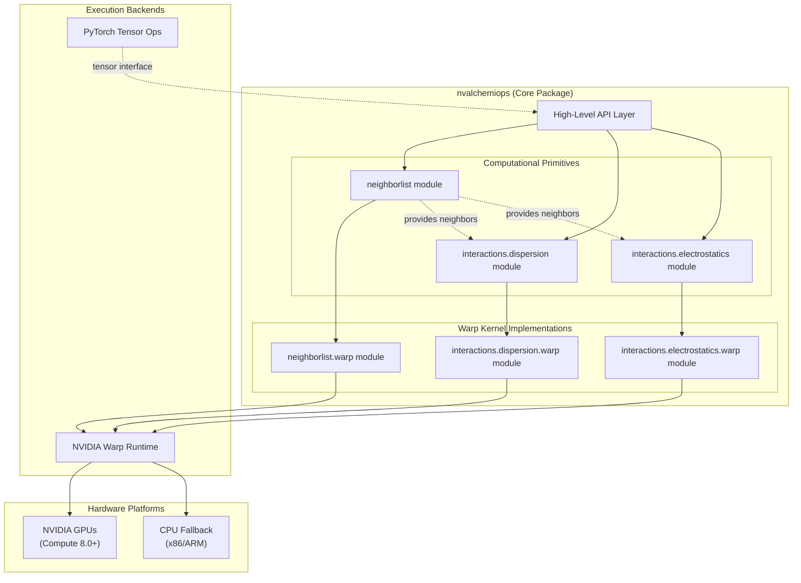
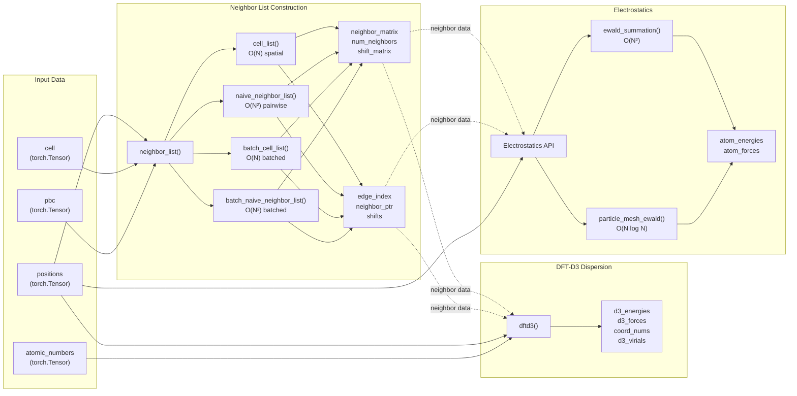
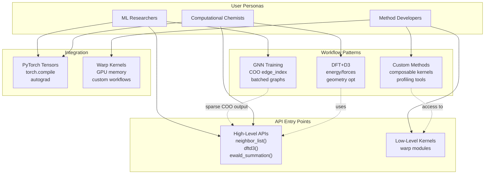
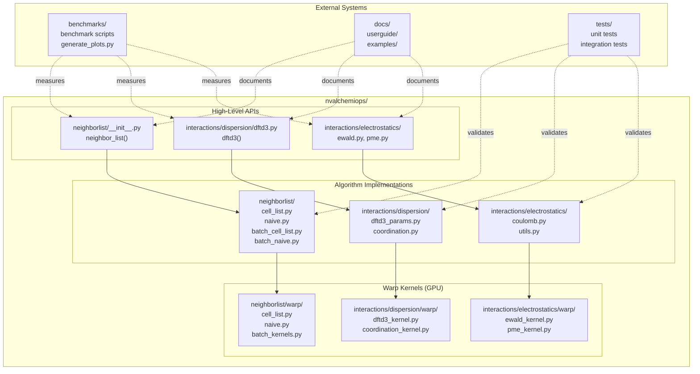
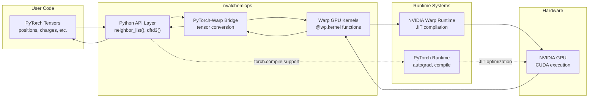

<!-- source: DeepWiki mcp.deepwiki.com · repo NVIDIA/nvalchemi-toolkit-ops · page 1 Overview · fetched 2026-10-26 -->

# Overview

<details>
<summary>Relevant source files</summary>

The following files were used as context for generating this wiki page:

- [README.md](README.md)
- [docs/index.md](docs/index.md)
- [docs/userguide/about/intro.md](docs/userguide/about/intro.md)

</details>


This page provides a high-level introduction to the NVIDIA ALCHEMI Toolkit-Ops codebase, its architectural design, computational primitives, and target use cases. For installation instructions, see [Installation and Setup](#1.1). For hands-on examples, see [Quick Start Guide](#1.2). For detailed documentation of individual components, see [Core Components](#2).

## What is NVIDIA ALCHEMI Toolkit-Ops?

NVIDIA ALCHEMI Toolkit-Ops (`nvalchemiops`) is a GPU-accelerated library providing computational primitives for atomistic simulations, computational chemistry, and machine learning workflows. The toolkit implements high-performance kernels in [NVIDIA Warp](https://github.com/NVIDIA/warp) and exposes them through PyTorch-compatible APIs.

**Key Capabilities:**

| Capability | Description | Scaling |
|-----------|-------------|---------|
| Neighbor list construction | Spatial decomposition with automatic algorithm selection | O(N) cell list or O(N²) naive |
| DFT-D3 dispersion corrections | Becke-Johnson damped dispersion with coordination-dependent C6 | Multi-pass force calculation |
| Electrostatic interactions | Ewald summation and particle mesh Ewald (PME) | O(N²) Ewald or O(N log N) PME |
| Batch processing | Heterogeneous systems with different sizes and parameters | Native batching support |

The toolkit is designed for systems ranging from small molecules (~100 atoms) to large crystalline structures (>100,000 atoms) and supports both single-system and batched operation modes.

**Sources:** [README.md:1-50](), [docs/index.md:1-16](), [docs/userguide/about/intro.md:1-50]()

## System Architecture

The following diagram illustrates the complete system architecture, showing how computational primitives, backend implementations, and hardware platforms relate to each other:



**Architecture Layers:**

1. **High-Level API Layer**: User-facing functions with automatic algorithm selection ([nvalchemiops/neighborlist/__init__.py](), [nvalchemiops/interactions/dispersion/dftd3.py](), [nvalchemiops/interactions/electrostatics/]())
2. **Computational Primitives**: Three main modules implementing neighbor lists, dispersion corrections, and electrostatics
3. **Warp Kernel Implementations**: GPU-optimized kernels written in NVIDIA Warp ([nvalchemiops/neighborlist/warp/](), [nvalchemiops/interactions/dispersion/warp/](), [nvalchemiops/interactions/electrostatics/warp/]())
4. **Execution Backends**: NVIDIA Warp runtime for GPU/CPU execution with PyTorch tensor compatibility

**Sources:** [README.md:10-25](), [docs/index.md:8-15](), [docs/userguide/about/intro.md:44-53]()

## Computational Primitives

The toolkit provides three core computational primitives that work together to enable atomistic simulations:



### Primitive 1: Neighbor List Construction

| Function | Algorithm | Complexity | Use Case |
|----------|-----------|------------|----------|
| `cell_list` | Spatial decomposition | O(N) | Single systems >5K atoms |
| `naive_neighbor_list` | Pairwise distance | O(N²) | Single systems <5K atoms |
| `batch_cell_list` | Batched spatial | O(N) | Multiple large systems |
| `batch_naive_neighbor_list` | Batched pairwise | O(N²) | Multiple small systems |

The unified `neighbor_list()` function automatically selects the appropriate algorithm based on system size and batching configuration. Output formats include dense matrices (for `torch.compile` optimization) and sparse COO format (for GNN integration).

**Key Code Entities:**
- [nvalchemiops/neighborlist/neighbor_list.py]() - Main API function
- [nvalchemiops/neighborlist/cell_list.py]() - Cell list implementation
- [nvalchemiops/neighborlist/naive.py]() - Naive implementation
- [nvalchemiops/neighborlist/warp/]() - GPU kernels

For detailed documentation, see [Neighbor Lists](#2.1).

### Primitive 2: DFT-D3 Dispersion Corrections

The `dftd3()` function computes Grimme's DFT-D3 dispersion energy with Becke-Johnson damping, using environment-dependent C6 coefficients derived from coordination numbers. The implementation uses a multi-pass kernel architecture:

| Pass | Purpose | Computation |
|------|---------|-------------|
| Pass 0 | PBC handling | Apply periodic boundary shifts |
| Pass 1 | Coordination | Calculate coordination numbers |
| Pass 2 | Direct forces | Compute dispersion forces |
| Pass 3 | Chain rule | Apply coordination-dependent derivatives |

**Key Code Entities:**
- [nvalchemiops/interactions/dispersion/dftd3.py]() - Main API
- [nvalchemiops/interactions/dispersion/dftd3_params.py]() - Parameter dataclass
- [nvalchemiops/interactions/dispersion/warp/dftd3_kernel.py]() - Multi-pass kernel

For detailed documentation, see [Dispersion Corrections (DFT-D3)](#2.2).

### Primitive 3: Electrostatics

Two methods are provided for long-range Coulomb interactions in periodic systems:

| Method | Function | Complexity | Recommended Size |
|--------|----------|------------|-----------------|
| Ewald | `ewald_summation()` | O(N²) | <5K atoms |
| PME | `particle_mesh_ewald()` | O(N log N) | >5K atoms |

Both methods split the $1/r$ potential into real-space (short-range) and reciprocal-space (long-range) components, with automatic parameter estimation based on target accuracy.

**Key Code Entities:**
- [nvalchemiops/interactions/electrostatics/ewald.py]() - Ewald summation
- [nvalchemiops/interactions/electrostatics/pme.py]() - Particle mesh Ewald
- [nvalchemiops/interactions/electrostatics/warp/]() - GPU kernels

For detailed documentation, see [Electrostatics](#2.3).

**Sources:** [README.md:16-24](), [docs/userguide/about/intro.md:54-265](), [docs/index.md:8-15]()

## Target Users and Use Cases

The toolkit serves three primary user personas with different interaction patterns:



### Use Case 1: Graph Neural Networks

ML researchers use `nvalchemiops` to generate graph connectivity for molecular datasets. The sparse COO output format (`return_neighbor_list=True`) provides `edge_index` directly compatible with GNN frameworks. Batching enables high-throughput training on datasets with heterogeneous molecule sizes.

**Example Workflow:**
```python
# From docs/userguide/about/intro.md:82-88
edge_index, neighbor_ptr, shifts = neighbor_list(
    positions, cutoff, cell=cell, pbc=pbc, return_neighbor_list=True
)
# edge_index is sparse COO format compatible with PyTorch Geometric
```

### Use Case 2: Method Development

Method developers access low-level Warp kernels to build custom atomistic algorithms. The modular kernel design allows composition of primitives (e.g., combining neighbor lists with custom interaction potentials).

**Key Code Entities:**
- [nvalchemiops/neighborlist/warp/]() - Neighbor list kernels
- [nvalchemiops/interactions/dispersion/warp/]() - Dispersion kernels
- [nvalchemiops/interactions/electrostatics/warp/]() - Electrostatics kernels

### Use Case 3: Computational Chemistry

Computational chemists integrate DFT-D3 dispersion corrections into density functional theory workflows. The `dftd3()` function provides accurate forces for geometry optimization and coordinates numbers for analysis.

**Example Workflow:**
```python
# From docs/userguide/about/intro.md:186-198
energy, forces, coord_num = dftd3(
    positions, numbers, neighbor_list=neighbors,
    a1=0.4289, a2=4.4407, s8=0.7875,  # PBE functional parameters
    d3_params=d3_params
)
```

**Sources:** [README.md:26-44](), [docs/index.md:17-28](), [docs/userguide/about/intro.md:16-42]()

## Package Structure

The codebase is organized into a three-layer hierarchy:



### Key Modules

| Module | Purpose | Key Files |
|--------|---------|-----------|
| `nvalchemiops.neighborlist` | Neighbor list construction | `neighbor_list.py`, `cell_list.py`, `naive.py` |
| `nvalchemiops.neighborlist.warp` | Neighbor list GPU kernels | `cell_list.py`, `naive.py`, `batch_kernels.py` |
| `nvalchemiops.interactions.dispersion` | DFT-D3 dispersion corrections | `dftd3.py`, `dftd3_params.py`, `coordination.py` |
| `nvalchemiops.interactions.dispersion.warp` | Dispersion GPU kernels | `dftd3_kernel.py`, `coordination_kernel.py` |
| `nvalchemiops.interactions.electrostatics` | Electrostatic interactions | `ewald.py`, `pme.py`, `coulomb.py` |
| `nvalchemiops.interactions.electrostatics.warp` | Electrostatics GPU kernels | `ewald_kernel.py`, `pme_kernel.py` |
| `benchmarks/` | Performance benchmarking | `benchmark_*.py`, `generate_plots.py` |
| `docs/` | Documentation | `userguide/`, `examples/`, `benchmarks/` |
| `tests/` | Test suite | Unit and integration tests |

**Sources:** [README.md:1-203](), package structure analysis

## Integration with PyTorch and NVIDIA Warp

The toolkit provides seamless integration with the PyTorch ecosystem while leveraging NVIDIA Warp for GPU acceleration:



### PyTorch Compatibility

All public API functions accept and return PyTorch tensors with the following features:

- **Automatic device handling**: CPU and CUDA tensors are supported transparently
- **`torch.compile` support**: Custom operators registered for JIT compilation
- **Autograd integration**: Gradients maintained where applicable (e.g., DFT-D3 forces)
- **Batch operations**: Native support for batched tensors with `batch_idx` parameter

For details, see [PyTorch Compatibility](#3.2).

### NVIDIA Warp Backend

GPU kernels are implemented in NVIDIA Warp, providing:

- **JIT compilation**: Kernels compiled at runtime for target GPU architecture
- **Memory optimization**: GPU memory layouts optimized for NVIDIA hardware
- **Profiling support**: Compatible with Nsight Systems and other NVIDIA tools
- **CPU fallback**: Automatic CPU execution when GPU unavailable

For details, see [NVIDIA Warp Integration](#3.1).

**Sources:** [docs/index.md:13-15](), [docs/userguide/about/intro.md:355-372](), [README.md:12-14]()

## Performance Characteristics

The toolkit exhibits distinct performance scaling behavior across different system sizes:

| System Size | Recommended Algorithm | Time Range | Memory Usage |
|-------------|----------------------|------------|--------------|
| <1K atoms | `naive` or `batch_naive` | ~0.3-0.5 ms | <100 MB |
| 1K-5K atoms | Algorithm transition region | ~0.5-2 ms | 100 MB - 1 GB |
| 5K-100K atoms | `cell_list` or `batch_cell_list` | ~2-100 ms | 1 GB - 10 GB |
| >100K atoms | `cell_list` (risk of OOM) | >100 ms | >10 GB |

The automatic algorithm selection in `neighbor_list()` switches from naive O(N²) to cell list O(N) at the ~5K atom threshold to optimize performance. For comprehensive performance analysis, see [Performance and Benchmarks](#4).

**Sources:** [README.md:16-24](), performance diagram analysis

## What's Next?

To get started with NVIDIA ALCHEMI Toolkit-Ops:

1. Follow [Installation and Setup](#1.1) to install the package
2. Try the [Quick Start Guide](#1.2) for working examples
3. Read [Core Components](#2) for detailed component documentation
4. Explore [Performance and Benchmarks](#4) to understand scaling behavior
5. Refer to [API Reference](#5) for complete function signatures

For method developers interested in low-level kernel access, see [NVIDIA Warp Integration](#3.1) and [Development and Contributing](#6).

**Sources:** [docs/userguide/about/intro.md:378-388](), [README.md:179-203]()

---

