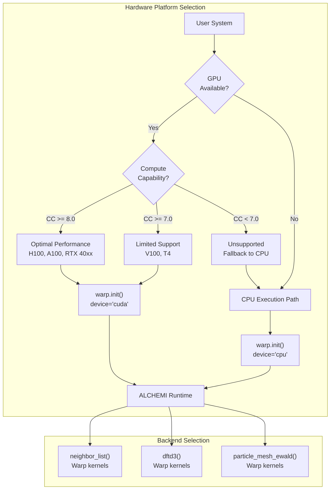
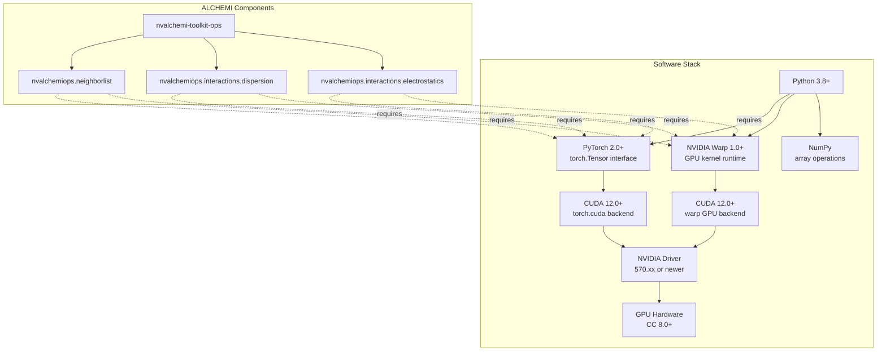
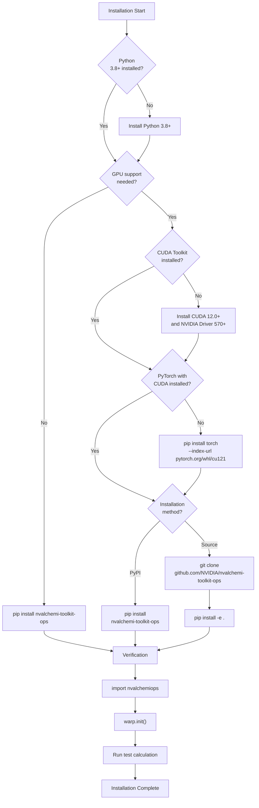
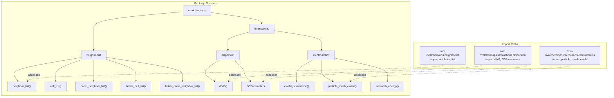

<!-- source: DeepWiki mcp.deepwiki.com · repo NVIDIA/nvalchemi-toolkit-ops · page 1.1 Installation and Setup · fetched 2026-10-26 -->

# Installation and Setup

<details>
<summary>Relevant source files</summary>

The following files were used as context for generating this wiki page:

- [README.md](README.md)
- [docs/userguide/about/faq.md](docs/userguide/about/faq.md)

</details>


This page provides comprehensive instructions for installing and configuring NVIDIA ALCHEMI Toolkit-Ops on your system. It covers hardware and software prerequisites, installation methods, verification procedures, and common setup issues.

For quick usage examples after installation, see [Quick Start Guide](#1.2). For detailed component-specific usage, refer to [Core Components](#2).

---

## Prerequisites

### Hardware Requirements

ALCHEMI Toolkit-Ops is designed for GPU acceleration but supports multiple execution backends:

| Platform | Requirements | Performance Tier |
|----------|-------------|------------------|
| **NVIDIA GPU** | Compute Capability 8.0+ (A100, H100, or newer) | Optimal |
| **NVIDIA GPU** | Compute Capability 7.0-7.5 (V100, T4) | Limited support |
| **x86 CPU** | AVX2 instruction set | Development/testing |
| **ARM CPU** | ARMv8-A (including Apple Silicon) | Development/testing |

**Recommended Hardware**: NVIDIA H100 80GB HBM3 GPU with CUDA 12.0+ for production workloads involving systems with >10,000 atoms or batch processing.



**Diagram: Hardware Platform Detection and Backend Initialization**

Sources: [docs/userguide/about/faq.md:16-23]()

---

### Software Requirements

#### Core Dependencies

The following software stack is required:



**Diagram: Software Dependency Stack**

| Component | Minimum Version | Recommended Version | Purpose |
|-----------|----------------|---------------------|---------|
| Python | 3.8 | 3.10+ | Core runtime |
| PyTorch | 2.0.0 | 2.1.0+ | Tensor operations, autograd |
| NVIDIA Warp | 1.0.0 | Latest stable | GPU kernel execution |
| CUDA Toolkit | 11.8 | 12.0+ | GPU compilation and runtime |
| NVIDIA Driver | 520.xx | 570.xx+ | GPU hardware interface |
| NumPy | 1.20.0 | Latest stable | Array operations |

**CUDA and Driver Compatibility**: CUDA 12.0+ requires driver version 520.61.05 or newer on Linux, 527.41 or newer on Windows. For optimal performance with H100 GPUs, use driver version 570.xx or newer.

Sources: [README.md:1-203](), [docs/userguide/about/faq.md:19-23]()

---

## Installation Methods

### PyPI Installation (Recommended)

The simplest installation method uses the Python Package Index:

```bash
pip install nvalchemi-toolkit-ops
```

This installs the latest stable release and all required dependencies. For GPU support, ensure PyTorch with CUDA support is installed first:

```bash
# Install PyTorch with CUDA 12.1 support
pip install torch --index-url https://download.pytorch.org/whl/cu121

# Then install ALCHEMI Toolkit-Ops
pip install nvalchemi-toolkit-ops
```

#### Installing Specific Versions

```bash
# Install a specific version
pip install nvalchemi-toolkit-ops==0.1.0

# Upgrade to the latest version
pip install --upgrade nvalchemi-toolkit-ops
```

Sources: [README.md:5]()

---

### Installation from Source

For development or to access unreleased features:

```bash
# Clone the repository
git clone https://github.com/NVIDIA/nvalchemi-toolkit-ops.git
cd nvalchemi-toolkit-ops

# Install in development mode
pip install -e .
```

Development mode (`-e` flag) creates a symlink to the source directory, allowing code changes to be immediately reflected without reinstallation.

#### Building with Specific CUDA Versions

```bash
# Set CUDA_HOME to specific CUDA installation
export CUDA_HOME=/usr/local/cuda-12.1

# Install with specific CUDA toolkit
pip install -e .
```

Sources: [README.md:3]()

---

## Installation Flow



**Diagram: Complete Installation Workflow**

Sources: [README.md:1-203](), [docs/userguide/about/faq.md:16-23]()

---

## Verification

After installation, verify that the package is correctly installed and can access GPU resources:

### Basic Import Test

```python
import nvalchemiops
import warp as wp
import torch

# Print version information
print(f"ALCHEMI Toolkit-Ops version: {nvalchemiops.__version__}")
print(f"Warp version: {wp.__version__}")
print(f"PyTorch version: {torch.__version__}")

# Check CUDA availability
print(f"CUDA available: {torch.cuda.is_available()}")
if torch.cuda.is_available():
    print(f"CUDA device: {torch.cuda.get_device_name(0)}")
    print(f"Compute capability: {torch.cuda.get_device_capability(0)}")
```

### Backend Verification

Verify that NVIDIA Warp can initialize on the correct device:

```python
import warp as wp

# Initialize Warp with CUDA backend
wp.init()
print(f"Warp device: {wp.get_device().name}")

# Check if CUDA is available to Warp
cuda_devices = wp.get_cuda_devices()
print(f"Warp CUDA devices: {cuda_devices}")
```

### Functional Test

Run a minimal neighbor list calculation to verify full functionality:

```python
import torch
from nvalchemiops.neighborlist import neighbor_list

# Set device
device = torch.device("cuda" if torch.cuda.is_available() else "cpu")
torch.set_default_device(device)

# Create test system
num_atoms = 1000
positions = torch.randn((num_atoms, 3)) * 5.0
cell = torch.eye(3).unsqueeze(0) * 20.0
pbc = torch.tensor([True, True, True], dtype=torch.bool)

# Compute neighbor list
neighbor_matrix, num_neighbors, shift_matrix = neighbor_list(
    positions,
    cutoff=5.0,
    cell=cell,
    pbc=pbc,
    method="cell_list"
)

print(f"Neighbor list computed successfully")
print(f"Total neighbors found: {num_neighbors.sum().item()}")
```

Expected output should show successful neighbor list computation with non-zero neighbors found. If using GPU, the computation should complete in under 1ms for 1000 atoms.

Sources: [README.md:57-90]()

---

## Component Import Mapping

Understanding the module structure helps with troubleshooting import errors:



**Diagram: Package Structure and Import Paths**

Sources: [README.md:59](), [README.md:104](), [README.md:150]()

---

## Initial Configuration

### Device Selection

By default, operations run on CUDA if available, falling back to CPU otherwise. Explicit device control:

```python
import torch

# Set default device globally
torch.set_default_device(torch.device("cuda"))

# Or specify device for individual tensors
device = torch.device("cuda:0")  # Use first GPU
positions = torch.randn((1000, 3), device=device)
```

### Precision Settings

ALCHEMI Toolkit-Ops supports both `float32` and `float64` precision:

```python
import torch

# Set default precision
torch.set_default_dtype(torch.float32)  # Recommended for GPU

# Or specify per-tensor
positions = torch.randn((1000, 3), dtype=torch.float64)
```

**Performance Note**: `float32` provides optimal GPU performance with minimal accuracy loss for most molecular simulations. Use `float64` only when high numerical precision is required.

### Warp Initialization Options

```python
import warp as wp

# Explicit initialization with options
wp.init()

# Force CPU execution
wp.init(force_cpu=True)

# Set CUDA device
wp.set_device("cuda:1")  # Use second GPU
```

Sources: [README.md:61-62]()

---

## Troubleshooting Common Setup Issues

### Issue: Import Error for `nvalchemiops`

**Symptoms**:
```python
ModuleNotFoundError: No module named 'nvalchemiops'
```

**Solutions**:
1. Verify installation: `pip list | grep nvalchemi`
2. Check Python environment: Ensure you're in the correct virtual environment
3. Reinstall: `pip install --force-reinstall nvalchemi-toolkit-ops`

---

### Issue: CUDA Not Available

**Symptoms**:
```python
torch.cuda.is_available()  # Returns False
```

**Diagnostic Steps**:

```python
import torch
print(f"PyTorch CUDA available: {torch.cuda.is_available()}")
print(f"PyTorch built with CUDA: {torch.version.cuda}")

import warp as wp
wp.init()
print(f"Warp CUDA devices: {wp.get_cuda_devices()}")
```

**Solutions**:
1. Install PyTorch with CUDA support:
   ```bash
   pip install torch --index-url https://download.pytorch.org/whl/cu121
   ```

2. Verify NVIDIA driver:
   ```bash
   nvidia-smi  # Should show driver version 520+ for CUDA 12
   ```

3. Check CUDA installation:
   ```bash
   nvcc --version  # Should match PyTorch CUDA version
   ```

---

### Issue: Compute Capability Not Supported

**Symptoms**:
```
RuntimeError: CUDA error: no kernel image is available for execution on the device
```

**Solutions**:

This occurs when GPU compute capability is below 7.0. Options:

1. **Upgrade Hardware**: Use GPU with compute capability 8.0+ (A100, H100, RTX 40xx)
2. **Use CPU Execution**:
   ```python
   import warp as wp
   wp.init(force_cpu=True)
   ```
3. **Build from Source**: Compile with appropriate compute architecture flags

Sources: [docs/userguide/about/faq.md:19]()

---

### Issue: Warp Initialization Fails

**Symptoms**:
```python
RuntimeError: Warp initialization failed
```

**Solutions**:

1. Check Warp version compatibility:
   ```bash
   pip show warp-lang
   ```

2. Reinstall Warp:
   ```bash
   pip install --upgrade warp-lang
   ```

3. Clear Warp cache:
   ```python
   import warp as wp
   wp.config.cache_kernels = False
   wp.init()
   ```

---

### Issue: Out of Memory on GPU

**Symptoms**:
```
RuntimeError: CUDA out of memory
```

**Solutions**:

1. Reduce batch size or system size
2. Use lower precision: `torch.set_default_dtype(torch.float32)`
3. Clear GPU cache:
   ```python
   import torch
   torch.cuda.empty_cache()
   ```

4. Monitor memory usage:
   ```python
   print(f"Allocated: {torch.cuda.memory_allocated() / 1e9:.2f} GB")
   print(f"Reserved: {torch.cuda.memory_reserved() / 1e9:.2f} GB")
   ```

For detailed performance characteristics and memory scaling, see [Performance and Benchmarks](#4).

---

### Issue: `torch.compile` Not Working

**Symptoms**:
Graph breaks or compilation failures when using `torch.compile`.

**Solutions**:

1. Verify kernel supports compilation - check function docstring
2. Pre-allocate output tensors to maintain constant shapes
3. Consult [torch.compile troubleshooting documentation](https://docs.pytorch.org/docs/stable/torch.compiler_troubleshooting.html)

For detailed `torch.compile` usage patterns, see [PyTorch Compatibility](#3.2).

Sources: [docs/userguide/about/faq.md:60-74]()

---

## Environment Variables

Useful environment variables for configuration:

| Variable | Purpose | Example |
|----------|---------|---------|
| `CUDA_VISIBLE_DEVICES` | Control GPU visibility | `export CUDA_VISIBLE_DEVICES=0,1` |
| `CUDA_HOME` | CUDA toolkit location | `export CUDA_HOME=/usr/local/cuda-12.1` |
| `WARP_CACHE_PATH` | Warp kernel cache location | `export WARP_CACHE_PATH=/tmp/warp_cache` |
| `TORCH_CUDA_ARCH_LIST` | CUDA architectures for compilation | `export TORCH_CUDA_ARCH_LIST="8.0 9.0"` |

---

## Next Steps

After successful installation and verification:

1. **Quick Start**: Try the examples in [Quick Start Guide](#1.2)
2. **Learn Components**: Explore [Core Components](#2) for detailed usage
3. **Performance Tuning**: Review [Performance and Benchmarks](#4) for optimization
4. **API Reference**: Consult [API Reference](#5) for complete function documentation

For additional questions, consult the [FAQ and Troubleshooting](#7) section or file an issue on [GitHub](https://github.com/NVIDIA/nvalchemi-toolkit-ops/issues).

Sources: [README.md:1-203](), [docs/userguide/about/faq.md:1-77]()

---

