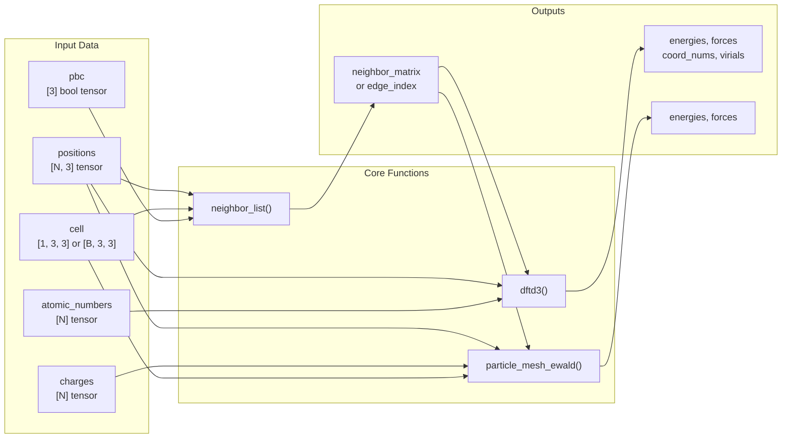
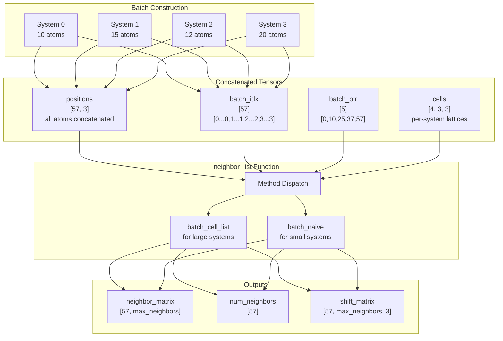
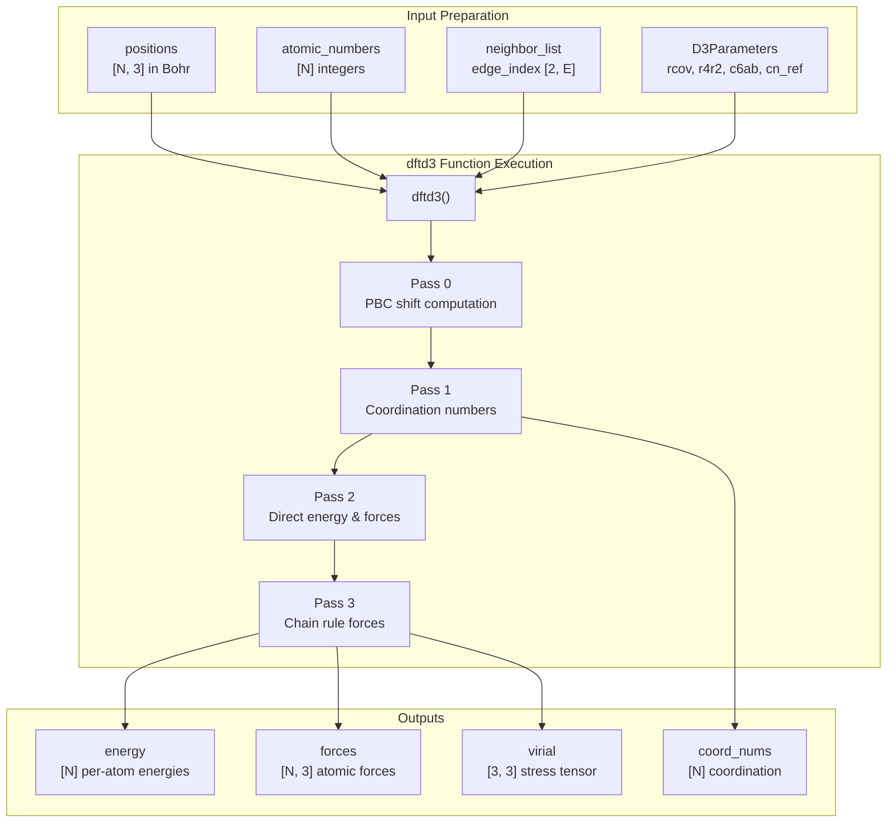
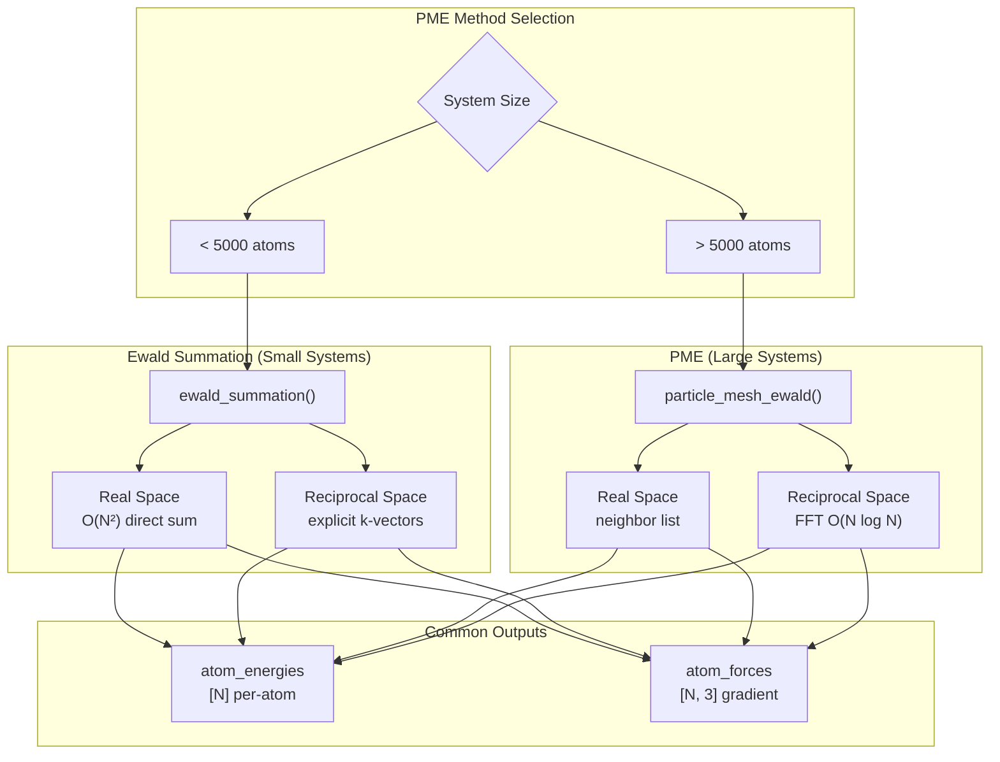

<!-- source: DeepWiki mcp.deepwiki.com · repo NVIDIA/nvalchemi-toolkit-ops · page 1.2 Quick Start Guide · fetched 2026-10-26 -->

# Quick Start Guide

<details>
<summary>Relevant source files</summary>

The following files were used as context for generating this wiki page:

- [README.md](README.md)
- [docs/sg_execution_times.rst](docs/sg_execution_times.rst)
- [docs/userguide/about/intro.md](docs/userguide/about/intro.md)

</details>


This guide provides minimal working examples to help you start using NVIDIA ALCHEMI Toolkit-Ops immediately. Each example demonstrates a core computational primitive with the simplest possible code. For detailed API documentation and parameter explanations, see [API Reference](#5). For installation instructions, see [Installation and Setup](#1.1).

## Prerequisites

Before running these examples, ensure you have:

1. Installed `nvalchemi-toolkit-ops` following [Installation and Setup](#1.1)
2. Access to a CUDA-capable GPU (recommended but not required)
3. PyTorch installed with CUDA support

All examples assume the following imports and device setup:

```python
import torch
from nvalchemiops.neighborlist import neighbor_list
from nvalchemiops.interactions.dispersion import dftd3
from nvalchemiops.interactions.electrostatics import particle_mesh_ewald

# Set default device and dtype
torch.set_default_dtype(torch.float32)
device = torch.device("cuda" if torch.cuda.is_available() else "cpu")
torch.set_default_device(device)
```

**Sources:** [README.md:55-89](), [docs/userguide/about/intro.md:1-14]()

## Workflow Overview



**Workflow Diagram:** This diagram shows the three main computational pathways. The `neighbor_list()` function provides connectivity data that feeds into both `dftd3()` for dispersion corrections and `particle_mesh_ewald()` for electrostatics.

**Sources:** [README.md:46-177](), [docs/userguide/about/intro.md:54-354]()

## Example 1: Single System Neighbor List

The simplest use case constructs a neighbor list for a single periodic system.

```python
# Create a small periodic system (32 atoms in a cubic cell)
num_atoms = 32
positions = torch.randn((num_atoms, 3)) * 5.0  # Random positions in ~10Å box
cell = torch.eye(3).unsqueeze(0) * 10.0  # 10Å cubic cell
pbc = torch.tensor([True, True, True])
cutoff = 4.0  # Angstroms

# Option 1: Dense matrix format (for torch.compile optimization)
neighbor_matrix, num_neighbors, shift_matrix = neighbor_list(
    positions,
    cutoff,
    cell=cell,
    pbc=pbc,
    method="cell_list"
)

# Option 2: Sparse COO format (for GNN frameworks)
edge_index, neighbor_ptr, shifts = neighbor_list(
    positions,
    cutoff,
    cell=cell,
    pbc=pbc,
    return_neighbor_list=True
)
```

**Output Shapes:**
| Format | Tensor | Shape | Description |
|--------|--------|-------|-------------|
| Dense | `neighbor_matrix` | `[N, max_neighbors]` | Padded neighbor indices |
| Dense | `num_neighbors` | `[N]` | Valid neighbor count per atom |
| Dense | `shift_matrix` | `[N, max_neighbors, 3]` | Periodic boundary shifts |
| Sparse | `edge_index` | `[2, num_edges]` | COO edge list (source, target) |
| Sparse | `neighbor_ptr` | `[N + 1]` | CSR-style pointer for edge slicing |
| Sparse | `shifts` | `[num_edges, 3]` | Periodic boundary shifts per edge |

**Sources:** [README.md:52-91](), [docs/userguide/about/intro.md:56-155]()

## Example 2: Batched Neighbor Lists

For high-throughput applications, process multiple systems simultaneously using batched operations.

```python
# Create batch of 4 systems with varying sizes
system_sizes = [10, 15, 12, 20]  # atoms per system
num_systems = len(system_sizes)
total_atoms = sum(system_sizes)

# Concatenate positions from all systems
positions = torch.randn((total_atoms, 3)) * 5.0

# Create batch metadata
batch_idx = torch.repeat_interleave(
    torch.arange(num_systems),
    torch.tensor(system_sizes)
)  # [0,0,...,1,1,...,2,2,...,3,3,...]

batch_ptr = torch.tensor([0] + system_sizes).cumsum(0)  # [0, 10, 25, 37, 57]

# Create per-system cells (can differ between systems)
cells = torch.eye(3).unsqueeze(0).expand(num_systems, -1, -1) * 10.0
pbc = torch.tensor([True, True, True])

# Compute batched neighbor list
neighbor_matrix, num_neighbors, shift_matrix = neighbor_list(
    positions,
    cutoff=4.0,
    cell=cells,
    pbc=pbc,
    batch_idx=batch_idx,
    batch_ptr=batch_ptr,
    method="batch_naive"  # Use batch_cell_list for larger systems
)
```



**Batch Processing Diagram:** Shows how heterogeneous systems are concatenated into single tensors with metadata. The `neighbor_list()` function automatically dispatches to `batch_cell_list()` or `batch_naive_neighbor_list()` based on `batch_idx` presence and system sizes.

**Sources:** [docs/userguide/about/intro.md:108-144](), [README.md:97-138]()

## Example 3: DFT-D3 Dispersion Corrections

Compute Becke-Johnson damped DFT-D3 dispersion energy and forces for a molecular system.

```python
from nvalchemiops.interactions.dispersion import D3Parameters

# Create a simple water molecule (coordinates in Bohr)
positions = torch.tensor([
    [0.0, 0.0, 0.0],      # O
    [1.81, 0.0, 0.0],     # H
    [-0.45, 1.76, 0.0]    # H
])
atomic_numbers = torch.tensor([8, 1, 1])  # O, H, H

# Build neighbor list with large cutoff for D3 (typically ~40 Bohr)
edge_index, neighbor_ptr, _ = neighbor_list(
    positions,
    cutoff=40.0,
    return_neighbor_list=True
)

# Load D3 reference parameters (must be provided separately)
# This contains rcov, r4r2, c6ab, cn_ref arrays
d3_params = D3Parameters.from_file("path/to/d3_params.pth")

# Compute D3 correction for PBE functional
energy, forces, coord_nums, virial = dftd3(
    positions=positions,
    numbers=atomic_numbers,
    neighbor_list=edge_index,
    neighbor_ptr=neighbor_ptr,
    a1=0.4289,    # PBE-specific
    a2=4.4407,    # PBE-specific
    s8=0.7875,    # PBE-specific
    d3_params=d3_params,
    compute_virial=True
)

print(f"D3 Energy: {energy.sum().item():.6f} Hartree")
print(f"Forces shape: {forces.shape}")  # [3, 3]
print(f"Coordination numbers: {coord_nums}")  # [3]
```



**DFT-D3 Multi-Pass Architecture:** The `dftd3()` function executes four kernel passes to compute coordination-dependent C6 coefficients. Pass 1 computes coordination numbers, which determine interpolation weights for C6 coefficients used in Pass 2 for energy/direct forces, and Pass 3 applies chain rule for coordination-dependent force contributions.

**Sources:** [README.md:94-139](), [docs/userguide/about/intro.md:163-261]()

## Example 4: Electrostatic Interactions with PME

Compute long-range Coulomb interactions using Particle Mesh Ewald for periodic systems.

```python
# Create a periodic system with point charges (e.g., NaCl crystal)
num_atoms = 64
positions = torch.randn((num_atoms, 3)) * 5.0  # Positions in Angstroms
charges = torch.randn((num_atoms,))  # Partial charges in electron units
cell = torch.eye(3).unsqueeze(0) * 15.0  # 15Å cubic cell
pbc = torch.tensor([True, True, True])

# Build neighbor list for real-space component
cutoff = 8.0  # Real-space cutoff in Angstroms
neighbor_matrix, num_neighbors, shift_matrix = neighbor_list(
    positions,
    cutoff,
    cell=cell,
    pbc=pbc,
    method="cell_list"
)

# Compute electrostatic energy and forces with automatic parameter tuning
atom_energies, atom_forces = particle_mesh_ewald(
    positions=positions,
    charges=charges,
    cell=cell,
    neighbor_matrix=neighbor_matrix,
    neighbor_matrix_shifts=shift_matrix,
    accuracy=1e-6  # Target accuracy
)

# Total system energy
system_energy = atom_energies.sum()
print(f"Electrostatic Energy: {system_energy.item():.6f} eV")
print(f"Forces shape: {atom_forces.shape}")  # [64, 3]
```



**Electrostatics Method Selection:** Both `ewald_summation()` and `particle_mesh_ewald()` split Coulomb interactions into real-space and reciprocal-space components. PME uses FFT acceleration for large systems, while Ewald uses explicit k-vector summation for smaller systems.

**Sources:** [README.md:141-177](), [docs/userguide/about/intro.md:263-353]()

## Complete Workflow Example

This example combines all three primitives to compute total energy and forces for a periodic molecular crystal.

```python
# System setup
positions = torch.randn((100, 3)) * 8.0
atomic_numbers = torch.randint(1, 9, (100,))
charges = torch.randn((100,)) * 0.5
cell = torch.eye(3).unsqueeze(0) * 20.0
pbc = torch.tensor([True, True, True])

# Step 1: Build neighbor list (used by both D3 and PME)
neighbor_matrix, num_neighbors, shift_matrix = neighbor_list(
    positions,
    cutoff=12.0,
    cell=cell,
    pbc=pbc,
    method="cell_list"
)

# Step 2: Compute dispersion correction
d3_params = D3Parameters.from_file("d3_params.pth")
d3_energy, d3_forces, _, _ = dftd3(
    positions=positions,
    numbers=atomic_numbers,
    neighbor_matrix=neighbor_matrix,
    neighbor_matrix_shifts=shift_matrix,
    a1=0.4289, a2=4.4407, s8=0.7875,  # PBE functional
    d3_params=d3_params
)

# Step 3: Compute electrostatics
elec_energy, elec_forces = particle_mesh_ewald(
    positions=positions,
    charges=charges,
    cell=cell,
    neighbor_matrix=neighbor_matrix,
    neighbor_matrix_shifts=shift_matrix,
    accuracy=1e-6
)

# Step 4: Combine contributions
total_energy = d3_energy.sum() + elec_energy.sum()
total_forces = d3_forces + elec_forces

print(f"Total Energy: {total_energy.item():.6f} Hartree")
print(f"D3 contribution: {d3_energy.sum().item():.6f}")
print(f"Electrostatic contribution: {elec_energy.sum().item():.6f}")
```

**Sources:** [README.md:46-177](), [docs/userguide/about/intro.md:54-354]()

## Key Function Signatures Reference

| Function | Module | Primary Purpose |
|----------|--------|----------------|
| `neighbor_list()` | `nvalchemiops.neighborlist` | Unified neighbor list construction with automatic algorithm selection |
| `cell_list()` | `nvalchemiops.neighborlist` | O(N) neighbor list for large single systems |
| `naive_neighbor_list()` | `nvalchemiops.neighborlist` | O(N²) neighbor list for small single systems |
| `batch_cell_list()` | `nvalchemiops.neighborlist` | O(N) neighbor list for batched large systems |
| `batch_naive_neighbor_list()` | `nvalchemiops.neighborlist` | O(N²) neighbor list for batched small systems |
| `dftd3()` | `nvalchemiops.interactions.dispersion` | DFT-D3(BJ) dispersion energy, forces, and coordination numbers |
| `ewald_summation()` | `nvalchemiops.interactions.electrostatics` | Ewald summation for systems <5000 atoms |
| `particle_mesh_ewald()` | `nvalchemiops.interactions.electrostatics` | PME with FFT acceleration for large systems |

**Sources:** [docs/userguide/about/intro.md:58-149](), [docs/userguide/about/intro.md:163-261](), [docs/userguide/about/intro.md:264-327]()

## Common Patterns and Best Practices

### Algorithm Selection
- Use `method="cell_list"` for single systems with >5000 atoms
- Use `method="naive"` for single systems with <5000 atoms
- Use `method="batch_cell_list"` for batches of large systems
- Use `method="batch_naive"` for batches of small systems
- Omit `method` parameter for automatic selection based on system size

### Output Format Selection
- Use dense matrix format (`return_neighbor_list=False`, default) for:
  - `torch.compile` optimization
  - Fixed-shape tensor requirements
  - Direct indexing workflows
- Use sparse COO format (`return_neighbor_list=True`) for:
  - Graph neural networks
  - Memory-constrained systems
  - Variable-size neighbor counts

### Unit Consistency
- **DFT-D3:** Positions and cutoffs should be in Bohr (atomic units)
- **Electrostatics:** Positions in Angstroms, charges in electron units
- **Cutoffs:** D3 typically uses ~40 Bohr, PME real-space uses ~8-12 Angstroms

**Sources:** [docs/userguide/about/intro.md:63-149]()

## Next Steps

After completing these quick start examples, explore:

1. **[Core Components](#2)** - Detailed documentation of neighbor lists, dispersion, and electrostatics
2. **[Performance and Benchmarks](#4)** - Scaling characteristics and optimization guidelines
3. **[API Reference](#5)** - Complete function signatures and parameter documentation
4. **Example Scripts** - Browse [examples/neighborlist/01_simple_neighbor_list.py](), [examples/dispersion/01_dftd3_molecule.py](), and [examples/electrostatics/03_pme_example.py]() for complete working examples

**Sources:** [docs/sg_execution_times.rst:53-64](), [docs/userguide/about/intro.md:378-388]()

---

