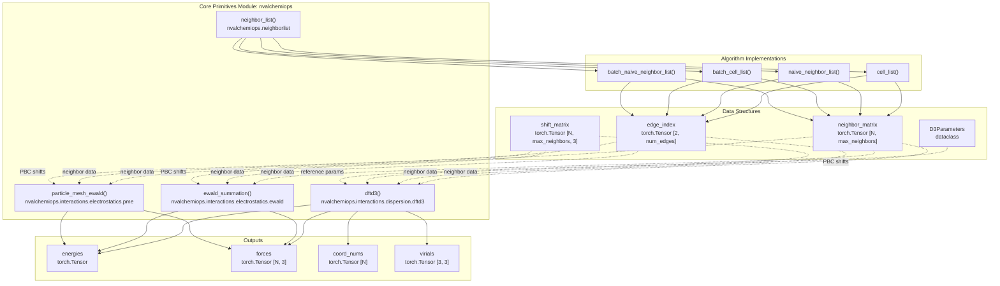
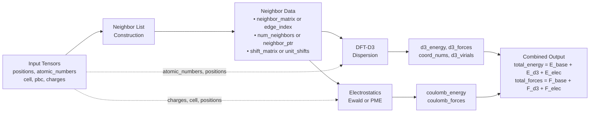
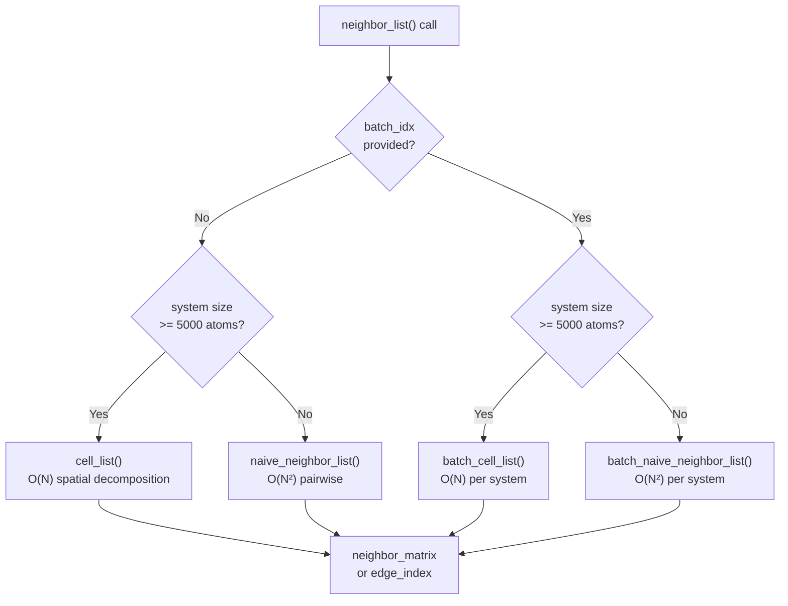
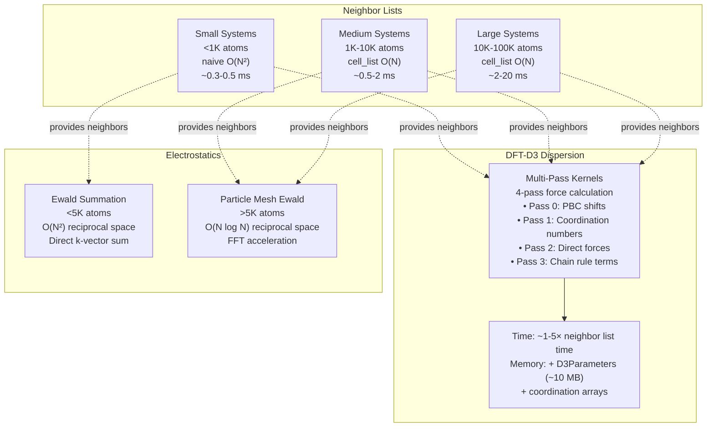
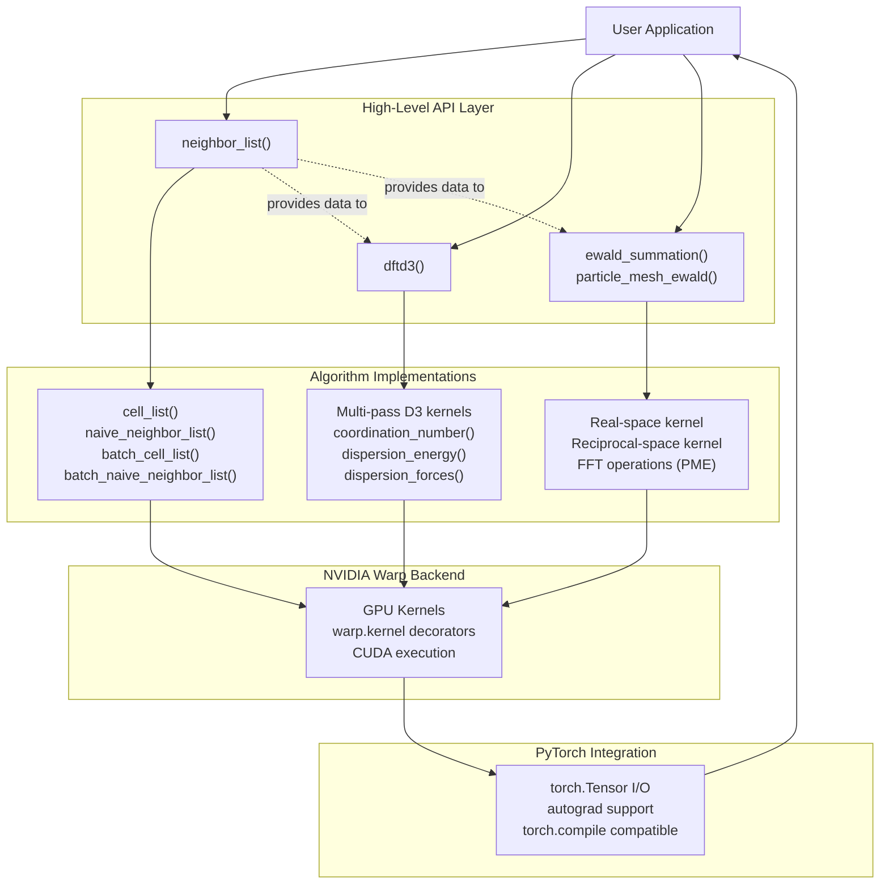

<!-- source: DeepWiki mcp.deepwiki.com · repo NVIDIA/nvalchemi-toolkit-ops · page 2 Core Components · fetched 2026-10-26 -->

# Core Components

<details>
<summary>Relevant source files</summary>

The following files were used as context for generating this wiki page:

- [README.md](README.md)
- [docs/index.md](docs/index.md)
- [docs/userguide/about/intro.md](docs/userguide/about/intro.md)

</details>


This document provides an overview of the three main computational primitives in NVIDIA ALCHEMI Toolkit-Ops: neighbor list construction, DFT-D3 dispersion corrections, and electrostatic interactions. It explains how these components work together, their unified API design, and the data flow between them.

For detailed implementation information about each component, see:
- Neighbor Lists: [#2.1](#2.1)
- DFT-D3 Dispersion Corrections: [#2.2](#2.2)
- Electrostatics: [#2.3](#2.3)

For system architecture and backend integration details, see [System Architecture](#3).

## Component Overview

ALCHEMI Toolkit-Ops consists of three GPU-accelerated computational primitives that form the foundation for atomistic simulations:

| Component | Primary Function | Complexity | Typical Cutoff |
|-----------|-----------------|------------|----------------|
| Neighbor Lists | Identify atoms within interaction range | O(N) or O(N²) | 6-40 Å |
| DFT-D3 Dispersion | Compute van der Waals corrections | O(N) after neighbor list | 20-40 Å |
| Electrostatics | Long-range Coulomb interactions | O(N²) or O(N log N) | 8-12 Å |

All three components share common design patterns:
- Unified high-level API with automatic algorithm selection
- Support for both single systems and heterogeneous batches
- PyTorch tensor inputs/outputs with `torch.compile` compatibility
- Multiple output formats (dense matrices or sparse COO)
- Implemented as NVIDIA Warp kernels for GPU acceleration

**Sources:** [README.md:10-24](), [docs/index.md:8-15](), [docs/userguide/about/intro.md:54-274]()

## System Architecture



**Diagram: Core Components and Data Flow**

This diagram shows the three main computational primitives and how they interconnect through shared data structures. The `neighbor_list()` function serves as a unified entry point that dispatches to algorithm-specific implementations, producing standardized output formats consumed by both dispersion and electrostatics calculations.

**Sources:** [docs/userguide/about/intro.md:54-274](), [README.md:46-177]()

## Component Interconnections

The three core components form a dependency hierarchy where neighbor lists provide foundational spatial information to higher-level interaction calculations:



**Diagram: Data Flow Between Components**

Neighbor lists are computed once and reused by multiple interaction calculations. This design minimizes computational overhead and ensures consistency in spatial decomposition across all energy terms.

**Sources:** [docs/userguide/about/intro.md:54-165](), [README.md:46-177]()

### Dependency Relationships

| Component | Requires | Produces | Used By |
|-----------|----------|----------|---------|
| Neighbor Lists | `positions`, `cutoff`, `cell`, `pbc` | `neighbor_matrix`/`edge_index`, `shifts` | DFT-D3, Electrostatics, GNN pipelines |
| DFT-D3 | Neighbor data, `atomic_numbers`, `D3Parameters` | `energies`, `forces`, `coord_nums`, `virials` | DFT calculations, MD simulations |
| Electrostatics | Neighbor data, `charges`, `cell` | `energies`, `forces` | MD simulations, charge equilibration |

**Sources:** [docs/userguide/about/intro.md:54-274]()

## Unified API Design

All three components follow a consistent API pattern that simplifies usage and enables automatic optimization:

### High-Level Unified Entry Points

```python
# Neighbor lists - automatic algorithm selection
from nvalchemiops.neighborlist import neighbor_list
result = neighbor_list(positions, cutoff, cell=cell, pbc=pbc, batch_idx=batch_idx)

# DFT-D3 - works with any neighbor format
from nvalchemiops.interactions.dispersion.dftd3 import dftd3
energy, forces, cn, virial = dftd3(positions, numbers, neighbor_matrix=..., d3_params=...)

# Electrostatics - method selection by system size
from nvalchemiops.interactions.electrostatics import ewald_summation, particle_mesh_ewald
atom_energies, forces = ewald_summation(positions, charges, cell, neighbor_list=...)
```

**Sources:** [docs/userguide/about/intro.md:58-90](), [README.md:52-177]()

### Common API Features

| Feature | Description | Example Parameter |
|---------|-------------|-------------------|
| Automatic selection | Chooses optimal algorithm based on system size | `method=None` (auto) |
| Explicit control | Allows manual algorithm specification | `method="cell_list"` |
| Format flexibility | Accepts dense matrices or sparse COO | `neighbor_matrix=...` or `neighbor_list=...` |
| Batch support | Processes multiple systems simultaneously | `batch_idx=torch.tensor([0,0,1,1,2,2])` |
| PBC handling | Unified periodic boundary condition interface | `pbc=torch.tensor([True, True, False])` |

**Sources:** [docs/userguide/about/intro.md:58-150]()

### Algorithm Selection Logic



**Diagram: Automatic Algorithm Selection in `neighbor_list()`**

The selection logic is implemented in [nvalchemiops/neighborlist/neighborlist.py]() and uses system size thresholds and batch configuration to choose the most efficient algorithm.

**Sources:** [docs/userguide/about/intro.md:58-150]()

## Output Format Standards

All components support two standard output formats for neighbor data, enabling integration with different downstream applications:

### Dense Matrix Format

Used by default for `torch.compile` optimization and fixed-shape kernel requirements:

```python
neighbor_matrix, num_neighbors, shift_matrix = neighbor_list(
    positions, cutoff, cell=cell, pbc=pbc
)
# neighbor_matrix: torch.Tensor [num_atoms, max_neighbors]
# num_neighbors: torch.Tensor [num_atoms]
# shift_matrix: torch.Tensor [num_atoms, max_neighbors, 3]
```

**Characteristics:**
- Fixed shape enables `torch.compile` optimization
- Memory usage: O(N × max_neighbors)
- Indexed directly by atom ID: `neighbors_of_atom_i = neighbor_matrix[i, :num_neighbors[i]]`

**Sources:** [docs/userguide/about/intro.md:70-90](), [README.md:52-91]()

### Sparse COO Format

Used for graph neural networks and memory-efficient storage:

```python
edge_index, neighbor_ptr, unit_shifts = neighbor_list(
    positions, cutoff, cell=cell, pbc=pbc, return_neighbor_list=True
)
# edge_index: torch.Tensor [2, num_edges] - COO format
# neighbor_ptr: torch.Tensor [num_atoms + 1] - CSR-style pointer
# unit_shifts: torch.Tensor [num_edges, 3]
```

**Characteristics:**
- Memory usage: O(num_edges) 
- Compatible with PyTorch Geometric and DGL
- Variable edge count per atom

**Sources:** [docs/userguide/about/intro.md:79-88](), [README.md:52-91]()

### Format Conversion

| From | To | Method |
|------|-----|--------|
| Dense → COO | Use `return_neighbor_list=True` | Automatic during `neighbor_list()` call |
| COO → Dense | Not directly supported | Reconstruct with new `neighbor_list()` call |

Both DFT-D3 and electrostatics functions accept either format through distinct parameters:
- Dense format: `neighbor_matrix=...`, `neighbor_matrix_shifts=...`
- COO format: `neighbor_list=...`, `unit_shifts=...`

**Sources:** [docs/userguide/about/intro.md:58-90](), [README.md:94-140]()

## Computational Characteristics

Each component has distinct computational and memory characteristics that determine when to use it:



**Diagram: Computational Characteristics by Component**

**Sources:** [docs/userguide/about/intro.md:54-274]()

### Performance Guidelines

| System Size | Neighbor Method | DFT-D3 Overhead | Electrostatics Method |
|-------------|----------------|-----------------|----------------------|
| <1K atoms | `naive` | 1-2× neighbor time | `ewald_summation` |
| 1K-5K atoms | `cell_list` | 2-3× neighbor time | `ewald_summation` |
| 5K-20K atoms | `cell_list` | 3-4× neighbor time | `particle_mesh_ewald` |
| >20K atoms | `cell_list` | 4-5× neighbor time | `particle_mesh_ewald` |

**Sources:** [docs/userguide/about/intro.md:266-274]()

## Batch Processing Architecture

All three components natively support batch processing for multiple systems with heterogeneous parameters:

### Batch Configuration

Batch processing requires two additional tensors that map atoms to their parent systems:

```python
# batch_idx: Maps each atom to its system ID
batch_idx = torch.tensor([0, 0, 0, 1, 1, 2, 2, 2, 2])  # 3 systems with 3, 2, 4 atoms

# batch_ptr: CSR-style pointer into atom array
batch_ptr = torch.tensor([0, 3, 5, 9])  # system 0: atoms 0-2, system 1: atoms 3-4, etc.
```

### Component-Specific Batch Support

| Component | Batch Parameter | Output Shape | Per-System Parameters |
|-----------|----------------|--------------|----------------------|
| Neighbor Lists | `batch_idx` | Concatenated atoms | `cell`: [num_systems, 3, 3] |
| DFT-D3 | `batch_idx` | Per-system energies: [num_systems] | `cell`, `a1`, `a2`, `s8` (can vary) |
| Electrostatics | `batch_idx` | Per-atom energies: [num_atoms] | `cell`: [num_systems, 3, 3] |

**Sources:** [docs/userguide/about/intro.md:108-143](), [README.md:94-140]()

### Memory Layout

Batched data uses a concatenated tensor layout where all atoms from all systems are stored sequentially:

```python
# Example: 3 systems with 3, 2, 4 atoms
positions = torch.cat([pos_system0, pos_system1, pos_system2])  # [9, 3]
atomic_numbers = torch.cat([nums_sys0, nums_sys1, nums_sys2])   # [9]
batch_idx = torch.tensor([0,0,0, 1,1, 2,2,2,2])                 # [9]
```

This layout enables efficient GPU kernel execution while supporting heterogeneous system sizes and parameters.

**Sources:** [README.md:94-140](), [docs/userguide/about/intro.md:228-253]()

## Component Integration Summary



**Diagram: Component Integration and Backend Architecture**

All three components share a common architecture: high-level Python APIs dispatch to algorithm-specific implementations written as NVIDIA Warp kernels, with PyTorch tensor handling for seamless ecosystem integration.

**Sources:** [docs/userguide/about/intro.md:355-377](), [README.md:10-45]()

---

This overview establishes the foundational structure of ALCHEMI Toolkit-Ops. For detailed information about each component's algorithms, parameters, and usage patterns, refer to their respective documentation pages:
- [Neighbor Lists](#2.1) - Algorithm selection, output formats, and rebuild detection
- [Dispersion Corrections](#2.2) - DFT-D3 multi-pass kernels and D3Parameters configuration  
- [Electrostatics](#2.3) - Ewald summation and PME methods for long-range interactions

---

