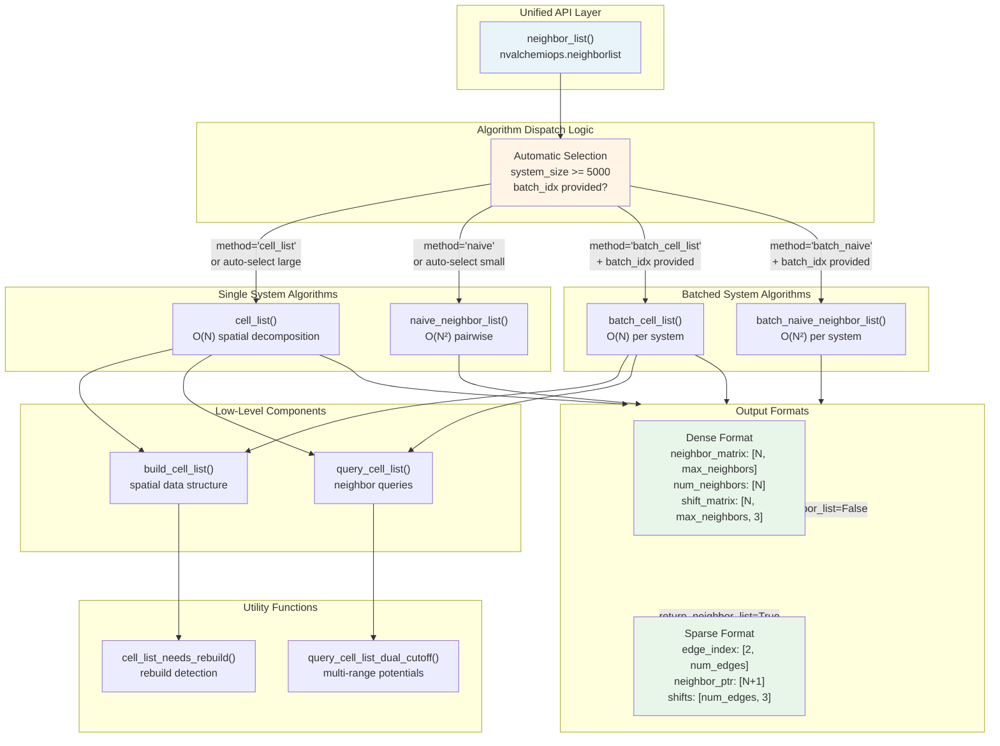
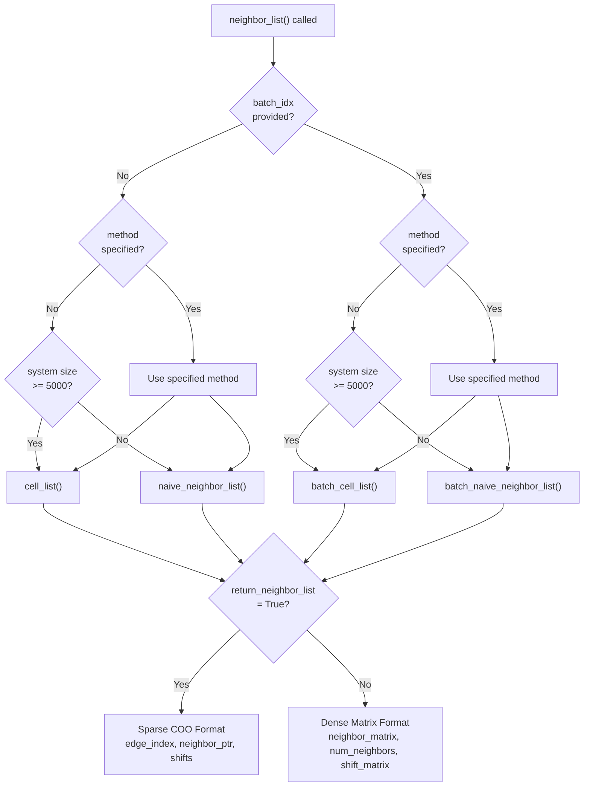
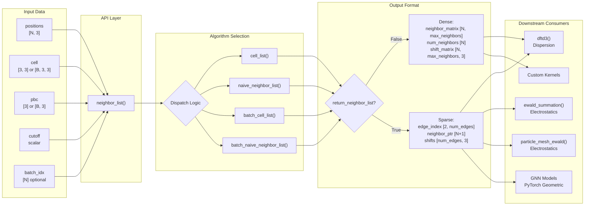

<!-- source: DeepWiki mcp.deepwiki.com · repo NVIDIA/nvalchemi-toolkit-ops · page 2.1 Neighbor Lists · fetched 2026-10-26 -->

# Neighbor Lists

<details>
<summary>Relevant source files</summary>

The following files were used as context for generating this wiki page:

- [README.md](README.md)
- [docs/userguide/about/faq.md](docs/userguide/about/faq.md)
- [docs/userguide/about/intro.md](docs/userguide/about/intro.md)
- [examples/neighborlist/neighbor-requires.txt](examples/neighborlist/neighbor-requires.txt)

</details>


This page provides detailed documentation of the neighbor list construction algorithms, their APIs, and usage patterns. Neighbor lists identify atom pairs within a specified cutoff distance and are the foundation for computing pairwise interactions in molecular simulations and graph neural networks.

For automatic algorithm selection guidance, see [Algorithm Selection](#2.1.1). For details on output format selection and conversion, see [Output Formats](#2.1.2). For performance analysis and scaling characteristics, see [Neighbor List Performance](#4.1).

**Sources:** [README.md:1-203](), [docs/userguide/about/intro.md:1-388]()

---

## Purpose and Scope

Neighbor list construction identifies all atom pairs $(i, j)$ where the distance $d_{ij} < r_{\text{cutoff}}$, accounting for periodic boundary conditions when present. This operation is required by virtually all pairwise interaction calculations, including dispersion corrections, electrostatics, and machine learning potentials. The `nvalchemiops.neighborlist` module provides four GPU-accelerated algorithms with automatic selection, two output formats, and utilities for rebuild detection and dual-cutoff queries.

**Sources:** [docs/userguide/about/intro.md:56-69]()

---

## Computational Problem

### Definition

Given:
- Atomic positions $\mathbf{r}_i \in \mathbb{R}^3$ for $i = 1, \ldots, N$
- Cutoff radius $r_{\text{cutoff}}$
- Optional: simulation cell $\mathbf{L} \in \mathbb{R}^{3 \times 3}$ and periodic boundary conditions

Find all pairs $(i, j)$ where:

$$d_{ij} = \|\mathbf{r}_j - \mathbf{r}_i + \mathbf{s} \cdot \mathbf{L}\| < r_{\text{cutoff}}$$

where $\mathbf{s} \in \mathbb{Z}^3$ is the unit cell shift vector for periodic systems.

### Complexity Tradeoffs

| Algorithm | Complexity | Overhead | Optimal For |
|-----------|-----------|----------|-------------|
| `naive_neighbor_list` | $O(N^2)$ | Low | Small systems (<5000 atoms) |
| `cell_list` | $O(N)$ | Moderate | Large systems (≥5000 atoms) |
| `batch_naive_neighbor_list` | $O(N^2)$ per system | Low | Batched small systems |
| `batch_cell_list` | $O(N)$ per system | Moderate | Batched large systems |

The crossover point depends on system density, cutoff radius, and hardware characteristics. See [Single System Performance](#4.1.1) and [Batched Performance](#4.1.2) for empirical scaling data.

**Sources:** [docs/userguide/about/faq.md:32-43](), [docs/userguide/about/intro.md:72-144]()

---

## System Architecture



**Neighbor List System Architecture**

This diagram shows how the unified `neighbor_list()` API dispatches to one of four underlying algorithms based on system characteristics and user-specified method. The function automatically selects between single-system and batched algorithms when `batch_idx` is provided, and between O(N) and O(N²) algorithms based on system size. All algorithms produce either dense matrix or sparse COO output formats.

**Sources:** [docs/userguide/about/intro.md:56-154](), [README.md:57-90]()

---

## Main API: `neighbor_list()`

### Function Signature

The unified interface is located at `nvalchemiops.neighborlist.neighbor_list()` and provides automatic algorithm selection:

```python
neighbor_list(
    positions: torch.Tensor,          # [N, 3] or [batch_N, 3]
    cutoff: float,
    cell: Optional[torch.Tensor] = None,      # [3, 3] or [batch_size, 3, 3]
    pbc: Optional[torch.Tensor] = None,       # [3] or [batch_size, 3]
    batch_idx: Optional[torch.Tensor] = None, # [batch_N]
    batch_ptr: Optional[torch.Tensor] = None, # [batch_size + 1]
    method: Optional[str] = None,             # "cell_list", "naive", "batch_cell_list", "batch_naive"
    return_neighbor_list: bool = False,       # True → sparse COO, False → dense matrix
    # ... additional parameters
)
```

### Automatic Dispatch Logic



**Algorithm Dispatch Decision Tree**

The `neighbor_list()` function uses a two-level decision process: first determining whether to use single-system or batched algorithms based on `batch_idx`, then selecting between O(N) cell-based or O(N²) naive algorithms based on system size (5000 atom threshold) or explicit `method` parameter.

**Sources:** [docs/userguide/about/intro.md:146-149](), [docs/userguide/about/intro.md:72-144]()

---

## Algorithm Implementations

### Cell List Algorithm (`cell_list`)

The cell list algorithm divides the simulation box into a grid of cells with size $\geq r_{\text{cutoff}}$, enabling O(N) neighbor searches by limiting queries to adjacent cells.

**Implementation:** `nvalchemiops.neighborlist.cell_list()`

**Key characteristics:**
- **Complexity:** O(N) for neighbor construction
- **Memory:** O(N × average_coordination)
- **Optimal for:** Systems ≥5000 atoms where $r_{\text{cutoff}} \ll L_{\min}$ (minimum box dimension)
- **Overhead:** Spatial decomposition construction adds constant overhead (~0.5ms on H100)

**Low-level interface:**
```python
# Two-stage process for caching spatial structure
cell_list_data = build_cell_list(positions, cell, pbc, cutoff)
neighbor_matrix, num_neighbors, shifts = query_cell_list(
    positions, cell, pbc, cutoff, cell_list_data
)
```

The `build_cell_list()` and `query_cell_list()` pair allows reusing the spatial data structure across multiple queries or timesteps.

**Sources:** [docs/userguide/about/intro.md:74-88](), [docs/userguide/about/faq.md:36-38]()

### Naive Algorithm (`naive_neighbor_list`)

The naive algorithm computes all pairwise distances without spatial acceleration, resulting in O(N²) complexity but minimal overhead.

**Implementation:** `nvalchemiops.neighborlist.naive_neighbor_list()`

**Key characteristics:**
- **Complexity:** O(N²) for all pairs
- **Memory:** O(N × average_coordination)
- **Optimal for:** Systems <5000 atoms where overhead dominates
- **Overhead:** Minimal kernel launch cost (~0.3ms on H100)

**Sources:** [docs/userguide/about/intro.md:91-106](), [docs/userguide/about/faq.md:39-40]()

### Batched Algorithms

Both `batch_cell_list()` and `batch_naive_neighbor_list()` process multiple systems simultaneously with heterogeneous sizes and parameters:

**Implementation:** 
- `nvalchemiops.neighborlist.batch_cell_list()`
- `nvalchemiops.neighborlist.batch_naive_neighbor_list()`

**Key differences from single-system:**
- Requires `batch_idx` tensor mapping atoms to systems
- Optional `batch_ptr` for efficient system boundary lookups
- Supports heterogeneous cells: `cell.shape = [num_systems, 3, 3]`
- Supports heterogeneous PBC: `pbc.shape = [num_systems, 3]`

**Batching requirements:**

| Input Tensor | Single System | Batched System |
|--------------|---------------|----------------|
| `positions` | `[N, 3]` | `[total_atoms, 3]` |
| `cell` | `[3, 3]` or `[1, 3, 3]` | `[num_systems, 3, 3]` |
| `pbc` | `[3]` or `[1, 3]` | `[num_systems, 3]` |
| `batch_idx` | Not required | `[total_atoms]` mapping atom→system |
| `batch_ptr` | Not required | `[num_systems + 1]` cumsum boundaries |

**Sources:** [docs/userguide/about/intro.md:108-144](), [README.md:94-139]()

---

## Output Formats

### Dense Matrix Format (Default)

When `return_neighbor_list=False` (default), the function returns:

```python
neighbor_matrix, num_neighbors, shift_matrix = neighbor_list(...)
```

| Tensor | Shape | Description |
|--------|-------|-------------|
| `neighbor_matrix` | `[N, max_neighbors]` | Neighbor indices per atom, padded with -1 |
| `num_neighbors` | `[N]` | Actual neighbor count per atom |
| `shift_matrix` | `[N, max_neighbors, 3]` | PBC unit cell shifts $(s_x, s_y, s_z)$ |

**Advantages:**
- Constant shape enables `torch.compile` optimization
- Efficient for dense iteration over all neighbors
- Direct indexing: `neighbor_matrix[i, k]` gives $k$-th neighbor of atom $i$

**Disadvantages:**
- Wastes memory if coordination numbers vary widely
- Padding required for variable neighbor counts

**Sources:** [README.md:70-78](), [docs/userguide/about/intro.md:52]()

### Sparse COO Format

When `return_neighbor_list=True`, the function returns:

```python
edge_index, neighbor_ptr, shifts = neighbor_list(..., return_neighbor_list=True)
```

| Tensor | Shape | Description |
|--------|-------|-------------|
| `edge_index` | `[2, num_edges]` | Source and target indices (COO format) |
| `neighbor_ptr` | `[N + 1]` | CSR-style pointers: neighbors of atom $i$ are `edge_index[1, neighbor_ptr[i]:neighbor_ptr[i+1]]` |
| `shifts` | `[num_edges, 3]` | PBC unit cell shifts per edge |

**Advantages:**
- Memory efficient for sparse connectivity
- Standard format for GNN frameworks (PyTorch Geometric, DGL)
- No padding overhead

**Disadvantages:**
- Variable shape complicates `torch.compile` optimization
- Requires indirection through `neighbor_ptr` for iteration

**Usage pattern:**
```python
for i in range(num_atoms):
    start, end = neighbor_ptr[i], neighbor_ptr[i + 1]
    neighbors_of_i = edge_index[1, start:end]
    shifts_of_i = shifts[start:end]
```

**Sources:** [README.md:79-88](), [docs/userguide/about/intro.md:52]()

---

## Usage Patterns

### Single System Example

```python
import torch
from nvalchemiops.neighborlist import neighbor_list

# Setup: 50,000 atoms in a 2D periodic box
positions = torch.randn(50_000, 3, device="cuda") * 10.0
cell = torch.eye(3, device="cuda").unsqueeze(0)  # [1, 3, 3]
pbc = torch.tensor([True, True, False], device="cuda")
cutoff = 6.0

# Dense output (default)
neighbor_matrix, num_neighbors, shift_matrix = neighbor_list(
    positions, cutoff, cell=cell, pbc=pbc, method="cell_list"
)
# Process: for atom i, neighbors are neighbor_matrix[i, :num_neighbors[i]]

# Sparse output (COO format)
edge_index, neighbor_ptr, shifts = neighbor_list(
    positions, cutoff, cell=cell, pbc=pbc, return_neighbor_list=True
)
# Process: for atom i, neighbors are edge_index[1, neighbor_ptr[i]:neighbor_ptr[i+1]]
```

**Sources:** [README.md:57-90]()

### Batched System Example

```python
import torch
from nvalchemiops.neighborlist import neighbor_list

# Setup: 3 systems with [100, 200, 150] atoms respectively
batch_idx = torch.cat([
    torch.zeros(100, dtype=torch.long),
    torch.ones(200, dtype=torch.long),
    torch.full((150,), 2, dtype=torch.long)
]).cuda()

positions = torch.randn(450, 3, device="cuda") * 5.0
cells = torch.stack([
    torch.eye(3) * 10.0,  # system 0
    torch.eye(3) * 15.0,  # system 1
    torch.eye(3) * 12.0,  # system 2
]).cuda()
pbc = torch.tensor([[True, True, True]] * 3, device="cuda")

# Batched neighbor list
neighbor_matrix, num_neighbors, shift_matrix = neighbor_list(
    positions, cutoff=5.0, cell=cells, pbc=pbc, 
    batch_idx=batch_idx, method="batch_cell_list"
)
```

**Sources:** [README.md:94-139]()

### Integration with Dispersion Calculations

```python
from nvalchemiops.neighborlist import neighbor_list
from nvalchemiops.interactions.dispersion import dftd3

# Build neighbor list with large cutoff for dispersion
neighbors, neighbor_ptr, shifts = neighbor_list(
    positions, cutoff=40.0, cell=cell, pbc=pbc, 
    return_neighbor_list=True
)

# DFT-D3 consumes sparse neighbor list
energies, forces, coord_nums = dftd3(
    positions=positions,
    numbers=atomic_numbers,
    neighbor_list=neighbors,
    neighbor_ptr=neighbor_ptr,
    unit_shifts=shifts,
    cell=cell,
    d3_params=d3_params,
    a1=0.4289, a2=4.4407, s8=0.7875  # PBE parameters
)
```

**Sources:** [docs/userguide/about/intro.md:186-198](), [README.md:94-139]()

---

## Advanced Features

### Rebuild Detection

Molecular dynamics simulations can avoid expensive neighbor list reconstruction by detecting when atoms have moved beyond a "skin" distance:

```python
from nvalchemiops.neighborlist import build_cell_list, cell_list_needs_rebuild

# Initial construction with skin distance
skin = 1.0
cell_list_data = build_cell_list(
    positions_t0, cell, pbc, cutoff=cutoff + skin
)

# During MD loop
for step in range(num_steps):
    positions_t = integrate(positions_t, velocities, forces, dt)
    
    # Check if rebuild needed
    needs_rebuild = cell_list_needs_rebuild(
        positions_t0, positions_t, cell, pbc, 
        skin=skin, cell_list_data=cell_list_data
    )
    
    if needs_rebuild:
        positions_t0 = positions_t.clone()
        cell_list_data = build_cell_list(
            positions_t0, cell, pbc, cutoff=cutoff + skin
        )
```

**Sources:** [docs/userguide/about/intro.md:156-161]()

### Dual Cutoff Queries

For potentials with multiple interaction ranges (e.g., separate short-range and dispersion cutoffs):

```python
from nvalchemiops.neighborlist import query_cell_list_dual_cutoff

# Build cell list once with maximum cutoff
cell_list_data = build_cell_list(positions, cell, pbc, cutoff=max_cutoff)

# Query with two cutoffs simultaneously
neighbors_short, neighbors_long, ... = query_cell_list_dual_cutoff(
    positions, cell, pbc,
    cutoff_short=6.0,
    cutoff_long=20.0,
    cell_list_data=cell_list_data
)
```

**Sources:** [docs/userguide/about/intro.md:151-154]()

---

## Data Flow Diagram



**Neighbor List Data Flow**

This diagram traces the complete data flow from input tensors through algorithm selection, format conversion, and consumption by downstream components. The `neighbor_list()` API accepts positions, cell parameters, and boundary conditions, dispatches to one of four algorithms, and produces either dense or sparse output consumed by dispersion, electrostatics, GNN models, or custom user code.

**Sources:** [docs/userguide/about/intro.md:56-154](), [README.md:57-177]()

---

## Performance Considerations

### Algorithm Selection Guidelines

| System Characteristics | Recommended Algorithm | Rationale |
|------------------------|----------------------|-----------|
| <1000 atoms, single system | `naive` | Minimal overhead, constant time region |
| 1000-5000 atoms, single system | Benchmark both | Transition region, density-dependent |
| >5000 atoms, single system | `cell_list` | O(N) scaling dominates |
| Batch of small systems (<1000 atoms each) | `batch_naive` | Low per-system overhead |
| Batch of large systems (>5000 atoms each) | `batch_cell_list` | O(N) scaling per system |
| Very dense systems (high coordination) | `cell_list` | Better memory locality |
| Sparse systems (low coordination) | Consider `naive` for small N | Less benefit from spatial decomposition |

### Memory Scaling

**Dense format:** $O(N \times \text{max\_neighbors})$  
**Sparse format:** $O(N \times \text{avg\_neighbors})$

For systems with uniform coordination, dense format has minimal overhead. For heterogeneous systems (e.g., molecules of varying sizes in a batch), sparse format reduces memory by up to 50%.

### Torch.compile Compatibility

The dense matrix format (`return_neighbor_list=False`) is fully compatible with `torch.compile` when output tensor shapes are pre-allocated. The sparse COO format has variable shape and may cause graph breaks depending on usage pattern.

**Sources:** [docs/userguide/about/intro.md:63-68](), [docs/userguide/about/faq.md:60-74]()

---

## Comparison to Other Libraries

### vs. ASE Neighbor Lists

| Feature | ALCHEMI Toolkit-Ops | ASE |
|---------|---------------------|-----|
| Execution | GPU (CUDA) via NVIDIA Warp | CPU (Python/C) |
| Batch processing | Native heterogeneous batching | Manual loop over systems |
| Output formats | Dense matrix + sparse COO | Iterator-based |
| torch.compile | Supported (dense format) | N/A |
| Typical speedup | 10-100× for >5000 atoms | Baseline |

ASE neighbor lists are suitable for CPU-based workflows and small-scale calculations. ALCHEMI Toolkit-Ops targets GPU-accelerated high-throughput applications where neighbor list construction can become a bottleneck.

**Sources:** [docs/userguide/about/faq.md:45-56]()

---

## Related Documentation

- For guidance on choosing between algorithms, see [Algorithm Selection](#2.1.1)
- For format conversion and usage with GNNs, see [Output Formats](#2.1.2)
- For performance benchmarks and scaling data, see [Neighbor List Performance](#4.1)
- For API reference with full parameter documentation, see [Neighbor List API](#5.1)
- For dispersion correction integration, see [Dispersion Corrections (DFT-D3)](#2.2)
- For electrostatics integration, see [Electrostatics](#2.3)

**Sources:** [docs/userguide/about/intro.md:1-388]()

---

