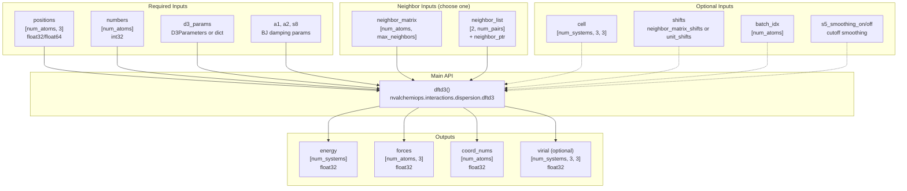
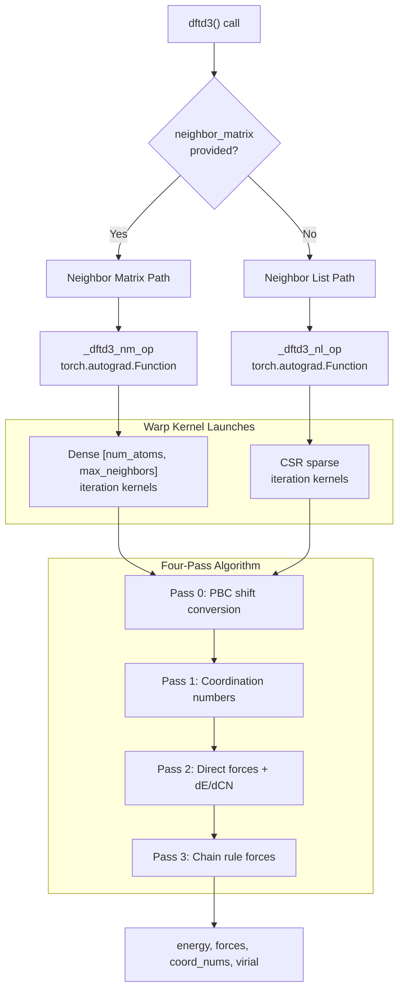
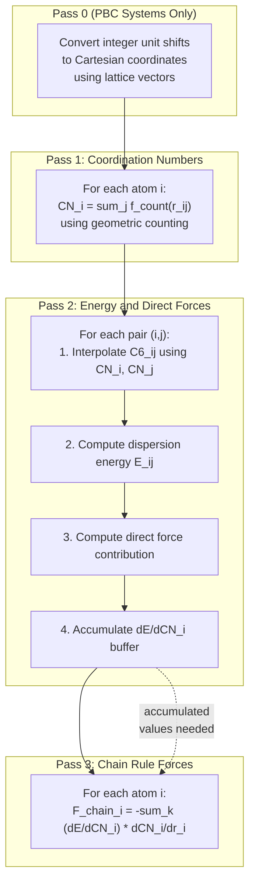

<!-- source: DeepWiki mcp.deepwiki.com · repo NVIDIA/nvalchemi-toolkit-ops · page 2.2 Dispersion Corrections (DFT-D3) · fetched 2026-10-26 -->

# Dispersion Corrections (DFT-D3)

<details>
<summary>Relevant source files</summary>

The following files were used as context for generating this wiki page:

- [README.md](README.md)
- [docs/userguide/about/intro.md](docs/userguide/about/intro.md)
- [docs/userguide/components/dispersion.md](docs/userguide/components/dispersion.md)

</details>


## Purpose and Scope

This page provides a comprehensive guide to DFT-D3(BJ) dispersion corrections in ALCHEMI Toolkit-Ops. It covers the main `dftd3` function interface, input/output formats, batching support, and integration with neighbor lists. For detailed information on the internal multi-pass kernel architecture, see [Multi-Pass Kernel Architecture](#2.2.1). For parameter configuration and loading reference data, see [D3Parameters Configuration](#2.2.2). For performance benchmarks and scaling characteristics, see [Dispersion Performance](#4.2).

**Sources:** [docs/userguide/components/dispersion.md:1-20]()

## Overview

DFT-D3 with Becke-Johnson (BJ) damping adds empirical dispersion corrections to density functional theory calculations to account for long-range van der Waals interactions. Standard DFT functionals systematically underestimate these interactions, leading to errors in binding energies, molecular crystal structures, conformational energies, and adsorption phenomena.

ALCHEMI Toolkit-Ops implements GPU-accelerated DFT-D3(BJ) with the following capabilities:

- **Environment-dependent C6 coefficients**: Coordination-number-based interpolation from reference grids
- **Two-body corrections**: C6 and C8 dispersion terms (ATM/C9 three-body terms not included)
- **Becke-Johnson damping**: Improved short-range behavior for equilibrium geometries
- **Full gradient support**: Analytic forces and optional virial tensors for periodic systems
- **Batched computation**: Process multiple systems with heterogeneous parameters simultaneously
- **Dual neighbor formats**: Support for both dense neighbor matrices and sparse COO lists
- **PyTorch integration**: Full `torch.compile` compatibility and autograd support

**Sources:** [docs/userguide/components/dispersion.md:18-30](), [README.md:18-21]()

## Core Function Interface



**Diagram: Data flow through the `dftd3` function showing required inputs, alternative neighbor formats, optional parameters, and outputs**

The main entry point is the `dftd3` function, which accepts positions, atomic numbers, neighbor information, damping parameters, and reference D3 parameters. It returns per-system energies, per-atom forces, per-atom coordination numbers, and optionally per-system virial tensors.

**Sources:** [docs/userguide/components/dispersion.md:47-98](), [README.md:94-139]()

## Neighbor Format Support

The `dftd3` function supports two neighbor representations that produce numerically identical results:

### Neighbor Matrix Format (Dense)

```python
neighbor_matrix, num_neighbors, neighbor_matrix_shifts = neighbor_list(
    positions, cutoff=50.0, cell=cell, pbc=pbc
)

energy, forces, coord_nums = dftd3(
    positions=positions,
    numbers=numbers,
    neighbor_matrix=neighbor_matrix,
    neighbor_matrix_shifts=neighbor_matrix_shifts,  # for PBC
    cell=cell,
    a1=0.3981, a2=4.4211, s8=0.7875,
    d3_params=d3_params
)
```

Dense tensor of shape `[num_atoms, max_neighbors]` where each row contains neighbor indices for an atom, padded with a fill value.

### Neighbor List Format (Sparse COO)

```python
neighbor_list_coo, neighbor_ptr, unit_shifts = neighbor_list(
    positions, cutoff=50.0, cell=cell, pbc=pbc, return_neighbor_list=True
)

energy, forces, coord_nums = dftd3(
    positions=positions,
    numbers=numbers,
    neighbor_list=neighbor_list_coo,
    neighbor_ptr=neighbor_ptr,
    unit_shifts=unit_shifts,  # for PBC
    cell=cell,
    a1=0.3981, a2=4.4211, s8=0.7875,
    d3_params=d3_params
)
```

Sparse tensor of shape `[2, num_pairs]` in COO (coordinate list) format with CSR pointer array.

**Format Selection Guidelines:**

| Format | Preferred When |
|--------|---------------|
| **Neighbor Matrix** | Using `torch.compile` (constant shapes), dense uniform systems |
| **Neighbor List (COO)** | Integrating with GNN libraries (PyG, DGL), sparse systems, memory efficiency critical |

Both formats require **symmetric (bidirectional)** neighbor pairs: if atom j is a neighbor of atom i, then atom i must also be a neighbor of atom j.

**Sources:** [docs/userguide/components/dispersion.md:146-180](), [docs/userguide/components/dispersion.md:47-98]()

## Internal Dispatch Mechanism



**Diagram: Dispatch mechanism from `dftd3` function to Warp kernels via custom autograd operators**

The `dftd3` function examines the provided arguments and dispatches to one of two custom PyTorch autograd operators:

- **`_dftd3_nm_op`**: Handles neighbor matrix format, launches kernels that iterate over dense `[num_atoms, max_neighbors]` arrays
- **`_dftd3_nl_op`**: Handles neighbor list format, launches kernels that traverse CSR (Compressed Sparse Row) format for sparse access

Both paths execute identical four-pass algorithms but differ in memory layout and access patterns. The dispatch occurs at [nvalchemiops/interactions/dispersion/dftd3.py]() based on which neighbor arguments are provided.

**Sources:** [docs/userguide/components/dispersion.md:527-542]()

## Multi-Pass Force Calculation Overview

DFT-D3 forces require both direct pairwise contributions and chain-rule terms arising from coordination-dependent C6 coefficients. This creates a data dependency requiring multiple kernel passes:



**Diagram: Four-pass kernel architecture showing data dependencies between coordination numbers, direct forces, and chain-rule corrections**

The key insight is that $\sum_k \partial E_{ik}/\partial \text{CN}_i$ must be accumulated over **all pairs** involving atom $i$ (Pass 2) before computing the CN-dependent force contributions (Pass 3). This separation is necessary because the chain-rule term depends on the global sum of energy derivatives with respect to coordination numbers.

For complete mathematical derivations and kernel implementation details, see [Multi-Pass Kernel Architecture](#2.2.1).

**Sources:** [docs/userguide/components/dispersion.md:494-526]()

## Batching Support

The `dftd3` function processes multiple systems simultaneously when `batch_idx` is provided:

```python
# Batch of 4 systems with 8 atoms each
positions = torch.randn(32, 3, device="cuda")  # 32 total atoms
numbers = torch.randint(1, 20, (32,), dtype=torch.int32, device="cuda")

batch_idx = torch.tensor([0,0,0,0,0,0,0,0,  # system 0
                          1,1,1,1,1,1,1,1,  # system 1
                          2,2,2,2,2,2,2,2,  # system 2
                          3,3,3,3,3,3,3,3], # system 3
                         dtype=torch.int32, device="cuda")

cells = torch.randn(4, 3, 3, device="cuda")  # per-system cells

neighbor_matrix, num_neighbors, shifts = neighbor_list(
    positions, cutoff=50.0, cell=cells, pbc=pbc,
    batch_idx=batch_idx, batch_ptr=batch_ptr
)

energy, forces, coord_nums = dftd3(
    positions=positions,
    numbers=numbers,
    neighbor_matrix=neighbor_matrix,
    neighbor_matrix_shifts=shifts,
    cell=cells,
    batch_idx=batch_idx,
    a1=0.3981, a2=4.4211, s8=0.7875,
    d3_params=d3_params
)

# energy.shape = (4,)  - per-system energies
# forces.shape = (32, 3) - per-atom forces
# coord_nums.shape = (32,) - per-atom coordination numbers
```

**Batching Behavior:**

| Quantity | Single System | Batched Systems |
|----------|--------------|----------------|
| **Energy output** | `[1]` per-system energy | `[num_systems]` per-system energies |
| **Forces output** | `[num_atoms, 3]` per-atom | `[total_atoms, 3]` per-atom (concatenated) |
| **Coord nums output** | `[num_atoms]` per-atom | `[total_atoms]` per-atom (concatenated) |
| **Virial output** | `[1, 3, 3]` per-system | `[num_systems, 3, 3]` per-system |
| **Cell input** | `[1, 3, 3]` or `[3, 3]` | `[num_systems, 3, 3]` |

The `batch_idx` tensor maps each atom to its parent system, allowing heterogeneous system sizes and parameters. Each system can have different unit cells, periodic boundary conditions, and atomic compositions.

**Sources:** [docs/userguide/components/dispersion.md:363-413](), [README.md:94-139]()

## Periodic Boundary Conditions

For periodic systems, provide the `cell` tensor and shift information from the neighbor list:

### With Neighbor Matrix

```python
neighbor_matrix, num_neighbors, neighbor_matrix_shifts = neighbor_list(
    positions, cutoff=50.0, cell=cell, pbc=pbc
)

energy, forces, coord_nums, virial = dftd3(
    positions=positions,
    numbers=numbers,
    neighbor_matrix=neighbor_matrix,
    neighbor_matrix_shifts=neighbor_matrix_shifts,  # [num_atoms, max_neighbors, 3]
    cell=cell,                                       # [num_systems, 3, 3]
    a1=0.3981, a2=4.4211, s8=0.7875,
    d3_params=d3_params,
    compute_virial=True
)
```

### With Neighbor List

```python
neighbor_list_coo, neighbor_ptr, unit_shifts = neighbor_list(
    positions, cutoff=50.0, cell=cell, pbc=pbc, return_neighbor_list=True
)

energy, forces, coord_nums = dftd3(
    positions=positions,
    numbers=numbers,
    neighbor_list=neighbor_list_coo,
    neighbor_ptr=neighbor_ptr,
    unit_shifts=unit_shifts,  # [num_pairs, 3]
    cell=cell,                # [num_systems, 3, 3]
    a1=0.3981, a2=4.4211, s8=0.7875,
    d3_params=d3_params
)
```

**PBC Pass 0:** When periodic boundary conditions are active, Pass 0 converts integer unit cell shifts to Cartesian displacement vectors by multiplying with lattice vectors. This conversion occurs once and the Cartesian shifts are reused in all subsequent passes.

**Virial Computation:** Setting `compute_virial=True` enables calculation of the stress tensor derivative for constant-pressure simulations and lattice optimization.

**Sources:** [docs/userguide/components/dispersion.md:100-142]()

## Parameter Requirements

### Damping Parameters (Functional-Dependent)

DFT-D3(BJ) requires three functional-specific parameters:

| Parameter | Description | Units |
|-----------|-------------|-------|
| `a1` | BJ damping parameter 1 | dimensionless |
| `a2` | BJ damping parameter 2 | Bohr |
| `s8` | Scaling factor for C8 term | dimensionless |

Common functionals:

| Functional | `a1` | `a2` (Bohr) | `s8` |
|------------|------|-------------|------|
| **PBE** | 0.3981 | 4.4211 | 0.7875 |
| **PBE0** | 0.4145 | 4.8593 | 1.2177 |
| **B3LYP** | 0.3981 | 4.4211 | 1.9889 |

Complete damping parameter tables are available from the [Grimme group DFT-D3 documentation](https://www.chemie.uni-bonn.de/grimme/de/software/dft-d3/).

### Reference Parameters (d3_params)

The `d3_params` argument must provide reference data for C6 interpolation. Three input methods are supported:

**Option 1: D3Parameters dataclass (recommended)**
```python
from nvalchemiops.interactions.dispersion.dftd3 import D3Parameters

d3_params = D3Parameters(
    rcov=covalent_radii,    # [max_Z+1] covalent radii in Bohr
    r4r2=r4r2_values,       # [max_Z+1] <r^4>/<r^2> expectation values
    c6ab=c6_reference,      # [max_Z+1, max_Z+1, 5, 5] C6 reference grid
    cn_ref=coord_num_ref    # [max_Z+1, max_Z+1, 5, 5] CN reference grid
)
```

**Option 2: Dictionary**
```python
d3_params = {
    "rcov": covalent_radii,
    "r4r2": r4r2_values,
    "c6ab": c6_reference,
    "cn_ref": coord_num_ref
}
```

**Option 3: Individual keyword arguments**
```python
energy, forces, coord_nums = dftd3(
    positions, numbers, neighbor_matrix,
    a1=0.3981, a2=4.4211, s8=0.7875,
    covalent_radii=covalent_radii,
    r4r2=r4r2_values,
    c6_reference=c6_reference,
    coord_num_ref=coord_num_ref
)
```

For loading reference parameters from standard files and detailed parameter descriptions, see [D3Parameters Configuration](#2.2.2).

**Sources:** [docs/userguide/components/dispersion.md:222-288]()

## Units and Data Types

### Unit Consistency

DFT-D3 kernels are unit-agnostic, but reference parameters use atomic units:

| Quantity | Unit | Conversion |
|----------|------|------------|
| **Positions** (input) | Bohr | Ångström × 1.8897259886 |
| **Energy** (output) | Hartree | × 27.211 → eV |
| **Forces** (output) | Hartree/Bohr | × 51.422 → eV/Å |
| **Virial** (output) | Hartree | × 27.211 → eV |
| **`a2` parameter** | Bohr | Same as positions |
| **Cutoffs** | Bohr | Same as positions |
| **C6 coefficients** | Hartree·Bohr⁶ | — |
| **Coordination numbers** | dimensionless | — |

**Warning:** Unit mismatches can cause out-of-memory errors (e.g., cutoff in Bohr but positions in Ångström) or incorrect results (cutoff in Ångström but positions in Bohr).

### Precision Handling

| Tensor | Input Dtype | Output Dtype | Notes |
|--------|-------------|--------------|-------|
| **positions** | `float32` or `float64` | — | FP64 for large cells or systems far from origin |
| **cell** | `float32` or `float64` | — | Must match positions dtype |
| **numbers** | `int32` | — | Atomic numbers |
| **neighbor indices** | `int32` | — | |
| **energy** | — | `float32` | Always |
| **forces** | — | `float32` | Always |
| **virial** | — | `float32` | Always |
| **coord_nums** | — | `float32` | Always |

Distance vectors are computed at input precision, but all dispersion calculations (C6 interpolation, damping functions, energy/force accumulation) use `float32` for efficiency.

**Sources:** [docs/userguide/components/dispersion.md:183-221](), [docs/userguide/components/dispersion.md:546-556]()

## Smooth Cutoff Function

Enable smooth energy/force cutoff transitions using the S5 switching function:

```python
energy, forces, coord_nums = dftd3(
    positions=positions,
    numbers=numbers,
    neighbor_matrix=neighbor_matrix,
    a1=0.3981, a2=4.4211, s8=0.7875,
    d3_params=d3_params,
    s5_smoothing_on=40.0,   # Begin transition (Bohr)
    s5_smoothing_off=50.0   # Complete cutoff (Bohr)
)
```

The S5 function provides $C^2$ continuity at both boundaries, preventing force discontinuities during molecular dynamics. When enabled, dispersion contributions smoothly decay to zero in the range `[s5_smoothing_on, s5_smoothing_off]`.

**Sources:** [docs/userguide/components/dispersion.md:290-296](), [docs/userguide/components/dispersion.md:415-427]()

## PyTorch Integration

### torch.compile Support

Both neighbor formats support JIT compilation:

```python
compiled_dftd3 = torch.compile(dftd3)

energy, forces, coord_nums = compiled_dftd3(
    positions=positions,
    numbers=numbers,
    neighbor_list=neighbor_list_coo,
    neighbor_ptr=neighbor_ptr,
    a1=0.3981, a2=4.4211, s8=0.7875,
    d3_params=d3_params,
    num_systems=num_systems  # Prevents CUDA graph break
)
```

Custom autograd operators (`_dftd3_nm_op` and `_dftd3_nl_op`) are registered for `torch.compile` compatibility. Providing `num_systems` explicitly avoids recompilation when batch size changes.

### Automatic Differentiation

The `dftd3` function integrates with PyTorch's autograd system. Gradients flow through positions for geometry optimization:

```python
positions.requires_grad_(True)

energy, forces, coord_nums = dftd3(
    positions=positions,
    numbers=numbers,
    neighbor_matrix=neighbor_matrix,
    a1=0.3981, a2=4.4211, s8=0.7875,
    d3_params=d3_params
)

# Forces are analytic gradients: forces = -dE/dr
# Can also compute via autograd: torch.autograd.grad(energy.sum(), positions)
```

**Sources:** [docs/userguide/components/dispersion.md:298-318](), [docs/userguide/about/intro.md:360-371]()

## Example Usage Patterns

### Non-Periodic Molecule

```python
import torch
from nvalchemiops.interactions.dispersion.dftd3 import dftd3
from nvalchemiops.neighborlist import neighbor_list

# Water molecule (convert Å to Bohr)
ANGSTROM_TO_BOHR = 1.8897259886
positions = torch.tensor([
    [0.0000,  0.0000,  0.1173],  # O
    [0.0000,  0.7572, -0.4692],  # H
    [0.0000, -0.7572, -0.4692],  # H
], device="cuda") * ANGSTROM_TO_BOHR

numbers = torch.tensor([8, 1, 1], dtype=torch.int32, device="cuda")

# Large box with pbc=False for non-periodic
cell = torch.eye(3, device="cuda").unsqueeze(0) * 100.0
pbc = torch.tensor([False, False, False], device="cuda")

neighbor_matrix, _, _ = neighbor_list(
    positions, cutoff=50.0, cell=cell, pbc=pbc
)

energy, forces, coord_nums = dftd3(
    positions=positions,
    numbers=numbers,
    neighbor_matrix=neighbor_matrix,
    a1=0.3981, a2=4.4211, s8=0.7875,
    d3_params=d3_params
)
```

### Periodic Crystal Batch

```python
# Batch of 4 unit cells
positions = torch.randn(32, 3, device="cuda") * ANGSTROM_TO_BOHR
numbers = torch.randint(1, 20, (32,), dtype=torch.int32, device="cuda")

cells = torch.eye(3, device="cuda").unsqueeze(0).repeat(4, 1, 1) * 10.0 * ANGSTROM_TO_BOHR
pbc = torch.tensor([[True, True, True]], device="cuda").repeat(4, 1)

batch_idx = torch.repeat_interleave(
    torch.arange(4, dtype=torch.int32, device="cuda"), 8
)
batch_ptr = torch.arange(0, 33, 8, dtype=torch.int32, device="cuda")

neighbor_matrix, _, shifts = neighbor_list(
    positions, cutoff=40.0,
    cell=cells, pbc=pbc,
    batch_idx=batch_idx, batch_ptr=batch_ptr
)

energy, forces, coord_nums, virial = dftd3(
    positions=positions,
    numbers=numbers,
    neighbor_matrix=neighbor_matrix,
    neighbor_matrix_shifts=shifts,
    cell=cells,
    batch_idx=batch_idx,
    a1=0.4145, a2=4.8593, s8=1.2177,  # PBE0 functional
    d3_params=d3_params,
    compute_virial=True
)
# energy.shape = (4,) - per-system energies in Hartree
```

**Sources:** [docs/userguide/components/dispersion.md:320-413]()

## Related Components

- **[Neighbor Lists](#2.1)**: Spatial decomposition algorithms for constructing neighbor data
- **[Multi-Pass Kernel Architecture](#2.2.1)**: Detailed four-pass algorithm implementation
- **[D3Parameters Configuration](#2.2.2)**: Loading and validating reference parameters
- **[Dispersion Performance](#4.2)**: Benchmark results and scaling characteristics
- **[Dispersion API](#5.2)**: Complete API reference with all function signatures

---

