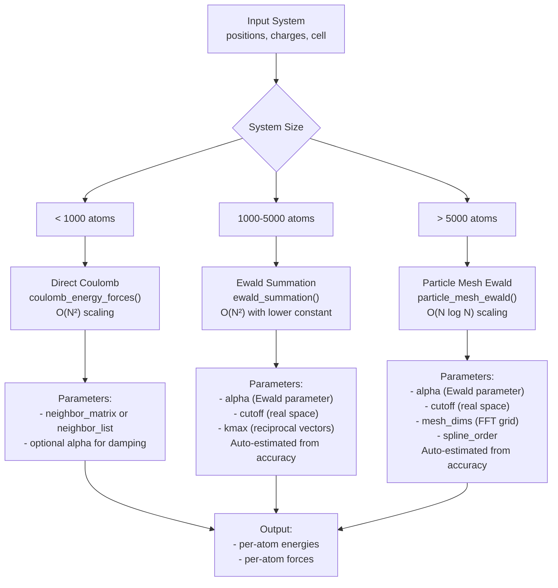
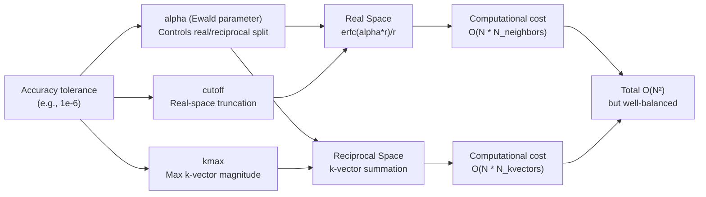
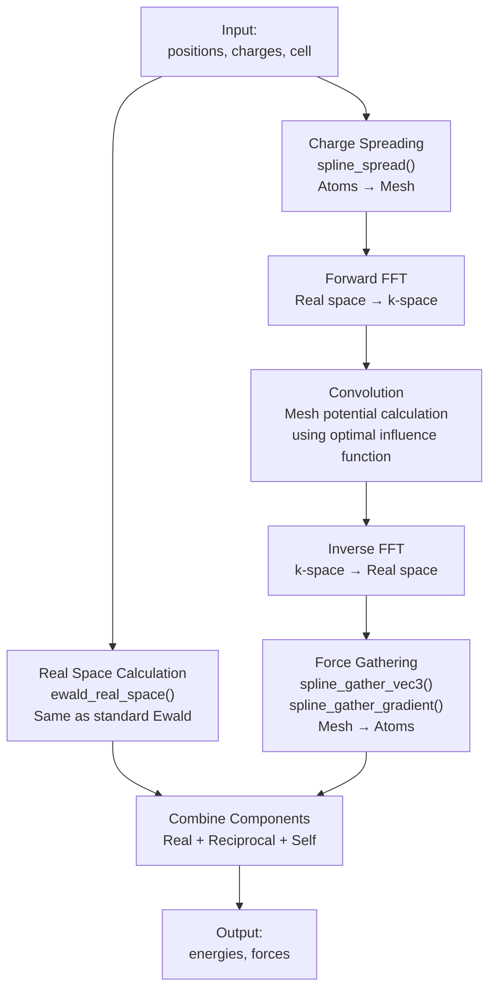
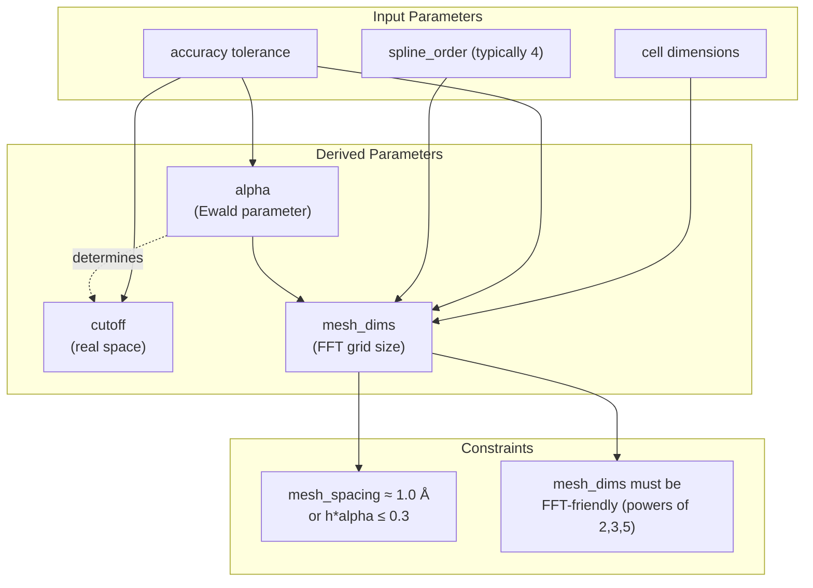
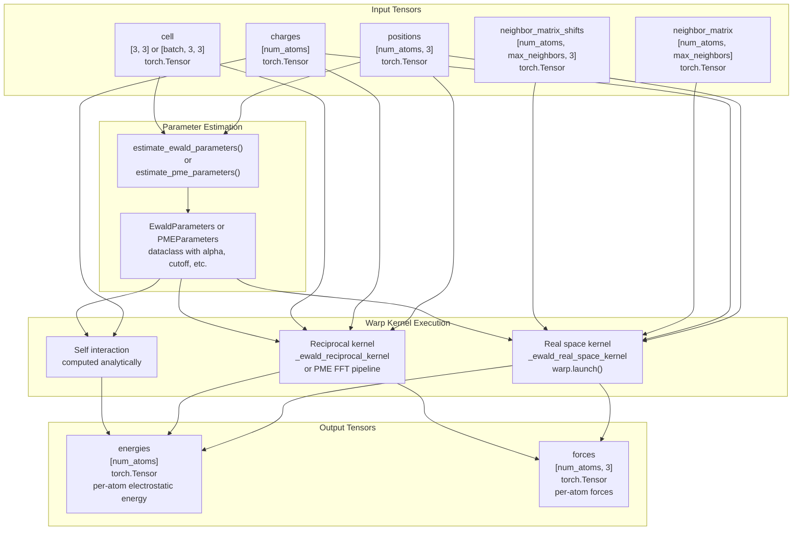

<!-- source: DeepWiki mcp.deepwiki.com · repo NVIDIA/nvalchemi-toolkit-ops · page 2.3 Electrostatics · fetched 2026-10-26 -->

# Electrostatics

<details>
<summary>Relevant source files</summary>

The following files were used as context for generating this wiki page:

- [CHANGELOG.md](CHANGELOG.md)
- [README.md](README.md)
- [docs/modules/electrostatics.rst](docs/modules/electrostatics.rst)
- [docs/userguide/about/intro.md](docs/userguide/about/intro.md)

</details>


## Purpose and Scope

This document describes the electrostatics module in `nvalchemiops`, which provides GPU-accelerated calculations of long-range Coulomb interactions in periodic and non-periodic systems. The module implements three complementary methods for computing electrostatic energies and forces: direct Coulomb summation, Ewald summation, and Particle Mesh Ewald (PME).

For detailed API documentation of specific functions and parameters, see [5.3](#5.3). For performance characteristics and benchmarking data, see [4.3](#4.3). For information about neighbor list construction required by these methods, see [2.1](#2.1).

**Sources:** [docs/modules/electrostatics.rst:1-7](), [docs/userguide/about/intro.md:263-275]()

---

## Overview

Long-range electrostatic interactions decay slowly as $1/r$, making naive pairwise summation computationally intractable for periodic systems. The electrostatics module addresses this challenge by splitting the slowly-converging Coulomb potential into short-range and long-range components that can be computed efficiently.

The module provides three calculation methods with automatic algorithm selection based on system size:

| Method | Scaling | Recommended System Size | Primary Use Case |
|--------|---------|------------------------|------------------|
| Direct Coulomb | O(N²) | <1000 atoms | Isolated molecules, real-space components |
| Ewald Summation | O(N²) | 1000-5000 atoms | Small to medium periodic systems |
| Particle Mesh Ewald (PME) | O(N log N) | >5000 atoms | Large periodic systems, molecular dynamics |

All methods support single-system and batched calculations, automatic differentiation via PyTorch autograd, and integration with the neighbor list system for efficient pair enumeration.

**Sources:** [docs/userguide/about/intro.md:263-275](), [CHANGELOG.md:7-10](), [README.md:142-177]()

---

## Module Architecture

```mermaid
graph TB
    subgraph "High-Level API"
        ES["ewald_summation()"]
        PME["particle_mesh_ewald()"]
        COULOMB["coulomb_energy_forces()"]
    end
    
    subgraph "Real Space Components"
        ERS["ewald_real_space()"]
        CE["coulomb_energy()"]
        CF["coulomb_forces()"]
        CEF["coulomb_energy_forces()"]
    end
    
    subgraph "Reciprocal Space Components"
        EREC["ewald_reciprocal_space()"]
        PREC["pme_reciprocal_space()"]
    end
    
    subgraph "Parameter Estimation"
        EST_E["estimate_ewald_parameters()"]
        EST_P["estimate_pme_parameters()"]
        EST_M["estimate_pme_mesh_dimensions()"]
        EP["EwaldParameters dataclass"]
        PP["PMEParameters dataclass"]
    end
    
    subgraph "Utility Functions"
        KV_E["generate_k_vectors_ewald_summation()"]
        KV_P["generate_k_vectors_pme()"]
        SPREAD["spline_spread()"]
        GATHER["spline_gather()"]
        GATHER_V["spline_gather_vec3()"]
        GATHER_G["spline_gather_gradient()"]
    end
    
    subgraph "External Dependencies"
        NL["neighbor_list module"]
        WARP["NVIDIA Warp kernels"]
        TORCH["PyTorch tensors & autograd"]
    end
    
    ES --> ERS
    ES --> EREC
    ES --> EST_E
    ES --> EP
    
    PME --> ERS
    PME --> PREC
    PME --> EST_P
    PME --> PP
    
    COULOMB --> CE
    COULOMB --> CF
    COULOMB --> CEF
    
    ERS -.->|"uses"| CEF
    EREC -.->|"uses"| KV_E
    PREC -.->|"uses"| KV_P
    PREC -.->|"uses"| SPREAD
    PREC -.->|"uses"| GATHER_V
    PREC -.->|"uses"| GATHER_G
    
    EST_P -.->|"uses"| EST_M
    
    ES -.->|"requires neighbor data"| NL
    PME -.->|"requires neighbor data"| NL
    COULOMB -.->|"requires neighbor data"| NL
    
    ERS -.->|"implemented in"| WARP
    EREC -.->|"implemented in"| WARP
    PREC -.->|"implemented in"| WARP
    CE -.->|"implemented in"| WARP
    CF -.->|"implemented in"| WARP
    
    ES -.->|"input/output"| TORCH
    PME -.->|"input/output"| TORCH
    COULOMB -.->|"input/output"| TORCH
```



**Diagram: Electrostatics Module Component Hierarchy**

This diagram illustrates the layered architecture of the electrostatics module. High-level functions (`ewald_summation`, `particle_mesh_ewald`) orchestrate calls to real-space and reciprocal-space components, using parameter estimation to automatically determine optimal settings. Utility functions handle k-vector generation and B-spline operations. All components integrate with the neighbor list module for efficient pair enumeration and use NVIDIA Warp for GPU acceleration.

**Sources:** [docs/modules/electrostatics.rst:1-93](), [docs/userguide/about/intro.md:263-353]()

---

## Calculation Methods

### Method Selection Strategy



**Diagram: Electrostatics Method Selection Decision Tree**

The electrostatics module provides three methods with different computational complexity and accuracy trade-offs. Direct Coulomb is suitable for small isolated systems or as a real-space component. Ewald summation handles medium-sized periodic systems with explicit k-vector summation. PME scales efficiently to large systems using FFT-accelerated reciprocal-space calculations.

**Sources:** [docs/userguide/about/intro.md:263-327](), [docs/modules/electrostatics.rst:8-49]()

---

### Ewald Summation

Ewald summation decomposes the $1/r$ Coulomb potential into complementary short-range and long-range contributions:

$$E_{\text{total}} = E_{\text{real}} + E_{\text{reciprocal}} + E_{\text{self}}$$

The real-space term uses the complementary error function $\text{erfc}(\alpha r)/r$ for rapid convergence, computed using the neighbor list. The reciprocal-space term sums over k-vectors in Fourier space. The self-interaction correction removes spurious interactions introduced by the Gaussian screening charges.

**Key Functions:**

| Function | Purpose | Input Format |
|----------|---------|--------------|
| `ewald_summation()` | Complete Ewald calculation | positions, charges, cell, neighbor data |
| `ewald_real_space()` | Real-space component only | positions, charges, neighbor_matrix, shifts, alpha |
| `ewald_reciprocal_space()` | Reciprocal-space component | positions, charges, cell, k_vectors, alpha |
| `estimate_ewald_parameters()` | Auto-tune parameters | cell, accuracy, cutoff_ratio |

**Parameter Relationships:**



**Diagram: Ewald Parameter Dependencies**

The Ewald parameter `alpha` controls the balance between real-space and reciprocal-space computations. Larger `alpha` shifts work to reciprocal space; smaller `alpha` shifts work to real space. The `estimate_ewald_parameters()` function automatically determines optimal values for `alpha`, `cutoff`, and `kmax` to achieve the requested accuracy while minimizing total computational cost.

**Sources:** [docs/modules/electrostatics.rst:20-28](), [docs/userguide/about/intro.md:280-302](), [README.md:142-177]()

---

### Particle Mesh Ewald (PME)

PME improves upon standard Ewald summation by using FFT to accelerate the reciprocal-space calculation, achieving O(N log N) scaling. The method spreads charges onto a regular mesh using B-splines, computes the reciprocal-space potential on the mesh via FFT, and gathers forces back to atomic positions.

**PME Algorithm Flow:**



**Diagram: PME Computational Pipeline**

PME uses B-spline interpolation to spread atomic charges onto a regular mesh, enabling FFT-based computation of the reciprocal-space potential. The real-space component uses the same erfc-damped potential as standard Ewald. Forces are gathered from the mesh using B-spline derivatives. This approach reduces the O(N²) reciprocal-space summation to O(N log N) FFT operations.

**Key Functions:**

| Function | Purpose | Key Parameters |
|----------|---------|----------------|
| `particle_mesh_ewald()` | Complete PME calculation | positions, charges, cell, accuracy |
| `pme_reciprocal_space()` | Reciprocal component via FFT | positions, charges, cell, mesh_dims, spline_order |
| `estimate_pme_parameters()` | Auto-tune all parameters | cell, accuracy, cutoff_ratio |
| `estimate_pme_mesh_dimensions()` | Determine FFT grid size | cell, alpha, spline_order, accuracy |

**PME-Specific Parameters:**



**Diagram: PME Parameter Estimation Dependencies**

PME requires careful balancing of mesh spacing, Ewald parameter, and real-space cutoff. The mesh spacing must be fine enough to accurately represent the charge density (typically ~1 Å), and mesh dimensions must be FFT-friendly for computational efficiency. The `estimate_pme_parameters()` function handles these constraints automatically.

**Sources:** [docs/modules/electrostatics.rst:30-37](), [docs/userguide/about/intro.md:304-327](), [docs/modules/electrostatics.rst:84-92]()

---

### Direct Coulomb

The direct Coulomb functions compute pairwise electrostatic interactions without Ewald decomposition. These are primarily used for isolated systems (molecules, clusters) or as building blocks for real-space components in Ewald/PME.

**Available Functions:**

| Function | Returns | Use Case |
|----------|---------|----------|
| `coulomb_energy()` | Per-atom energies | Energy-only calculations |
| `coulomb_forces()` | Per-atom forces | Force-only calculations |
| `coulomb_energy_forces()` | Both energies and forces | Combined calculation (more efficient) |

**Damping Support:**

All Coulomb functions support an optional `alpha` parameter for error function damping:

- **Undamped** (`alpha=None`): $V(r) = \frac{q_i q_j}{r}$
- **Damped** (`alpha>0`): $V(r) = \frac{q_i q_j \cdot \text{erfc}(\alpha r)}{r}$

The damped variant is used as the real-space component in Ewald summation and PME.

**Sources:** [docs/modules/electrostatics.rst:39-48]()

---

## Integration with Neighbor Lists

All electrostatic methods require neighbor information to enumerate atom pairs within the real-space cutoff efficiently. The module accepts two input formats:

### Dense Neighbor Matrix Format

```python
neighbor_matrix, num_neighbors, shift_matrix = neighbor_list(
    positions, cutoff, cell=cell, pbc=pbc, method="cell_list"
)

energies, forces = ewald_summation(
    positions, charges, cell,
    neighbor_matrix=neighbor_matrix,
    neighbor_matrix_shifts=shift_matrix,
    accuracy=1e-6
)
```

The dense format uses fixed-size arrays with shape `[num_atoms, max_neighbors]`. This format is optimal for `torch.compile` and consistent memory access patterns.

### Sparse COO Format

```python
neighbor_list, neighbor_ptr, shifts = neighbor_list(
    positions, cutoff, cell=cell, pbc=pbc, 
    return_neighbor_list=True
)

energies, forces = particle_mesh_ewald(
    positions, charges, cell,
    neighbor_list=neighbor_list,
    neighbor_shifts=shifts,
    accuracy=1e-6
)
```

The sparse format uses coordinate (COO) representation with shape `[2, num_edges]`. This format is memory-efficient for low-connectivity systems and compatible with graph neural network libraries.

**Cutoff Selection:**

For electrostatic calculations, the neighbor list cutoff should match the real-space cutoff determined by the Ewald/PME parameters. Typical values are 10-15 Å depending on system density and accuracy requirements. The parameter estimation functions return appropriate cutoff values:

```python
from nvalchemiops.interactions.electrostatics import estimate_ewald_parameters

params = estimate_ewald_parameters(cell, accuracy=1e-6)
# params.cutoff contains the optimal real-space cutoff
```

**Sources:** [docs/userguide/about/intro.md:287-302](), [README.md:148-177]()

---

## Data Flow and Code Mapping



**Diagram: Data Flow Through Electrostatics Calculation**

This diagram maps the concrete data structures (PyTorch tensors with specific shapes) through the calculation pipeline. Input tensors are validated and converted to Warp arrays, parameters are estimated if not provided, Warp kernels execute on GPU, and results are returned as PyTorch tensors with preserved gradients for autograd.

**Sources:** [docs/modules/electrostatics.rst:1-48](), [README.md:148-177]()

---

## Batched Calculations

All electrostatic methods support batched calculations for processing multiple independent systems simultaneously. Batching is enabled by providing `batch_idx` and optionally `batch_ptr` tensors that partition atoms into systems.

### Batch Index Format

```python
# Example: 3 systems with 10, 15, and 20 atoms
batch_idx = torch.tensor([0,0,...,0, 1,1,...,1, 2,2,...,2])  # [45] - system index per atom
batch_ptr = torch.tensor([0, 10, 25, 45])  # [4] - cumulative atom counts

# Cell parameters can vary per system
cells = torch.stack([cell1, cell2, cell3])  # [3, 3, 3]

energies, forces = ewald_summation(
    positions,      # [45, 3] - concatenated atoms
    charges,        # [45] - concatenated charges
    cells,          # [3, 3, 3] - per-system cells
    neighbor_matrix=neighbor_matrix,
    neighbor_matrix_shifts=shift_matrix,
    batch_idx=batch_idx,
    accuracy=1e-6
)

# Output energies are per-atom; sum by system:
system_energies = torch.zeros(3)
system_energies.scatter_add_(0, batch_idx, energies)
```

### Heterogeneous Parameter Support

Batched calculations support heterogeneous parameters across systems:

| Parameter | Batched Shape | Behavior |
|-----------|---------------|----------|
| `cell` | `[num_systems, 3, 3]` | Each system has independent cell |
| `pbc` | `[num_systems, 3]` | Per-system periodic boundary conditions |
| `charges` | `[total_atoms]` | Concatenated, can differ by system |
| `accuracy` | Scalar | Shared across all systems (can be overridden with explicit parameters) |

When using batched mode with automatic parameter estimation, the parameters are estimated once using representative cell dimensions (typically the largest system). For maximum accuracy across heterogeneous systems, compute parameters per-system and provide them explicitly:

```python
from nvalchemiops.interactions.electrostatics import estimate_ewald_parameters

# Estimate parameters for each system
params_list = [estimate_ewald_parameters(cells[i], accuracy=1e-6) 
               for i in range(num_systems)]

# Use maximum cutoff across all systems for neighbor list
max_cutoff = max(p.cutoff for p in params_list)
```

**Sources:** [docs/userguide/about/intro.md:328-353]()

---

## PyTorch Integration

### Autograd Support

All electrostatic functions are fully differentiable and integrate with PyTorch's automatic differentiation:

```python
positions = torch.randn(100, 3, requires_grad=True)
charges = torch.randn(100, requires_grad=True)
cell = torch.eye(3).unsqueeze(0)

energies, forces = ewald_summation(
    positions, charges, cell,
    neighbor_matrix=neighbor_matrix,
    neighbor_matrix_shifts=shifts,
    accuracy=1e-6
)

# Compute gradients
total_energy = energies.sum()
total_energy.backward()

# Gradients are available
pos_grad = positions.grad  # dE/d(positions)
charge_grad = charges.grad  # dE/d(charges)
```

### torch.compile Compatibility

The electrostatics module registers custom operators for `torch.compile` to enable JIT compilation and graph optimization:

```python
import torch

@torch.compile
def compute_electrostatics(positions, charges, cell, neighbor_matrix, shifts):
    energies, forces = ewald_summation(
        positions, charges, cell,
        neighbor_matrix=neighbor_matrix,
        neighbor_matrix_shifts=shifts,
        accuracy=1e-6
    )
    return energies.sum(), forces

# First call: compilation overhead
energy, forces = compute_electrostatics(positions, charges, cell, nb_mat, shifts)

# Subsequent calls: optimized execution
energy, forces = compute_electrostatics(positions2, charges2, cell2, nb_mat2, shifts2)
```

**Sources:** [docs/userguide/about/intro.md:357-371]()

---

## Common Usage Patterns

### Pattern 1: Single Periodic System (Ewald)

Suitable for molecular dynamics simulations of small to medium systems.

```python
from nvalchemiops.interactions.electrostatics import ewald_summation
from nvalchemiops.neighborlist import neighbor_list

# System setup
positions = ...  # [num_atoms, 3] in Angstroms
charges = ...    # [num_atoms] in elementary charge units
cell = ...       # [3, 3] in Angstroms
pbc = torch.tensor([True, True, True])

# Build neighbor list with automatic cutoff from Ewald estimation
from nvalchemiops.interactions.electrostatics import estimate_ewald_parameters
params = estimate_ewald_parameters(cell, accuracy=1e-6)

neighbor_matrix, num_neighbors, shifts = neighbor_list(
    positions, cutoff=params.cutoff, cell=cell.unsqueeze(0), pbc=pbc
)

# Compute electrostatics
energies, forces = ewald_summation(
    positions, charges, cell,
    neighbor_matrix=neighbor_matrix,
    neighbor_matrix_shifts=shifts,
    accuracy=1e-6
)

total_energy = energies.sum()
```

### Pattern 2: Large System (PME)

Optimized for systems with >5000 atoms using FFT acceleration.

```python
from nvalchemiops.interactions.electrostatics import particle_mesh_ewald

# PME automatically estimates parameters including mesh dimensions
energies, forces = particle_mesh_ewald(
    positions, charges, cell,
    neighbor_matrix=neighbor_matrix,
    neighbor_matrix_shifts=shifts,
    accuracy=1e-6,
    spline_order=4  # B-spline order (typically 4 or 5)
)
```

### Pattern 3: Batched High-Throughput

Process multiple systems simultaneously for screening or training.

```python
# Concatenate multiple systems
all_positions = torch.cat([pos1, pos2, pos3])
all_charges = torch.cat([chg1, chg2, chg3])
all_cells = torch.stack([cell1, cell2, cell3])

batch_idx = torch.tensor([0]*len(pos1) + [1]*len(pos2) + [2]*len(pos3))

# Build batched neighbor list
neighbors, _, shifts = neighbor_list(
    all_positions, cutoff=12.0, cell=all_cells, pbc=pbc,
    batch_idx=batch_idx, return_neighbor_list=True
)

# Batched electrostatics
energies, forces = ewald_summation(
    all_positions, all_charges, all_cells,
    neighbor_list=neighbors,
    neighbor_shifts=shifts,
    batch_idx=batch_idx,
    accuracy=1e-6
)

# Aggregate per-system energies
system_energies = torch.zeros(3).scatter_add_(0, batch_idx, energies)
```

### Pattern 4: Explicit Parameter Control

Bypass automatic estimation for maximum control or when using precomputed parameters.

```python
from nvalchemiops.interactions.electrostatics import (
    ewald_real_space, 
    ewald_reciprocal_space,
    generate_k_vectors_ewald_summation
)

# Manually specified parameters
alpha = 0.3  # Ewald parameter in inverse Angstroms
cutoff = 12.0  # Real-space cutoff in Angstroms
kmax = 5  # Maximum k-vector index

# Generate k-vectors
k_vectors = generate_k_vectors_ewald_summation(cell, kmax)

# Compute components separately
real_energies, real_forces = ewald_real_space(
    positions, charges,
    neighbor_matrix, shifts,
    alpha, cutoff
)

recip_energies, recip_forces = ewald_reciprocal_space(
    positions, charges, cell, k_vectors, alpha
)

# Self-interaction correction
self_energy = -alpha / np.sqrt(np.pi) * (charges ** 2).sum()

# Combine
total_energies = real_energies + recip_energies + self_energy / len(charges)
total_forces = real_forces + recip_forces
```

**Sources:** [docs/userguide/about/intro.md:280-353](), [README.md:142-177]()

---

## Key Parameters Reference

### Common Parameters

| Parameter | Type | Description | Typical Values |
|-----------|------|-------------|----------------|
| `positions` | `Tensor[N, 3]` | Atomic positions in Cartesian coordinates | Angstroms |
| `charges` | `Tensor[N]` | Atomic charges | Elementary charge units |
| `cell` | `Tensor[3, 3]` or `[B, 3, 3]` | Unit cell lattice vectors | Angstroms |
| `accuracy` | `float` | Target relative error in energy | `1e-4` to `1e-8` |
| `pbc` | `Tensor[3]` or `[B, 3]` | Periodic boundary conditions per axis | Boolean tensor |

### Ewald-Specific Parameters

| Parameter | Type | Description | Auto-Estimated |
|-----------|------|-------------|----------------|
| `alpha` | `float` | Ewald convergence parameter | ✓ |
| `cutoff` | `float` | Real-space cutoff distance | ✓ |
| `kmax` | `int` or `Tensor[3]` | Max reciprocal vector indices | ✓ |
| `k_vectors` | `Tensor[M, 3]` | Explicit reciprocal space vectors | Generated from `kmax` |

### PME-Specific Parameters

| Parameter | Type | Description | Auto-Estimated |
|-----------|------|-------------|----------------|
| `mesh_dims` | `Tensor[3]` or `[B, 3]` | FFT grid dimensions | ✓ |
| `spline_order` | `int` | B-spline interpolation order | Default: 4 |
| `mesh_spacing` | `float` | Target grid spacing | Used in estimation |

### Batching Parameters

| Parameter | Type | Description | Required for Batching |
|-----------|------|-------------|----------------------|
| `batch_idx` | `Tensor[N]` | System index per atom | ✓ |
| `batch_ptr` | `Tensor[B+1]` | Cumulative atom counts | Optional |

**Sources:** [docs/modules/electrostatics.rst:1-93]()

---

## Implementation Details

### Code Organization

The electrostatics module is organized into several submodules in the `nvalchemiops.interactions.electrostatics` package:

| Submodule | Primary Functions | Purpose |
|-----------|------------------|---------|
| `ewald` | `ewald_summation`, `ewald_real_space`, `ewald_reciprocal_space` | Ewald summation implementation |
| `pme` | `particle_mesh_ewald`, `pme_reciprocal_space` | PME implementation with FFT |
| `coulomb` | `coulomb_energy`, `coulomb_forces`, `coulomb_energy_forces` | Direct Coulomb interactions |
| `parameters` | `estimate_ewald_parameters`, `estimate_pme_parameters`, parameter dataclasses | Automatic parameter estimation |
| `k_vectors` | `generate_k_vectors_ewald_summation`, `generate_k_vectors_pme` | Reciprocal space vector generation |

Supporting mathematical functions are provided in:

- `nvalchemiops.spline`: B-spline spreading and gathering for PME
- `nvalchemiops.math`: Spherical harmonics, Gaussian basis, special functions

### NVIDIA Warp Backend

All performance-critical computations are implemented as NVIDIA Warp kernels, providing:

- **GPU Acceleration**: Automatic CUDA code generation and kernel launch
- **Memory Efficiency**: Optimized memory access patterns for coalescing
- **Type Safety**: Compile-time type checking for kernel arguments
- **Batching**: Native support for parallel execution across systems

Warp kernels are launched from Python functions that handle tensor conversion, shape validation, and gradient setup for PyTorch autograd.

**Sources:** [docs/userguide/about/intro.md:364-371](), [CHANGELOG.md:7-12]()

---

## Relationship to Other Components

### Neighbor Lists (2.1)

Electrostatics methods require neighbor enumeration for efficient real-space calculations. The cutoff distance for the neighbor list should match the real-space cutoff determined by Ewald/PME parameters. See [2.1](#2.1) for neighbor list construction details.

### Dispersion Corrections (2.2)

Electrostatics and dispersion corrections are complementary components in molecular force fields. Both use the same neighbor list data and can be computed simultaneously. See [2.2](#2.2) for DFT-D3 dispersion documentation.

### Performance Benchmarks (4.3)

Detailed performance analysis, scaling characteristics, and backend comparisons are documented in the benchmarking section. See [4.3](#4.3) for electrostatics performance data.

### API Reference (5.3)

Complete function signatures, parameter descriptions, and return types are provided in the API reference. See [5.3](#5.3) for detailed API documentation.

**Sources:** [docs/userguide/about/intro.md:54-154](), [docs/userguide/about/intro.md:263-353]()

---

