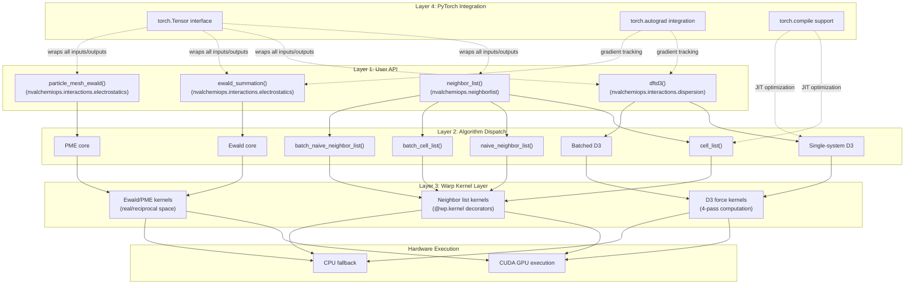
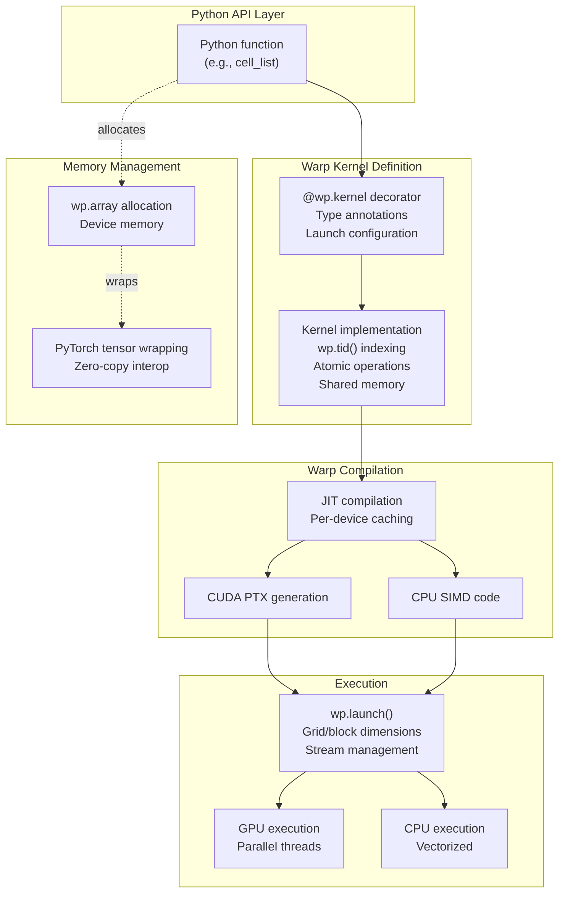
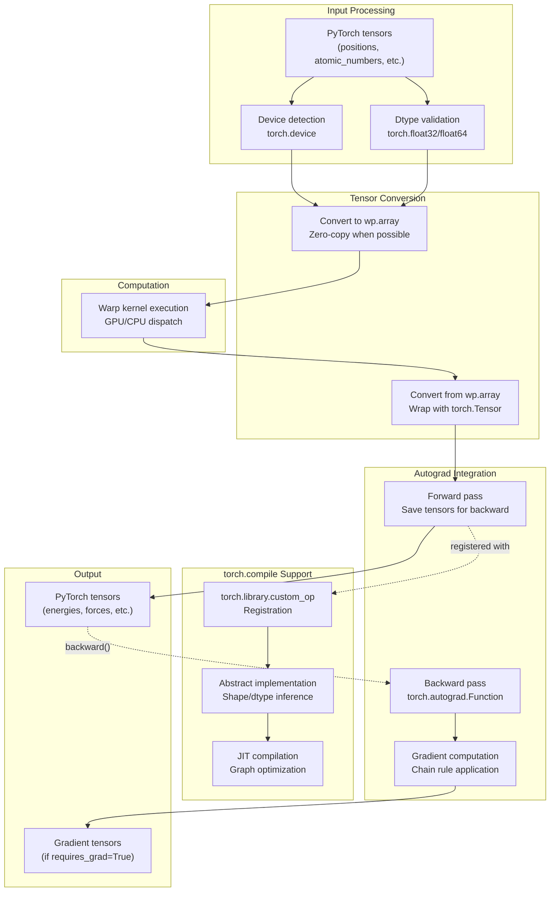
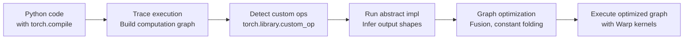
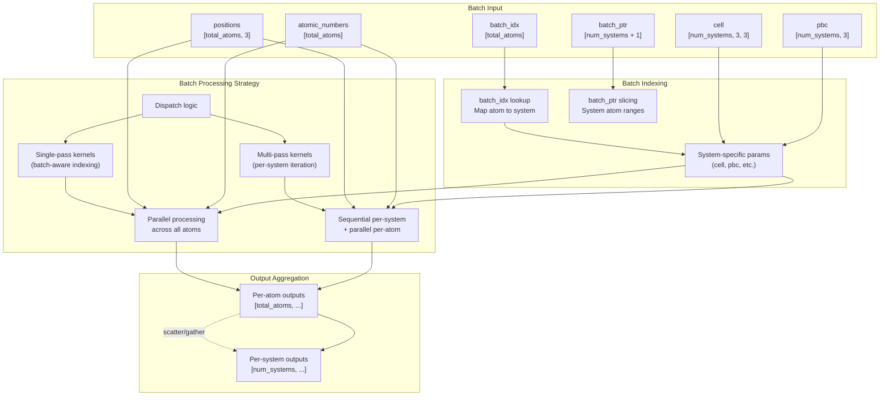
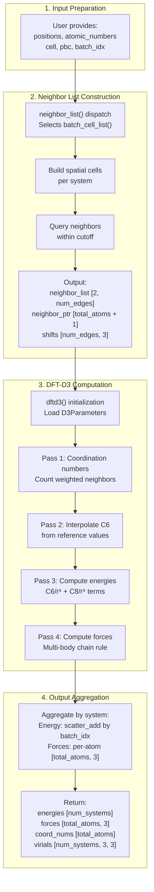

<!-- source: DeepWiki mcp.deepwiki.com · repo NVIDIA/nvalchemi-toolkit-ops · page 3 System Architecture · fetched 2026-10-26 -->

# System Architecture

<details>
<summary>Relevant source files</summary>

The following files were used as context for generating this wiki page:

- [README.md](README.md)
- [docs/userguide/about/faq.md](docs/userguide/about/faq.md)
- [docs/userguide/about/intro.md](docs/userguide/about/intro.md)

</details>


This page describes the internal architecture of NVIDIA ALCHEMI Toolkit-Ops, focusing on how the three computational primitives integrate with NVIDIA Warp for GPU acceleration, PyTorch for tensor operations, and the batch processing system. For details on the computational primitives themselves, see [Core Components](#2). For performance characteristics, see [Performance and Benchmarks](#4).

## Architectural Overview

NVIDIA ALCHEMI Toolkit-Ops follows a three-layer architecture: a high-level Python API layer, a GPU acceleration layer built on NVIDIA Warp, and a PyTorch compatibility layer that provides tensor operations and automatic differentiation.



**Sources:** [README.md:10-44](), [docs/userguide/about/intro.md:44-54]()

The architecture separates concerns into distinct layers:

| Layer | Responsibility | Key Technologies |
|-------|---------------|------------------|
| **User API** | Unified interface with automatic algorithm selection | Python functions |
| **Algorithm Dispatch** | Route to appropriate implementation based on system size and batching | Conditional logic |
| **Warp Kernels** | GPU-accelerated computation primitives | NVIDIA Warp `@wp.kernel` decorators |
| **PyTorch Integration** | Tensor operations, autograd, JIT compilation | PyTorch tensors and operators |
| **Hardware** | Execution on CUDA GPUs or CPU fallback | CUDA runtime |

**Sources:** [README.md:10-14](), [docs/userguide/about/intro.md:44-54]()

## NVIDIA Warp Backend

All computational primitives are implemented as NVIDIA Warp kernels. Warp provides a Python-embedded DSL for writing GPU kernels that compile to optimized CUDA code or CPU SIMD instructions.



**Sources:** [README.md:12-14](), [docs/userguide/about/faq.md:16-23]()

### Kernel Organization

Warp kernels follow a consistent pattern across all computational primitives:

1. **Type-annotated kernel functions** - Each kernel uses Warp's type system (`wp.int32`, `wp.float32`, `wp.vec3`, etc.) for static compilation
2. **Thread indexing** - `wp.tid()` retrieves the global thread index for parallel execution
3. **Atomic operations** - Neighbor counting and force accumulation use `wp.atomic_add()` for thread-safe updates
4. **Launch configuration** - Python wrappers call `wp.launch()` with grid dimensions matching problem size

**Sources:** [README.md:12-14]()

### Memory Layout

Warp kernels operate on `wp.array` objects that map directly to PyTorch tensors:

- **Positions**: Shape `[num_atoms, 3]`, contiguous layout for coalesced memory access
- **Neighbor matrices**: Shape `[num_atoms, max_neighbors]` for dense format
- **Cell lists**: Spatial decomposition with hash-based lookups
- **Batch indices**: Shape `[num_atoms]` for heterogeneous batch processing

**Sources:** [README.md:55-90]()

### Hardware Requirements

The Warp backend supports:

| Platform | Requirements |
|----------|-------------|
| **NVIDIA GPU** | CUDA Compute Capability 8.0+ (A100, H100, etc.) |
| **CPU** | x86_64 or ARM64 (including Apple Silicon) |
| **CUDA Version** | 12.0+ recommended for optimal performance |
| **Driver** | 570.xx or newer |

**Sources:** [docs/userguide/about/faq.md:16-23]()

## PyTorch Compatibility Layer

All inputs and outputs use PyTorch tensors, providing seamless integration with ML workflows and automatic differentiation.



**Sources:** [README.md:55-90](), [docs/userguide/about/intro.md:357-376]()

### Tensor Interface

The PyTorch compatibility layer handles:

- **Automatic device placement**: Kernels execute on the same device as input tensors (CUDA or CPU)
- **Dtype support**: Both `torch.float32` and `torch.float64` supported
- **Zero-copy conversion**: Warp arrays wrap PyTorch tensor memory when layouts match
- **Contiguity handling**: Non-contiguous tensors are copied to contiguous buffers before kernel launch

**Sources:** [docs/userguide/about/intro.md:357-364]()

### Automatic Differentiation

Select operations support automatic differentiation via `torch.autograd.Function`:

- **Forward pass**: Computation proceeds through Warp kernels, saving necessary tensors
- **Backward pass**: Custom gradient implementations compute derivatives with respect to inputs
- **Gradient tracking**: Output tensors maintain `requires_grad=True` when inputs require gradients

The DFT-D3 and electrostatics functions support full gradient computation for forces and energies.

**Sources:** [docs/userguide/about/intro.md:357-364]()

### torch.compile Integration

Selected kernels register with `torch.compile` for JIT optimization:



**Sources:** [docs/userguide/about/faq.md:60-74](), [docs/userguide/about/intro.md:357-364]()

For `torch.compile` compatibility:

- Output tensors must be pre-allocated with known shapes
- Custom operators register abstract implementations for shape inference
- Graph breaks are avoided by using tensor operations instead of Python control flow

**Sources:** [docs/userguide/about/faq.md:60-74]()

## Batch Processing Architecture

The toolkit provides native support for processing multiple systems simultaneously with heterogeneous parameters.



**Sources:** [README.md:95-138](), [docs/userguide/about/intro.md:236-253]()

### Batch Indexing Scheme

Batched operations use two indexing tensors:

1. **`batch_idx`**: Shape `[total_atoms]`, maps each atom to its system index
2. **`batch_ptr`**: Shape `[num_systems + 1]`, CSR-style pointers defining atom ranges per system

For example, with 3 systems containing 5, 3, and 4 atoms:
- `batch_idx = [0, 0, 0, 0, 0, 1, 1, 1, 2, 2, 2, 2]`
- `batch_ptr = [0, 5, 8, 12]`
- System 0 atoms: `positions[0:5]`
- System 1 atoms: `positions[5:8]`
- System 2 atoms: `positions[8:12]`

**Sources:** [README.md:111-120]()

### Heterogeneous Parameters

Each system in a batch can have:
- Different cell parameters (`cell` has shape `[num_systems, 3, 3]`)
- Different periodicity (`pbc` has shape `[num_systems, 3]`)
- Different atomic compositions (via concatenated `positions` and `atomic_numbers`)

Kernels index into per-system parameters using the atom's `batch_idx` value:

```python
system_id = batch_idx[atom_idx]
atom_cell = cell[system_id]
atom_pbc = pbc[system_id]
```

**Sources:** [README.md:95-138](), [docs/userguide/about/intro.md:229-253]()

### Batch Algorithm Selection

The unified `neighbor_list()` API automatically selects batched algorithms:

| Condition | Algorithm | Complexity |
|-----------|-----------|------------|
| `batch_idx` provided + system size < 5000 atoms | `batch_naive_neighbor_list()` | O(N²) per system |
| `batch_idx` provided + system size ≥ 5000 atoms | `batch_cell_list()` | O(N) per system |
| No `batch_idx` + system size < 5000 atoms | `naive_neighbor_list()` | O(N²) single system |
| No `batch_idx` + system size ≥ 5000 atoms | `cell_list()` | O(N) single system |

**Sources:** [docs/userguide/about/intro.md:58-149]()

## Data Flow Through the System

The following diagram illustrates how data flows through a typical batched DFT-D3 calculation:



**Sources:** [README.md:95-138](), [docs/userguide/about/intro.md:177-253]()

Key data transformations:

1. **Neighbor list stage**: Converts 3D positions to graph connectivity (edge list or dense matrix)
2. **Coordination calculation**: Aggregates neighbor information per atom
3. **C6 interpolation**: Maps coordination numbers to dispersion coefficients
4. **Force computation**: Differentiates energy with respect to positions using multi-pass kernel
5. **System aggregation**: Sums per-atom energies to per-system totals using `batch_idx`

**Sources:** [README.md:95-138]()

## Integration Points

### External Libraries

The toolkit integrates with:

| Library | Integration Point | Purpose |
|---------|------------------|---------|
| **NVIDIA Warp** | Kernel implementation | GPU acceleration via `@wp.kernel` decorators |
| **PyTorch** | Tensor interface | All inputs/outputs are `torch.Tensor` objects |
| **CUDA** | Runtime execution | Device management, memory allocation, kernel launch |

**Sources:** [README.md:10-14](), [docs/userguide/about/intro.md:355-376]()

### Profiling and Debugging

The architecture supports standard profiling tools:

- **Nsight Systems**: Profile kernel launches and memory transfers
- **Nsight Compute**: Analyze kernel occupancy and memory bandwidth
- **PyTorch Profiler**: Profile Python-level overhead and data movement
- **Warp debugging**: Set `warp.config.mode = "debug"` for kernel assertions

**Sources:** [docs/userguide/about/intro.md:365-370]()

### Future Extensions

The architecture is designed for extensibility:

- New Warp kernels can be added by following existing kernel patterns
- New PyTorch custom operators register via `torch.library.custom_op`
- Batch processing extends naturally to new primitives via `batch_idx` indexing

**Sources:** [README.md:179-194]()

---

