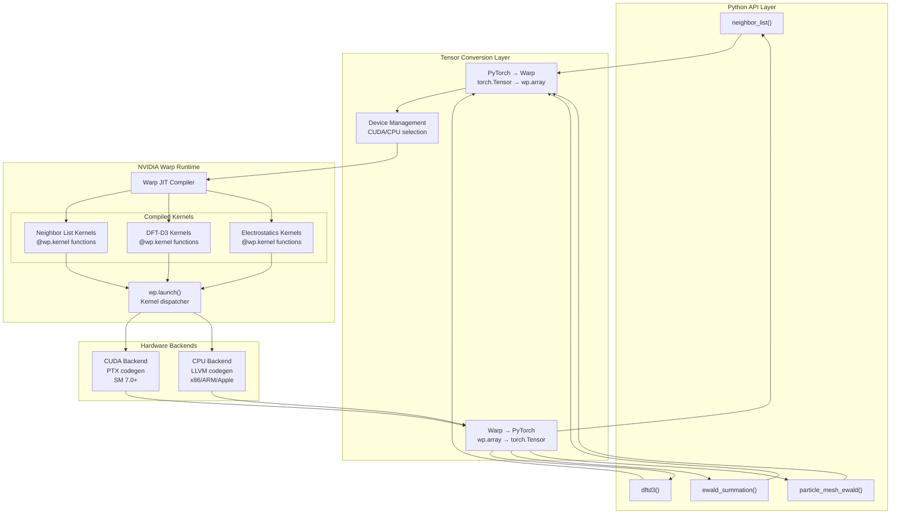
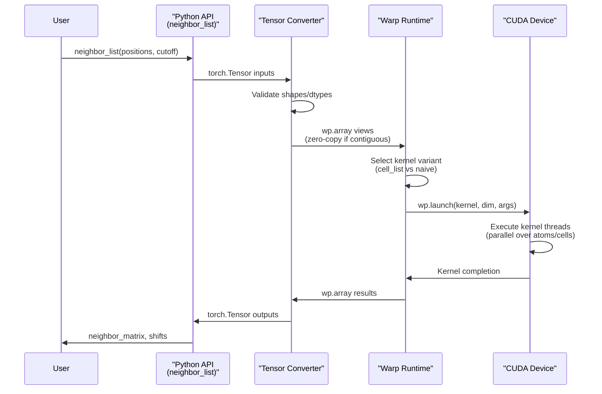
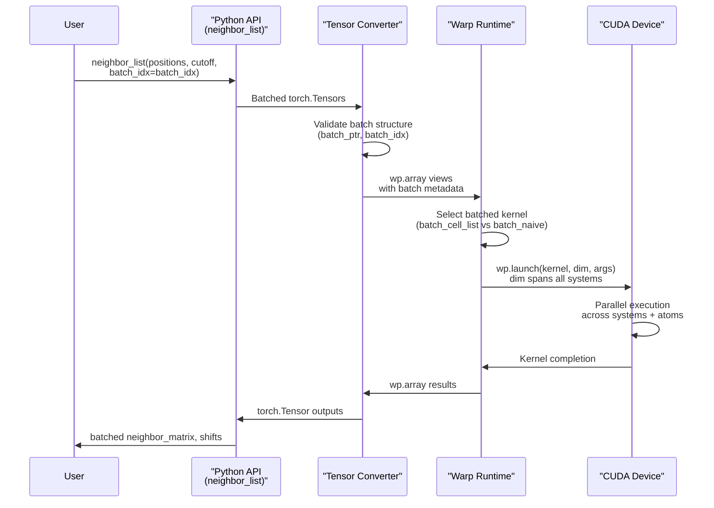
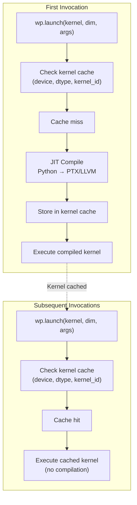
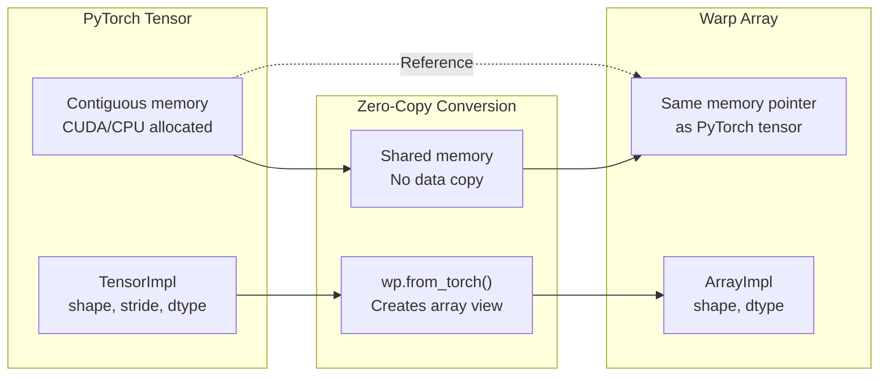
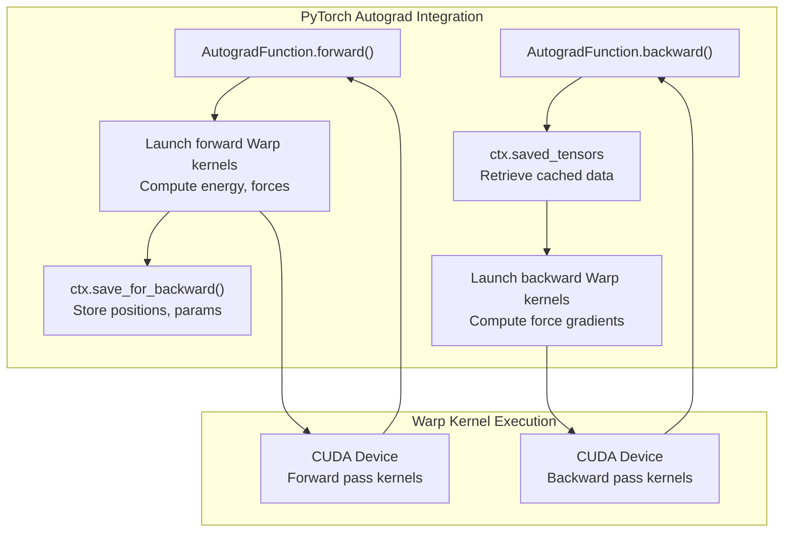

<!-- source: DeepWiki mcp.deepwiki.com · repo NVIDIA/nvalchemi-toolkit-ops · page 3.1 NVIDIA Warp Integration · fetched 2026-10-26 -->

# NVIDIA Warp Integration

Relevant source files

The following files were used as context for generating this wiki page:

- [README.md](README.md)
- [docs/userguide/about/faq.md](docs/userguide/about/faq.md)
- [docs/userguide/about/intro.md](docs/userguide/about/intro.md)

## Purpose and Scope

This document describes how NVIDIA ALCHEMI Toolkit-Ops leverages [NVIDIA Warp](https://nvidia.github.io/warp/) as its core computational backend for GPU-accelerated kernels. It covers the kernel architecture, organization within the codebase, cross-platform execution capabilities, and performance characteristics of Warp-based implementations.

For information about PyTorch tensor compatibility and autograd integration built on top of these Warp kernels, see [PyTorch Compatibility](#3.2). For details on how batched operations are implemented using Warp primitives, see [Batch Processing](#3.3). For specific API usage of computational primitives powered by Warp, refer to the Core Components sections ([Neighbor Lists](#2.1), [Dispersion Corrections](#2.2), [Electrostatics](#2.3)).

## What is NVIDIA Warp?

NVIDIA Warp is a Python framework for writing high-performance GPU kernels in a Python-like syntax. The toolkit uses Warp as its foundational backend because it provides:

| Feature | Benefit to ALCHEMI Toolkit-Ops |
|---------|--------------------------------|
| **Python-like Syntax** | Kernels are readable and maintainable without low-level CUDA code |
| **JIT Compilation** | Kernels compile to optimized PTX for NVIDIA GPUs or native code for CPUs |
| **Cross-platform** | Single kernel source runs on CUDA GPUs (SM 7.0+), x86/ARM CPUs, and Apple Silicon |
| **Automatic Differentiation** | Supports gradient computation for ML workflows |
| **PyTorch Integration** | Direct tensor interoperability with zero-copy conversion |

All computational primitives in `nvalchemiops` are implemented as Warp kernels, which are then wrapped with Python APIs that handle tensor conversion, memory management, and PyTorch integration.

**Sources:** [README.md:10-14](), [docs/userguide/about/intro.md:5-9](), [docs/userguide/about/intro.md:367-370]()

## System Architecture

### Overall Warp Integration

**Diagram: End-to-End Warp Integration Architecture**

This architecture shows the complete data flow from Python API calls through Warp compilation to hardware execution. Python APIs in `nvalchemiops` accept PyTorch tensors, which are converted to Warp arrays via zero-copy views when possible. The Warp JIT compiler generates optimized kernels for the target device (CUDA or CPU), which are then launched via `wp.launch()`. Results are converted back to PyTorch tensors for return to the caller.

**Sources:** [README.md:10-14](), [docs/userguide/about/intro.md:360-370](), [docs/userguide/about/faq.md:18-23]()

## Kernel Organization

### Computational Primitive to Kernel Mapping

```mermaid
graph TB
    subgraph "nvalchemiops.neighborlist"
        CL["cell_list()"]
        BCL["batch_cell_list()"]
        NAIVE["naive_neighbor_list()"]
        BNAIVE["batch_naive_neighbor_list()"]
        
        CL_BUILD["build_cell_list()"]
        CL_QUERY["query_cell_list()"]
        
        CL --> CL_BUILD
        CL --> CL_QUERY
        BCL --> CL_BUILD
        BCL --> CL_QUERY
    end
    
    subgraph "nvalchemiops.interactions.dispersion"
        D3_MAIN["dftd3()"]
        
        D3_CN["coordination_number<br/>calculation"]
        D3_ENERGY["energy_kernel"]
        D3_FORCES["force_kernels<br/>4-pass architecture"]
    end
    
    subgraph "nvalchemiops.interactions.electrostatics"
        EWALD["ewald_summation()"]
        PME["particle_mesh_ewald()"]
        
        EWALD_REAL["real_space_kernel"]
        EWALD_RECIP["reciprocal_space_kernel"]
        PME_REAL["pme_real_space_kernel"]
        PME_RECIP["pme_reciprocal_kernel<br/>FFT-based"]
    end
    
    subgraph "Warp Kernel Layer"
        direction LR
        
        subgraph "Cell List Kernels"
            CL_HASH["@wp.kernel<br/>compute_cell_hashes"]
            CL_SORT["@wp.kernel<br/>sort_particles"]
            CL_COUNT["@wp.kernel<br/>count_neighbors"]
            CL_FILL["@wp.kernel<br/>fill_neighbor_matrix"]
        end
        
        subgraph "Naive Kernels"
            NAIVE_COUNT["@wp.kernel<br/>naive_count"]
            NAIVE_FILL["@wp.kernel<br/>naive_fill"]
        end
        
        subgraph "D3 Kernels"
            D3_CN_K["@wp.kernel<br/>compute_coordination"]
            D3_E_K["@wp.kernel<br/>compute_d3_energy"]
            D3_F_K0["@wp.kernel<br/>force_pass_0_pbc"]
            D3_F_K1["@wp.kernel<br/>force_pass_1_cn"]
            D3_F_K2["@wp.kernel<br/>force_pass_2_direct"]
            D3_F_K3["@wp.kernel<br/>force_pass_3_chain"]
        end
        
        subgraph "Electrostatics Kernels"
            EWALD_R_K["@wp.kernel<br/>ewald_real_space"]
            EWALD_K_K["@wp.kernel<br/>ewald_k_space"]
            PME_R_K["@wp.kernel<br/>pme_real_space"]
            PME_FFT["@wp.func<br/>pme_spread_gather<br/>+ FFT ops"]
        end
    end
    
    CL_BUILD --> CL_HASH
    CL_BUILD --> CL_SORT
    CL_QUERY --> CL_COUNT
    CL_QUERY --> CL_FILL
    
    NAIVE --> NAIVE_COUNT
    NAIVE --> NAIVE_FILL
    
    D3_CN --> D3_CN_K
    D3_ENERGY --> D3_E_K
    D3_FORCES --> D3_F_K0
    D3_FORCES --> D3_F_K1
    D3_FORCES --> D3_F_K2
    D3_FORCES --> D3_F_K3
    
    EWALD_REAL --> EWALD_R_K
    EWALD_RECIP --> EWALD_K_K
    PME_REAL --> PME_R_K
    PME_RECIP --> PME_FFT
```

**Diagram: Python API Functions to Warp Kernel Mapping**

This diagram maps high-level Python API functions to the underlying Warp kernels they invoke. Each computational primitive consists of multiple specialized kernels optimized for specific tasks. For example, `cell_list()` uses separate kernels for spatial hashing, sorting, neighbor counting, and neighbor matrix population. The DFT-D3 implementation employs a four-pass kernel architecture to handle coordination-dependent forces efficiently.

**Sources:** [docs/userguide/about/intro.md:56-87](), [docs/userguide/about/intro.md:164-169](), [README.md:18-24]()

## Kernel Invocation Patterns

### Single-System Execution

For single-system calculations, the execution pattern follows this sequence:

**Diagram: Single-System Kernel Execution Flow**

The key performance optimization is the zero-copy conversion between PyTorch tensors and Warp arrays when tensors are contiguous in memory. This avoids data duplication and allows Warp kernels to operate directly on PyTorch's memory allocations.

**Sources:** [docs/userguide/about/intro.md:360-364]()

### Batched Execution

Batched operations follow a similar pattern but dispatch to specialized batched kernels:

**Diagram: Batched Kernel Execution Flow**

Batched kernels are designed to process multiple systems simultaneously, with each CUDA thread block potentially handling different systems. The batch metadata (`batch_idx`, `batch_ptr`) is passed to Warp kernels to enable per-system processing within a single kernel launch.

**Sources:** [docs/userguide/about/intro.md:108-143](), [README.md:22-24]()

## Cross-Platform Execution

### Hardware Backend Selection

Warp automatically selects the appropriate backend based on the device specified in PyTorch tensors:

| PyTorch Device | Warp Backend | Code Generation | Supported Hardware |
|----------------|--------------|-----------------|-------------------|
| `cuda` | CUDA | PTX → native GPU code | NVIDIA GPUs (Compute Capability 7.0+) |
| `cuda:0`, `cuda:1` | CUDA | PTX → native GPU code | Multi-GPU systems (device selection) |
| `cpu` | CPU (LLVM) | LLVM IR → native x86/ARM | x86-64, ARM64, Apple Silicon |

The device selection happens transparently during tensor conversion:

1. Python API receives PyTorch tensors with `.device` attribute
2. Conversion layer creates Warp arrays on the same device
3. Warp JIT compiler generates backend-specific code on first kernel invocation
4. Subsequent calls reuse compiled kernels (cached by device and dtype)

This enables the same kernel source code to run efficiently across all supported platforms without modification.

**Sources:** [docs/userguide/about/faq.md:18-23]()

### Kernel Compilation and Caching

**Diagram: Warp Kernel Compilation and Caching**

The first call to any Warp kernel triggers JIT compilation, which typically adds 100-500ms of latency. Subsequent calls are fast (microseconds) as they reuse the cached compiled kernel. This warm-up pattern is important for benchmarking—all toolkit benchmarks include warmup iterations to exclude compilation time from measurements.

**Sources:** [docs/userguide/about/faq.md:18-23]()

## Memory Layout and Optimization

### Warp Array Memory Model

Warp arrays support multiple memory layouts, and `nvalchemiops` kernels are optimized for specific patterns:

| Array Type | Memory Layout | Use Case in Toolkit |
|------------|---------------|---------------------|
| `wp.array(shape=(N,), dtype=float)` | Contiguous 1D | Scalar per-atom quantities (energies, charges) |
| `wp.array(shape=(N, 3), dtype=float)` | Row-major 2D | Positions, forces, shifts (3D vectors) |
| `wp.array(shape=(N, M), dtype=int)` | Row-major 2D | Neighbor matrices (dense format) |
| `wp.array(shape=(K,), dtype=int)` | Contiguous 1D | Edge indices (COO sparse format) |

### Zero-Copy Tensor Conversion

The toolkit minimizes memory overhead through zero-copy conversion when possible:

**Diagram: Zero-Copy PyTorch to Warp Tensor Conversion**

When a PyTorch tensor is contiguous and on a supported device, `wp.from_torch()` creates a Warp array that references the same memory without copying. This is critical for performance in ML training loops where neighbor lists may be recomputed frequently. Non-contiguous tensors require a copy via `.contiguous()` before conversion.

**Sources:** [docs/userguide/about/intro.md:360-364]()

### GPU Memory Optimization Strategies

The toolkit employs several Warp-specific optimizations for GPU memory efficiency:

1. **Kernel Fusion**: Multiple operations are fused into single kernels to minimize memory traffic. For example, neighbor list construction combines hashing, counting, and filling in a single pass where possible.

2. **Shared Memory Usage**: Cell list kernels use Warp's `wp.shared_array` for staging cell data in fast shared memory, reducing global memory bandwidth requirements.

3. **Coalesced Access**: All kernels are designed for coalesced memory access patterns—threads in a warp access consecutive memory addresses when possible.

4. **Launch Configuration**: Kernel launch dimensions are computed based on system size to maximize GPU occupancy (threads per SM) while respecting shared memory limits.

These optimizations are implemented in the Warp kernel implementations themselves and are transparent to Python API users.

**Sources:** [docs/userguide/about/intro.md:367-370]()

## Integration with PyTorch

### Custom Autograd Functions

For operations that require gradient computation (e.g., DFT-D3 forces), the toolkit wraps Warp kernels in PyTorch `autograd.Function` classes:

**Diagram: Warp Integration with PyTorch Autograd**

This integration enables Warp-accelerated operations to participate in end-to-end automatic differentiation for ML training. The forward pass executes Warp kernels to compute energies and forces, while the backward pass computes gradients of the loss with respect to positions using additional Warp kernels or analytical derivatives.

**Sources:** [docs/userguide/about/intro.md:360-364]()

### torch.compile Compatibility

Select kernels support `torch.compile` when pre-allocated output tensors are provided. The compilation process treats Warp kernel calls as opaque operations:

| Kernel Category | torch.compile Support | Requirements |
|-----------------|----------------------|--------------|
| Neighbor lists (dense format) | ✓ Supported | Pre-allocated neighbor_matrix |
| Neighbor lists (sparse COO) | ✗ Not supported | Dynamic output size |
| DFT-D3 energy/forces | ✓ Supported | Pre-allocated output tensors |
| Electrostatics | ✓ Supported | Pre-allocated output tensors |

When using `torch.compile`, the Warp kernel invocation becomes a single node in the compiled graph, allowing PyTorch to optimize surrounding Python operations while treating the Warp kernel as a high-performance primitive.

**Sources:** [docs/userguide/about/faq.md:60-74](), [docs/userguide/about/intro.md:360-364]()

## Performance Characteristics

### Kernel Launch Overhead

Warp kernel launches from Python have measurable overhead that affects small workloads:

| System Size | Kernel Launch Overhead | Total Execution Time | Overhead Fraction |
|-------------|------------------------|----------------------|-------------------|
| < 1K atoms | ~50-100 μs | ~300-500 μs | ~20-30% |
| 1K-10K atoms | ~50-100 μs | ~500-5000 μs | ~1-10% |
| > 10K atoms | ~50-100 μs | > 5000 μs | < 1% |

For small systems, the fixed kernel launch overhead dominates execution time, which is why naive O(N²) algorithms can outperform O(N) cell lists despite worse asymptotic complexity. For large systems, the overhead becomes negligible relative to computation time.

**Sources:** [README.md:22-24]()

### Memory Bandwidth Utilization

Warp kernels in the toolkit achieve high memory bandwidth utilization on modern GPUs:

- **Neighbor list construction**: Bandwidth-bound for large systems, achieving 500-800 GB/s on H100 (approaching theoretical peak of ~2 TB/s HBM3)
- **DFT-D3 calculations**: Compute-bound due to transcendental functions (exp, coordination number interpolation)
- **Electrostatics**: Mixed workload—real-space is bandwidth-bound, reciprocal-space (FFT) is compute-bound

The memory layout optimizations described above are critical for maintaining high bandwidth utilization across all kernel types.

**Sources:** [docs/userguide/about/intro.md:367-370]()

### Comparison with Native CUDA

Warp-generated code performance is comparable to hand-written CUDA for well-optimized kernels:

| Metric | Hand-Written CUDA | Warp-Generated Code |
|--------|-------------------|---------------------|
| **Throughput** | Baseline (1.0x) | 0.85-0.95x (typical) |
| **Development Time** | High (weeks for complex kernels) | Low (days for same kernels) |
| **Maintainability** | Lower (verbose, platform-specific) | Higher (Python-like syntax) |
| **Portability** | CUDA only | CUDA + CPU + Apple Silicon |

The 5-15% performance gap is acceptable given the development velocity and cross-platform benefits. For performance-critical inner loops, the toolkit implements kernels with careful attention to Warp idioms (e.g., `wp.tid()`, coalesced access patterns) to minimize this gap.

**Sources:** [README.md:10-14](), [docs/userguide/about/intro.md:367-370]()

---

**Sources:** [README.md:1-203](), [docs/userguide/about/intro.md:1-388](), [docs/userguide/about/faq.md:1-77]()

---

